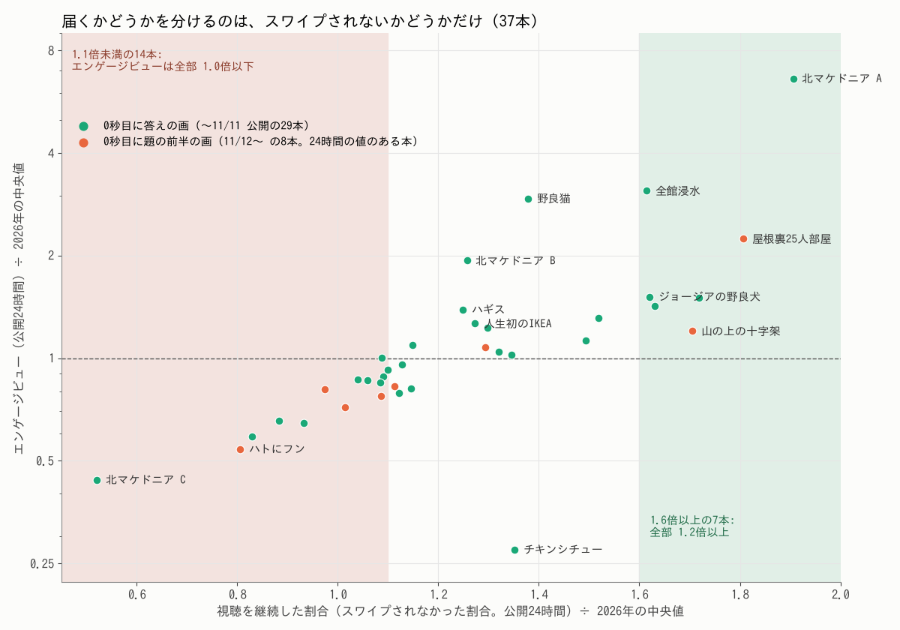
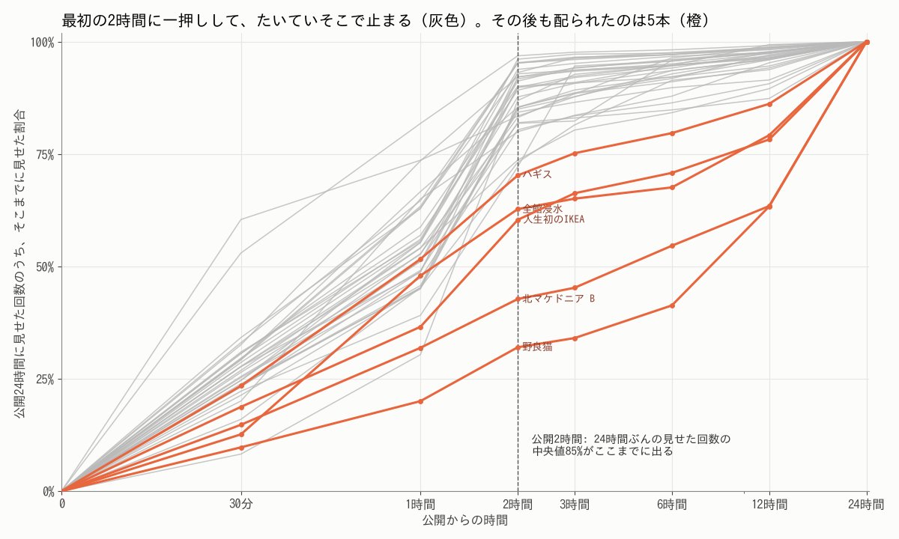
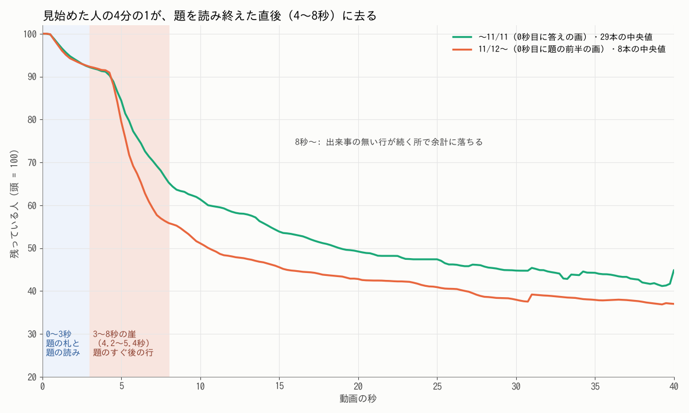
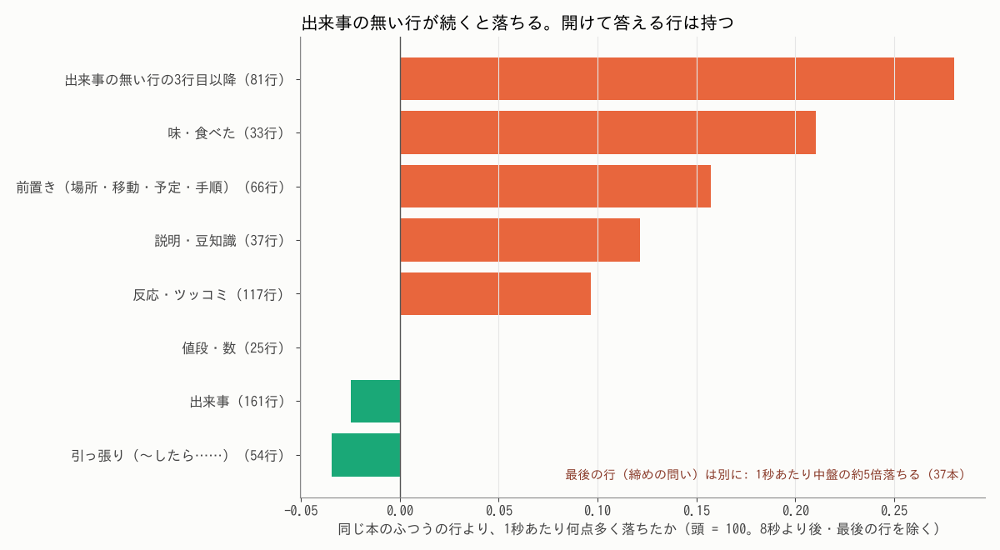

# ショートの数字 — なぜ配られないか・どの行で離れるか（2026-11-23）

[#1403](https://github.com/Ayato-kosaka/live-streaming/issues/1403) の A（アナリティクス）の紙。あやと（2026-11-23）「1ヶ月ぐらい投稿してるけど、全然バズってない」への、数字の側からの答え。
**日付の付いた記録なので、あとから直さない。** 前の紙は [`shorts-analytics-2026-11.md`](shorts-analytics-2026-11.md)（2026-11-11・26本）。
同じことは繰り返さず、今回新しく取ったもの（分ごとの見せた回数・分析の画面の割合・原稿の行と維持率カーブの重ね・TikTok）を足した。

**ここには生の数を書かない。** 値は全部、前の紙と同じ物差し（2026年に公開した過去ショート33本の中央値 = 1.00）との比か、
出した本どうしの中央値との比か、割合（%）か、維持率カーブの頭を100に直した点。生の数は EC2 と BigQuery にだけある（9章）。

## 0. 先に結論

1. **配られないのは、最初の一押しで止まるから。** どの本も、公開から3時間に YouTube が見せる回数はほぼ同じ（37本中31本が中央値±15%）で、24時間ぶんの85%（中央値）が公開2時間以内に出る。3時間から24時間で増えるのは中央値1.10倍。その後も配られ続けたのは37本中5本だけ
2. **一押しのあとに続くかを分けるのは、継続（スワイプされなかった割合）だけ。** 継続が物差しの1.1倍未満の14本はエンゲージビューが全部1.0倍以下、1.6倍以上の7本は全部1.2倍以上。3→8秒の落ち・中盤の落ち・最後まで残った割合は、届き方と結びつかない（相関 −0.14〜0.10）
3. **いまの継続は中央値1.15倍で、見せた人の約6割がスワイプしている。** TikTok でも3秒で半分が去る。同じ本は両方で同じ所で落ちる（順位の相関 0.54）。あやとの「3秒は見たいってなるフックになってない」は数字と合う
4. **見始めた人がいちばん去るのは4〜8秒。** 37本中35本で、カーブの最大の崖が4.2〜5.4秒にあり、3→8秒で頭の4分の1が去る。題を読み終えた直後の行で、37本中23本はそこが「やってきたのは〜」の類の前置き
5. **中盤は、出来事の無い行が3行続く所・題の答えを言った直後・最後の問いで落ちる。**「〜したら……」で開けて次の行で答える組は落ちない
6. **11/12 からの形**（0秒目に題の前半の画）**で崖が10点深くなった**（偶然 0.013）。11/11 からの12本のエンゲージビューの中央値は0.85倍（それまでの26本は1.02倍）
7. 尺・題の形・0秒目の画の種類・本人の声・時刻・曜日は、この本数では効きを分けられない（5章）

## 1. 何を、どこから取ったか

| 何 | どこから | いつ |
| --- | --- | --- |
| 時点の値（24時間・72時間・7日・14日）と全期間の値・維持率カーブ（100点） | 前の紙と同じ（`tools/shorts/metrics/` の `collect` → `ship`）。EC2 の Chrome で Studio を**読むだけ**。BigQuery `youtube_chat.shorts_metrics` は [run 45171084899](https://github.com/Ayato-kosaka/live-streaming/actions/runs/45171084899) で 160行 → **165行**（24時間 37・72時間 35・7日 31・14日 24・全期間 38） | 2026-11-23 12:04 UTC |
| **公開24時間の分ごとの系列・72時間の時間ごとの系列**（見せた回数・継続・エンゲージビュー・再生） | 同じ `yta_web/get_cards`（期間を「公開から1日・3日」で切る）の `mainSeries`。24時間は1分刻み、72時間は1時間刻みで返る。継続の系列は刻みごとの値で、見せた回数で重みを付けて足すとカードの合計に37本とも一致した | 2026-11-23 12:24 UTC |
| **分析の画面の割合**（見つけた方法・視聴者の区分・登録者の再生時間・端末） | 2026-11 の新しい分析の画面は `browse`（`FEanalytics_hub_video_reach`・`_engagement`・`_audience`、params は動画 ID を包んだもの）で組まれる。画面を1回開いて画面が送った本文（委任の context ごと）を写し、動画 ID だけ替えて送り直した。期間は「公開後」 | 同上 |
| 原稿の行と秒 | 出した版の指示書 `shorts/videos/<id>/p*/edit_*.json` の `narration.lines[].at`（30fps）。北マケドニアの3本は指示書が無いので `yk-by7R7iPA/p3/spec_*.json` の行を字数で尺に割った（推定。行の例からは外した） | — |
| 行の種類 | 38本・677行を1行ずつ読んで、筋の中で何をしている行かを10の種類に分けた（題読み・締めの問い・配信への行を含む。4.4）。カーブと重ねたのは37本・656行 | — |
| TikTok | TikTok Studio の1本ごとの分析が裏で読む `/aweme/v2/data/insight/` を、ログイン済みの Chrome（`~/cdp-fish`）のページの中から読んだ。**読むだけ・押さない** | 2026-11-23 12:50 UTC |
| Instagram | **取れない。** 出したのは 11/22 21:30 からの1本（公開1日未満）で、比べる本が無い | — |

- 比の計算は全部 EC2 の上でして、比と割合だけを持ち帰った（`~/shorts-metrics/extra/ratios.json`・`~/shorts-metrics/tt/ratios.json`）
- 分ごとの系列・分析の画面の割合・TikTok は **BigQuery に入れていない**（EC2 にだけある。9章）
- 物差しは前の紙の1章の表のまま（継続 34.48%・エンゲージビュー 24時間 554・7日 604 ほか）。再生（views）の比は読まない（前の紙と同じ理由）

## 2. 出した38本

### 2.1 届き方（中央値 = 1.00。割合は「公開後」）

- **最初の3時間に見せた回数**・**3時間→24時間**は、出した本どうしの中央値との比と、同じ本の中の伸び。**2時間までの割合**は、公開24時間に見せた回数のうち2時間までに見せた割合
- **ショート フィード**は見つけた方法のうちショート フィードの割合、**新しい視聴者**は視聴者の区分の「新しい視聴者」、**登録者の再生時間**は総再生時間のうち登録者の割合
- ※仮 = 締切から48時間たつ前に取った値

| # | 公開（JST） | 回 | 尺（秒） | 継続 24h | EV 24h | EV 7d | 最初の3時間に見せた回数 | 3時間→24時間 | 2時間までの割合 | ショート フィード | 新しい視聴者 | 登録者の再生時間 |
| ---: | --- | --- | ---: | ---: | ---: | ---: | ---: | ---: | ---: | ---: | ---: | ---: |
| 1 | 10/17（土）10:22 | 北マケドニア A（出発25分前のケバブ） | 40.9 | 1.91 | 6.61 | 6.49 | 4.44 | 1.08 | 87% | 92% | 94% | 5% |
| 2 | 10/17（土）19:37 | 北マケドニア B（出国の朝のケバブ） | 41.0 | 1.26 | 1.94 | 3.56 | 0.96 | 2.21 | 43% | 93% | 90% | 7% |
| 3 | 10/17（土）21:00 | 北マケドニア C（路線バスは対面払い） | 36.3 | 0.52 | 0.44 | 0.52 | 1.13 | 1.03 | 96% | 88% | 65% | 33% |
| 4 | 10/19（月）04:57 | アプリの回 | 56.3 | 1.04 | 0.87 | 0.85 | 1.10 | 1.05 | 94% | 88% | 81% | 20% |
| 5 | 10/21（水）19:00 | アルバニアの宿 | 46.7 | 1.13 | 0.96 | 1.17 | 1.08 | 1.08 | 90% | 87% | 75% | 11% |
| 6 | 10/22（木）07:00 | フランス10日 | 38.5 | 1.52 | 1.31 | 1.76 | 1.06 | 1.13 | 85% | 87% | 75% | 8% |
| 7 | 10/22（木）19:00 | 夕日と野良犬 | 51.1 | 1.09 | 0.89 | 0.92 | 1.05 | 1.06 | 92% | 89% | 78% | 18% |
| 8 | 10/23（金）12:11 | フォカッチャ | 42.8 | 1.63 | 1.42 | 1.71 | 1.06 | 1.14 | 85% | 88% | 85% | 15% |
| 9 | 10/23（金）19:00 | 銅像 | 41.7 | 1.72 | 1.50 | 1.75 | 1.04 | 1.16 | 84% | 90% | 75% | 13% |
| 10 | 10/24（土）19:00 | ストックホルムの地下鉄 | 37.2 | 1.10 | 0.92 | 0.95 | 1.03 | 1.13 | 83% | 89% | 75% | 18% |
| 11 | 10/25（日）21:30 | 山奥の動物 | 50.8 | 1.06 | 0.86 | 0.85 | 1.08 | 1.04 | 93% | 90% | 79% | 16% |
| 12 | 10/26（月）21:30 | 滝で大惨事 | 48.7 | 1.09 | 1.00 | 1.11 | 1.06 | 1.20 | 80% | 89% | 69% | 15% |
| 13 | 10/28（水）21:31 | ホステルを追い出された | 38.0 | 1.32 | 1.04 | 1.54 | 0.96 | 1.13 | 85% | 81% | 67% | 17% |
| 14 | 10/29（木）21:30 | 野良猫 | 30.1 | 1.38 | 2.94 | 5.49 | 1.00 | 2.94 | 32% | 94% | 90% | 5% |
| 15 | 10/30（金）21:30 | 髭剃り探し | 38.8 | 1.12 | 0.79 | 0.79 | 0.91 | 1.06 | 91% | 88% | 76% | 21% |
| 16 | 10/31（土）21:30 | 行列店の大衆食堂 | 40.1 | 0.93 | 0.65 | 0.62 | 0.91 | 1.04 | 95% | 89% | 72% | 41% |
| 17 | 11/1（日）21:30 | エディンバラ | 47.6 | 0.88 | 0.66 | 0.80 | 0.96 | 1.07 | 92% | 77% | 72% | 10% |
| 18 | 11/2（月）21:30 | アフタヌーンティー | 48.8 | 1.30 | 1.23 | 1.32 | 1.06 | 1.23 | 73% | 89% | 74% | 6% |
| 19 | 11/3（火）21:30 | 全館浸水 | 35.9 | 1.61 | 3.10 | 4.17 | 1.73 | 1.54 | 63% | 94% | 87% | 5% |
| 20 | 11/4（水）21:30 | バゲット | 52.1 | 1.15 | 1.09 | 1.07 | 1.24 | 1.06 | 72% | 91% | 78% | 15% |
| 21 | 11/5（木）21:30 | ハギス | 33.9 | 1.25 | 1.39 | 1.91 | 1.15 | 1.33 | 70% | 88% | 82% | 7% |
| 22 | 11/6（金）21:30 | チキンシチュー | 52.3 | 1.35 | 0.27 | 0.30 | 0.24 | 1.14 | 83% | 67% | 53% | 53% |
| 23 | 11/7（土）21:30 | 生意気子猫 | 34.6 | 0.83 | 0.59 | 0.56 | 0.96 | 1.02 | 97% | 89% | 82% | 24% |
| 24 | 11/8（日）21:30 | ジョージアの野良犬 | 42.6 | 1.62 | 1.51 | 1.52 | 1.03 | 1.24 | 74% | 90% | 83% | 7% |
| 25 | 11/9（月）21:30 | ラトビアのヒッチハイク | 48.6 | 1.15 | 0.81 | 0.81 | 0.91 | 1.07 | 92% | 90% | 76% | 30% |
| 26 | 11/10（火）21:30 | 人生初のIKEA | 44.2 | 1.27 | 1.26 | 1.55 | 0.90 | 1.51 | 60% | 92% | 83% | 8% |
| 27 | 11/11（水）21:30 | はかり無しの量り方 | 42.5 | 1.34 | 1.02 | 1.01 | 1.01 | 1.04 | 95% | 91% | 81% | 9% |
| 28 | 11/12（木）21:30 | うどん手打ち | 46.1 | 1.11 | 0.83 | 0.85 | 0.93 | 1.10 | 88% | 86% | 81% | 16% |
| 29 | 11/13（金）21:30 | 対談（イラン国境） | 37.6 | 1.49 | 1.12 | 1.37 | 0.94 | 1.10 | 90% | 90% | 76% | 17% |
| 30 | 11/14（土）21:30 | ハードパン3種 | 54.4 | 1.29 | 1.08 | 1.08※仮 | 0.94 | 1.21 | 82% | 92% | 82% | 8% |
| 31 | 11/15（日）21:30 | ハトにフン | 42.3 | 0.81 | 0.54 | 0.59※仮 | 0.89 | 1.04 | 95% | 90% | 81% | 16% |
| 32 | 11/16（月）21:30 | リーズを1日 | 45.5 | 1.08 | 0.85 | 取れていない（7日がまだ） | 0.96 | 1.12 | 85% | 91% | 74% | 8% |
| 33 | 11/17（火）21:30 | 教会で場違い | 34.0 | 0.97 | 0.81 | 取れていない（7日がまだ） | 0.95 | 1.20 | 82% | 92% | 74% | 9% |
| 34 | 11/18（水）21:30 | マトカ渓谷 | 56.4 | 1.09 | 0.77 | 取れていない（7日がまだ） | 0.89 | 1.10 | 90% | 92% | 76% | 27% |
| 35 | 11/19（木）21:30 | 山の上の十字架 | 52.5 | 1.71 | 1.20 | 取れていない（7日がまだ） | 0.91 | 1.07 | 93% | 94% | 79% | 9% |
| 36 | 11/20（金）21:30 | パソコンを送ったら | 47.0 | 1.01 | 0.72 | 取れていない（7日がまだ） | 0.90 | 1.09 | 89% | 91% | 81% | 15% |
| 37 | 11/21（土）21:30 | ブルガリアの屋根裏25人部屋 | 45.6 | 1.81 | 2.24 | 取れていない（7日がまだ） | 1.43 | 1.20 | 80% | 94% | — | 4% |
| 38 | 11/22（日）21:30 | ブルガリアのヨーグルト | 54.9 | 取れていない（24時間がまだ） | 取れていない（24時間がまだ） | 取れていない（7日がまだ） | — | — | — | 92% | — | 6% |

### 2.2 中の残りかたと TikTok

- **3→8秒の落ち**・**8秒→尺の9割の落ち**は、維持率カーブの頭を100に直した点。**最後まで**は最後の点（頭=100）
- **TikTok 再生**は TikTok に出した本どうしの中央値との比（同じ原稿の TikTok 版）、**TikTok 3秒の残り**は TikTok の維持率（スワイプした人も入る）、**TikTok 最後まで**は「最後まで見た」割合

| # | 回 | 1行目の種類 | 3→8秒の落ち | 8秒→尺の9割の落ち | 最後まで | 平均再生率が100%超 | TikTok 再生 | TikTok 3秒の残り | TikTok 最後まで |
| ---: | --- | --- | ---: | ---: | ---: | --- | ---: | ---: | ---: |
| 1 | 北マケドニア A（出発25分前のケバブ） | 前置き | −28.5 | −12.6 | 33 | 超えない | 1.13 | 55% | 9% |
| 2 | 北マケドニア B（出国の朝のケバブ） | 前置き | −15.4 | −32.4 | 34 | 超えない | 1.03 | 36% | 8% |
| 3 | 北マケドニア C（路線バスは対面払い） | 前置き | −23.2 | −22.7 | 26 | 超えない | 1.23 | 46% | 10% |
| 4 | アプリの回 | 前置き | −31.1 | −34.2 | 21 | 超えない | 1.03 | 34% | 3% |
| 5 | アルバニアの宿 | 引っ張り | −15.6 | −26.9 | 44 | 超えない | 1.25 | 37% | 9% |
| 6 | フランス10日 | 前置き | −26.2 | −24.2 | 35 | 超えない | 1.75 | 45% | 9% |
| 7 | 夕日と野良犬 | 引っ張り | −26.1 | −25.8 | 31 | 超えない | 0.87 | 41% | 9% |
| 8 | フォカッチャ | 前置き | −33.0 | −31.7 | 23 | 超えない | 1.00 | 47% | 3% |
| 9 | 銅像 | 反応 | −29.4 | −41.6 | 20 | 超えない | 1.05 | 55% | 6% |
| 10 | ストックホルムの地下鉄 | 引っ張り | −18.3 | −36.4 | 23 | 超えない | 1.19 | 46% | 8% |
| 11 | 山奥の動物 | 引っ張り | −27.7 | −36.7 | 20 | 超えない | 0.92 | 43% | 5% |
| 12 | 滝で大惨事 | 前置き | −18.8 | −37.1 | 28 | 超えない | 1.00 | 40% | 5% |
| 13 | ホステルを追い出された | 出来事 | −18.6 | −23.6 | 13 | 超えない | 1.03 | 52% | 12% |
| 14 | 野良猫 | 前置き | −28.8 | −26.3 | 26 | 超えない | 0.99 | 48% | 11% |
| 15 | 髭剃り探し | 前置き | −26.8 | −17.1 | 37 | 超えない | 0.95 | 55% | 15% |
| 16 | 行列店の大衆食堂 | 前置き | −18.1 | −18.5 | 43 | 超えた | 1.19 | 39% | 9% |
| 17 | エディンバラ | 説明 | −25.7 | −23.7 | 31 | 超えない | 4.01 | 46% | 9% |
| 18 | アフタヌーンティー | 前置き | −16.2 | −22.7 | 49 | 超えた | 3.06 | 57% | 16% |
| 19 | 全館浸水 | 引っ張り | −18.1 | −18.1 | 38 | 超えない | 1.46 | 67% | 22% |
| 20 | バゲット | 説明 | −26.5 | −27.9 | 28 | 超えない | 0.84 | 41% | 4% |
| 21 | ハギス | 説明 | −29.2 | −22.0 | 31 | 超えない | 1.08 | 41% | 6% |
| 22 | チキンシチュー | 前置き | −33.7 | −24.0 | 26 | 超えない | 0.86 | 46% | 6% |
| 23 | 生意気子猫 | 前置き | −39.0 | −22.1 | 22 | 超えない | 0.89 | 51% | 7% |
| 24 | ジョージアの野良犬 | 出来事 | −23.1 | −31.1 | 27 | 超えない | 0.93 | 60% | 16% |
| 25 | ラトビアのヒッチハイク | 前置き | −30.2 | −17.5 | 41 | 超えない | 1.75 | 42% | 6% |
| 26 | 人生初のIKEA | 説明 | −9.9 | −12.5 | 56 | 超えた | 1.35 | 50% | 19% |
| 27 | はかり無しの量り方 | 前置き | −39.7 | −18.7 | 32 | 超えない | 0.88 | 50% | 5% |
| 28 | うどん手打ち | 前置き | −31.1 | −25.3 | 24 | 超えない | 0.81 | 53% | 12% |
| 29 | 対談（イラン国境） | 出来事 | −33.6 | −31.0 | 28 | 超えない | 1.85 | 50% | 9% |
| 30 | ハードパン3種 | 前置き | −29.1 | −30.7 | 30 | 超えない | 1.00 | 52% | 6% |
| 31 | ハトにフン | 前置き | −37.0 | −22.2 | 22 | 超えない | 0.59 | 46% | 6% |
| 32 | リーズを1日 | 前置き | −15.8 | −20.6 | 53 | 超えた | 1.28 | 47% | 7% |
| 33 | 教会で場違い | 前置き | −42.7 | −19.2 | 26 | 超えない | 0.88 | 43% | 6% |
| 34 | マトカ渓谷 | 前置き | −37.5 | −23.9 | 28 | 超えない | 0.82 | 36% | 4% |
| 35 | 山の上の十字架 | 前置き | −36.2 | −22.6 | 24 | 超えない | 0.85 | 51% | 14% |
| 36 | パソコンを送ったら | 出来事 | −24.1 | −17.3 | 17 | 超えない | 0.89 | 44% | 10% |
| 37 | ブルガリアの屋根裏25人部屋 | 前置き | −39.3 | −17.2 | 21 | 超えない | 0.72 | 52% | 8% |
| 38 | ブルガリアのヨーグルト | 前置き | 取れていない（カーブがまだ） | — | — | 超えない | 1.18 | 47% | 9% |

## 3. なぜ配られないか

### 3.1 最初の2時間に一押しして、たいていそこで止まる

- **一押しの大きさは、どの本もほぼ同じ。** 公開から3時間に見せた回数は、37本中31本が中央値の±15%に入る。大きかったのは北マケドニア A（4.44倍）・全館浸水（1.73倍）・屋根裏25人部屋（1.43倍）・バゲット（1.24倍）・ハギス（1.15倍）、小さかったのはチキンシチュー（0.24倍）
- **一押しは公開2時間でほぼ終わる。** 公開24時間に見せた回数のうち、30分までに26%・1時間までに53%・**2時間までに85%**・3時間までに91%・12時間までに96%（37本の中央値）
- **そのあと伸びた本は少ない。** 3時間→24時間で見せた回数が1.3倍を超えたのは5本（野良猫 2.94・北マケドニア B 2.21・全館浸水 1.54・人生初のIKEA 1.51・ハギス 1.33）。24時間→72時間で見せた回数が増えたのも中央値1.08倍（35本）
- 前の紙は「24時間で勝負がつく」と書いた。**37本中32本は、2時間でついている。** 24時間の数字は、多くの本で、2時間の一押しの結果をあとから読んでいるだけ
- **公開から30分の継続は、その後より低い**（中央値0.92倍。30分〜1時間は1.13倍）。なぜかはこの数字に無い

### 3.2 続くかを分けるのは、継続だけ

| 継続（24時間）÷ 物差し | 本数 | エンゲージビュー 24時間の中央値 | いちばん下 | いちばん上 | 1.0倍以上 |
| --- | ---: | ---: | ---: | ---: | ---: |
| 1.1倍未満 | 14 | 0.79 | 0.44 | 1.00 | 1本 |
| 1.1〜1.3倍 | 10 | 1.08 | 0.79 | 1.94 | 6本 |
| 1.3〜1.6倍 | 6 | 1.08 | 0.27 | 2.94 | 5本 |
| 1.6倍以上 | 7 | 1.51 | 1.20 | 6.61 | 7本 |

届き方（エンゲージビュー 24時間・対数）との相関（37本）:

| 何 | 相関（順位の相関） |
| --- | --- |
| 継続（24時間） | **0.74（0.82）** |
| 公開1時間の継続 | 0.62（0.70） |
| 最初の3時間に見せた回数 | 0.70（0.53） |
| 平均視聴時間 | −0.09（−0.14） |
| 3→8秒の残り（前の紙の物差し） | 0.12（0.14） |
| 3→8秒の落ち（頭=100 の点） | −0.14 |
| 8秒→尺の9割の落ち | −0.06 |
| 最後まで残った割合（頭=100） | 0.10 |
| 尺 | −0.27（−0.19） |
| 高評価（100エンゲージビューあたり） | −0.71（−0.70） |

- **門は継続。** 1.1倍を切った14本は、いちばん上でも1.00倍。1.6倍を超えた7本は全部1.2倍以上
- **継続は要るが、それだけでは足りない。** 銅像（1.72）・山の上の十字架（1.71）は継続が上位でも1.50・1.20で、一押しの先へは広がっていない（3時間→24時間 1.16・1.07）。何が足りなかったかは、この数字には無い
- **中に入ってからの残りかたは、届き方を決めていない。** 3→8秒も中盤も最後までも、相関は −0.14〜0.10。原稿の「次へ次へ」は、見た人の体験には効いても、この37本では一押しの先へ広がるかどうかと結びついていない（4章の崖と中盤の落ちは、届き方とは別の課題）
- 高評価は前の紙と同じく逆向き（届かなかった本ほど、もとから見てくれる人の割合が高い）

### 3.3 届いた本は、知らない人に届いている

| | エンゲージビュー 1.5倍以上（7本） | 1.0〜1.5倍（12本） | 1.0倍未満（18本） | 全部（38本） |
| --- | ---: | ---: | ---: | ---: |
| 見つけた方法のうちショート フィード | 93% | 89% | 89% | 90% |
| 新しい視聴者 | 89% | 79% | 76% | 78% |
| 総再生時間のうち登録者 | 5% | 9% | 18% | 14% |
| 高評価（100エンゲージビューあたり） | 2.3 | 2.4 | 4.1 | 3.3 |

- どの本も、見られているのは9割がショート フィード（検索は中央値3%・チャンネル ページは3%）。**配られるかどうかが、ほぼ全部**
- 届かなかった本は、知らない人に見せた分が少ないぶん、登録者の割合が上がる
- **チキンシチューは一押しそのものが小さかった**（最初の3時間 0.24倍・ショート フィード 67%・新しい視聴者 53%・登録者の再生時間 53%）。継続は1.35倍で悪くない。前の紙の「理由は分からない」は変わらず、1本では切り分けられない

### 3.4 言えること・言えないこと

**言えること**

- 一押しは2時間で終わる。判定（72時間）を待たなくても、**公開2〜3時間の見せた回数と継続で、大半の本の行き先は決まっている**（24時間ぶんの91%が3時間まで）。例外は、あとから伸びた5本
- 届かせたいなら、まず**継続を1.6倍（見せた人の55%がスワイプしない）より上に**。いまの中央値は1.15倍（約40%）で、37本中7本しか届いていない
- 継続を上げる所は、スワイプが決まる最初の一瞬（4.2）。中の残りかたは、この37本では届き方と結びついていない

**言えないこと**

- 継続を上げれば必ず広がるか: 1.6倍以上の7本でも、一押しが大きかったか一押しの先へ広がったのは北マケドニア A・全館浸水・屋根裏25人部屋の3本で、ほかの4本は一押しの中で上位だっただけ。継続の先に何があれば広がるか（題材・見せた相手の興味など）は、この数字では見えない
- 一押しの大きさが何で決まるか: 北マケドニア A（4.44倍）は最初の本で、公開の時刻（10:22）もほかと違う。1本では分けられない

## 4. どの行で離れるか

### 4.1 カーブの形

37本の維持率カーブ（頭=100）を秒で重ねた中央値の形:

| 秒 | 残り（頭=100） | その区間で去った点 |
| --- | ---: | ---: |
| 3秒 | 92.5 | 0→3秒で 7.5 |
| 8秒 | 68.1 | **3→8秒で 24.4** |
| 20秒 | 54.9 | 8→20秒で 13.2 |
| 40秒 | 47.0 | 20→40秒で 7.9 |
| 最後の点 | 27.8（本ごとの中央値） | 最後の行で大きく落ちる（4.5） |

カーブの中で去る分のおよそ3分の1が、3→8秒の5秒間に集まっている。

### 4.2 0〜3秒: スワイプはカーブに出る前に済んでいる

- YouTube のカーブは、3秒までに頭から7.5点しか落ちない。一方で、見せた人の約6割はスワイプしている（継続の中央値1.15倍 ≒ 40%）。**スワイプした人は、カーブにはほとんど出てこない**（そう読むほかない桁の差）。カーブで「0〜3秒の落ち」を見ても、フックの良し悪しは測れない
- **TikTok のカーブはスワイプした人も含む。** 39本の中央値で、1秒 83%・2秒 62%・**3秒 46%**・5秒 33%・8秒 24%。3秒で半分が去っている
- **同じ本は、両方で同じ所で落ちる。** TikTok の3秒の残りと YouTube の継続の順位の相関は 0.54（38本）、TikTok の3→8秒の残りと YouTube の3→8秒の落ちは 0.68（37本）。落ちる所は、場の気まぐれではなく、その本の頭で決まっている
- 0秒目の画・題の字・最初の言葉のどれでスワイプされたかは、この数字では分けられない（どれも0秒に重なる）。比べられる軸は5章

### 4.3 4〜8秒の崖: 題を読み終えた直後の行

- **最も急な1秒は、37本中35本で4.2〜5.4秒に始まる**（ほかは人生初のIKEA 1.0秒・パソコン 6.0秒）。題の札はおおむね0〜3秒、1行目（題を読む行）は1.9〜4.3秒で終わる。崖は、その次の行の頭にあたる
- **37本中23本は、その行が前置き**（場所・移動・予定）。3→8秒の落ちの中央値は:

| 題のすぐ後の行 | 本数 | 3→8秒の落ち（頭=100）の中央値 | 例（その行の字） |
| --- | ---: | ---: | --- |
| 前置き（場所・移動・予定・手順） | 23 | 30.2 | 「やってきたのは、首都スコピエ！」「北マケドニアから、ブルガリアの首都ソフィアへバス移動！」「首都からバスで、紅葉のマトカ渓谷へ！」 |
| 説明 | 4 | 26.1 | 「イギリスのスコットランドで有名な」「パンって、量るのも発酵も難しいやん？」 |
| 出来事 | 4 | 23.6 | 「おじさん２人が来て、宿を閉めるから30分で出ていけって。」「7年愛用したパソコンの画面が壊れた！」 |
| 引っ張り（〜したら……） | 5 | 18.3 | 「受付を探して、屋上に上がったら……」「夜中にゆっくりシャワー浴びてたら、スタッフに」 |

- 前置き・説明で始めた27本（中央値29.1）と、出来事・引っ張りで始めた9本（23.1）の差は、偶然 0.05（反応で始めた1本・銅像 29.4 は表から外した）
- いちばん落ちなかった本: 人生初のIKEA（9.9。「この国、物価がぶっ壊れてんねん。」→「マクドのビッグマックが、1040円！？」。骨組みの「3〜5秒は数字か条件を1つ」どおり）・アルバニアの宿（15.6）・リーズ（15.8）
- いちばん落ちた本: 教会で場違い（42.7。「楽しみにしてた大聖堂、これは偉大や！」）・はかり無しの量り方（39.7。「明日焼くのは、こねたら一晩ほったらかすだけのパン！」）・屋根裏25人部屋（39.3）・生意気子猫（39.0）・マトカ渓谷（37.5）・ハトにフン（37.0）
- **11/12 からの本（0秒目に題の前半の画。カーブのある8本）は、それまでの29本より崖が10.4点深い**（偶然 0.013）。8本中7本が前置きで始まるが、前置きで始めた本どうしでも 27.7（16本）→ 37.0（7本）で、前置きだけでは説明しきれない。継続（1.11倍 対 1.25倍）とエンゲージビュー（0.82倍 対 1.02倍）の差は偶然の幅（0.57・0.28）
- 崖は届き方とは結びつかない（3.2）。ただ、崖で去る4分の1は、その本の中身を見ずに去っている

### 4.4 中盤（8秒より後）: 出来事の無い行が続くと落ちる

- 数えかた: 1行ごとに「その行の秒のあいだにカーブが落ちた点」から「同じ秒に37本がふつう落ちる点」を引き、さらに同じ本の中のふつうの行（8秒より後の中央値）を引いた。1秒あたりの点で並べる。最後の行は 4.5 で別に見た
- 行の種類（656行を1行ずつ読んで付けた）と、8秒より後で最後でない行の結果:

| 種類 | 行 | 1秒あたりの余計な落ち（平均） | 大きく落ちた行（+0.5点/秒を超えた）の割合 |
| --- | ---: | ---: | ---: |
| 味・食べた | 33 | +0.21 | 21% |
| 前置き（場所・移動・予定・手順） | 66 | +0.16 | 17% |
| 説明・豆知識 | 37 | +0.12 | 19% |
| 反応・ツッコミ | 117 | +0.10 | 11% |
| 値段・数 | 25 | 0.00 | 4% |
| 出来事 | 161 | −0.02 | 6% |
| 引っ張り（〜したら……） | 54 | −0.03 | 4% |
| （出来事・引っ張り・数の無い行が3行以上続いた3行目以降） | 81 | **+0.28** | **25%** |

- 前置き・説明・反応・味の253行と、出来事・引っ張り・数の240行の差は、偶然 0.0001 未満
- **同じ調子が続く所で落ちる。** 出来事・引っ張り・数の無い行が3行以上続くと、3行目からは1秒あたり +0.28点・4行に1行が大きく落ちる。例: ハードパン3種「ということで、強力粉1キロ使って3種類の生地で実験や！」「いつものイースト4gと、減らした1gと、冷蔵庫で発酵させたの！」（+1.1点/秒ずつ）、チキンシチューの手順の7行
- **題の答えを言う行で落ちる。** 人生初のIKEA「640円！安すぎるやろ！」（+1.3点/秒）、チキンシチュー「完全にお店の味や！」（+0.9点/秒）。答えのあとに次の問いが無いと、見る理由が切れる
- 反応・感想だけの行で落ちた例: ストックホルム「でもこの街、好きすぎる！」（+2.7点/秒）、アプリの回「コツコツ積み上げた上に、こういう日が来るんよ。」（+2.4点/秒）、銅像「……101体目、僕。」（+1.4点/秒）
- **持った行は、開けて答える組。**「ほんで注文したら……」「見に行ったら、壁に水が流れた跡が！」「ほんで冷蔵庫……外。」「なんで閉鎖するんか、他の宿泊者に聞いたら、」（どれも −0.6〜−1.2点/秒）
- 1行ずつの差は小さい（1行2〜3秒で0.5点前後）。積もるのは、同じ調子の行が続く所と答えの直後

### 4.5 終わり: 最後の行で去る

- 最後の行（多くは「みんなは〜？」の問い）の1秒あたりの落ちは、中盤の約5倍（2.6点/秒 対 0.55点/秒・37本の中央値）。最後の行の約3秒で、そこまで残った人（頭=100 で 37.4）の2割強（8.2点）が去る
- 終わりでカーブが上がる（2周目に入る）本は37本中0本。最後の行は「終わり」の合図として受け取られている

### 4.6 数えかたの注意

- カーブは尺の1%ごとの100点で、40秒の本なら0.4秒刻み。人が指を動かすまでの遅れ（1秒ほど）を引いていないので、落ちは「その行の頭か、1つ前の行の終わり」で起きたと読む
- 行の種類は、こちらが原稿を読んで付けた（1人の読み）。種類の境目（反応か出来事か）で迷う行はある
- 北マケドニアの3本は行の秒を字数で推定したので、行の例には使っていない（表の数には入れた）

## 5. 比べる軸

エンゲージビュー・継続は24時間（ヨーグルトの回は継続だけ全期間）。**1組が10本前後で、前の紙の数えかた（7本なら1.6倍、14本なら1.4倍を超えたときだけ向きがある）に届く差は、ここには無い。**

| 軸 | 組（本数） | エンゲージビューの中央値 | 継続の中央値 | 3→8秒の落ち | 言えること |
| --- | --- | ---: | ---: | ---: | --- |
| 尺 | 41秒以下（14）／42〜48秒（15）／49秒以上（9） | 1.08／1.00／0.88 | 1.25／1.15／1.15 | 26.5／25.7／30.1 | 49秒以上の9本に1.5倍以上は0本。差は偶然の幅（41秒で切って 0.51） |
| 0秒目の画の種類 | 食べ物（10）／景色（8）／動物（7）／場所・物（5）／ほか（8） | 1.26／1.06／0.89／0.96／— | 1.29／1.31／1.09／1.15／— | — | 食べ物がやや上（ほかとの差 偶然 0.049）。前の紙と同じ向き。何通りも切った中の1つ |
| 0秒目の画の決め方 | 答えの画（〜11/11・29）／題の前半の画（11/12〜・9） | 1.02／0.82 | 1.25／1.11 | 26.2／36.6 | 崖は前半の画のほうが深い（偶然 0.013）。届き方の差は偶然の幅 |
| 題の形 | 言い切る（12）／すぎた（11）／伏せる（9）／てみた（5） | 0.96／0.96／1.00／1.35 | 1.34／1.13／1.15／1.26 | 31.1／26.8／28.5／22.1 | 分けられない（言い切る 対 伏せる・すぎた 0.93） |
| 本人の声（配信の声の行） | あり（12）／なし（26） | 1.00／0.99 | 1.37／1.14 | 31.1／26.4 | 継続は上（偶然 0.046）だが、声は0秒目に無い。11/18 からの本と猫の回に重なっていて、声の効きとは言えない |
| 編集の世代 | 10月（16）／11/1〜11/17（17）／11/18〜（5） | 0.98／1.02／0.99 | 1.12／1.25／1.48 | 26.1／29.2／36.9 | 11/18 からの5本は継続が上で崖が深い。5本 |
| 題材 | トラブル（11）／料理（6）／グルメ（5）／動物（5）／街歩き（6）／ほか（5） | 1.00／1.05／1.31／0.86／0.83／— | 1.15／1.32／1.26／1.06／1.09／— | — | 分けられない。1.5倍以上の7本は トラブル3・動物2・グルメ1・街歩き1・料理0 |
| 時刻 | 21:30（28）／ほかの時刻（10/17〜10/24・10） | 1.00／1.13 | 1.20／1.19 | 28.8／26.1 | 分けられない（0.51）。10/25 から全部 21:30 |
| 曜日 | 1つの曜日に3〜8本 | 0.76（日）〜1.26（火・木） | — | — | 分けられない |

## 6. 見直し（平均再生率100%超）

- 全期間の平均再生率が100%を超えたのは38本中4本（人生初のIKEA・リーズを1日・アフタヌーンティー・行列店の大衆食堂）。4本とも「最後まで」も高い（43〜56。全体の中央値は28）
- 4本のエンゲージビューは 0.65〜1.27倍で、見直しの多さは届き方に乗っていない
- 終わりでカーブが上がる（ループして2周目に入る）本は0本（4.5）

## 7. TikTok・Instagram

**TikTok**（出した本のうち、数字のある39本。同じ原稿を出している）

- **TikTok も、どの本もほぼ同じ所で止まっている。** 再生の比は39本中30本が中央値の0.8〜1.3倍。1.5倍を超えたのは5本（エディンバラ 4.01・アフタヌーンティー 3.06・対談（イラン国境） 1.85・フランス10日 1.75・ラトビアのヒッチハイク 1.75）
- **当たりの本は YouTube と別。** TikTok の再生と YouTube のエンゲージビューの順位の相関は 0.20（37本）。YouTube の首位の北マケドニア A は TikTok で1.13倍、TikTok の首位のエディンバラは YouTube で0.66倍
- **TikTok で伸びた本は検索から来ている。** 見つけた方法の中央値は「おすすめ」92%・検索4%だが、対談は検索53%・ラトビアは47%・エディンバラは24%。地名や出来事で探される題材は、TikTok では検索で後から伸びる
- 最後まで見た割合の中央値は8%（3〜22%）、平均で見た長さは尺の24%（11〜49%）。最後まで見た割合と再生の順位の相関は 0.33
- 3秒の残り（中央値46%）と再生の順位の相関は 0.08。TikTok の配りかたは、この39本では頭の残りで分けられていない

**Instagram:** 取れない（11/22 21:30 からの1本が公開1日未満）。

## 8. 数字から出る次の手（案。決めるのは報告のあと）

1. **公開2時間で読む。** 判定を「72時間」から「2時間」に寄せる。公開2時間の見せた回数と継続は、`yta_web/get_cards` の分ごとの系列で取れる（今回の読みかた。道具にはまだ入れていない）
2. **崖の行を変えた本で比べる。** 題のすぐ後を前置きではなく、数字か出来事にした本を出し、3→8秒の落ちと継続を前置きの本と並べる（7本なら1.6倍で向き）
3. **継続の目安を1.6倍に置く。** 出す前の下見で継続は測れないので、公開2時間の継続を毎回読み、1.6倍に届いた本と届かない本の頭（0秒目の画・題・最初の言葉）を並べる
4. **TikTok の検索。** 地名と出来事で探される題材が TikTok で伸びた。キャプションの地名の入れかたを、伸びた3本と並べて見る

## 9. 生の数を見るとき

時点の値は前の紙の7章の SQL で BigQuery から引ける。今回足したものは BigQuery に無く、EC2（i-0684d39b0c1b1abb6）の中にだけある:

| 何 | EC2 の置き場（持ち主だけが読める） |
| --- | --- |
| 分ごと・時間ごとの系列と分析の画面の割合（38本） | `/home/ubuntu/shorts-metrics/extra/x_<動画ID>.json`・画面の字 `flat_<動画ID>.json.gz` |
| 比だけにしたもの（この紙の元） | `/home/ubuntu/shorts-metrics/extra/ratios.json` |
| TikTok の1本ごとの分析（53本ぶんの返事） | `/home/ubuntu/shorts-metrics/tt/x_<投稿ID>.json`・比 `ratios.json` |
