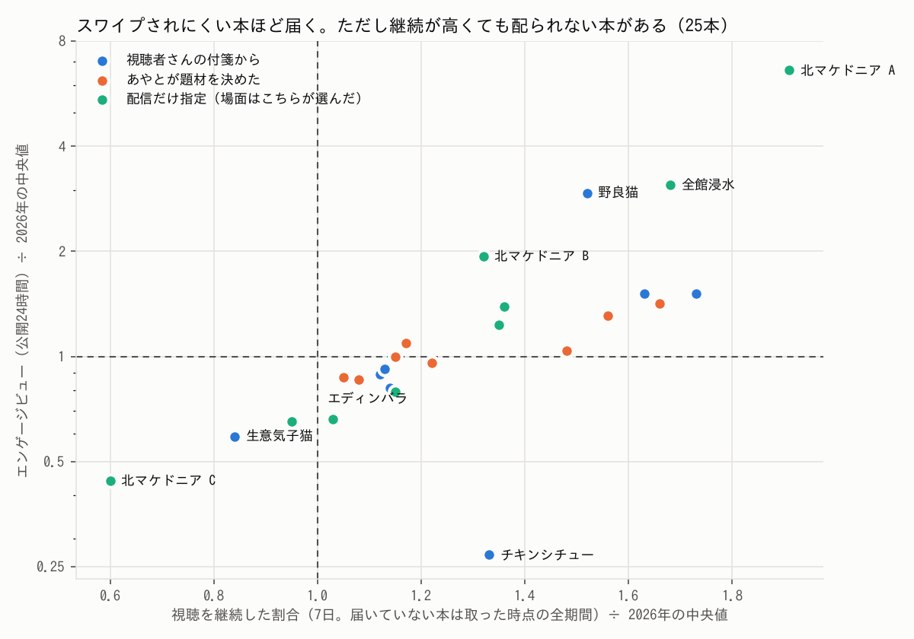
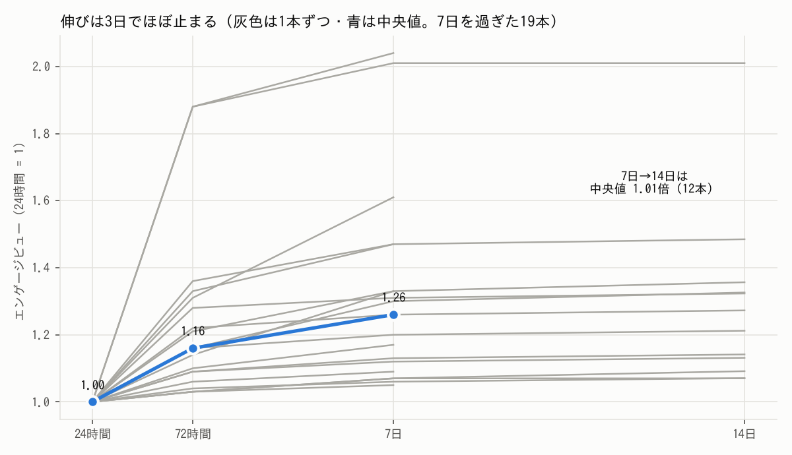
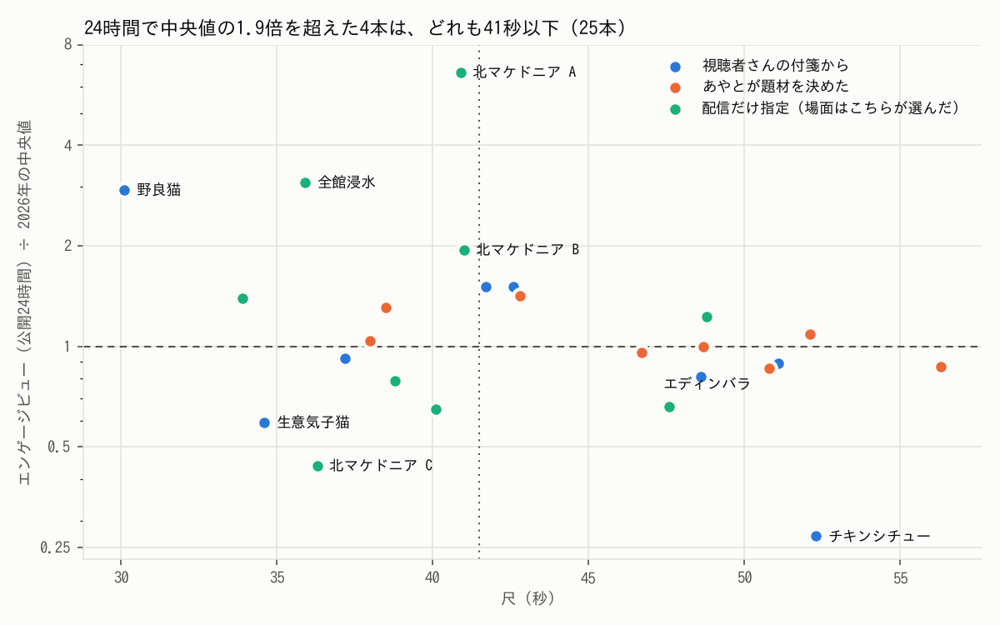
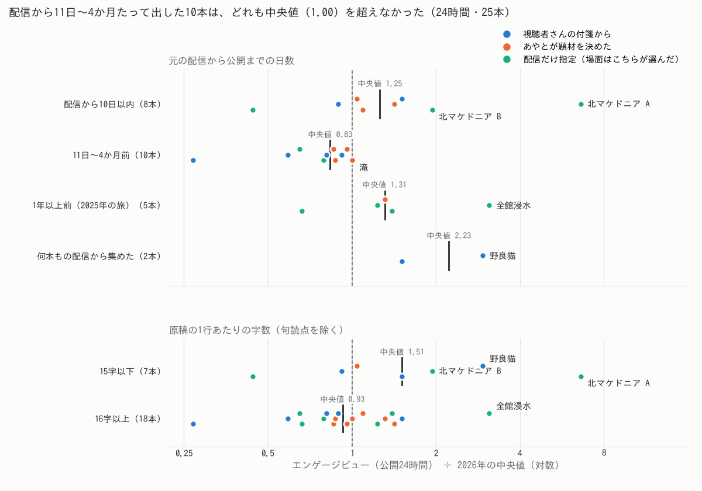

# ショートの数字のまとめと論点（2026-11-11）

あやと（2026-11-11）「諸々これまでのアナリティクスまとめて、論点を整理してください」への答え。
**日付の付いた記録なので、あとから直さない。** 次に数字を見直したら、別の日付で新しく書く。

**ここには生の数を書かない。** リポジトリは公開で、#921 で「数字は BigQuery（非公開）、リポジトリには集計した学びだけ」と
決めてある（`tools/shorts/metrics/shorts_metrics.py` の頭・`playbook.md` の物差しの節）。この紙の値は全部、
**2026年に公開した過去ショート33本の中央値との比**（中央値 = 1.00）か、同じ本の中の比。生の数は 7章の SQL で引ける。

## 0. 先に結論

1. **届くかどうかは、公開して最初の24時間でほぼ決まる。** 24時間の順位と7日の順位はほぼ同じ（順位の相関 0.99・19本）。
   72時間から7日で伸びるのは中央値 1.04倍、7日から14日は 1.01倍。**あとから火が付いた本は1本も無い。**
2. **スワイプされにくさは物差しを上回った。届き方は中央値並みのまま。** 視聴を継続した割合の中央値は 1.21倍（26本中23本が1倍超）。
   エンゲージビューは24時間で中央値 1.00倍（25本）。届き方を決めているのは YouTube が見せた回数（相関 0.92〜0.95）で、
   継続はその一部しか言い当てない。継続が上位でも配られなかった本がある（チキンシチュー: 継続 1.33・エンゲージビュー 0.27）。
3. **当たりは4本で、どれも41秒以下。** 北マケドニア A（24時間 6.61）・全館浸水（3.10）・野良猫（2.94）・北マケドニア B（1.94）。
   42秒以上の13本は、いちばん届いた本でも 1.51。n=25 で、仮説のまま（尺のほかに何が違うかを分けられていない）。



## 1. 何を、どこから取ったか

| 何 | どこから | いつ |
| --- | --- | --- |
| YouTube の時点の値（24時間・72時間・7日・14日） | YouTube Studio の裏の `yta_web/get_cards`（期間 = 公開から N 日で区切る `TIME_PERIOD_UNIT_NTH_DAYS`）。EC2 の Chrome で**読むだけ**（`studio_metrics.READ_ONLY`）。道具は `tools/shorts/metrics/` | 締切から48時間を過ぎて取った値は確定（2026-11-03 に取った44個と、2026-11-11 02:17 UTC に取った28個）。48時間に届く前に取った7個は「仮」（下の表で ※仮。Studio があとで直すことがある） |
| YouTube の全期間の値・維持率カーブ（3→8秒の残り・4→7秒の落ち） | 同じ `get_cards` の、期間を切らない全期間と `audienceRetentionHighlightsCardConfig` | 2026-11-11 02:17 UTC（11:17 JST）に26本ぶん |
| 公開の状態と公開時刻・尺 | Studio の `creator/get_creator_videos`（`timePublishedSeconds`・`videoDurationMs`） | 同上 |
| 置き場 | BigQuery `youtube_chat.shorts_metrics`。Actions の `shorts_metrics.yml`（[run 42945389903](https://github.com/Ayato-kosaka/live-streaming/actions/runs/42945389903)）が MERGE で入れた。69行 → **105行**（24時間 25・72時間 23・7日 19・14日 12・全期間 26） | 2026-11-11 |
| 比 | EC2 の上で `rows.json` から比だけを計算して持ち帰った（生の数はこの作業箱に来ていない） | 2026-11-11 |
| TikTok | **取れていない。** 読む道具が無い（#911 で「EC2 の Chrome の分析画面から読む」と方針までは決めた）。今回は作り足していない | — |

列と物差しの対応（物差しは `playbook.md` の「物差し」の節、#911 で 2026-10-15 に取った2026年の33本の中央値）:

| この紙の名前 | BigQuery の列 | Studio の指標 | 割る相手（中央値） |
| --- | --- | --- | --- |
| 継続（視聴を継続した割合 = スワイプされなかった割合） | `stayed_to_watch_pct` | `SHORTS_FEED_IMPRESSIONS_VTR` | 34.48% |
| エンゲージビュー（EV） | `engaged_views` | `ENGAGED_VIEWS` | 24時間 554・7日 604 |
| 再生 | `views` | `EXTERNAL_VIEWS` | 24時間 1,883・7日 2,441 |
| 平均視聴時間 | `avg_view_duration_s` | `AVERAGE_WATCH_TIME` | 25.3秒 |
| 平均再生率 | `avg_view_pct` | `AVERAGE_WATCH_PERCENTAGE` | **33本の物差しが無い。** 出した26本（全期間）の中央値で割った |
| 3→8秒の残り | `keep_3to8_pct` | 維持率カーブ（頭を100に直す） | 69.21% |
| 4→7秒の落ち | `retention_curve` から計算 | 同上 | 比ではなく差（頭 = 100 の点数）。H1 の基準は −10 以内 |
| 高評価・登録者 | `likes`・`subs_net` | `RATINGS_LIKES`・`SUBSCRIBERS_NET_CHANGE` | 物差しが無い。エンゲージビューあたりで書いた |
| YouTube が見せた回数 | `shorts_feed_impressions` | `SHORTS_FEED_IMPRESSIONS` | 物差しが無い。出した本の中央値で割った（3章でだけ使う） |

**再生（views）の比は読まない。** YouTube が 2026-08-27 に数え方を変えていて、33本と揃わない。今回も中央値は
24時間 0.72・7日 0.70 で、エンゲージビューが中央値を超える本でも再生は1倍を切る（11/3 と同じ）。表には載せるが、届き方はエンゲージビューで読む。

## 2. 出した全部の回

### 2.1 1本ずつの素性（YouTube で公開済みの26本。公開順）

- 型は企画（`shorts/videos/*/p*/plan.md`）とこちらの読みで付けた。題は札の字（`post_*.json` の `title`、北マケドニアの3本は `spec_*.json` の `title_card`）
- 頼み: **視聴者さんの付箋**＝島の付箋の頼みから作った回（あやとが「作って」と言ったもの）／**あやとが題材を決めた**＝あやとが最初から何を作るか（題材・題の字・作り方）を決めて頼んだ回／**配信だけ指定**＝あやとは配信を渡し、場面と題の案はこちらが出した回（題の字は、あやとが直したものが多い）
- 仮説: 制作記録に「確かめる仮説」を書いた回だけ番号を書いた（`playbook.md` の H・N）

| # | 公開（JST） | 題（札） | 型 | 頼み | 尺（秒） | 仮説 | YouTube | TikTok の数字 |
| --- | --- | --- | --- | --- | ---: | --- | --- | --- |
| 1 | 10/17（土）10:22 | 国際バス出発25分前に、ケバブ頼んだらまさかの事態！ | ハプニング | 配信だけ指定 | 40.9 | H1 | `Do04EoViYdU` | 取れていない（道具が無い） |
| 2 | 10/17（土）19:37 | アルバニア出国の朝に、ケバブ食べてみた！ | グルメ | 配信だけ指定 | 41.0 | H2 | `rVGC150Y3hA` | 取れていない（道具が無い） |
| 3 | 10/17（土）21:00 | アルバニアの路線バスは、対面払い！？ | 日本との違い | 配信だけ指定 | 36.3 | N1 | `W96gFSEKxZs` | 取れていない（道具が無い） |
| 4 | 10/19（月）04:57 | アプリ作り始めて1年、ついに1日4700人突破！ | 旅でない（積み重ね） | あやとが題材を決めた | 56.3 | H2・N2 | `waajCeichi8` | 取れていない（道具が無い） |
| 5 | 10/21（水）19:00 | 🇦🇱アルバニアの1泊1400円ホステルが異常すぎた😰 | 発見（宿） | あやとが題材を決めた | 46.7 | 書いていない | `qcWK52DE0X8` | 取れていない（道具が無い） |
| 6 | 10/22（木）07:00 | 🇫🇷 フランスを10日レンタカー旅してみた！ | 旅のまとめ（王道） | あやとが題材を決めた | 38.5 | H1・H2・H19 | `cwolzunLAko` | 取れていない（道具が無い） |
| 7 | 10/22（木）19:00 | 🇲🇰 北マケドニアの夕日見に行ったら、野良犬に襲われた！ | ハプニング | 視聴者さんの付箋 | 51.1 | 書いていない | `ieMGyM2QjCA` | 取れていない（道具が無い） |
| 8 | 10/23（金）12:11 | 海外キッチンでワンパンチーズフォカッチャ作ったらまさかの事態に！ | 料理（ハプニング） | あやとが題材を決めた | 42.8 | 書いていない | `PZXKg7NET20` | 取れていない（道具が無い） |
| 9 | 10/23（金）19:00 | 🇲🇰 北マケドニアに来たら、1,200億円かけて銅像だらけにした国だった | 発見（街） | 視聴者さんの付箋 | 41.7 | 書いていない | `frcgM9wiRr8` | 取れていない（道具が無い） |
| 10 | 10/24（土）19:00 | 🇸🇪 ストックホルム来たら、地下鉄が高すぎた！ | 発見（物価） | 視聴者さんの付箋 | 37.2 | 書いていない | `VP9gim0yrCw` | 取れていない（道具が無い） |
| 11 | 10/25（日）21:30 | 🇬🇪海外の山奥に来たら、動物たちがはちゃめちゃすぎた！ | 動物 | あやとが題材を決めた | 50.8 | 書いていない | `3Z2Kq-H0BCo` | 取れていない（道具が無い） |
| 12 | 10/26（月）21:30 | 🇬🇪ジョージアで滝を観に行こうと思ったら大惨事に！ | ハプニング | あやとが題材を決めた | 48.7 | 書いていない | `NibbSNmx0U8` | 取れていない（道具が無い） |
| 13 | 10/28（水）21:31 | 🇲🇰海外ホステルを追い出されました！ | ハプニング | あやとが題材を決めた | 38.0 | 書いていない | `CSE9FVCRdlw` | 取れていない（道具が無い） |
| 14 | 10/29（木）21:30 | 🐱海外の野良猫たち人懐こすぎた！ | 動物（集め） | 視聴者さんの付箋 | 30.1 | 書いていない | `2vKj9g3BAdA` | 取れていない（道具が無い） |
| 15 | 10/30（金）21:30 | 🇦🇱アルバニアでの髭剃り探しが大変すぎた！ | ハプニング（日常） | 配信だけ指定 | 38.8 | 書いていない | `XMxoa-BWRME` | 取れていない（道具が無い） |
| 16 | 10/31（土）21:30 | 🇲🇰北マケドニアの行列店の大衆食堂を食べてみた！ | グルメ | 配信だけ指定 | 40.1 | 書いていない | `IZpZGM5Xbyg` | 取れていない（道具が無い） |
| 17 | 11/1（日）21:30 | 🇬🇧イギリスのエディンバラを、1日で回ったらやばかった！ | 街歩き（王道） | 配信だけ指定 | 47.6 | H1・H19 | `wACcdJnOv18` | 取れていない（道具が無い） |
| 18 | 11/2（月）21:30 | 🇬🇧イギリスにあるアフタヌーンティーの超本場がやばすぎた！ | グルメ（本場） | 配信だけ指定 | 48.8 | 書いていない | `jz5RjaX-H6Q` | 取れていない（道具が無い） |
| 19 | 11/3（火）21:30 | 🇬🇧イギリスの宿でシャワーを浴びたら、全館浸水しました！ | ハプニング | 配信だけ指定 | 35.9 | 書いていない | `wDtTjwEd0Pg` | 取れていない（道具が無い） |
| 20 | 11/4（水）21:30 | 海外旅行中に作ったバケットが簡単すぎた！ | 料理（レシピ） | あやとが題材を決めた | 52.1 | 書いていない | `As4LP4FPzPw` | 取れていない（道具が無い） |
| 21 | 11/5（木）21:30 | 🇬🇧イギリスのめちゃくちゃ美味しい料理、ハギスを食べてみた！ | グルメ（名物） | 配信だけ指定 | 33.9 | H1 | `YJvEbZ3dmEQ` | 取れていない（道具が無い） |
| 22 | 11/6（金）21:30 | 🇲🇰北マケドニアで、チキンシチューを作ったらお店の味やった！ | 料理（レシピ） | 視聴者さんの付箋 | 52.3 | 書いていない | `GLmdZ6wkaqA` | 取れていない（道具が無い） |
| 23 | 11/7（土）21:30 | 🇬🇪ジョージアの生意気子猫が、膝で爆睡したくせに僕をすぐ忘れやがった！ | 動物（猫の型） | 視聴者さんの付箋 | 34.6 | 書いていない | `F9BGvL10A5o` | 取れていない（道具が無い） |
| 24 | 11/8（日）21:30 | 🇬🇪ジョージアに来たら、野良犬が共存してた！ | 動物（集め） | 視聴者さんの付箋 | 42.6 | 書いていない | `5O7Hi-dY_-k` | 取れていない（道具が無い） |
| 25 | 11/9（月）21:30 | 🇱🇻ラトビアでヒッチハイクしたら、夫婦の車で大惨事に！！ | ハプニング | 視聴者さんの付箋 | 48.6 | 書いていない | `W4jJBhqnF30` | 取れていない（道具が無い） |
| 26 | 11/10（火）21:30 | 🇸🇪スウェーデンで人生初のIKEAに行ったら、安すぎた！ | 発見（物価） | 視聴者さんの付箋 | 44.2 | 書いていない | `sXli7CMU3HI` | 取れていない（道具が無い） |

### 2.2 数字（中央値 = 1.00）

- **継続**は7日の値。7日に届いていない本は、取った時点の全期間の値（公開から何日かを添えた）
- **EV**＝エンゲージビュー。**24h→7d** は同じ本の中のエンゲージビューの伸び（33本は 1.1〜1.6倍。11/3 の表は再生の伸びだったので、少しずれる）
- **平均視聴時間・平均再生率・3→8秒・4→7秒・高評価・登録者**は、2026-11-11 に取った全期間の値
- **高評価**は 100エンゲージビューあたり、**登録者**は純増の 1,000エンゲージビューあたり
- ※仮 = 締切から48時間たつ前に取った値（Studio があとで直すことがある）

| # | 回 | 継続 | EV 24h | EV 7d | 再生 24h | 再生 7d | 平均視聴時間 | 平均再生率 | 3→8秒 | 4→7秒の落ち | 24h→7d | 高評価 /100EV | 登録者 /1000EV |
| --- | --- | --- | --- | --- | --- | --- | --- | --- | --- | --- | --- | --- | --- |
| 1 | 北マケドニア A | 1.91 | 6.61 | 6.49 | 3.15 | 2.60 | 1.17 | 1.02 | 0.97 | −25.4 | 1.07 | 1.5 | 0.5 |
| 2 | 北マケドニア B | 1.32 | 1.94 | 3.56 | 1.27 | 1.92 | 1.33 | 1.16 | 1.20 | −12.8 | 2.01 | 2.3 | 0.9 |
| 3 | 北マケドニア C | 0.60 | 0.44 | 0.52 | 0.67 | 0.60 | 1.08 | 1.04 | 1.07 | −19.0 | 1.30 | 6.1 | 0.0 |
| 4 | アプリの回 p2 | 1.05 | 0.87 | 0.85 | 0.72 | 0.59 | 1.22 | 0.76 | 0.98 | −23.4 | 1.06 | 3.9 | 0.0 |
| 5 | アルバニアの宿 | 1.22 | 0.96 | 1.17 | 0.70 | 0.68 | 1.82 | 1.38 | 1.20 | −12.4 | 1.33 | 4.6 | 1.4 |
| 6 | フランス | 1.56 | 1.31 | 1.76 | 0.81 | 0.89 | 1.10 | 1.01 | 1.00 | −19.7 | 1.47 | 2.3 | 0.0 |
| 7 | 夕日と野良犬 | 1.12 | 0.89 | 0.92 | 0.64 | 0.56 | 1.54 | 1.06 | 1.03 | −22.6 | 1.13 | 5.2 | 0.0 |
| 8 | フォカッチャ | 1.66 | 1.42 | 1.71 | 0.78 | 0.77 | 1.08 | 0.90 | 0.96 | −27.3 | 1.31 | 2.4 | 0.0 |
| 9 | 銅像 | 1.73 | 1.51 | 1.75 | 0.72 | 0.72 | 0.92 | 0.78 | 1.00 | −22.3 | 1.26 | 3.8 | 0.9 |
| 10 | ストックホルムの地下鉄 | 1.13 | 0.92 | 0.95 | 0.70 | 0.59 | 1.00 | 0.94 | 1.16 | −13.9 | 1.12 | 3.1 | 0.0 |
| 11 | 山奥の動物 | 1.08 | 0.86 | 0.85 | 0.66 | 0.54 | 1.13 | 0.79 | 1.01 | −23.5 | 1.07 | 5.0 | 1.9 |
| 12 | 滝で大惨事 | 1.15 | 1.00 | 1.11 | 0.79 | 0.70 | 1.34 | 0.98 | 1.16 | −14.6 | 1.20 | 3.1 | 0.0 |
| 13 | ホステルを追い出された | 1.48 | 1.04 | 1.54 | 0.70 | 0.79 | 1.10 | 1.00 | 1.14 | −15.6 | 1.61 | 3.3 | 1.1 |
| 14 | 野良猫 | 1.52 | 2.94 | 5.49 | 1.89 | 2.74 | 0.86 | 1.00 | 0.99 | −23.8 | 2.04 | 4.4 | 1.2 |
| 15 | 髭剃り探し | 1.15 | 0.79 | 0.79 | 0.60 | 0.50 | 1.09 | 0.99 | 0.99 | −18.7 | 1.09 | 3.1 | 0.0 |
| 16 | 行列店の大衆食堂 | 0.95 | 0.65 | 0.62 | 0.61 | 0.48 | 1.80 | 1.56 | 1.15 | −16.2 | 1.05 | 3.2 | 0.0 |
| 17 | エディンバラ | 1.03 | 0.66 | 0.80 | 0.61 | 0.57 | 1.36 | 1.01 | 1.03 | −19.9 | 1.33 | 4.5 | 0.0 |
| 18 | アフタヌーンティー | 1.35※仮 | 1.23 | 1.32※仮 | 0.82 | 0.73※仮 | 2.31 | 1.68 | 1.19 | −13.9 | 1.17 | 3.6 | 2.5 |
| 19 | 全館浸水 | 1.68※仮 | 3.10 | 4.17※仮 | 1.78 | 1.97※仮 | 1.20 | 1.19 | 1.14 | −13.0 | 1.47 | 0.8 | 0.4 |
| 20 | バゲット | 1.17（全期間・公開6.6日） | 1.09 | 取れていない（時点がまだ・11/11 21:30〜） | 0.82 | 取れていない（時点がまだ・11/11 21:30〜） | 1.42 | 0.95 | 1.03 | −22.0 | 取れていない（時点がまだ・11/11 21:30〜） | 2.6 | 0.0 |
| 21 | ハギス | 1.36（全期間・公開5.6日） | 1.39 | 取れていない（時点がまだ・11/12 21:30〜） | 0.98 | 取れていない（時点がまだ・11/12 21:30〜） | 0.91 | 0.96 | 0.97 | −23.3 | 取れていない（時点がまだ・11/12 21:30〜） | 1.9 | 0.9 |
| 22 | チキンシチュー | 1.33（全期間・公開4.6日） | 0.27 | 取れていない（時点がまだ・11/13 21:30〜） | 0.19 | 取れていない（時点がまだ・11/13 21:30〜） | 1.39 | 0.94 | 0.94 | −28.8 | 取れていない（時点がまだ・11/13 21:30〜） | 7.5 | 0.0 |
| 23 | 生意気子猫 | 0.84（全期間・公開3.6日） | 0.59 | 取れていない（時点がまだ・11/14 21:30〜） | 0.56 | 取れていない（時点がまだ・11/14 21:30〜） | 0.82 | 0.84 | 0.83 | −35.7 | 取れていない（時点がまだ・11/14 21:30〜） | 4.1 | 0.0 |
| 24 | ジョージアの野良犬 | 1.63（全期間・公開2.6日） | 1.51※仮 | 取れていない（時点がまだ・11/15 21:30〜） | 0.83※仮 | 取れていない（時点がまだ・11/15 21:30〜） | 1.08 | 0.90 | 1.07 | −18.9 | 取れていない（時点がまだ・11/15 21:30〜） | 2.4 | 0.0 |
| 25 | ラトビアのヒッチハイク | 1.14（全期間・公開1.6日） | 0.81※仮 | 取れていない（時点がまだ・11/16 21:30〜） | 0.59※仮 | 取れていない（時点がまだ・11/16 21:30〜） | 1.81 | 1.32 | 取れていない（維持率カーブが Studio にまだ出ていない） | 取れていない（同上） | 取れていない（時点がまだ・11/16 21:30〜） | 4.1 | 2.2 |
| 26 | 人生初のIKEA | 1.21（全期間・公開0.6日） | 取れていない（時点がまだ・11/11 21:30〜） | 取れていない（時点がまだ・11/17 21:30〜） | 取れていない（時点がまだ・11/11 21:30〜） | 取れていない（時点がまだ・11/17 21:30〜） | 2.37 | 1.88 | 取れていない（維持率カーブが Studio にまだ出ていない） | 取れていない（同上） | 取れていない（時点がまだ・11/17 21:30〜） | 2.1 | 0.0 |

### 2.3 出したが、上の表に無いもの

| 回 | 出した先・時刻 | 数字 |
| --- | --- | --- |
| 北欧周遊 × 蜃気楼（23秒・ナレーションなし。`nordic-shinkiro/p2tt2`） | TikTok だけ（2026-10-24）。YouTube の下書きは消した | 取れていない（TikTok を読む道具が無い） |
| ほったらかしパンのはかり（`urwD3EmjTxs/p1-A`・`y2b07xe2-nk`） | 予約（2026-11-11 21:30 JST） | 取れていない（取った時点で予約中。24時間は 11/12 21:30 から） |
| 偏見をなくしたくて、イラン国境まで歩いたお話（対談の切り抜き。`LxrbXwHssF0/C`・`nl-A72Io7Sc`） | 予約（2026-11-13 21:30 JST） | 取れていない（予約中。24時間は 11/14 21:30 から） |
| リーズを1日歩く（`S5yf_Ir50xU/p3`・`cJbIZUniHqk`） | 予約（2026-11-16 21:30 JST。11/6 の枠から動かした） | 取れていない（予約中） |
| 差し替えで消した5本（`mdbEL8b5b_8`・`yYBqfXBhkCg`・`KjU8rcsN7PM`・`jH5SZqTP3M8`・`_3-HD96xiXI`） | 公開前に差し替えた | 数えない（Studio で「消してある」） |

TikTok には YouTube と同じ26本と北欧の1本、計27本を出していて、**数字は1本も取れていない**。

## 3. 全体

| 指標 | 2026-11-03（前回） | 2026-11-11（今回） |
| --- | --- | --- |
| 継続の中央値 | 1.19（18本） | **1.21**（26本。1倍超 23本・上位4分の1の境 1.15 以上 17本・0.8 未満 1本） |
| EV 24時間の中央値 | 0.98（18本） | **1.00**（25本。1倍超 12本・2倍以上 3本） |
| EV 7日の中央値 | 1.14（12本） | **1.17**（19本。1倍超 11本・2倍以上 4本） |
| 3→8秒の残りの中央値 | 1.01（17本） | **1.03**（24本。0.83〜1.20） |
| 4→7秒の落ち（基準 −10 以内） | 17本で0本 | 24本で**0本**（中央値 −19.8・−12.4〜−35.7） |
| 平均視聴時間の中央値 | — | 1.19 |
| EV の伸び（同じ本の中） | — | 24h→72h 1.14（23本）・24h→7d **1.26**（19本。2倍超は北マケドニア B 2.01・野良猫 2.04 の2本）・7d→14d **1.01**（12本） |
| 高評価 | — | 26本を合わせて 100EV あたり 2.9 |
| 登録者の純増 | — | 26本を合わせて 1,000EV あたり 0.64。純増がプラスの本は26本中11本 |
| 共有 | 19本とも 0 | 26本中25本が 0（全館浸水だけ 0 でない） |



**つながり（相関。EV は対数で）:**

| 何と何 | 24時間（25本。3→8秒と4→7秒はカーブの出た24本） | 7日（19本） |
| --- | --- | --- |
| 継続 × EV | **0.72**（順位 0.79） | **0.83**（順位 0.90） |
| 3→8秒の残り × EV | 0.11 | −0.09 |
| 4→7秒の落ち × EV | 0.16 | −0.11 |
| YouTube が見せた回数 × EV | **0.92** | **0.95** |
| 継続 × 見せた回数 | 0.41 | 0.64 |
| 尺 × EV | −0.35 | −0.43 |
| 平均視聴時間 × EV | −0.18 | −0.25 |
| 高評価（/EV）× EV（全期間・26本） | −0.65 | |

## 4. 論点

### 4.1 事実

1. **24時間で勝負がつく。** 24時間の EV の順位で、7日の順位がほぼ決まる（順位の相関 0.99・19本）。72時間→7日は中央値 1.04倍（いちばん伸びた本で 1.23倍）、
   7日→14日は 1.01倍（12本。最大 1.02倍）。24時間→7日で2倍を超えたのは2本（北マケドニア B・野良猫）で、どちらも72時間までに 1.88倍に届いていた
2. **届き方は「YouTube が何回見せたか」でほぼ決まる。** 見せた回数と EV の相関は 0.92（24時間）・0.95（7日）。見せた回数と継続の相関は 0.41・0.64
3. **継続は物差しを上回り続けている。** 26本中23本が1倍超。前回（18本）と同じ向き。ただし **10月下旬から全部の本が「0秒目に題の札とその本でいちばんの画、1行目は題を読む」で作られている**（F-015 10/16・F-020 10/18・F-047 10/23）ので、どの決まりが効いたかは分けられない
4. **継続が上位でも配られなかった本がある。** チキンシチュー（継続 1.33・見せた回数は出した本の中央値の 0.24倍・EV 0.27）。26本で、継続が上位4分の1なのに EV が中央値の半分を切ったのはこの1本だけ。理由は分からない
5. **3→8秒の残りと4→7秒の落ちは、届き方と結びつかない**（相関 −0.11〜0.16）。4→7秒の落ちが基準（−10 以内）に入った本は24本で0本。H1 を確かめた4本（北マケドニア A −25.4・フランス −19.7・エディンバラ −19.9・ハギス −23.3）も全部外
6. **当たりの4本は全部41秒以下。** 41秒以下の12本は24時間 EV の中央値 1.18（0.44〜6.61。当たりも外れも大きい）、42秒以上の13本は 0.96（0.27〜1.51。中央値のまわりに収まる）。
   尺と EV の相関は −0.35（24時間）・−0.43（7日）。いまの骨組みは「60秒弱」（`script_writing.md` 1章・`SKILL.md` の 350字・22行前後）で、42秒以上が26本中14本



7. **型ごと**（24時間 EV の中央値）: グルメ 1.31（4本）・動物 1.19（4本）・料理 1.09（3本）・ハプニング 1.00（7本）・発見 0.96（3本。IKEA はまだ）。
   1本だけの型: 旅のまとめ（フランス）1.31・旅でない（アプリ）0.87・街歩きの王道（エディンバラ）0.66・日本との違い（北マケドニア C）0.44。
   動物は、何匹もを集めた回（野良猫 2.94・ジョージアの野良犬 1.51）と、1匹・1場面の回（生意気子猫 0.59・山奥の動物 0.86）で割れた
8. **頼みごと**（24時間 EV の中央値・継続の中央値）: 視聴者さんの付箋 9本 0.91・1.21／あやとが題材を決めた 8本 1.02・1.19／配信だけ指定 9本 1.23・1.32。
   付箋の9本には当たりの野良猫（2.94）も、いちばん届かなかったチキンシチュー（0.27）も入っていて、ばらつきが大きい
9. **時期**（24時間 EV の中央値）: 10/17〜10/24 の10本 1.14・10/25〜11/03 の9本 1.00・11/04〜11/10 の6本 0.95。11/04 からの本は付箋の回が多い（6本中4本）
10. **出した時刻は 10/25 から16本すべて 21:30 JST。** 曜日は1つの曜日に2〜4本。時刻と曜日の効きは、この出しかたでは測れない
11. **題の字・0秒目の画では、当たりと外れを分けられなかった。** 当たり4本の0秒目は回る肉の串・膝の上の猫・水浸しのシャワー室の戸口・ケバブの断面、外れ5本は出来上がったシチュー・向かってくる路線バス・膝の上の子猫・料理の卓・地図のアニメーション。食べ物も猫も両方にいる
12. **高評価は、届かなかった本ほど多い**（相関 −0.65）。チキンシチュー 7.5・北マケドニア C 6.1（100EV あたり）、全館浸水 0.8・北マケドニア A 1.5。
    届かなかった本は、もともと見てくれる人に多く見せた、という読みと合う（確かめてはいない）
13. **登録者はほとんど増えていない。** 1,000EV あたり 0.64人、26本中15本は純増 0
14. **仮説の記録が増えていない。** 11/3 に「企画に確かめる仮説と変えた1点を書く」と決めたが、11/3 以後に公開した8本で書いてあるのはハギス（H1）の1本だけ。
    はかりの回（11/11 公開）は「A と B を両方出して比べる」と書いたが、B を出す予定が無い
15. **TikTok は27本出して、数字は0本。** 数字取りの定期化（#921）もまだで、今回も手で回した（前回から8日あいた）

### 4.2 解釈（言えること・言えないこと）

**言えること**

- **判定は72時間で足りる。** 7日・14日を待っても順位は変わらない。仮説の判定を「14日後」に置く理由は無い（#922 の受け入れ条件は「14日後に判定を書く」）
- **物差しは「継続が主、3→8秒は副」に見直してよい。** 前回「本数が増えても同じなら見直す」と書いた条件（`playbook.md` H23）に当たった（12本 → 19本で同じ向き）
- **H1（4〜8秒の2つ目の山）は、今の埋め方では効いていない。** 4本とも基準の外で、4→7秒の落ちは届き方とも結びつかない。山の行を足す手間に見合わない
- **スワイプを減らす作りは効いている見込みが高いが、それだけでは配られない。** 継続が上がっても、見せた回数が増えるのは一部（相関 0.41〜0.64）。残りは、この数字では見えない何か（題材への関心・初見の人への見せ方・YouTube 側の配り方）

**言えないこと（n が小さい・混ざっている）**

- 尺: 当たり4本が全部41秒以下なのは目立つが、短い本は題材も単純（出来事1つ・猫を集めた）で、**尺が効いたのか題材が効いたのかを分けられない**（n=25）
- 型・頼みごと: どの群も3〜9本で、群の中のばらつきが群の差より大きい。**n=3〜9 で仮説のまま**
- 時期の下がり: 1本目の北マケドニア A（6.61）が前の群を押し上げているのと、11/04 からは付箋の回が多いのが重なっていて、作りが悪くなったとは言えない
- 時刻・曜日: 21:30 固定なので測れない
- チキンシチューが配られなかった理由: 分からない（同じ日のほかの投稿・題・レシピの型のどれも、1本では切り分けられない）
- TikTok: 何も言えない

### 4.3 仮説の判定の更新案（`playbook.md` の台帳）

台帳の「結果」の欄には、2026-11-11 の事実だけを足した。**状態の書き換えは、下の案のまま止めてある。**

| # | いまの状態 | 案 | 理由 |
| --- | --- | --- | --- |
| H1 4〜8秒に2つ目の山 | 確かめ中 | **否定（今の埋め方では）** | 確かめた4本とも4→7秒の落ちが基準の外（−19.7〜−25.4）。24本で基準に入った本は0。4→7秒の落ちは届き方と結びつかない（−0.11〜0.16）。決まり「複数の本で同じ向き」に当たる |
| H2 0秒目にいちばんの画と一行の題 | 確かめ中 | **台帳から外し、決まり（F-015・F-020・F-047）の側に置く** | 10/18 から全部の本がこの作りで、比べる相手が無い。確かめた3本は2本が境を超えた（変わらず） |
| H19 王道を憧れとして | 確かめ中 | 確かめ中のまま（向きは「王道の街回りは弱い」） | 同じ旅（スコットランド）の中で、王道のエディンバラ 0.66 に対し、寄り道の全館浸水 3.10・名物のハギス 1.39（24時間 EV）。組は1つ |
| H23 物差しは継続と3→8秒 | 確かめ中 | **支持（継続）・否定（3→8秒）。物差しを「継続が主・3→8秒は副」に** | 継続 × EV は 0.72（25本）・0.83（19本）、3→8秒 × EV は 0.11・−0.09。前回の見直しの条件に当たった |
| N1 日本との違いを答えに置く短い型 | 確かめ中 | そのまま（n=1） | 変わらず最下位の群（継続 0.60・EV 7日 0.52） |
| N2 旅でない形 | 確かめ中 | そのまま（n=1） | 変わらず（継続 1.05） |
| 新 N3 何匹もの動物を集めた回は届く | — | **仮説として足す** | 野良猫 2.94・ジョージアの野良犬 1.51（24時間）。1匹の話（生意気子猫 0.59）と割れた。n=2 |
| 新 N4 41秒以下は当たりが出やすい | — | **仮説として足す**（あやとの判断 D2 のあと） | 4.1 の6。題材と混ざっているので、同じ題材で尺だけ変えた本で確かめる |

## 5. あやとに決めてほしいこと

**D1. ショートで何を増やしたいか（何を「当たり」とするか）**

いまは、こちらが黙って「初見の人に届いた数（エンゲージビュー）」で当たりを決めている。物差しを変えると、当たりの本が入れ替わる。

| 選んだら | 当たりになる本（いまの数字で） | 変わること |
| --- | --- | --- |
| A. 初見に届く数（いまのまま） | 北マケドニア A・野良猫・全館浸水・北マケドニア B | 何も変えない |
| B. 登録者の増え | 1,000EV あたりで上位はアフタヌーンティー 2.5・ラトビア 2.2・山奥の動物 1.9（全館浸水は 0.4） | 登録者の物差し（33本の中央値）を新しく取る。いまは26本中15本が0なので、本数が要る |
| C. 配信に来てくれる人 | いまは測れていない | 配信のチャットに初めて来た人のうち、ショートから来た人を数える仕組みを新しく作る（取り込みと Studio の流入元を突き合わせる） |

**D2. 尺の目安**

いまの骨組みは「60秒弱」で、26本中14本が42秒以上。当たりの4本は全部41秒以下（ただし題材と混ざっている）。

| 選んだら | 変わること |
| --- | --- |
| A. いまのまま（60秒弱まで） | 何も変えない。尺の効きは分からないまま |
| B. 次の6本を40秒以下で作って比べる | 原稿は 250字・16行前後まで（いまは企画に書いてある本で 270〜340字ほど）。入らない場面を削る。約1週間で n=6 の比べができる |
| C. 目安を40秒以下に変える | 骨組み（`script_writing.md` 1章）と原稿の字数の上限を書き換える。長い話（旅のまとめ・レシピ）は2本に割る |

**D3. 出す時刻**

10/25 から全部 21:30 JST で、時刻の効きは測れない。最初の24時間で勝負がつくので、時刻は効く見込みがある。

| 選んだら | 変わること |
| --- | --- |
| A. 21:30 のまま | 何も変えない |
| B. 2週間だけ、21:30 と別の時刻（例えば 12:30 か 19:00）を1日おきに | 予約の時刻だけ変える（作りは同じ）。2週間で各7本ずつの比べ |

**D4. 視聴者さんの付箋の回を、何で測るか**

付箋の9本は、24時間 EV の中央値 0.91（ほかは 1.02・1.23）。ばらつきが大きく、当たりの野良猫も入っている。

| 選んだら | 変わること |
| --- | --- |
| A. ほかの回と同じ物差し（いまのまま） | 付箋の頼みの字（題の核。F-063）と、届きやすい形（D2 の尺など）がぶつかったときは、届きやすさも見て題と構成を決める |
| B. 付箋の回は「頼んだ人に応える回」として、届き方の判定から外す | 付箋の頼みのとおりに作り、尺や型の比べ（仮説の確かめ）には数えない。比べに使える本が1週間に2〜5本減る（11/04〜11/10 は7本中5本が付箋の回） |

## 6. 仕組みの穴（こちらで直すもの。あやとの判断は要らない）

1. **数字取りが手のまま（#921 の定期化）。** 今回は 11/3 から8日あいた。Studio は公開からの期間で切って返すので遅れても値は失われないが、**誰も見ないまま次の本を作っている。**
   24時間で勝負がつくので、公開の翌日に取って72時間で判定する輪にしたい。Actions からは EC2 に届かないので、決まった時刻に起きるセッション（`send_later` か定時のセッション）が `collect` と `ship` を回す形になる
2. **TikTok の数字が0本。** #911 で決めた方針（EC2 の Chrome の分析画面から読む）のまま道具が無い。投稿の担当の Chrome に TikTok のログインがあるので、それを借りて読む道具を作る
3. **14日の時点は要らない。** 7日→14日は 1.01倍。判定は72時間に寄せ、14日は取ってもよいが待たない（`studio_metrics.CHECKPOINTS` と `playbook.md` の「14日後に判定」の書きかえ）
4. **物差しの無い指標がある。** 平均再生率・見せた回数・高評価・登録者・72時間・14日には、33本の中央値が無い。#911 の98本から同じ形で取り直せば作れる
5. **共有（SHARINGS）は今回1本で 0 でなかった。** 名前が「共有」を指していないという前回の疑いは弱まったが、画面と1回突き合わせるまで物差しにしない
6. **仮説の記録が企画に入らない。** 決まりを書いても書かれない（8本中1本）。`brief.py` の1枚か `lint.py` で、企画に「確かめる仮説」と「変えた1点」の欄が無ければ止める形にしないと守られない
7. **はかりの回の A/B の比べは、B を出さないと成り立たない。** 出す予定に入れるか、仮説の欄を書き直す

## 7. 生の数を見るとき（BigQuery）

リポジトリには載せない。BigQuery の画面で:

```sql
SELECT plan, video_id, checkpoint, provisional, published_at, fetched_at, duration_s,
       views, engaged_views, stayed_to_watch_pct, avg_view_duration_s, avg_view_pct,
       shorts_feed_impressions, likes, comments, shares, subs_gained, subs_lost, subs_net, keep_3to8_pct
FROM `live-streaming-d3cac.youtube_chat.shorts_metrics`
WHERE platform = 'youtube'
ORDER BY published_at, video_id, IFNULL(checkpoint_hours, 99999);
```

中央値との比は `python3 tools/shorts/metrics/shorts_metrics.py summary-sql` の SELECT。

## 8. 論点（広げた版・2026-11-11 追記）

あやと（[#1173](https://github.com/Ayato-kosaka/live-streaming/issues/1173#issuecomment-6801317331)）「論点少なくない？」への足し。
5章の D1〜D4 は、あやとの返事ですべていまのまま（D1 A 初見に届く数・D2 A 60秒弱まで・D3 21:30・D4 A 付箋の回も同じ物差し）。
ここに並べるのは**決めてもらうことではなく、数字と制作の記録から出る論点**（帳面 F-072）。1つの論点を
「事実 → 解釈（言える／言えない・n）→ 次にこちらで確かめること」の3行で書く。数字は 2.2 の表の比をそのまま使い、取り直していない。1〜7章は書き換えていない。

### 8.0 先に、いちばん大事な5つ

1. **素材の古さ（論点6）。** 配信から11日〜4か月たって出した10本は、24時間 EV がどれも 1.00 以下（中央値 0.83）。10日以内の8本は 1.25、2025年の旅の5本は 1.31。尺で分けても、頼みの出どころを揃えても同じ向き。これから出す本の半分がこの古さにある
2. **1行の字数が伸びている（論点9）。** 行の数は 19.5 → 16 行に減ったのに、1本の字数は300字前後のまま。1行15字以下の7本は EV 1.51・継続 1.48、16字以上の18本は 0.93・1.17。尺（D2）とは別のつまみ
3. **頼みの出どころで、ばらつきの幅が違う（論点13）。** あやとが題材を決めた8本は 0.86〜1.42 に収まり、当たりも大外れも無い。当たり4本のうち3本は「配信だけ指定」
4. **数字が作りに戻るのが遅くなった（論点15）。** 上げてから公開までの在庫が 0.04日 → 1.54日 → 3.68日（中央値）。24時間で勝負がつくのに、学びが次の本に入るのは公開の5日ほどあと
5. **宿の料理の回は出すたびに下がった（論点7）。** 1.42 → 1.09 → 0.27。今夜のパンと、作っている2本（うどん・パン3種）も宿の料理



### 8.1 足して数えたもの

| 何 | どこから |
| --- | --- |
| 原稿の行の数・字数・配信の本人の声の行 | 出した版の `spec*.json` の `rows` と `edit_*.json` の `orig_voice`。北マケドニアの3本は `yk-by7R7iPA/p3/spec_*.json`。字数は句読点・括弧・空白を除いて数えた |
| 話す速さ | 字数 ÷ 尺（2.1 の秒） |
| 元の配信の日 | `streams/manifest.tsv`。2025年の英国の4本は各回の `highlights.md` の配信開始、フランスは使った配信（2025年3月）。何本もの配信から集めた2本（野良猫・ジョージアの野良犬）は日を持たない |
| 題の形・0秒目の画・最後の行 | 2.1 の題、`spec` の1行目の `visual`、最後の行の字。分けかたはこちらの読み |
| 版の数 | `posted.md`・`tools/shorts/post/posted.json` にある出した版の名前（`-v6` なら6）。**こちらの見直しで書き出し直した版も数えている** |
| 作る日数・在庫 | 制作 issue（札 `shorts`）を立てた時刻 → 出した版を YouTube に上げた時刻（`posted.json`）→ 公開の時刻 |
| あやとの直し | 帳面（`.claude/skills/viral-shorts-creator/references/ayato_feedback.md`）の「言われた」の行のうち、その回の制作 issue を出どころにした数 |
| TikTok の出しかた | `posted.json` の `place: tiktok` |

**偶然で出る割合**（下で「偶然 0.07」のように書く）: 本をくじで2つに分け直して（2万回）、同じかそれ以上の中央値の差が出た割合。
0.05 を切れば偶然では出にくい。ただし**ここでは20通りほど切って見ている**ので、0.05 前後の差は偶然を引いていることがある。
中央値の比 1.0 の同じ集まりから6本と6本を引いても、20回に1回は 1.7倍の差が出る（14本と14本で 1.4倍）。

時期は 4.1 の9と同じ3つに切った: 10/17〜10/24（10本）・10/25〜11/3（9本）・11/4〜11/10（7本）。

### 8.2 題と頭

**論点1. 題の形（伏せる／言い切る）**

- 事実: 24時間 EV の中央値は「〜てみた」1.35（4本）・伏せる（まさかの事態・大惨事・やばかった）1.00（5本）・落ちを言い切る 0.97（8本）・「〜すぎた」0.96（7本）・問い 0.44（1本）。継続は 言い切る 1.41・てみた 1.34・すぎた 1.19・伏せる 1.15
- 解釈: 形で届き方は分かれない。継続は言い切った側が高く、今日の F-071（落ちを伏せる）と逆向きに見えるが、偶然 0.42 で**言えない**。言い切った8本はどれも「言っても見る理由が残る出来事」（全館浸水・銅像だらけ）で、F-071 が当たる「言うと見る理由が消える回」はまだ1本も出していない
- 次: F-071 で出す回（パン3種 #1171）の継続を、言い切った料理の回と並べる。企画に「F-031 と F-071 のどちらを当てた題か」を書いて、本数が増えたら分けて数える

**論点2. 題の飾り（国旗・数字・長さ・疑問形）**

- 事実: 国旗の無い7本 1.42・ある18本 0.94（偶然 0.07）。数字の入った6本 1.14・無い19本 1.00。題の字数（14〜31字）と EV の順位の相関 −0.01。疑問形は北マケドニア C の1本（0.44）だけ
- 解釈: 国旗の無い7本は、F-030（10/21）より前の4本と、国の名前を言わず「海外」で引いた3本（フォカッチャ・野良猫・バゲット）で、国旗そのものの効きとは分けられない。長さと数字は効いていない
- 次: 国旗は決まり（F-030）のまま。論点5（国の知られかた）と合わせて、国の名前で引くか「海外」で引くかを見る

**論点3. 0秒目の画**

- 事実: 0秒目が食べ物の9本は EV 1.31（8本）・継続 1.33、動物の6本 0.95・1.14、街や景色の5本 0.92・1.13。本人の顔から入ったのは1本（ホステル 1.04）。当たり4本の0秒目は食べ物2・膝の上の猫1・水浸しの戸口1。サムネイルも題の札の見えるコマで、0秒目とほぼ同じ絵
- 解釈: 食べ物がやや上だが、群の中の幅（0.27〜6.61）のほうがずっと大きく、言えない。10月下旬から全部が「答えを先に見せる画」（4.1 の3）なので、作りの違いではなく画の種類の違いしか見ていない
- 次: 0秒目が効くのはスワイプされるかどうかなので、届き方ではなく継続と「見せた回数あたりの EV」（BigQuery の `shorts_feed_impressions` で出せる）を画の種類で並べる

### 8.3 中身

**論点4. 型（ハプニングの当たりと並）**

- 事実: 当たり4本のうち2本はハプニング（北マケドニア A・全館浸水。どちらも41秒以下）。ハプニングの残り5本は 0.79〜1.04 で、題で「大惨事に」と言った2本（滝 1.00・ラトビア 0.81）は伸びなかった
- 解釈: ハプニングは当たりと並の両方が出る。当たった2本は、題に時間の締切（出発25分前）か被害の大きさ（全館）が具体的に入っている——こちらの読みで n=2、**言えない**
- 次: ハプニングの企画に「題に締切か大きさが入っているか」の印を付けて、次のハプニングの回から数える

**論点5. 題材の国（知られている国かどうか）**

- 事実: 題に出した国が日本で知られた国（イギリス・フランス・スウェーデン）の6本は 1.27、あまり知られていない国（北マケドニア・アルバニア・ジョージア・ラトビア）の14本は 0.88（偶然 0.07）。国を言わない5本（北マケドニア A・アプリ・フォカッチャ・野良猫・バゲット）は 1.42。題に「北マケドニア」と出した5本は、いちばん上でも 1.51
- 解釈: 知られた国が上に見えるが、イギリスとフランスの本は2025年の旅の素材（論点6）で、古さと頼み（配信だけ指定）が重なる。分けられない
- 次: あまり知られていない国の回で、F-057（題は大きい枠で引く）どおり「海外」で引く題を1本作り、同じ国の名前で引いた回と並べる

**論点6. 素材の古さ（元の配信から公開まで）**

- 事実: 10日以内の8本 1.25・11日〜4か月の10本 0.83・2025年の旅の5本 1.31・何本もの配信から集めた2本 2.23（偶然 0.004）。11日〜4か月の10本は**全部 1.00 以下**（25本から無作為に10本選んで全部そうなる割合は1万分の1）。尺で分けても（41秒以下 0.72 対 1.67、それより長い 0.86 対 1.23）、頼みを揃えても（付箋 0.70 対 1.51、あやと 0.92 対 1.20、各4本）同じ向き
- 解釈: 今回いちばん強い差。ただし区切りは日数の空き（8日と17日、104日と592日のあいだ）を見てから切っていて、20通りほど見たうちの1つなので、偶然を引いた見込みは残る。なぜかは数字に無い。付箋の回はこの古さに集まりやすい（付箋9本のうち5本。あやと8本のうち4本、配信だけ指定9本のうち2本）
- 次: これから出す6本のうち、パン（今夜・13日）・タリン（約2か月）・パン3種（11日超）の3本がこの古さ、うどん（約5か月）はそれより古い。出したら同じ図に足して、向きが続くかを見る。続くなら、10日以内の素材を先に作る順番にする（付箋の回の物差しは D4 のまま）

**論点7. 同じ題材を続けたとき**

- 事実: 宿で料理した回は、出すたびに下がった（フォカッチャ 10/23 1.42 → バゲット 11/4 1.09 → チキンシチュー 11/6 0.27）。猫は 野良猫 2.94 → 生意気子猫 0.59、犬は 夕日の野良犬 0.89 → ジョージアの野良犬 1.51。今夜のパン（11/11）と、作っている うどん（#1170）・パン3種（#1171）も宿の料理
- 解釈: 料理は3本続けて下がっているが n=3 で、チキンシチューは継続 1.33 なのに見せた回数そのものが少なかった本（4.1 の4）。猫と犬は「集めた回が上」で、2本目だから下がったとは言えない
- 次: 料理の4〜6本目の24時間を、この並びに足す。下がり続けるなら、料理の回を続けて出さず間を空ける

**論点8. 尺（D2 はいまのまま）**

- 事実: 41秒以下の12本のうち、当たりでない8本は 0.44〜1.39。そのうち4本（ストックホルム・髭剃り・行列店・生意気子猫）は11日〜4か月の素材で、4本とも 0.92 以下
- 解釈: 短いだけでは当たらない。尺の効き（4.1 の6）は、素材の古さ（論点6）と1行の字数（論点9）と重なっている
- 次: 尺は 60秒弱まで（D2 A）。尺は記録だけ続け、論点6・9と合わせて読む

**論点9. 1行の字数**

- 事実: 1行あたりの字数の中央値が、時期ごとに 15.1 → 16.2 → 17.8 字。行の数は 19.5 → 18 → 16 行に減り、1本の字数は 299 → 303 → 301 字で変わらない。15字以下の7本は EV 1.51・継続 1.48、16字以上の18本は 0.93・1.17（偶然 0.017・継続は 0.08）。1行の字数と EV の順位の相関は −0.31（24時間）・−0.35（7日）。尺とはほぼ無関係（0.17）
- 解釈: 「出来事を1行1つ」（F-056）で行を畳んだぶん、1行が長くなっている見込みが高い。尺を変えずに動かせるつまみ。ただし15字以下の7本のうち6本は 10/28 までの本（残り1本は 10/29 の野良猫）で、時期と重なる
- 次: 企画に1行の字数の中央値を書く。この先2週間の14本を、1本の字数は変えずに「行を分けて1行15字以下」と「いまの書きかた」で交互に書き、論点24の数えかた（1組7本ずつでは 1.6倍まで偶然で出る）で読む

**論点10. 話す速さ**

- 事実: 字数 ÷ 尺は 5.1〜8.2字/秒。いちばん速いのは北マケドニアの3本（8.0〜8.2。声の倍率 1.73〜1.76、F-019 で 1.4 までにする前）で、当たり2本といちばん下の C（0.44）が並ぶ。1.4 にしてからは 5.1〜7.8。速さと EV の順位の相関 0.07、継続とも 0.07
- 解釈: 話す速さは届き方と結びつかない
- 次: 変えない。字が入らないときは倍率で詰めず、字を削る（F-019 のまま）

**論点11. 配信の本人の声の量と、形式の幅**

- 事実: 本人の声の行があるのは7本（野良猫 14行中7行・生意気子猫 11行中6行・全館浸水 2行・滝・チキンシチュー・ジョージアの野良犬・ラトビア 各1行）。ある7本も無い18本も EV 1.00。声が主の2本は 2.94 と 0.59 に割れた。形式は26本中24本が AI の語り、本人の声が主の回が2本、対談は0本（11/13 に予約）、字幕だけの回は TikTok の北欧の1本だけ
- 解釈: 声の量では分からない。形式がほぼ1つなので、形式の効きは測れていない
- 次: 対談（11/13）の24時間と継続を、語りの回と同じ物差しで読む。叫びの声（F-051）を使った行に印を付けて数える（全館浸水は v6 で配信の声2行を大きくした回）

**論点12. 最後の行（問い／アーカイブへ）**

- 事実: 最後の行が「みんなは〜？」の問いの20本、アーカイブや配信へ誘う5本（夕日の野良犬・フォカッチャ・ストックホルム・滝・ホステル。どれも 10/28 まで）、無し1本（野良猫）。EV 0.96・1.00、継続 1.21・1.15。登録者が純増した本は、問いで20本中9本、アーカイブへで5本中1本
- 解釈: 最後の行は届いたあとに見られるので、届き方を変えないのは筋が通る。問いの役目はコメント、アーカイブへの役目は配信への流れで、どちらもこの紙では測っていない
- 次: BigQuery の `comments` で、100EV あたりのコメントを最後の行の形ごとに並べる（比で出す）

### 8.4 作りかた

**論点13. 頼みの出どころ（ばらつきの幅）**

- 事実: 24時間 EV の幅は、あやとが題材を決めた8本 0.86〜1.42（中央値 1.02）、付箋の8本 0.27〜2.94（0.91）、配信だけ指定の9本 0.44〜6.61（1.23）。当たり4本は 配信だけ指定3（北マケドニア A・B・全館浸水）・付箋1（野良猫）・あやと0。0.6 を切った3本は 配信だけ指定1・付箋2
- 解釈: あやとが決めた回は外れが無いかわりに、当たりもまだ出ていない。当たりはこちらが場面を選んだ回に多いが n=9 で、北マケドニアの2本は同じ配信
- 次: D4 は A（同じ物差し）のまま、出どころは記録だけ続ける。当たりの出る率（いま25本中4本）を出どころごとに数え直し、あやとが決めた回で当たりが出たら、何が違ったかを見る

**論点14. 作りの手間（版の数・あやとの直し）**

- 事実: 出した版は 1〜10版（中央値 4）で、時期ごとに 3 → 5 → 6 と増えた。版が6以上の8本は EV 1.31、3以下の10本は 0.86（偶然 0.12）。帳面でその回の issue を出どころにした指摘の数と EV の順位の相関は 0.05、制作 issue のコメント数とは −0.05。原稿の行に「あやとの字」と残っている回は少なくとも11本（全館浸水は14行全部、髭剃りは17行中14行）あるが、印の付けかたが回ごとに違う（あやとが書き直したチキンシチューには印が無い）
- 解釈: 手間をかけた本が届かなかったわけではない。あやとの直しの多さと届き方は無関係。版の数にはこちらの見直しも入っていて、往復の回数そのものではない。あやとの字がどれだけ入ったかは、いまの記録では数えられない
- 次: 版の名前に「あやとの返事を受けて直した版」と「こちらで直した版」を分けて書き、原稿の行の「あやとの字」の印を揃える。往復の回数と、あやとの字の割合が数えられるようにして、F-044（往復は半分）の効きもそれで見る

**論点15. 作る日数と在庫（数字が作りに戻るまで）**

- 事実: 制作 issue → 出した版を上げるまでが 0.72日 → 0.56日 → 2.22日、上げてから公開までが 0.04日 → 1.54日 → 3.68日（時期ごとの中央値）。11/4 に付箋の5件を一度に立て、11/6 に4本をまとめて予約した
- 解釈: 24時間で勝負がつく（0章の1）のに、いまは1本を公開した時点で次の3〜4本が予約済み。学びが次の本に入るのは早くて公開の5日ほどあと。毎日出すには在庫が要るが、在庫が伸びるほど輪が遅くなる
- 次: 予約の在庫は3本までにして、それより先の本は前の本の24時間を見てから仕上げる（段取りの話で、出す時刻は 21:30 のまま）。数字取りの定期化（6章の1）と合わせる

**論点16. 同じ配信・同じ日から何本**

- 事実: 1つの配信から3本（北マケドニアの移動の回: A 6.61 → 9時間後に B 1.94 → 1.4時間後に C 0.44）。2025-01-19 のエディンバラの1日から3本（エディンバラ 0.66 → 2日後 全館浸水 3.10 → 2日後 ハギス 1.39）。ジョージアの猫の配信は3本に使った（野良猫・生意気子猫・ジョージアの野良犬）。同じ日に2本以上出したのは 10/17・10/22・10/23 の3日
- 解釈: 同じ配信の2本目・3本目だから下がる、という向きは無い（スコットランドは後の本が上）。前の本から1.4時間で出した C がいちばん下だが、1本
- 次: 1日1本・24時間あける（いまの出しかた）を続ける。「同じ配信の何本目か」を記録に足して、本数が増えたら並べる

### 8.5 出しかた

**論点17. 頻度と間隔・空く日**

- 事実: 10/17〜10/23 は1日に0〜3本、10/28 からは毎日 21:30 に1本で14日続いた。曜日ごとの中央値は 0.79（土・6本）〜3.10（火・1本）で、1つの曜日に1〜6本。予約は 11/11・11/13・11/16 の3本で、11/12・11/14・11/15 が空く（作っている #1169〜#1171 が入れば埋まる）
- 解釈: 毎日出すことと曜日の効きは、この出しかたでは測れない（D3 は 21:30 のまま）
- 次: 空いた日のあとの本の24時間を、前日に本があった日と分けて記録する（1本ずつなので判断には使わない）

### 8.6 届いたあと

**論点18. 登録者の増え**

- 事実: 純増があった本は26本中11本。出どころ別に 配信だけ指定 9本中5本・あやと 8本中3本・付箋 9本中3本。1,000EV あたりの上位はアフタヌーンティー 2.5・ラトビア 2.2・山奥の動物 1.9 で、どれも当たりではない。登録の比と EV の順位の相関は 0.36（24時間）・0.45（7日）、平均視聴時間とは 0.08、尺とは −0.07
- 解釈: 届いた本ほど登録が付きやすい、くらいしか言えない。1本ごとの純増が小さく、1人の差で比が大きく動く。D1 は A（初見に届く数）なので、登録は主の物差しにしない
- 次: 記録だけ続ける。#911 の98本から登録の中央値を取れたら（6章の4）、比で読み直す

**論点19. 高評価とコメント**

- 事実: 100EV あたりの高評価と EV の順位の相関は −0.69（24時間）・−0.57（7日）、継続とも −0.55。出どころ別の中央値は 付箋 4.1・あやと 3.2・配信だけ指定 3.1。コメントはこの紙の表に入れていない（BigQuery の列 `comments` にはある）
- 解釈: 高評価が多い本ほど、知らない人に配られていない（4.1 の12 と同じ。もともと見てくれる人の割合が高い）。付箋の回の高評価が多いのも同じ読みと合う。高評価は「良い本」の印には使えない
- 次: コメントも同じ向きかを、100EV あたりで出す（論点12と同じ集計）

**論点20. 関連動画（元の配信）と配信への流れ**

- 事実: 26本とも関連動画に、使った配信の1本を付けている（集めた回は、そのうちの1本）。10/21 からは全部の本の最後に「※YouTubeで毎日22時から配信」の札（F-042）。2025年の旅の5本は、2025年の配信へ渡している。ショートから元の配信へ何人渡ったかは、どこにも取っていない
- 解釈: 関連動画と最後の札が配信に人を連れてきているかは、何も言えない（D1 の C は選ばれていないので、主の物差しではない）
- 次: Studio で元の配信の側の流入元（ショートから）を、5本ほど手で1回読み、流れがあるかだけ確かめる

### 8.7 TikTok

**論点21. TikTok との違い**

- 事実: TikTok には27本出して（YouTube の26本と北欧の蜃気楼1本）、数字は0本。出しかたの違いは、キャプションに「YouTube「@あやとグルメアプリ」の生配信から」の1行・音源なし・カバーは題の札のコマ。TikTok は予約の日を動かせないので、日を動かすために消して入れ直したのが4回（ハギス・バゲット・リーズ・パン）、版の差し替えで入れ直したのが4回。台帳で途中で止まった回（`pending`）は TikTok 5回・YouTube 1回
- 解釈: YouTube で効いた・効かなかったことが TikTok でも同じかは、何も言えない。入れ直しが TikTok の配りに響くかも分からない
- 次: #911 の道具（EC2 の Chrome で TikTok Studio の分析を読む）を作り、まず26本の順位が YouTube と同じかを見る。入れ直した8本とそれ以外を分けて並べる

### 8.8 帳面

**論点22. あやとの指摘の多い所**

- 事実: 帳面は72項目・言われた113回。分類では 構成 38回（34%）・画 23・進め方 16・題 14・音 8・言い回し 7・投稿 5・事実 2。いちばん繰り返したのは F-031（題は場所と起きたことで言い切る）6回、F-008（初見に「？」を残さない）5回、F-001 と F-055（グルメの回）4回。「初見で分かるか」の項目（F-008・F-048・F-070）を合わせると8回。週ごとの回数は 59 → 18 → 30 → 6（10/15 から1週ずつ）
- 解釈: 直しは減っているが、題と「初見で分かるか」は繰り返し言われている。今日の F-070・F-071 もこの2つ。指摘の数と届き方は無関係（論点14）で、指摘はあやとの水準に合わせるためのもの、届き方の予言ではない
- 次: 批評役は F-008・F-070 を最初に当てる。題は F-031 と F-071 のどちらを当てた回かを企画に書く（論点1）

### 8.9 物差し

**論点23. 固定していて測れないもの**

- 事実: 26本で変えていないもの——AI の声（Holiday Twist）・曲（クシコス・ポスト。10/21 に OtoLogic からポケットサウンドの音源へ）・題の札（黒い箱・0〜4秒）・1行目で題を読む（フランスの回のほかは全部）・関連動画・サムネイル（題の札のコマ）・最後の札（10/21 から）・21:30（10/25 から）
- 解釈: これらの良し悪しは数字から言えない。届き方の大半を決めている「YouTube が何回見せたか」（3章）を動かしているものが、この中にあるかもしれない
- 次: 固定のまま置く。変えて比べるときは1度に1か所、2週間（14本）を交互に出して論点24の数えかたで読む

**論点24. 何本あれば言えるか**

- 事実: 当たり（24時間 1.9倍超）は25本中4本。群の中の幅（0.27〜6.61）は群どうしの差（0.8〜1.5倍）よりずっと大きい。同じ集まりから引いても、6本と6本で 1.7倍、14本と14本で 1.4倍の差が20回に1回は出る。今回の切り方で偶然では出にくかった差は、素材の古さ（0.004）と1行の字数（0.017）の2つだけ
- 解釈: 「6本と6本」の比べでは、1.5倍くらいの差は偶然でも出る。当たりの率（16%）で比べるのは、この本数ではできない
- 次: 仮説の比べ（4.3 の N3・N4、論点6・9）は中央値で読み、1組7本なら 1.6倍、14本なら 1.4倍を超えたときだけ「向きがある」と書く。72時間での判定（4.2）は1本ごとの話として、組の判定とは分けて書く
