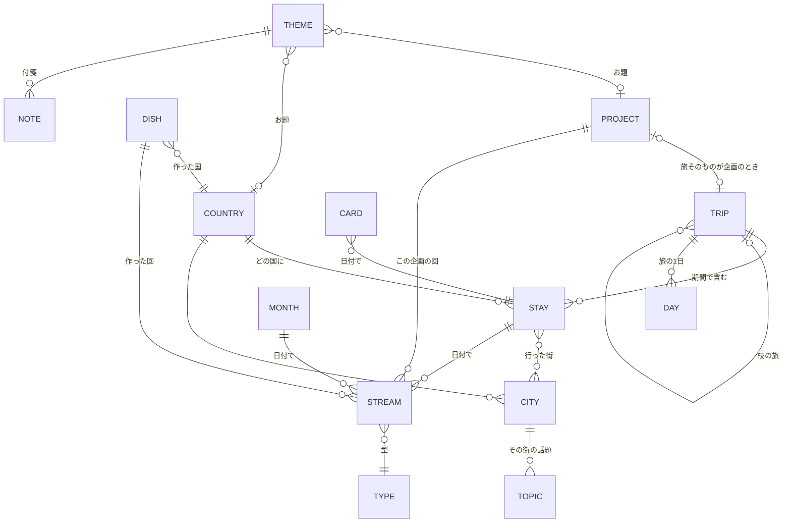

# 仕様: 種類と関係（あやと島に在るものと、その結ばれかた）

種別: 仕様

**これは仕様である。拘束力がある。** 面・表・道を足す前に読む。
変えるときは、先に決定の記録（[`docs/adr/`](../adr/README.md)）を1枚書き、同じ PR でここを直す。
経緯はここに書かない（決定の記録 0002・0003・0004・0007 が持つ）。

道の決まりは [`routes.md`](./routes.md)。Firestore と BigQuery の箱は [`../island-db.md`](../island-db.md)。

**ここに書いてあるのは「こう在るべき」で、まだそうなっていない所がある。** 8章に、条ごとの現状と、直す issue を並べてある。

---

## 1. 用語

| 語 | 意味 |
| --- | --- |
| 種類 | 島に在るものの型。面はちょうど1つの種類を持つ（3章の表） |
| 切り口 | 種類の属する軸。5つ（2章） |
| 持ち主 | その事実・文章・数字を書いてよい、ただ1つの種類 |
| 鍵 | ほかの種類を指す欄。名前の鍵（slug）と日付の2種類だけ |
| 札 | ほかの切り口のものを、題・1行・リンクで見せる部品。本文を持たない |
| 入口 | 島の建物9つ。道の上にかぶせる案内の層（[`routes.md`](./routes.md) 4章） |

## 2. 切り口

**M-1** 切り口は5つとする。種類は、ちょうど1つの切り口に属する。

| 切り口 | 答える問い | 時間との関係 |
| --- | --- | --- |
| 場所 | どこ。どんな所か | 時間を持たない |
| 旅 | いつ、どの順で回ったか | 時間を隙間なく割る |
| 企画 | 何をやったか。なぜ、どうなったか | 旅の上に重なる |
| 配信 | どんな放送を、いつやったか | 1回の放送／ひと月 |
| つくったもの | 何を作ったか | 作った日を持つ |

このほかに、人（あやと・住人）と、声（お題・付箋）が在る。

## 3. 種類

**M-2** 面は、下の表の種類をちょうど1つ持つ。表に無い種類の面は作らない。足すときは [`/feature-design`](../../.claude/skills/feature-design/SKILL.md) を通す。

| 種類 | 切り口 | 定義 | 主キー | 指す先（鍵） | 面 |
| --- | --- | --- | --- | --- | --- |
| 国 | 場所 | 入国した国 | slug | — | 在る |
| 街 | 場所 | 国の中の街・地点 | (国, slug) | 国（slug） | ガイドを書いた街だけ |
| 街の話題 | 場所 | 1つの街で完結する話（物価・見どころ・日帰りの遠出） | (国, 街, slug) | 街（slug） | 在る |
| 滞在 | 場所×旅 | ある国に居た、ひと続きの期間 | (国, 着いた日) | 国（slug）・行った街（slug の並び） | 無い |
| 旅 | 旅 | 名前のついた、ひと続きの周遊 | slug | 親の旅（slug。枝の旅だけ） | 在る（島） |
| 旅の1日 | 旅 | 旅の中の1日ぶんの記録 | (旅, 日付) | 旅（slug） | 記録を書いた日だけ |
| 企画 | 企画 | 名前のついた挑戦・祭り・節目。始まりと終わりが在る | slug | 旅（slug。旅そのものが企画のときだけ）・回（videoId の並び） | 在る |
| 配信1回 | 配信 | 1回の放送 | videoId | 日付 | 無い（YouTube へ出る） |
| 配信の型 | 配信 | くり返す放送の型 | slug | — | 在る |
| 月 | 配信 | 暦のひと月 | YYYY-MM | — | 在る |
| 料理 | つくったもの | 配信で作った1品 | slug | 作った国（slug）・作った日・回（videoId） | 在る |
| アプリ | つくったもの | 配信で作っているアプリ | slug | — | 在る |
| グッズ | つくったもの | 持って帰れるもの・店で買えるもの | id | — | 一覧だけ |
| カード | つくったもの | その日の写真1枚 | id | 日付・住人 | 一覧だけ |
| 住人 | 人 | 配信に集まる人と、そのキャラクター | チャンネル | — | 一覧だけ |
| お題 | 声 | 付箋を貼る先 | id | 企画（slug）か、国（slug）か、日付。どれも無くてよい。日を持つお題は、その日の配信の型（slug）も指せる（[ADR 0015](../adr/0015-dated-theme-names-stream-type.md)） | 掲示板の中 |
| 付箋 | 声 | 視聴者さんの1枚 | id | お題（id） | 掲示板の中 |

**M-3** 伝説は種類ではない。企画に付く印（殿堂入り）である。伝説の表を別に持たない。

**M-4** 移動と滞在は企画ではない。滞在の表に書く。

**M-5** 地域（ヨーロッパ・中東 など）は種類ではない。国を束ねる語彙は「旅」だけとする。

## 4. 関係

**M-6** 種類どうしを結ぶ鍵は、名前の鍵（slug）と日付の2種類だけとする。次のもので結ばない。
- リンク先の文字列（`href`）を表に手で書く
- 名前の文字が一致するかどうか
- 別々に付けた id が、たまたま同じ字であること

**M-7** 配信1回は、日付で滞在に結ばれる。その配信が「どの国から・どの旅の中か・どの月か」は、日付から引く。手で書かない。

## 5. 不変条件

書き出しの前に見張りが確かめる。外れたら書き出しを止める。

| 条 | 決まり |
| --- | --- |
| **M-10** | 本線の旅（親を持たない旅）は、最初の旅の始まりから今日まで、隙間も重なりも無く並ぶ |
| **M-11** | 枝の旅の期間は、親の旅の期間の中に収まる |
| **M-12** | 滞在は互いに重ならない。滞在は、本線の旅ちょうど1つの期間に収まる |
| **M-13** | 終わりの日が空の滞在は、多くて1つ。それが「いまここ」である |
| **M-14** | 配信の在る日は、ちょうど1つの滞在に入る |
| **M-15** | 名前の鍵の指す先が在る（国・街・旅・企画・お題） |
| **M-16** | 旅と1対1で結ぶ企画は、旅1つにつき多くて1つ |
| **M-17** | 国の一覧に、国でないものを置かない（国境の区間・地域・旅） |

## 6. 持ち主（どこに書くか）

**M-20** 同じ事実・同じ文章・同じ数字は、持ち主の1か所にだけ書く。ほかの面は、札で引くか、持ち主の値を読んで出す。書き写さない。

| 事実 | 持ち主 | 引いて出す側 |
| --- | --- | --- |
| いつ、どの国・街に居たか（予定を含む） | 滞在 | 表紙の「いまここ・つぎ」／国の「いつ居たか」／歩いた国の数／旅の「回った国」／案内の出し分け／毎晩の焼き直し |
| 旅の期間・名前 | 旅 | 島・歩いた国の束・月・数字 |
| その場所がどんな所か | 国・街・街の話題 | — |
| 企画の話（なぜ・決まり・名場面・結果）と、その数字（日数・距離・台数） | 企画 | 国・旅・あやとのこと の面は札と値で引く |
| 日ごとの道のり | 旅の1日 | 企画の面は札で引く |
| 料理そのもの | 料理 | 国・街・旅の面は札で引く |

**M-21** 国をまたぐ体験の話は、企画に書く。1つの街で完結する話は、街の話題に書く。日ごとの記録は、旅の1日に書く。

**M-22** 終わりの日を、見立てで書かない。決まっていなければ空にする。「いまここ」は、つぎの滞在が始まった日に入れ替わる。日付が過ぎただけでは消えない。

### 引きかた

| 出したいもの | 引きかた |
| --- | --- |
| いまここ | 終わりの日が空の滞在（M-13） |
| つぎ | 着く日が今日より先の滞在のうち、いちばん近いもの |
| 国が入る旅 | その国の滞在と、期間が重なる旅（1つの国が、いくつもの旅に出てよい） |
| 旅が回った国 | 期間が重なる滞在の国を、着いた順に |
| 国・街でやった企画 | 企画の期間と、滞在の期間が重なるもの |
| 旅の中の企画 | 企画の期間が、旅の期間と重なるもの。旅と1対1の企画は鍵で |
| 国・街・旅で作った料理 | 料理の「作った国」と「作った日」 |
| 月に居た国・旅・企画 | 月の期間と重なる滞在・旅・企画 |
| カードの日に居た所 | カードの日付が入る滞在 |

## 7. 状態

**M-30** 滞在と企画は、日付から状態が決まる。状態を表に手で書かない。

| 状態 | 滞在 | 企画 |
| --- | --- | --- |
| これから | 着く日が先 | 始まる日が先（日が決まっていないものも） |
| いま | 着いていて、終わりの日が空か先 | 始まっていて、終わっていない |
| おわった | 終わりの日を過ぎた | 終わった日を過ぎた |

**M-31** 「いまここ・つぎ・今夜」を面として言うのは、表紙だけとする。状態のための建物・面・道を作らない。

**M-32** 表紙の「これから」に出すのは、つぎの滞在・これからの企画・定例の配信のつぎの回、の3つとする。

## 8. 現状との差（2026-11-22）

仕様のとおりになっていない所。直ったら行を消す。

| 条 | いま | 直す issue |
| --- | --- | --- |
| M-5 | 表紙の島（`components/isle/cover.ts`）が `Country.region` を1か所読む。値はどの国にも入っていないので空を読むだけ。読む所が外れたら型の欄（`content/countries.ts`）ごと消す | #1276 |
| M-6 | `Theme.href` の直書き。国の「行った街」と街のガイドは名前の文字で結ぶ | #1357 |
| M-20 | 居場所を2か所に手書き（滞在の表・島の便りの `island/state.current`） | #1278 |
| M-31 | `/now`（いまどこ）が建物と面を持つ | #1278 |
| 札 | 料理→国、企画→国、企画↔料理、旅↔月、のリンクが無い（国→伝説の企画は、国の面のパスポートに1行だけ在る。`lib/projectsOf.ts`） | #1357 |
| 配信1回 | 表が無い。videoId が7つの焼き込みに別々に出る | 未定（足すときは `/feature-design`） |
