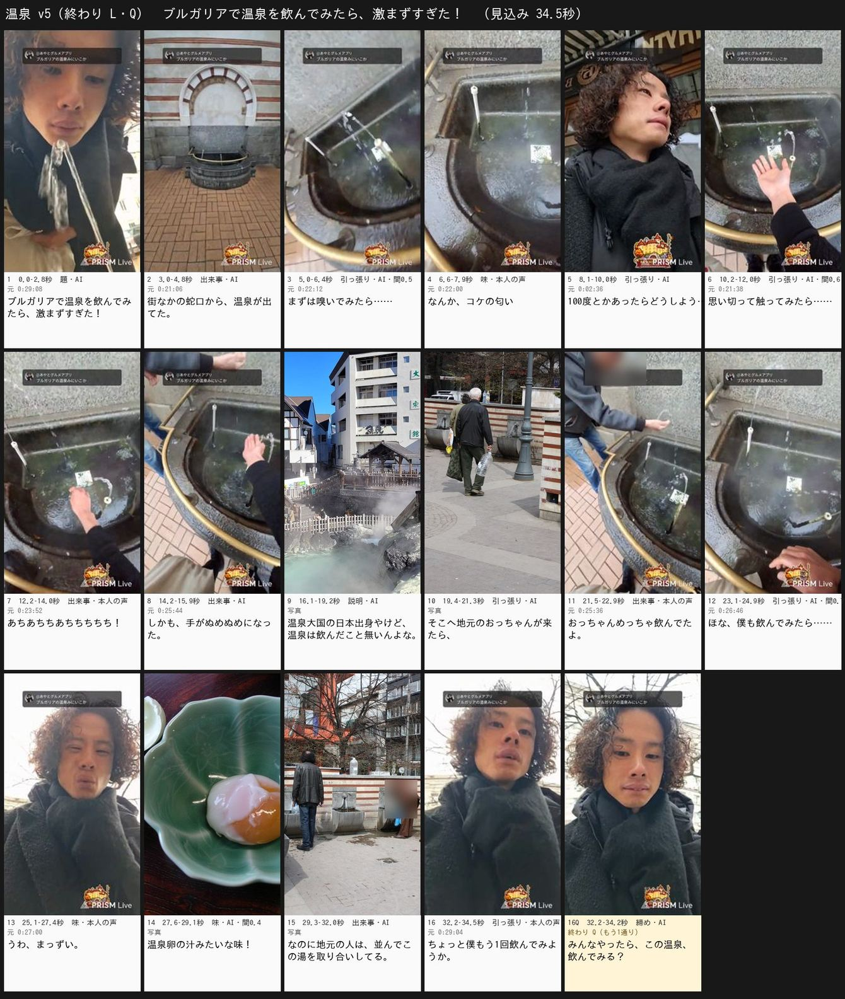

# 温泉の回 p1 v5（ons-p1-v5）— 新しい作りかたの原稿と絵コンテ（#1403 の試し・帳面 F-093）

**まだ声も書き出しもしていない。** 原稿と絵コンテだけ。いまの予約（v4g・11/25）には触っていない（`../spec.json`・`../script.txt` ほかは v4g のまま）。

- 下敷き: あやとの書き直し（#1270 [6978805149](https://github.com/Ayato-kosaka/live-streaming/issues/1270#issuecomment-6978805149)）の字と言い回し
- 当てた決まり: あやとの答え（#1403 [7106707630](https://github.com/Ayato-kosaka/live-streaming/issues/1403#issuecomment-7106707630)）の Q2〜Q5 と F-091、診断 `diagnosis_2026-11-23.md` の4章、C の R1〜R15
- 置いたもの: `script_L.txt`・`spec_L.json`（終わり L＝輪）／`script_Q.txt`・`spec_Q.json`（終わり Q＝問い）／`storyboard.jpg`（L の16コマ＋Q の終わり）
- 秒は見込み（AI の行は毎秒8.0字・行の間0.2秒・hold、本人の声は区間の長さ）。**見込み 約34.5秒**（v4g は 45.7秒）

## 原稿（L＝輪で終える版）

| # | 秒 | 行（字幕＝声） | 種類・開け閉め | 声 | 画（配信の時刻） | 間 |
| ---: | --- | --- | --- | --- | --- | --- |
| 1 | 0.0 | ブルガリアで温泉を飲んでみたら、激まずすぎた！ | 題・o | AI | 0:29:08 蛇口の湯が弧を描いて口に入る → 1.3秒で 0:29:18 歯を見せてしかめる | |
| 2 | 3.0 | 街なかの蛇口から、温泉が出てた。 | 出来事・oc | AI | 0:21:06 縞模様の壁のアーチの下の湯船へ近づく → 0:21:16 湯気の立つ蛇口。札「◆ソフィア（温泉が49か所の街）」 | |
| 3 | 5.0 | まずは嗅いでみたら…… | 引っ張り・o | AI | 0:22:12 湯面へ顔を近づける | 0.5秒 |
| 4 | 6.6 | なんか、コケの匂い | 味・c | **本人** 0:22:00.0〜0:22:00.5＋0:22:01.45〜0:22:02.2 | 同じ秒の湯気の立つ湯船 | |
| 5 | 8.1 | 100度とかあったらどうしよう…… | 引っ張り（数）・o | AI | 0:02:36 見上げる本人の顔 | |
| 6 | 10.2 | 思い切って触ってみたら…… | 引っ張り・o | AI | 0:21:38 湯へ手のひらを差し出す | 0.6秒 |
| 7 | 12.2 | あちあちちあちちちちち！ | 出来事・c | **本人** 0:23:52.55〜0:23:54.4 | 同じ秒の湯に手を当てる所 | |
| 8 | 14.2 | しかも、手がぬめぬめになった。 | 出来事・o | AI | 0:25:43.5 濡れて光る手のひら | |
| 9 | 16.1 | 温泉大国の日本出身やけど、温泉は飲んだこと無いんよな。 | 説明・o | AI | 写真 草津の湯畑 → 0:02:29 話す本人 | |
| 10 | 19.4 | そこへ地元のおっちゃんが来たら、 | 引っ張り・o | AI | 写真 ボトルを持って蛇口へ歩く男性の後ろ姿 | |
| 11 | 21.5 | おっちゃんめっちゃ飲んでたよ。 | 出来事・oc | **本人** 0:26:04.95〜0:26:06.4 | 0:25:36 地元の人が湯を手で受ける（顔は外へ寄せる）→ 写真 蛇口にかがんで飲む男性の後ろ姿 | |
| 12 | 23.1 | ほな、僕も飲んでみたら…… | 引っ張り・o | AI | 0:26:46 湯船に身をかがめる | 0.7秒 |
| 13 | 25.1 | うわ、まっずい。 | 味・c | **本人** 0:26:51.35〜0:26:53.7 | 0:27:00 1回目に飲んだあとの顔 | |
| 14 | 27.6 | 温泉卵の汁みたいな味！【答】 | 味・c | AI | 写真 器の中の温泉卵 | 0.4秒 |
| 15 | 29.3 | なのに地元の人は、並んでこの湯を取り合いしてる。 | 出来事・o | AI | 写真 蛇口に並んで湯を汲む人（後ろ姿） | |
| 16L | 32.2 | ちょっと僕もう1回飲んでみようか。 | 引っ張り・o | **本人** 0:29:02.8〜0:29:04.3 | 同じ秒の本人 → 0:29:06.9 蛇口へかがむ所で切る → **0秒目の 0:29:07 へつながる** | 1.0秒 |
| 16Q | 32.2 | みんなやったら、この温泉、飲んでみる？ | 締め・o | AI | 0:29:00 カメラに向かう本人 → 終わりの札 | |

行ごとの根拠の秒・残した本人の言葉・選んだ理由は `spec_L.json` の `why`・`kept`・`reason`。

## 0〜8秒の前と後

| | v4g（いまの予約） | v5 |
| --- | --- | --- |
| 0秒目 | 蛇口から直に飲む → しかめ顔（出来事） | 同じ（もう出来事だったので変えない） |
| 題の直後（3秒〜） | やってきたのは、ブルガリアの首都ソフィア！（前置き） | 街なかの蛇口から、温泉が出てた。（出来事）。街の名前と「温泉の上の街」は場所の札へ |
| 5〜8秒 | この街、温泉の上に建ってるらしい！→ 温泉大国の日本出身やけど、（説明2行） | まずは嗅いでみたら……→〔本人の声〕なんか、コケの匂い |
| 0〜8秒の本人の声 | 無（最初は7行目の後半・14秒ごろ） | 6.6秒 |
| 数 | 3〜8秒に無し | 100度（8.1秒） |
| 最初の出来事 | 18.3秒「あ、これや！湯気が出てる！」 | 3.0秒 |

## 答えのあとと終わり

- 題の答え（14行目「温泉卵の汁みたいな味！」）は尺の約80%。答えの直後の15行目「なのに地元の人は、並んでこの湯を取り合いしてる。」で次の問い（なんで？）を開く（v4g と同じ行。Q3 で答えのあとを開く形は、この回はもうできていた）
- **終わり L（輪）**: 本人の声「ちょっと僕もう1回飲んでみようか。」で切る。声は0秒目の「飲んでみたら、激まずすぎた！」へ、画は 0:29:06.9（蛇口へかがむ）で切って0秒目の 0:29:07（同じ2回目の飲み）へつながる。配信の順も「地元の人が持って帰る（0:28:30）→ もう1回飲む（0:29:02）」のとおり
- **終わり Q（問い）**: あやとの字「みんなやったら、この温泉、飲んでみる？」
- こちらの推し: **L**。出した37本は最後の問いの行で2割強が去り、2周目に入った本は0本（A）。L は最後の言葉と画が0秒目に続くように作れる、この回にしか無い終わり

## 話し方の数字

| | v4g | v5 |
| --- | --- | --- |
| 行 | 21 | 16（L・Q とも） |
| 「！」で終わる行（題を除く） | 12/19 | 2/15（あちあち・温泉卵） |
| 起きたことの言い切り（〜た。〜てる。） | — | 2・8・11・15行目 |
| 行の間 | 全部 0.27秒 | ふつう 0.2秒、山の前 0.5・0.6・0.7秒（3・6・12行目のあと）、答えのあと 0.4秒 |
| 本人の声 | 5か所（最初 14秒ごろ） | 5か所（L）・4か所（Q）。最初 6.6秒 |
| 速さ | tempo 1.4 | 変えない（1.4） |

## あやとの書き直しから変えた所

| あやとの行 | v5 | なぜ |
| --- | --- | --- |
| やってきたのは、ブルガリアの首都ソフィア！ | 場所の札「◆ソフィア（温泉が49か所の街）」 | Q2（題の直後に前置きを置かない）。49か所は英語版ウィキペディア「Sofia」 |
| この街、温泉の上に建ってるらしい！ | 同じ札へ | 同上 |
| 温泉大国の日本出身やけど、／温泉を飲んだことは無いんよな。 | 9行目に1行で（飲む直前） | なぜ（F-070）を飲む直前の懸けに。1人目の批評役が「前置き2行で少し緩む」 |
| 歩いて着いたら、／え、これが温泉の建物？めっちゃ素敵！／温泉の出る蛇口もあるらしくて、探したら……／あ、これや！湯気が出てる！ | 2行目「街なかの蛇口から、温泉が出てた。」に畳み、建物と湯気は画で見せる | 出来事を3秒目に。建物の行は反応で、題の約束（飲む）から遠い |
| 嗅いでみたら、コケの匂い！ | まずは嗅いでみたら……／〔本人の声〕なんか、コケの匂い | 嗅ぐ→触る→飲むの3段を同じ形（〜てみたら……→本人の声）で重ねる（R10） |
| しかも、手がぬめぬめや！ | しかも、手がぬめぬめになった。 | 「！」は山だけ。起きたことは「〜た。」で（話し方の目線合わせ） |
| え、この湯をめっちゃ飲んでる！ | 〔本人の声〕おっちゃんめっちゃ飲んでたよ。 | v4g と同じ本人の声。画を飲む動きに替えた（2人目の批評役） |
| ほな、僕も飲んでみる！ | ほな、僕も飲んでみたら…… | 3段目の引っ張り。山の前の間 |
| うわ、まずいわ！ | 〔本人の声〕うわ、まっずい。 | v4g と同じ区間 |
| 温泉卵の汁みたいな味する！ | 温泉卵の汁みたいな味！ | 短く。「！」は題の答えのここ |
| なのに地元の人は、並んでこの湯を取り合いしてる！ | 同じ（「！」→「。」） | 答えのあと次を開く行 |
| みんなやったら、この温泉、飲んでみる？ | Q はそのまま／L は本人の声の輪 | F-091 |

## 関所

- **lint**（いまの `tools/shorts/script/lint.py`）: L・Q とも ✕ 0。△ 4: L-WIDE（9・15行目と Q の16行目が16字を越える。9・15行目は意味が切れるので割らない）・L-AFTER（15行目は答えのあとの行＝Q3 の試しで置いた行）・L-END（L の終わりは問いではない＝F-091。あやと「終わりは臨機応変に」）
- **批評役**（`critic.py`・claude -p・high）
  - 1人目（L）: ✕1「3行目（100度）の問いを7行目で答える前に、嗅ぐ話へ移る」→ **採った**: 配信の順（嗅ぐ → 熱さが怖い → 触る）に並べ替え。点 a5 b4 c4 d4 e4 f4。「9〜10行目の前置き2行で少し緩む」→ **採った**: 1行に畳んだ
  - 2人目（L・直したあと）: ✕1「11行目、飲んでたと言うが画は手を伸ばす所」（F-014）→ **採った**: 画を、湯を手で受ける所＋蛇口にかがんで飲む男性の写真に。字は変えていない。点 a4 b4 c4 d4 e4 f4・跳 0・取消 0・当てた約束 45
  - Q は終わりの1行だけが違い、あやとの字なので批評役に回していない（7.3 の上限）

## 本人の声の区間

| 行 | 区間 | 確かめ |
| ---: | --- | --- |
| 4 | 0:22:00.0〜0:22:00.5＋0:22:01.45〜0:22:02.2 | v4g で whisper と自動字幕を突き合わせ済み |
| 7 | 0:23:52.55〜0:23:54.4 | v4g と同じ（whisper「あっつ」・自動字幕「あち」で割れた所。耳で確かめる） |
| 11 | 0:26:04.95〜0:26:06.4 | v4g で一致 |
| 13 | 0:26:51.35〜0:26:53.7 | v4g で whisper「うわ、まっずい」 |
| 16L | 0:29:02.8〜0:29:04.3 | **新しい区間。自動字幕の語の時刻（ちょっと 0:29:02.84 〜 か。0:29:04.08）で切った。whisper は声の段で**。直前の書き込みの読み上げは入れない。聞き取れなければ AI の声で同じ字 |

## 迷った所（あやとに見本で聞くなら）

1. **終わり: L（輪）か Q（問い）か。** 絵コンテの最後の2コマ
2. 9行目を1行に畳んだ（あやとの2行 → 1行・25字）。割るなら「温泉大国の日本出身やけど、／温泉は飲んだこと無いんよな。」に戻す（＋0.7秒）
3. テロップ・効果音は、F の軸（`teko/F_axis.md`）を当てる段で決める。spec の `big` の印は v4g のまま仮
