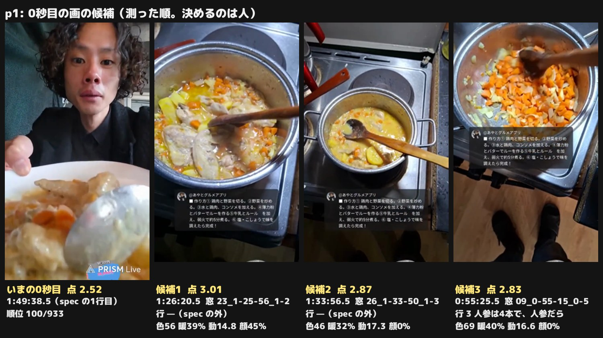
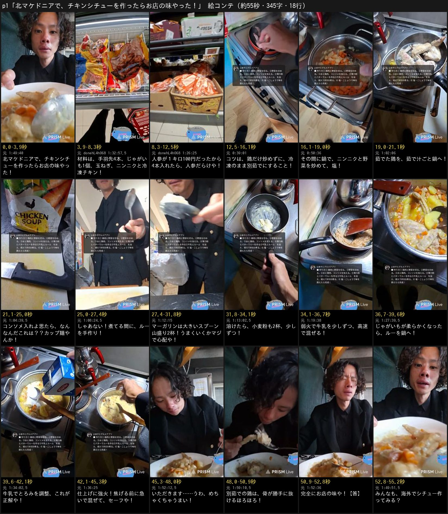

# 北マケドニアのアサリ抜きクラムチャウダー p1 — 「🇲🇰北マケドニアで、アサリ抜きクラムチャウダーを作ったらお店の味やった！」の原稿

制作 issue は #1108。視聴者さんの付箋の頼み（要約）: 10/16 にクラムチャウダーを作った回の、材料を入れるところと煮込むところ——**鶏と野菜を別々に煮て、ルーを入れて煮る流れ**を、**見た人がみんな作れる**ショートにしてほしい。付箋の画像は使わない（あやと 2026-11-04・チャット）。
**1次は原稿だけ。** 本編集・声はまだ作らない（あやとが原稿に返事をしてから）。返事を待つあいだに素材を取り込み、行ごとの画・0秒目・絵コンテを足した（6章。原稿の字は1次のまま）。

| | |
| --- | --- |
| 配信 | [E2oGYjnVQSA](https://www.youtube.com/watch?v=E2oGYjnVQSA)（2026-10-16 22:13 JST「北マケドニアでグラムチャウダー作ります」。スコピエの宿の台所、外出なし）。2行目の前提だけ前日の [CKJvprUMOgA](https://www.youtube.com/watch?v=CKJvprUMOgA)（10-15 22:01。スーパーでアサリを見送る所） |
| 型 | **レシピ**（配信アーカイブを本人の一人称で語る、ふだんの回の型。F-052 の「別の型」ではない）。材料と分量・手順の順番・火加減を、配信で本人が言った・見せたとおりに1行1手順で。言っていない分量は書かない |
| 題の札 | **🇲🇰北マケドニアで、アサリ抜きクラムチャウダーを作ったらお店の味やった！**（0〜4.0秒・黒い箱。国旗は `flags.py emoji 北マケドニア`） |
| 1行目 | 題の札をそのまま読む（F-047） |
| 作る数 | 1案（付箋が場面と型を決めているので） |
| 原稿 | **19行・343字・見積もり 54.9秒**（上限の倍率で毎秒6.8字・行の間0.25秒。素材で確かめたあと10・11・15行を直した版。10章） |
| 機械の検査 | `lint.py` **✕ 0**・△ 3（1行目＝題の札が4.6秒・10行目が4.1秒・16行目「いただきます」の「ます」）／批評役1人目 ✕ 1（F-014）→ 直す → 2人目 ✕ 1（F-056）→ 直し案のとおり直した（直しは2回まで・3人目は呼ばない）。そのあと、チャットとの突き合わせで、本人の言葉に見えた2か所が視聴者さんの書き込みの読み上げだったと分かり、本人の言葉に替えた（10 章） |

**外した範囲（F-059 の書きかたで）:** 寝坊の謝罪会見と前日の夕日（0:00〜0:12:30）、宿の日本人の人・ほかの国の人とのやり取り（0:23:30・0:40:30・1:36:30）、
水が残った鍋に油を入れて跳ねた所（0:35:30）、手羽先が3つのつもりで4つだった所（0:42:00。数の「4本」だけ残した）、人参の切りかたの工夫（0:46:30〜0:54:00）、
小麦粉の色が白くない（1:14:30）、牛乳パックの開けかた（1:18:00〜1:19:30）、牛乳を入れすぎて焦げかけた所（1:20:30）、ルーを一度ふつふつさせて火を止める所（1:26:30。尺のため）、
胡椒を入れ忘れて後から足した所（1:56:00）、料理の採点（1:57:00〜。人の問いに答えた採点で、店の名前を出す比べになる）、残りをペンネ・グラタンにする話（2:00:30〜）、疲れの話と告知（2:10:00〜）。
前日の回からは、アサリを見送る所だけを使い、ルーレットで料理が決まる所（1:19:30〜1:20:30）とカニ・マッシュルームの案は入れていない。

## 0. 伝えたいこと・前提・参考

- **伝えたいこと（1行）:** 鶏だけ別茹でにして、ルーをマーガリンと小麦粉から手で作れば、旅先の宿の台所でもお店の味のシチューになる
- **見る人とそろえる前提（`script_writing.md` 0.7）:**
  - **クラムチャウダーなのにアサリが無い。** 題で「アサリ抜き」（本人の言い方。前日 1:22:30「貝がなかったらクラムチャウダーあさり抜きにします」・当日 0:14:00）と先に言い、2行目（4.8秒〜）で「アサリが高すぎて鶏にした → ほぼクリームシチュー」と答える。見る人は「何を作る動画か」を、5秒で日本の言葉（クリームシチュー）で持てる
  - **日本で「ルー」は市販の固まり。** 9行目で「ルーを手作り」と言ってから、10〜12行目でマーガリンと小麦粉から作る所を見せる（本人も 1:51:30「市販のルーみたいな固形になるんかと思ってた」）
- **筋（`planning.md` 1.7）:** アサリを諦めて鶏で作る（スーパー）→ 材料 → 鶏だけ別茹で・野菜は鍋で炒める（コンロ）→ 鶏を茹で汁ごと合わせる → カップ麺の取り違え → ルーを手作り（フライパン）→ 鍋に入れて仕上げる → 食べたら骨が抜けるほろほろ → お店の味 → 問い。段ごとに場面が変わる（冷凍棚 → まな板 → 鍋 → フライパン → 鍋 → 皿と顔）
- **土台 → 山 → 結末 → 問い（F-022）:** 土台 2〜4行（アサリを諦めて鶏・材料）／山 8〜12行（コンソメのつもりがカップ麺 → ルーを手作り）／結末 16〜18行（ひと口・ほろほろ・お店の味。18行が【答】）／問い 19行
- **前ふりと回収:** 5行目「コツは、鶏だけ炒めずに、冷凍のまま別茹でにすること！」→ 17行目「別茹での鶏は、骨が勝手に抜けるほろほろ！」→ 19行目の問い「鶏を別茹でして作ってみる？」。コツは本人が食べたあとに言ったこと（2:01:30）を、手順の頭へ移した（方針2）

### 写す参考（`script_writing.md` 7.1）: f8t（インド料理を素手で）と vJo（伊勢海老）

f8t は「枠を宣言して、段を上げながら手を動かし、段ごとに1つツッコむ」が、レシピの手順の並べかたに合う。vJo は「思てたら外れ → すぐ次へ」が、カップ麺の1行に合う。

| 秒 | 参考のその拍で起きること | この原稿の行 | 写すもの | 写さないもの |
| --- | --- | --- | --- | --- |
| 0〜4.6 | f8t・vJo 0〜2: 題の札。画は出来上がりの料理・手元 | 1 | 題の札の下に、出来上がったシチューの画（答えを先に見せる） | 「〜したい！」の札の形（あやとの回は場所と出来事で言い切る） |
| 4.8〜8.2 | vJo 3〜4: 値段に驚く → 1語で決める | 2 | 値段の壁（アサリが高い）→ すぐ決める（鶏にした → ほぼシチュー） | 値段の数（F-056） |
| 8.4〜17.3 | f8t 13〜15: 枠を宣言 | 3〜5 | 材料 → ツッコミ1つ（人参だらけ）→「コツは〜」で見続ける枠を1行で決める | 講座の名前・番号 |
| 17.6〜22.2 | f8t 16〜23: 決まりを順に → ツッコむ | 6〜7 | 手順を1行1つ（炒める・茹で汁ごと合わせる） | — |
| 22.5〜27.4 | vJo 16〜26: 思てたら → 外れ（状況が動く）→ 失敗のすぐあとに次へ | 8〜9 | 「入れよ思たら、カップ麺やった！」→「しゃあない！」で閉じて次の段へ | 人に聞いた話 |
| 27.4〜45.4 | f8t 24〜34: 「次！」で段を上げる → 手を動かす → ツッコミ / f8t 35〜40: 意気込み → 結果 | 9〜15 | ルーの段へ移る（転）→ 分量と本人の心配（うまくいくかマジで心配や）→ 手順 → 心配への答え（これが正解や） | 「中級編」の札・調子に乗った一言（本人は心配していたので） |
| 45.7〜52.5 | f8t 41〜44: 頂点の1語 | 16〜18 | ひと口の声 → 前ふりの回収（ほろほろ）→ 題の答え（お店の味） | — |
| 52.8〜55.1 | f8t 60〜61: 「みんな」への問い | 19 | 題の約束（作れる）を、コツを入れた問いで返す | — |

### 途中のハプニングを入れるか（依頼の「作れる動画の邪魔にならない範囲で」）

| ハプニング | 配信の時刻 | 入れたか | 理由 |
| --- | --- | --- | --- |
| コンソメのつもりで開けたらカップ麺だった | 1:03:30〜1:05:30 | **入れた（8行目＋9行目の「しゃあない！」）** | コンソメを入れる手順そのものを言う行なので、作る人は「ここでコンソメ」と受け取れる。約5秒で、手順が続く真ん中（22〜27秒）に笑いを1つ置ける。味にも響いていない（1:55:00「全くパスタ感じひん」）ので、真似する人を迷わせない |
| 牛乳を入れすぎて焦げかけた | 1:20:30〜1:21:00 | 外した | 12行目「牛乳を少しずつ」・14行目「牛乳でとろみを調整」と並べると、入れすぎたのに牛乳を足すように聞こえて、作る人が迷う |
| 牛乳パックの開けかたが分からない | 1:18:00〜1:19:30 | 外した | 作りかたに関わらない。手順の途中で話が逸れる |
| 手羽先が3つのつもりで4つ | 0:42:00〜0:42:30 | 外した（数の「4本」だけ） | 笑いが小さく、作る人に要るのは数だけ |
| 小麦粉が白くない | 1:14:30〜1:16:30 | 外した | 理由が分からないまま終わり、作る人を不安にさせる |

## 1. 原稿（19行）

```
北マケドニアで、アサリ抜きクラムチャウダーを作ったらお店の味やった！
アサリが高すぎて鶏にしたから、ほぼクリームシチューや！
材料は、手羽先4本、じゃがいも1個、玉ねぎ、ニンニク！
人参は4本で、人参だらけや！
コツは、鶏だけ炒めずに、冷凍のまま別茹でにすること！
その間に鍋で、ニンニクと野菜を炒めて、塩！
茹でた鶏を、茹で汁ごと鍋へ！
コンソメ入れよ思たら、カップ麺やった！
しゃあない！煮てる間に、ルーを手作り！
マーガリンを大きいスプーン山盛り2杯！うまくいくかマジで心配や！
溶けたら、小麦粉も2杯、少しずつ！
弱火で牛乳を少しずつ、高速で混ぜる！
じゃがいもが柔らかくなったら、ルーを鍋へ！
牛乳でとろみを調整、これが正解や！
仕上げに強火！焦げる前に急いで混ぜて、セーフや！
いただきます……うわ、めちゃくちゃうまい！
別茹での鶏は、骨が勝手に抜けるほろほろ！
完全にお店の味や！【答】
みんなも、鶏を別茹でして作ってみる？
```

## 2. 1行ずつ4欄（＋画）

「元の出来事」の時刻は、この回 E2oGYjnVQSA の中の時刻（2行目だけ前日の回）。「使う画」は 2026-11-04 に素材を取り込んで、写っているのを確かめた秒（6章。spec の `src`・`still` と同じ）。前日の回の画は「前日 CKJvprUMOgA の」と書いた。

| # | 元の出来事（配信の時刻） | 見る人に届く文（読み上げる字） | 残した本人の言葉 | 選んだ理由 | 使う画（素材で確かめた秒） | 読まない札 |
| ---: | --- | --- | --- | --- | --- | --- |
| 1 | 題の札をそのまま読む（F-047）。1:52:30「あのお店の味です。完全に」・0:14:00「クラムチャウダーあさり抜き、…チキンクリームシチューみたいな感じで行こうと思います」 | 北マケドニアで、アサリ抜きクラムチャウダーを作ったらお店の味やった！ | お店の味 | 答え（お店の味）を札で先に言い、0秒目の画で出来上がりを見せる。「アサリ抜き」で何が変かを1語で立て、2行目ですぐ答える（F-031・F-008） | 【0秒目・hook.py で点 2.52（933コマ中100位）。上位3つはルーを入れる前の鍋・牛乳を足す途中の鍋・人参の鍋で、出来上がりではないので選ばない】1:49:38.5〜1:49:41.3 出来上がったシチューの皿をカメラの前へ突き出す（にんじん・じゃがいも・手羽先とスプーン。皿が画面の下半分、上に本人の顔）→ 1:35:26〜1:35:28 鍋のとろりとしたシチューをスプーンで持ち上げる寄り（手羽先とにんじんが見える）。題の札の下 |  |
| 2 | 前日の回（CKJvprUMOgA）の1時間38分30秒〜1時間44分30秒: 冷凍のアサリを手に「1000円もするわ」→「あさりはやめよう。やっぱ高いわ」→「まあ鶏肉あるからええやろ」。この回 0:14:00「クラムチャウダーあさり抜き、シチュー、クリームシチュー、チキンクリームシチューみたいな感じで行こうと思います」 | アサリが高すぎて鶏にしたから、ほぼクリームシチューや！ | クリームシチュー（0:14:00 の本人の言い方） | 題の「アサリ抜き」の「？」に、5秒目で答える（0.7）。何を作る動画かを「ほぼクリームシチュー」と日本の言葉でそろえる。値段の数は言わない（F-056） | 前日 CKJvprUMOgA の 1:38:35〜1:38:36.6 スーパーの冷凍ケースで、殻つきアサリの袋（青い波の絵）を指さす→ 前日 1:43:48〜1:43:49 空の赤いカゴを持って冷凍ケースの通路を歩き去る（人は写らない）→ 1:30:46.5〜1:30:47.5 鍋に入れた白いルーが溶けて、クリームシチューになっていく所 |  |
| 3 | 0:38:00〜0:39:00 冷凍の手羽先を出して鍋へ・0:42:30「僕3つ入れたよね。気づけば4つに増えてます」・0:56:30「じゃがいも1個しか持ってない」・0:33:00「玉ねぎ切っていきます」・0:39:30「ニンニクを（ひとかけ）入れます」 | 材料は、手羽先4本、じゃがいも1個、玉ねぎ、ニンニク！ |  | 見た人が作れるよう、本人が言った数だけを付ける（手羽先は入れた4本・じゃがいもは1個）。玉ねぎとニンニクは数を言っていないので付けない（X2） | 0:42:44〜0:42:45.3 赤いフライパンの湯の中の手羽先（木べらで1本持ち上げ、残り3本が湯に沈む。湯は泡立っている）→ 0:57:27〜0:57:28.1 じゃがいもを包丁でむく手元 → 0:36:28〜0:36:29.1 玉ねぎを切る手元。ニンニクは写る画が小さいので画に出さない |  |
| 4 | 0:44:00「4本ぐらいいっちゃうよ」→ 0:45:30「3本で1回様子見」→ 0:51:30「もう1本行っとこう。念のために」→ 0:55:00「ニンジンだらけシチューになってんけど」 | 人参は4本で、人参だらけや！ | 人参だらけ（「ニンジンだらけシチュー」） | 材料の数（人参4本）に、本人のツッコミを同じ行で返す。情報の行が続く頭に、1つ笑いを置く（方針4・2〜3秒ごとに反応） | 0:52:36〜0:52:37 4本目の人参を縦横に切って刻む手元 → 0:55:24〜0:55:25 鍋いっぱいの角切りの人参（上から） |  |
| 5 | 0:21:00「鶏肉冷凍のままやねんけどさ」・0:22:00「確かに鶏肉炒める必要ないもんね」・0:28:00「（一緒に茹でると）野菜が炒められへんから」・0:37:30〜0:39:00 固まった冷凍の手羽先を水の鍋へ・2:01:30「別で1回茹でたから多分茹で時間が超長くて、だからあのこんだけホロホロになってる」「（1人やと）2個も使うの…めんどくさいが勝つ…1個でやっちゃう、だから美味しくならへん」 | コツは、鶏だけ炒めずに、冷凍のまま別茹でにすること！ |  | 付箋の頼みの核（鶏と野菜を別々に煮る）を、手順の頭でコツとして1行で言う。本人が食べたあとに言ったコツ（2:01:30）を前へ移し、17行目で回収する（方針2・前ふり）。ふつうは鶏も炒めるので「炒めずに」「冷凍のまま」も同じ行に入れる（批評役2人目の F-056: 2行に分けると言い直しになる） | 0:38:58〜0:38:59.4 袋から出した、凍って固まったままの手羽先を手に持つ → 0:39:00.2〜0:39:02.4 それを赤いフライパン（鶏だけの器）に入れる |  |
| 6 | 0:39:30「ニンニクを（ひとかけ）入れます」・0:49:00「急がへんかったら玉ねぎは焦げちゃう」・0:50:30「すごくいい匂いしてるよ」・1:01:00「ニンニクも入ってて、もうすっごいいい匂いが来てるよ。で、塩ね」・1:01:30「そしたら炒めて」 | その間に鍋で、ニンニクと野菜を炒めて、塩！ |  | 2つ目の鍋の手順を1行に畳む。野菜を入れる順や切りかたの試行錯誤は外す（F-056・方針4） | 0:42:01.5〜0:42:03 鍋の玉ねぎ（ニンニクも同じまな板から 0:41:25〜0:41:30 に入れた）を木べらで炒める→ 0:50:38.5〜0:50:39.9 人参も入った鍋を炒める。塩を振る手元は写っていない（1:01:24 は声だけ） |  |
| 7 | 1:01:30〜1:02:30 茹でた手羽先と茹で汁を、野菜の鍋に入れる（1:02:00「行ってらっしゃい」・1:02:30「もうちょいきます…牛乳入れるから…足しとこ」）・1:03:00「鶏出汁まで行っちゃいました」 | 茹でた鶏を、茹で汁ごと鍋へ！ |  | 茹で汁を水の代わりに使う所が、見た人が真似する要。2つの鍋が1つになる所を1行で見せる | 1:02:04.3〜1:02:06.3 フライパンで茹でた手羽先を、茹で汁ごと傾けて野菜の鍋へ流し入れる（汁が見える） |  |
| 8 | 1:03:30「この前買ったこのチキンスープ…チキンコンソメみたいな…入れてみる」→ 1:04:00「パスタみたいの入ってんねんけど…これカップラーメンやん」・1:04:30「間違えた…完全にパスタ入ってるよ」 | コンソメ入れよ思たら、カップ麺やった！ | カップ麺（「これカップラーメンやん」） | コンソメを入れる手順を言いながら、外の国の袋を読み違えた笑いを1つだけ残す（方針4・vJo の「思てたら」）。題の答えには関わらないので1行で済ます | 1:04:38.5〜1:04:40 袋の表（CHICKEN SOUP の字と鶏の絵）→ 1:04:28〜1:04:29.25 開けた袋から手のひらに出した黄色い乾麺 |  |
| 9 | 1:05:00「もうしゃあない…ちょっと入れとくよ」・1:05:30「このくらいじゃあ入れときます」・1:06:00「じゃあ今からルー作ってきます」・1:07:30 フライパンを出す | しゃあない！煮てる間に、ルーを手作り！ | しゃあない | カップ麺の行を本人の口ぐせで閉じ、すぐ次の段（ルー）へ移る（F-054・転）。「ルーを手作り」で、市販のルーではないと先に言う（0.7） | 1:05:35.5〜1:05:36.8 袋の中身を鍋に入れる → 1:14:12〜1:14:13.2 小麦粉の袋（麦の絵）を手に持つ（ルーの材料） |  |
| 10 | 1:10:13「バターと小麦粉やんな」・1:10:34「いや、これがうまくいくかマジで心配や」・1:08:23〜1:08:32 使う大きいスプーンを持ち上げて見せる・1:12:14「1杯目」・1:12:28「2杯目」（どちらもスプーンからはみ出す山盛り）。包みは青い字で Margarin（1:12:00〜1:12:12。前日 CKJvprUMOgA の1時間53分50秒「バターが結構高いんで。マーガリンにしますね」）。本人は当日ずっと「バター」と呼ぶが、使ったのはマーガリン。0:15:00（読み上げたレシピ）「バター30g溶かして薄力粉30g」 | マーガリンを大きいスプーン山盛り2杯！うまくいくかマジで心配や！ | うまくいくかマジで心配や | 分量を本人の量りかた（大きいスプーン山盛り2杯）で言い、レシピの g は読まない札に回す。使った物は画と包みの字のとおりマーガリンと言う（X2）。初めて手で作るルーの前の本人の心配を同じ行で言い、14行目「これが正解や」で答える（方針2: 危なくなる前に言う）。分量の行の画は分量が見える手元（F-061） | 1:08:23.5〜1:08:25 使う大きいスプーンを持ち上げて見せる → 1:12:14.6〜1:12:16 1杯目、スプーンからはみ出す山盛りのマーガリン→ 1:12:27.7〜1:12:29.2 2杯目の山盛り。包みは Margarin（1:12:00〜1:12:12 に字が写る） | レシピでは バター・小麦粉 各30g |
| 11 | 1:12:57「これで弱火にして」・1:13:01 フライパンで溶けたマーガリン・1:15:28「まず1杯目」・1:15:39 小麦粉をスプーンで落とす・1:15:47「慎重に行ったよ」・1:15:53「2杯目」・1:16:00 2杯目を落とす。火を止めたとは言っていない（画にも無い） | 溶けたら、小麦粉も2杯、少しずつ！ |  | 溶けたのを合図に、小麦粉を2杯に分けて入れる所を1行に（F-061）。火を止めたかは本人も言わず画にも無いので、火加減は言わない（X2。火加減は12行目の「弱火で」で本人の言葉どおりに言う） | 1:13:01.8〜1:13:02.6 フライパンで溶けたマーガリン → 1:15:39.1〜1:15:39.9 小麦粉の1杯目をスプーンで落とす → 1:16:00.2〜1:16:01 2杯目 |  |
| 12 | 1:17:00〜1:17:30 弱火にして、フライパンのルーを速く混ぜる（本人「高速ワンハンドです」）・牛乳を少し足す・1:21:30「牛乳足してもう1周する」 | 弱火で牛乳を少しずつ、高速で混ぜる！ |  | 火加減（弱火）と牛乳の入れかた（少しずつ）を言い、手の速さは画で見せる。牛乳パックの開けかたで迷った所と、入れすぎた所は外す（F-056・作る人を迷わせない） | 1:19:37〜1:19:38.3 牛乳のパックからフライパンのルーへ少し注ぐ → 1:17:40.5〜1:17:41.8 木べらでフライパンのルーを速く混ぜる（「高速ワンハンドです」の所） |  |
| 13 | 1:27:30「1回じゃがいも柔らかくチェック。いい感じやと思う」・1:28:00〜1:30:30 フライパンのルーを鍋に入れる（1:30:30「入れました。で、これを混ぜてけばいいよね」） | じゃがいもが柔らかくなったら、ルーを鍋へ！ |  | ルーを入れる合図（じゃがいもが柔らかい）を言う。付箋の頼みの「ルーを入れて煮る」の所（転: フライパンから鍋へ戻る） | 1:27:38.5〜1:27:40 鍋のじゃがいもを木べらで確かめる → 1:30:16〜1:30:17.4 フライパンを傾けて、ルーをオレンジのへらで鍋に落とす（正面の画） |  |
| 14 | 1:32:00「なんかあの水が少ない気がする」・1:33:30 レシピの牛乳の量を見て「300ml。じゃ、もうちょっと牛乳」を足す・1:34:30「とろみもこんなもんな気がしてきた…めちゃくちゃ美味しい。これが正解や」 | 牛乳でとろみを調整、これが正解や！ | これが正解や | 牛乳はシチューの元になる量なので手順に入れる。本人は量らず様子で足したので「調整」と言い、レシピの目安は読まない札に置く（X2）。手順の行が続く所なので、とろみが決まった所の本人の一言を同じ行で返す（方針4。批評役1人目の (b)） | 1:34:01.5〜1:34:02.8 牛乳のパックから鍋へ注ぐ → 1:35:04.5〜1:35:05.7 とろみの付いたシチューを木べらで混ぜる寄り | レシピの目安は牛乳300ml |
| 15 | 1:36:28「1回じゃあちょっと強火にするね」・1:36:24〜1:36:26 強火の鍋を混ぜる・1:37:15 フライパンを洗いに離れる・1:38:22「やべ。こげる。急げ。」・1:38:40〜1:38:59 戻ってシチューを木べらで混ぜる・1:38:46「セーフです」 | 仕上げに強火！焦げる前に急いで混ぜて、セーフや！ | 焦げる・急げ・セーフ（「やべ。こげる。急げ。」「セーフです」） | 仕上げの火加減（強火）と、焦がさないよう混ぜる所を、本人の言葉と画で言えることだけで1行に（F-061・F-048）。書き込みの言葉に近い言いかた（鍋底・ぷくぷくしたら弱火）は使わない。焦げる前に戻って間に合った所を「セーフや」で返す（方針4） | 1:36:24.5〜1:36:25.9 強火にした鍋を上から混ぜる → 1:38:45〜1:38:46.8 戻って白いシチューを木べらで混ぜる（1:38:46「セーフです」の所） |  |
| 16 | 1:52:00「いただきます。うわ、めちゃくちゃうまい。やばい。これはやばい」【元の声の候補 1:52:00〜1:52:30 のうち「いただきます……うわ、めちゃくちゃうまい」の3〜4秒（秒は素材で決める）】（元の声: 候補: 1:52:00〜1:52:30 の「いただきます……うわ、めちゃくちゃうまい」（素材で秒を決め、話している所の大きさで揃える）） | いただきます……うわ、めちゃくちゃうまい！ | うわ、めちゃくちゃうまい | 「いただきます」で手順の段から食べる段へ移り、ひと口目の声で返す。臨場感が出るので配信の本人の声を流す候補にする（F-051・f8t の頂点の1語） | 元の声の秒で切る: 1:52:12.3〜1:52:13 「いただきます」（スプーンを口へ）→ 1:52:19.7〜1:52:20.3 「うわ」→ 1:52:22.5〜1:52:24.8 「めちゃくちゃうまい」（噛んでいる間の 2.4秒は切る）。AI の声にするなら 1:52:12〜1:52:13.5 ひと口 → 1:52:20〜1:52:21.25 目を閉じた顔 |  |
| 17 | 1:59:00「手羽先どうやって食べんの？…うわ、ホロホロや」・1:59:30「もう骨がさ、もう自然と剥き出てきてるよ」・2:01:30「別で1回茹でたから多分茹で時間が超長くて、だからこんだけホロホロ」・1:25:30「スープの鶏肉がもうすごいほろほろになって…骨が出てきてるよ。見て」 | 別茹での鶏は、骨が勝手に抜けるほろほろ！ | ほろほろ・骨が勝手に（「骨が自然と剥き出てきてる」） | 5行目の「コツは別茹で」を、食べて分かった結果で回収する（前 → 答）。本人も「多分」と言う理由の言い切りはせず、「別茹での鶏は」と結果だけを言う（X2） | 1:59:10〜1:59:11.4 手羽先を手で持ってかぶりつく → 1:59:37〜1:59:38.5 皿の上で骨を引くと身がするっと外れる手元 |  |
| 18 | 1:52:30「何これ？あのお店の味です。完全に。しかもあのカロリーの高めのお店です」・1:54:00「今まで食べたシチューの一番うまい」【答】 | 完全にお店の味や！【答】 | 完全に・お店の味 | 題の約束（お店の味）を、本人の1語で閉じる（F-025）。答えのあとは問いだけにする（F-037） | 1:52:35〜1:52:36.9 目を閉じて「あのお店の味です」と言う顔（皿は手前） |  |
| 19 | 2:00:00「牛乳と小麦粉があれば（作れる）…長期滞在してる時は作れるね」・2:01:30「（いつもは）1個でやっちゃう、だから美味しくならへん」 | みんなも、鶏を別茹でして作ってみる？ |  | 見た人が作れる、を問いにして返す。コツ（別茹で）をもう一度言って、答えやすくする（F-032） | 1:49:50〜1:49:52.6 シチューの皿をもう一度カメラに寄せる（冒頭の皿の呼び戻し。※YouTubeで毎日22時から配信 の札が乗る） |  |

## 3. 当て表（約束のカード35枚）

| ID | 約束 | 当たる行 | どう直したか／当たらない理由 |
| --- | --- | --- | --- |
| F-004 | 外の語り手の説明口調にしない。あやとの一人称・あやとの言葉（関西弁）で書く | 2・4・8・9・10・14・16・18 | 全部の行を本人の一人称・関西弁の語りで書いた（「〜や！」「しゃあない」「うまくいくかマジで心配や」「これが正解や」「入れよ思たら」「セーフや」）。外の語り手（あやとは・本人いわく）は0。です・ます調は「いただきます」の決まり文句だけ |
| F-005 | 参考の骨組みに企画を入れ替えない。借りるのは構成の原則だけ | 5・8・10・16 | f8t からは「段で進む講座の枠（5行目の“コツは”）と、頂点の1語（16）」、vJo からは「思てたら → 外れ → すぐ次へ（8・9）」の拍だけを借りた。企画の型（レシピ）・伝えたいこと（別茹でとルーでお店の味）・山とオチ（お店の味）はこの回のもの。言い回しは借りていない |
| F-006 | ふだん人が言わない言い回しを使わない | 5・14・19 | ふだんの料理の言葉だけにした（別茹で・とろみ・茹で汁）。「別茹で」はパスタのレシピでも使う普通の言い方。書き言葉の組み立て（〜を実施・〜を投入）は0 |
| F-007 | お金は円だけで言う。1行に同じ中身を2回入れない | — | お金の数は1つも言わない。アサリの値段（前日の回で「1000円もする」）も「高すぎて」だけにした（F-056 と同じ理由。題の答えに要らない） |
| F-008 | 見る人の頭に「？」を残さない。知らない名前・番号、日本の常識と食い違う前提、前置きの無い人・物は、先にそろえる | 0・1・2・9 | 題の「アサリ抜きクラムチャウダー」の食い違いを、2行目（4.8秒〜）で「アサリが高すぎて鶏にした → ほぼクリームシチュー」とそろえた。日本で「ルー」は市販の固まりなので、9行目で「ルーを手作り」と先に言い、10〜12行目でマーガリンと小麦粉から作る所を見せる。出てくる物（手羽先・人参・カップ麺・フライパン）は誰でも知っている物だけ |
| F-014 | ナレーションが名指す物が、その行の画に写っている | 1・2・3・4・5・6・7・8・9・10・11・12・13・14・15・16・17・18・19 | 行ごとに、名指す物・動きが写りそうな配信の時刻を visual に書いた（字幕の30秒ごとの時刻からの候補）。5行目は「鶏だけ別茹で」なので、鶏だけの鍋に手羽先を入れる所（0:38:00〜0:40:00）を当て、写っているかの分からない「鍋2つが並ぶ画」は使わない（批評役1人目の ✕）。7行目の「茹で汁ごと」は、写っている区間を素材を取り込んで確かめてから決める |
| F-015 | 題の札は 0秒目から開始4秒まで。地は黒い箱 | 0 | title_card_seconds は 4.0（0秒目から4秒で消す）。地は黒い箱（title_card_bg: black） |
| F-019 | ナレーションを早送りにしない。声の倍率は 1.4 まで、入らないなら字を減らす | — | 19行・344字（記号を除く）。上限の倍率で毎秒6.8字・行の間0.25秒の見積もりで約55.1秒。350字の内側。声を作ったら実物で測り直す |
| F-022 | 案ごとに話の強みを分けない。どの案にも土台 → 山 → 結末 → 問い | 2・5・8・12・16・18・19 | 1案。土台＝2〜4行（アサリを諦めて鶏で作る・材料）、山＝8〜12行（コンソメのつもりがカップ麺 → 心配しながらルーを手作りする所）、結末＝16〜18行（ひと口・ほろほろ・お店の味）、問い＝19行 |
| F-025 | 結末に別の筋を足さない。題の気持ちで終える | 18・19 | 結末は題の「お店の味」で閉じる（18）。そのあとは問いだけ。食べ残しのペンネ・グラタンの案・料理の採点の話（1:57〜2:01）は、新しい筋になるので入れない |
| F-030 | 題の札に、国の名前の前に国旗を付ける | 0 | 題の札の国の名前の前に 🇲🇰（flags.py emoji 北マケドニア の字）。1行目では国旗を読まない |
| F-031 | 題は、場所と、そこで本当に起きたこと（出来事・数字）で言い切る。比喩を題にしない | 0・1 | 題は場所（北マケドニア）と、本当に起きたこと（アサリ抜きで作った・食べたらお店の味）で言い切った。「お店の味」は本人の言葉（1:52:30）。比喩・見立ては使わない |
| F-032 | 最後の行は「みんな」への問いか、入りきらなかった見どころを渡す「アーカイブ見てね」の1行 | 19 | 最後の行は「みんな」への問い（鶏を別茹でして作ってみる？）。問いのあとに何も足さない。アーカイブへの1行は、入りきらない見どころ（採点・寝坊）が題の気持ちと別の話なので置かない |
| F-033 | 話の幅は、狭すぎず広すぎず | 2・5・9・13・16 | 筋は1本（アサリを諦める → 鶏を別茹で・野菜を炒める → ルーを手作り → 合わせる → 食べたらお店の味）。段ごとに場面が変わる（スーパーの冷凍棚 → 鍋とコンロ → フライパン → 鍋 → 皿と顔）。寝坊・夕日・LINE スタンプなど筋に乗らない話は外した |
| F-034 | 1本目で研究した構成（どの参考を、どの拍で写すか）を毎回当て、自分のレビューを何度も通してから見せる | 5・8・16 | 写す参考を書く前に f8t と vJo に決め、plan.md に拍ごとの写し表を書いた（要の行: 5 枠・8 思てたら・16 頂点の1語）。lint と、往復を知らない批評役2人に回した（直しは2回） |
| F-035 | 作った見立て（「〇〇に見えてきた」）を言わない。比べるなら、見る人の物差しと数字で言い切る | 18 | 「〜に見えてきた」の見立ては0。「お店の味」は食べた本人の判定（1:52:30）で、作った物差しではない。配信の「カレーかよっていうぐらい」の比べは、見る人に伝わりにくいので使わない |
| F-036 | 映像の枠の中でだけ正しい事実を、落ちに使わない | 3・4・10・17 | 数（手羽先4本・人参4本・じゃがいも1個・スプーン山盛り2杯）は、この日のこの鍋に入れた数で、見る人が受け取る範囲（この1回の作りかた）と同じ。17行目の「骨が勝手に抜ける」もこの日の手羽先のこと |
| F-037 | 答えが出たら、すぐ締める。同じ話の行を重ねない | 18・19 | 【答】は18行目（完全にお店の味や！）。締めの問い（19）までの間は0行。ほろほろ（17）は答えの前に置いた |
| F-039 | 配信をなぞらない。前の行から次の行へ、見る人が自分で渡れるように書く（行間を空けない） | 2・5・8・9・10・13・14・17 | 4欄で書き、1行ずつ前の行から渡れるかを見た。題の「？」→ 2 で答える、5 の前ふり（コツは別茹で）→ 17 で回収、8 の外れ → 9「しゃあない」で閉じて次の段へ、10 の心配 → 14「これが正解や」で答える、12（フライパン）→ 13「じゃがいもが柔らかくなったら」で鍋へ戻る。字幕の文をつないだ行は0 |
| F-040 | 話を二転三転させない。見る人が受け取った結論をひっくり返すのは、1本に1回まで | 8 | 取消は0。8行目（コンソメのつもりがカップ麺）は外の出来事で状況が動いただけで、本人が言い切ったことは打ち消していない |
| F-043 | 「参考にしたい」の型では、題の札は旅の手段と日数で言う。同行者の話は入れない | — | この回は旅の手段と日数を真似したい「参考」の型ではなく、料理のレシピの型。題に手段と日数は当てない。同行者もいない |
| F-047 | 冒頭は原則、題をそのまま読む。原稿は急がされても時間をかけて質を上げる | 1・9・10・16 | 1行目は題の札をそのまま読む。配信に無い決め台詞・つなぎは足していない（「しゃあない」1:05:00・「うまくいくかマジで心配や」1:10:30・「これが正解や」1:34:30・「セーフ」1:38:46・「うわ、めちゃくちゃうまい」1:52:00 は本人の言葉）。本人が読み上げた視聴者さんの書き込みの字は、本人の言葉として使わない（批評役のあとで、10・12行目の2か所を外した）。次の配信には誘わないので時刻は要らない |
| F-048 | 配信の内輪（コメント・チャット・あだ名・常連の言葉）を持ち出さない。ショートを見るのはほとんど初見の人 | 10・12 | コメント・チャット・視聴者の話は0。手順の多くは配信中の書き込みに助けられているが、声では本人がしたこととだけ言い、「教えてもらった」も言わない。字幕では本人の言葉に見えた10行目の決め台詞と12行目の擬音は、チャットと突き合わせると視聴者さんの書き込みの読み上げ（1:11:29・1:16:48 の書き込み）だったので、10行目は本人の「うまくいくかマジで心配や」（1:10:30）に、12行目は「高速で混ぜる」に替えた（字は帳面の書きかたどおり写さない）。why の引用も、読み上げの字を外して、したことと本人の言葉だけにした。視聴者さんの名前・呼び名も0。素材で確かめたあと（2026-11-04）、11行目の「火を止めて」と15行目の「鍋底を混ぜて」「ぷくぷくしたら弱火」も、本人が言っていない・書き込みの言葉に近いと分かったので、本人の言葉と画で言えることに替えた（plan.md 10章） |
| F-049 | 題も原稿も、助詞を抜いた詰めた日本語にしない。早口で曖昧な日本語は聞き手のストレス | 0・1・5・19 | 題も行も助詞を抜かない（「クラムチャウダーを作ったら」「鶏を別茹でして」）。「入れよ思たら」は関西の話し言葉で、助詞を落とした詰めた言い方ではない |
| F-050 | 字幕をつなげて並べない。推論に時間とトークンを使い、面白く・ハラハラして・海外の有益な話と海外の空気（食べ物・景色）が伝わる原稿にする | 3・6・10・11・12・15 | 字幕を起きた順に写さず、レシピの手順として組み直した（1行1手順・分量と火加減を入れる）。切る・炒める・ルーの試行錯誤の約1時間から、真似に要る言葉だけを残した。残した本人の言葉は口ぐせ・気持ち・味の言い方だけ（しゃあない・マジで心配や・これが正解や・ほろほろ・お店の味） |
| F-051 | 叫び・驚きの声（うわー・やばい）は、臨場感が出るなら配信の本人の声をそのまま使ってよい | 16 | 16行目「いただきます……うわ、めちゃくちゃうまい！」を、配信の本人の声（1:52:00〜1:52:30 のうちの3〜4秒）を流す候補にした。秒と大きさは素材を取り込んで決める（話している所の大きさで揃える）。ほかの行は AI の声 |
| F-052 | 型の違うショートに、配信の回の型を持ち込まない。雰囲気の型は、ゼロから決める | — | 配信アーカイブを本人の声（AI の声で本人の一人称）で語る、ふだんの回の型。帳面の決まり（題の札・関西弁・最後の問い・最後の札）をそのまま当てる |
| F-054 | トラブルの原因を伝え、次の場所に着いたら説明を引っ張らない | 8・9 | トラブル（カップ麺）の原因は「コンソメのつもりで開けたらカップ麺」と1行で言い、9行目の「しゃあない」ですぐ次の手順へ移る。引っ張らない |
| F-055 | グルメの回は、店の空気（行列・相席の人が頼んだ物・目の前で焼いている物）と「何を食べたくなったか」を入れる。値段は言わない。題は「〇〇食べてみた」で何を食べたかを言う | 2 | 店で食べる回ではなく、宿の台所で作る回なので、店の空気（行列・相席）は当たらない。代わりに「何を作りたくて、何を使ったか」（アサリが高くて鶏）を2行目で言う。値段は言わない。題は「食べてみた」ではなく、作った物と結果で言う |
| F-056 | 細部を詰め込まない。数字・比べ・理由を削って、出来事を1行1つで進める。本当にあった人とのやり取りを残す | 2・6・8 | 1行に1つの手順。批評役2人目の ✕ で、コツ（5）と鶏の茹でかた（旧6）の2行を1行に畳んだ。削った細部: アサリの値段と重さ・代わりに見たカニ・マッシュルームの案・レシピの出どころ・牛乳パックの開けかた・小麦粉の色・水が残った鍋の油はね・人参の切りかたの工夫・2回の寝坊。カップ麺は1行だけ残した |
| F-057 | 題は大きい枠（国・本場・「めちゃくちゃ美味しい」）で引き、街の名前は2行目で出す。名物は見る人が食べたくなる言葉で題にする | 0 | 題は国（北マケドニア）と「お店の味」の大きい枠で引く。街の名前（スコピエ）は出さない（筋に要らない） |
| F-059 | 「〜は要らない」と言われた場面は、そこから続く出来事（そこで買った物を食べる話まで）ごと外す | — | あやとの「〜は要らない」の指定はこの回に無い。付箋の頼みで外す範囲の指定も無い。こちらで外した範囲は plan.md の頭に書いた |
| F-061 | 題が「簡単」なら、失敗を山にしない。手順を温度・時間の数字つきで並べ、見た人が真似できるレシピにする | 3・4・5・10・11・12・15 | 題は「簡単」ではないが、付箋の頼み（見た人が作れる）に合わせて、手順を順に・数と火加減つきで並べた（手羽先4本・じゃがいも1個・人参4本・スプーン山盛り2杯／冷凍のまま茹でる・溶けたら小麦粉・弱火でこねる・仕上げに強火で焦げる前に混ぜる）。分量の行の画は分量が見える手元（10 のスプーン）。本人が時間を言っていないので、茹で時間・煮込み時間の数は声に入れていない（配信の時計で数えた目安は、素材で確かめてから札に足す候補として plan.md 6 章に）。失敗は山にしない（カップ麺は1行） |
| F-063 | 題は、依頼の核の言葉で言う。題材が決まった回に、題材の外のもの（犬の回の猫）を入れない | 0・5・13・19 | 付箋の核の言葉「クラムチャウダー」を題に、「鶏と野菜を別々に煮る」を5行目（コツは、鶏だけ…別茹で）と19行目の問いに、「ルーを入れて煮る」を13行目（ルーを鍋へ）に入れた。題材の外の料理（ペンネ・グラタン・パン）は入れない |
| X2 | 煽らない・事実と違うことを言わない。1行ずつ、元動画の時刻か外の出典を持つ | 1・2・3・4・5・6・7・8・9・10・11・12・13・14・15・16・17・18・19 | 1行ずつ why に配信の時刻を書いた（2行目のアサリは前日の回の時刻）。言っていない分量は書かない（玉ねぎ・ニンニク・牛乳の量・時間）。レシピの g と ml は読まない札で「レシピでは」と付けた。17行目の理由は本人も「多分」なので、言い切らず結果だけにした |

## 4. 尺の見積もり

記号を除いた字数（`readtime.py` の `chars`）を、声を上限の倍率 1.4 で読んだ速さ（毎秒6.8字）で割り、行の間を0.25秒ずつ足した（`planning.md` 2）。声を作ったら実物の長さで測り直す。

| # | 字 | 秒（始め〜終わり） | 行 |
| ---: | ---: | --- | --- |
| 1 | 31 | 0.0〜4.6 | 北マケドニアで、アサリ抜きクラムチャウダーを作ったらお店の味やった！ |
| 2 | 23 | 4.8〜8.2 | アサリが高すぎて鶏にしたから、ほぼクリームシチューや！ |
| 3 | 22 | 8.4〜11.7 | 材料は、手羽先4本、じゃがいも1個、玉ねぎ、ニンニク！ |
| 4 | 12 | 11.9〜13.7 | 人参は4本で、人参だらけや！ |
| 5 | 23 | 13.9〜17.3 | コツは、鶏だけ炒めずに、冷凍のまま別茹でにすること！ |
| 6 | 18 | 17.6〜20.2 | その間に鍋で、ニンニクと野菜を炒めて、塩！ |
| 7 | 12 | 20.5〜22.2 | 茹でた鶏を、茹で汁ごと鍋へ！ |
| 8 | 17 | 22.5〜25.0 | コンソメ入れよ思たら、カップ麺やった！ |
| 9 | 15 | 25.2〜27.4 | しゃあない！煮てる間に、ルーを手作り！ |
| 10 | 28 | 27.7〜31.8 | マーガリンを大きいスプーン山盛り2杯！うまくいくかマジで心配や！ |
| 11 | 14 | 32.1〜34.1 | 溶けたら、小麦粉も2杯、少しずつ！ |
| 12 | 16 | 34.4〜36.7 | 弱火で牛乳を少しずつ、高速で混ぜる！ |
| 13 | 18 | 37.0〜39.6 | じゃがいもが柔らかくなったら、ルーを鍋へ！ |
| 14 | 15 | 39.9〜42.1 | 牛乳でとろみを調整、これが正解や！ |
| 15 | 20 | 42.3〜45.3 | 仕上げに強火！焦げる前に急いで混ぜて、セーフや！ |
| 16 | 17 | 45.5〜48.0 | いただきます……うわ、めちゃくちゃうまい！ |
| 17 | 18 | 48.3〜50.9 | 別茹での鶏は、骨が勝手に抜けるほろほろ！ |
| 18 | 8 | 51.2〜52.3 | 完全にお店の味や！ |
| 19 | 16 | 52.6〜54.9 | みんなも、鶏を別茹でして作ってみる？ |

**19行・343字・約54.9秒**（60秒未満・350字・22行の内側）。題の札は 0〜4.0秒。2つ目の山（アサリが高すぎて鶏に）は 4.8秒から。

## 5. 確かめた事実（1文ずつ、配信の時刻）

時刻はこの回 E2oGYjnVQSA の中（「前日」とあるものは CKJvprUMOgA の中）。字幕は自動の聞き取りなので、「素材で」とあった所は、返事を待つあいだに区間を取り込んで、画と音で確かめた（2026-11-04。くわしくは 6.2）。

| 行 | 言っていること | 根拠 | 確かさ |
| ---: | --- | --- | --- |
| 1 | 北マケドニアで作った | 議事録: スコピエの宿の台所（外出なし） | 確か |
| 1 | アサリ抜き | 前日 1:22:30「貝がなかったらクラムチャウダーあさり抜きにします」・当日 0:14:00「クラムチャウダーあさり抜き」 | 確か（本人の言い方） |
| 1・18 | お店の味 | 1:52:30「あのお店の味です。完全に」 | 確か（本人の判定） |
| 2 | アサリが高すぎて、鶏にした | 前日 1:38:30「400g…1000円もするわ」→ 1:43:00「やっぱ高いわ」→ 1:43:30「あさりはやめよう」→ 1:44:30「まあ鶏肉あるからええやろ」 | 確か（値段の数は言わない） |
| 2 | ほぼクリームシチュー | 0:14:00「シチュー、クリームシチュー、チキンクリームシチューみたいな感じで行こうと思います」 | 確か |
| 3 | 手羽先4本 | 0:38:30「3つぐらい？…2つの塊…あともう1個」→ 0:42:30「僕3つ入れたよね。気づけば4つに増えてます」・1:53:00「鶏肉を4つも入れる」 | 確か。0:42:44 に、木べらで持ち上げた1本と湯の中の3本が写る（重なっていて、画だけで4本と言い切るほどははっきりしない） |
| 3 | じゃがいも1個 | 0:56:30「じゃがいも1個しか持ってない」 | 確か |
| 3 | 玉ねぎ・ニンニク | 0:33:00「玉ねぎ切っていきます」・0:39:30「ニンニクを（ひとかけ）入れます」（字幕は「蓋け」） | 入れたのは確か。**数は言わない**（ニンニクは 1:53:00 で本人が「いっぱい入れた」とも言い、量が割れる。玉ねぎの数は当日言っていない） |
| 4 | 人参4本・人参だらけ | 0:44:00「4本ぐらい」→ 0:45:30「3本で1回様子見」→ 0:51:30「もう1本行っとこう」→ 0:55:00「ニンジンだらけシチューになってんけど」 | 確か（本人の言葉で）。**画で4本がそろう所は無い**（0:44:49〜0:44:51 に束で持つ・0:51:43〜0:51:51 に4本目を切る） |
| 5 | 鶏は炒めずに、冷凍のまま、鶏だけ別で茹でる | 0:21:00「鶏肉冷凍のまま」・0:22:00「炒める必要ないもんね」・0:28:00「（一緒やと）野菜が炒められへんから」・0:37:30〜0:39:00 水の鍋へ・2:01:30「別で1回茹でた」 | 確か。**鶏を茹でた器は赤いフライパン**（0:39:00〜0:39:04 に凍ったまま入れ、0:42:44 に湯が泡立つ。1:07:55「フライパンがめっちゃ汚かった。あの鶏肉が」も合う）。野菜は銀色の両手鍋。声は器を言わず「別茹で」とだけ言うので、字はそのまま |
| 6 | 鍋でニンニクと野菜を炒めて、塩 | 0:35:30 鍋に油・0:49:00「玉ねぎは焦げちゃう」・1:01:00「ニンニクも入ってて…で、塩ね」・1:53:00「ニンニクを炒めんのに時間かけた」 | 確か。ニンニクは 0:39:49〜0:40:59 に玉ねぎのまな板で刻み、0:41:25〜0:41:30 に玉ねぎと一緒に**野菜の鍋へ**（鶏のフライパンには入れていない）。**塩を振る手元は画に無い** |
| 7 | 茹でた鶏を茹で汁ごと鍋へ | 1:01:30〜1:02:30 茹でた手羽先と茹で汁を野菜の鍋へ（1:02:00「行ってらっしゃい」・1:02:30「もうちょいきます…足しとこ」）・1:03:00「鶏出汁まで行っちゃいました」 | 確か。1:02:04〜1:02:08 にフライパンを傾けて、茹で汁ごと注ぐ画がある |
| 8・9 | コンソメのつもりがカップ麺。しゃあない、入れた | 1:03:30〜1:04:30「チキンコンソメみたいな…パスタ入ってんねんけど…これカップラーメンやん」・1:05:00「しゃあない…ちょっと入れとくよ」・1:07:30「騙されました。カップラーメンでした」 | 確か |
| 9 | 煮てる間に、ルーを手作り | 1:06:00「今からルー作ってきます」・1:25:30（ルーの途中で）「スープの鶏肉がもうすごいほろほろ」 | 確か |
| 10 | マーガリンを大きいスプーン山盛り2杯 | 1:12:14「1杯目」・1:12:28「2杯目」大きいスプーンでマーガリンをすくう（包みの字は Margarin）。札の「レシピでは各30g」は 0:15:00 に本人が読み上げたレシピの字 | 2杯・山盛り・大きいスプーンは画で確か（1:08:23 のスプーン、1:12:15・1:12:28 の山盛り）。**包みはマーガリン**（1:12:00〜1:12:12 に「Margarin」の字。前日のスーパー 1:53:56 に同じ包みを取り、1:53:50「マーガリンにしますね」）。当日の本人はずっと「バター」と呼ぶ |
| 10 | うまくいくかマジで心配や | 1:10:34「いや、これがうまくいくかマジで心配や」（マーガリンと小麦粉を出した所） | 確か |
| 11 | 溶けたら、小麦粉も2杯、少しずつ | 1:13:01 フライパンで溶けたマーガリン・1:15:28「まず1杯目」・1:15:47「慎重に行ったよ」・1:15:53「2杯目」 | 確か（1:15:39・1:16:00 に1杯ずつ落とす）。**火を止めたかは分からないので、直した字では言わない**（電気のコンロでつまみが写らない。本人の声は 1:12:57「これで弱火にして」・1:17:23「弱火にする」で、止めたとは言っていない） |
| 12 | 弱火で、牛乳を少しずつ、高速で混ぜる | 1:17:00〜1:17:30 弱火にして速く混ぜる（本人「高速ワンハンドです」）・牛乳を少し足す・1:21:30「牛乳足してもう1周する」 | 確か |
| 13 | じゃがいもが柔らかくなったら、ルーを鍋へ | 1:27:30「じゃがいも柔らかくチェック」・1:28:00〜1:30:30 ルーを鍋に入れる（1:30:30「入れました」） | 確か |
| 14 | 牛乳でとろみを調整、これが正解や | 1:32:00「水が少ない気がする」・1:33:30 レシピの量を見て「300ml。じゃ、もうちょっと牛乳」・1:34:30「これが正解や」。札の「300ml」はレシピの量で、本人は量っていない | 確か |
| 15 | 仕上げに強火！焦げる前に急いで混ぜて、セーフや | 1:36:28「1回じゃあちょっと強火にするね」・1:37:15 フライパンを洗いに離れる・1:38:22「やべ。こげる。急げ。」・1:38:40〜1:38:59 戻って混ぜる・1:38:46「セーフです」 | 確か（本人の言葉と画）。直す前の「鍋底を混ぜて」「ぷくぷくしたら弱火」は、書き込みの言葉に近く、泡の寄りも画に無いので外した（10章） |
| 16 | いただきます……うわ、めちゃくちゃうまい | 1:52:00 | 確か |
| 17 | 別茹での鶏は、骨が勝手に抜けるほろほろ | 1:59:00「うわ、ホロホロや」・1:59:30「骨が自然と剥き出てきてる」・2:01:30「別で1回茹でたから多分…ホロホロ」 | 確か。理由は本人も「多分」なので、声は結果だけ |
| 19 | （問い） | — | — |

## 6. 画（2026-11-04 に素材を取り込んで確かめた）

取り込んだもの: run 41800632689（字幕を1文ずつの秒で＝この回と前日の回。1秒1コマの zoom＝台所の 0:32:50〜1:41:00 と食べる所の 1:48:50〜2:02:00。ルーの包みの字を読む 2x2・720 の zoom＝1:07:20〜1:12:50。前日のスーパーの 1秒1コマ＝1:37:30〜1:45:00 と、マーガリンの棚の 2x2・720＝1:52:00〜1:54:30）と、run 41810005773（clips: この回 32区間・計15.6分、前日 3区間・計44秒。1秒1コマで決めた秒の前後だけ）。
回まるごとは取っていない。暗号文は開いたあと作業枝から下ろした。行ごとの画は 2章の表と spec.json の `src`・`still`・`visual`（前日の回は `CKJvprUMOgA H:MM:SS–…` の形）。

- **19行とも、名指す物・動きが写る秒を見つけた**（F-014）。ただし画では見せられないものが2つある: 3行の「ニンニク」（刻んだ粒が小さく、玉ねぎと一緒にまな板から鍋へ入る）・6行の「塩」（振る手元が写っていない。1:01:24 は声だけ）。どちらも声で言い、画はその前後の手元にした。直す前の15行の「ぷくぷく」も泡の寄りが無かったので、15行は直した（10章）
- 行の秒（記号を除いた字 ÷ 毎秒6.8字 ＋ 0.25秒）に区間を前から当てて、**どのカットも 3秒未満・区間の長さは行の長さに足りる**（いちばん長いカットは 1行の 2.8秒）
- **カクつき（`tools/shorts/qa/stutter.py`）: 使う40区間すべて ○**（同じ絵の繰り返しは最大 24%・実質 22.9fps 以上。線は 60%）
- **画の種類（F-024）は 20 を超える**（皿のシチュー・鍋のシチューの寄り・スーパーの冷凍ケース・通路と空のカゴ・フライパンの手羽先・凍った手羽先・じゃがいも・玉ねぎ・人参を刻む手元・人参の鍋・スープの袋・乾麺・小麦粉の袋・大きいスプーン・マーガリンのスプーン・溶けたマーガリン・牛乳のパック・ルーを鍋に落とす正面・食べる顔・手羽先の骨）
- **自撮り（話す顔）は 16〜18行の食べる所と、1・19行の皿の上の顔だけ**（食べた瞬間とその反応。F-058）。手順の行（3〜15）は手元・鍋・袋で、10行のスプーンと13行のルーを落とす所に体が写る
- **同じ場面の使い回し（F-026）:** 食卓の場面が 1行（2.8秒）・16〜18行（7.5秒）・19行（2.6秒）の3回で約 12.9秒（尺の約 23%）。上限（3回・25%）の内
- **似た画の続き（F-029）:** 鍋を上から見た画が 14行の2カット目から 15行の終わりまで約 4.4秒続く（シチューの寄り → 強火の鍋 → 戻って混ぜる寄り）。本編集で `check.py` の `similar_run` を必ず当てる。越えるなら 15行の1カット目を 13行の正面の画（1:30:06〜1:30:21）の残りに替える手がある
- **絵コンテのぼかし:** 画面の上の固定コメントは**チャンネルの持ち主のアカウント**の作り方の書き込みで、視聴者さんの名前・書き込みが写るコマは無い。絵コンテにぼかしは付けていない。書き出しでは、上の帯・PRISM Live の透かし・投げ銭の目標の帯（右下）・食べる所の右下の豚の貯金箱を隠す
- **第三者:** まな板側のカメラが部屋を向く間（0:32:50・0:40:20・0:43:40〜0:44:30 のベストの男の人・0:44:50〜0:44:57・0:48:30・0:53:20・0:54:50・0:56:20〜0:57:00・0:58:30・1:06:20〜1:07:10・1:10:00〜1:10:30・1:14:30〜1:14:40）は、奥の食卓や横に人が写るので使う区間から外した。前日のスーパーは 1:42:44〜1:42:46・1:43:30〜1:43:40 に買い物客が写る（使っていない。2行の 1:43:48〜1:43:49 は写らない）

### 6.1 0秒目の画（`tools/shorts/plan/hook.py` で測った）



候補は clips の1秒ごと 933コマ。回まるごとの archive は取っていないので、1秒1コマの zoom の変わりめと動きを archive の代わりに渡した（区間の頭も切れ目に足した。道具は書き換えていない）。
前日の回の区間は道具が読めないので、2行の前日の `src` を外した写しで測った。左端の「いまの0秒目」は、書き出し前なので、選んだ秒（1:49:39）の clips から切った1コマ。

| 候補 | 時刻 | 点 | 何が写っているか | 選ぶか |
| --- | --- | ---: | --- | --- |
| 1 | 1:26:20.5 | 3.01 | ルーを入れる前の鍋（黄色いスープに手羽先・じゃがいも・人参）。顔 45% は手羽先を顔と数えた誤り | 出来上がる前の色。題の答えではない |
| 2 | 1:33:56.5 | 2.87 | 牛乳を足す途中の鍋（まだ黄色が強い） | 途中の画 |
| 3 | 0:55:25.5 | 2.83 | 人参でいっぱいの鍋（色の強さ 69 でいちばん） | 4行で使う（人参だらけ）。答えではない |
| 選んだ | 1:49:38.5〜1:49:41.3 | 2.52（933コマ中100位） | 出来上がったシチューの皿をカメラの前に突き出す（にんじん・じゃがいも・手羽先とスプーン。上に本人の顔） | **選んだ。** 題の答え（お店の味）の出来上がりそのもの（F-020）。白いシチューは色の強さ・暖色で点が伸びないが、0秒目に「何が作れるか」が見える画は、ほかに皿の 1:49:50 しか無い。2カット目は鍋のとろりとしたシチューをスプーンで持ち上げる寄り（1:35:26〜1:35:28） |

1次の候補②「1:59:00 骨がするっと抜ける」は、手で持ってかぶりつく画で、骨が抜ける所は小さい（17行で使う）。③「1:30:30 ルーを入れて白く混ざる」は 2行の3カット目に使った。

### 6.2 確かめたこと（1次で「素材で確かめる」と書いたもの）

| 確かめたこと | 結果 | 根拠（配信の時刻） |
| --- | --- | --- |
| 手羽先4本が画で数えられるか | **数えられるが、はっきりはしない。** 0:42:44 に、木べらで持ち上げた1本と、湯に沈んだ3本が写る。重なっていて、画だけで4本と言い切るほどではない | clips の原寸。本人は 0:42:28「4つに増えてる」・1:53:16「鶏肉を4つも」。3行の画は 0:42:44〜0:42:45.3 |
| 人参4本が画で数えられるか | **4本がそろう画は無い。** 0:44:49〜0:44:51 に3〜4本を束で持つ（奥に宿の人が写るので使わない）・0:45:47「3本で1回様子見」・0:51:43〜0:51:51 に4本目をまな板で切る | 字幕と 1秒1コマ。4行の「4本」は本人の言葉（0:44:28・0:51:38）で支える。画は4本目を刻む手元と、人参でいっぱいの鍋 |
| 鶏を茹でた器 | **赤いフライパン**（外が赤・内が黒、黒い取っ手）。0:39:00〜0:39:04 に凍ったままの手羽先を入れ、0:42:30〜0:42:49 に湯が泡立ってアクが浮き、1:02:00 に蓋を取って野菜の鍋へ注ぐ。野菜は銀色の両手鍋 | 1秒1コマと clips。0:39:01「鍋がちっちゃい」はこのフライパンのこと。1:07:55「フライパンがめっちゃ汚かった。あの鶏肉が」は、茹でたフライパンを 1:02:33 に流しで洗い、同じフライパンでルーを作ったから。声は器を言わない（5行「別茹で」）ので、字は変えない |
| ニンニクがどちらに入ったか | **野菜の鍋。** 0:39:49〜0:40:59 に玉ねぎを切ったまな板の上で刻み、0:41:25〜0:41:30 にまな板を傾けて玉ねぎと一緒に鍋へ入れた。鶏のフライパンには入れていない | 1秒1コマ。本人も 1:01:06「ニンニク入ってるよ」（野菜の鍋を見ながら）・1:53:09「ニンニクを炒めんのに時間かけた」。量は 2:06:30「ニンニク2かけしか入れてない」（原稿は数を言っていない） |
| 茹で汁ごと注ぐ画 | **ある。** 1:02:04〜1:02:08 にフライパンを傾けて、手羽先と茹で汁を一緒に野菜の鍋へ流し入れる（汁が見える）。1:02:46〜1:02:56 の「もうちょいきます」は、白いカップで水を足す所（茹で汁ではない） | clips の原寸。7行の画は 1:02:04.3〜1:02:06.3 |
| **バターかマーガリンか** | **マーガリン。** 1:12:00〜1:12:12 にスプーンですくう包みに、青い字で「Margarin」（カメラの向きで上下が逆に写る。上下を返すと読める）。前日のスーパーでも 1:53:56〜1:53:58 に同じ青い字の包みを棚から取る | 2x2・720 の zoom（当日 1:12:00・1:12:02・1:12:10、前日 1:53:56・1:53:58）。前日 1:53:50「バターが結構高いんで。マーガリンにしますね」。当日の本人はずっと「バター」と呼ぶ |
| 「山盛り」とスプーンの大きさ | **どちらも画と合う。** 1:08:23〜1:08:32 に持ち上げて見せるのは柄の長い大きいスプーン（カレーを食べる大さじぐらい）。1:12:15（1杯目）・1:12:28（2杯目）とも、スプーンの皿からはみ出す山盛り | clips の原寸。分量の言いかた（2杯・山盛り）は、本人が書き込みを読み上げた所（1:08:04・1:12:08）にも出るが、したことは画のとおり |
| 11行「溶けたら火を止めて」（直す前） | **火を止めたかは分からない → 「火を止めて」を外した**（10章）。 電気のコンロで、つまみも写らない。本人の声は 1:09:21「今フライパンの火止めちゃう」（マーガリンを入れる前。書き込みを読み上げた直後）・1:12:57「これで弱火にして」・1:17:23「弱火にする」。1:13:22 に火を止める話が出るのは書き込みの読み上げで、小麦粉の前に止めたとは言っていない | 字幕と clips（1:13:01 に溶けたマーガリン、1:15:39・1:16:00 に小麦粉を落とす） |
| 15行「強火で鍋底を混ぜて、ぷくぷくしたら弱火」（直す前） | **本人の言葉と画で言えることに直した**（10章）。強火（1:36:28「強火にするね」）・ぷくぷく（1:38:59「ちょっとプクプクしてきたね」）・弱火（1:39:17「1回弱火に戻します」）は本人の言葉。鍋底から混ぜる画は 1:38:40〜1:38:59。**泡の寄りは無い**（1:38:59〜1:39:20 は混ぜている寄り、1:39:36〜1:39:38 は止めた鍋を上から見た小さい画） | 字幕・clips・1秒1コマ。「鍋底を混ぜて」は、本人が 1:37:10 に書き込みを読み上げた言葉に近い（したことは画と合う。本人はフライパンを洗いに離れ、1:38:22「焦げる、急げ」で戻って混ぜた） |
| 16行の元の声の秒 | **いただきます 1:52:12.3〜1:52:13.0・うわ 1:52:19.7〜1:52:20.3・めちゃくちゃうまい 1:52:22.5〜1:52:24.8。** 話している所は −12〜−24dB、間の噛む音は −30〜−45dB で、声ははっきりしている。「うわ」と「めちゃくちゃうまい」の間に噛む 2.4秒があるので切る（3つつなぐと 3.6秒で、AI の声の見積もり 2.75秒より 0.85秒長い） | 語の時刻つきの字幕と、clips の音を 0.1秒ごとに測った。**前後 1:51:20〜1:52:40 に視聴者さんの名前の読み上げは無い**（読み上げているのは名前の無い書き込みだけ）。spec の `src` は元の声の3区間にした（AI の声にするなら画は 1:52:12〜1:52:13.5 と 1:52:20〜1:52:21.25） |
| 時間の目安を札に足せるか | **火は付いていた。** 鶏だけ: 0:39:00 にフライパンへ → 0:42:44 に湯が泡立ち → 1:02:04 に野菜の鍋へ（**約23分**。1次の「約25分」は字幕の30秒刻みからの見込みで、23分に直す）。合わせて: 0:39:00 → 1:39:17 に弱火へ戻す（**約1時間**。1:35:32「1回火を強めて」で、鍋はそれまでも火にかかっていた） | 1秒1コマと clips。札にするなら 5行「鶏だけで約23分」・17行「鶏は合わせて約1時間」（声には入れない。X2） |

### 6.3 絵コンテ

各コマの下に、動画の中の秒・元の配信の時刻・その行の原稿。表は `table_p1.md`。



### 6.4 本編集で取る素材（clips）

今回取った区間で、19行の画が全部そろう。
この回: 0:36:18-0:36:42・0:38:32-0:38:48・0:38:56-0:39:08・0:41:46-0:42:10・0:42:28-0:42:50・0:44:46-0:44:54・0:50:34-0:50:50・0:52:30-0:52:46・0:55:15-0:55:31・0:57:18-0:57:42・
1:01:16-1:01:34・1:01:56-1:02:31・1:02:46-1:03:06・1:03:56-1:04:40・1:05:15-1:05:56・1:08:20-1:08:33・1:12:12-1:12:31・1:12:46-1:13:05・1:14:06-1:14:24・1:15:20-1:16:06・
1:17:10-1:17:50・1:19:26-1:19:58・1:25:56-1:26:22・1:27:36-1:27:56・1:30:00-1:31:20・1:33:50-1:34:20・1:34:44-1:35:36・1:36:18-1:36:42・1:38:30-1:39:35・1:49:28-1:50:01・1:52:05-1:52:40・1:59:05-1:59:50。
前日 CKJvprUMOgA: 1:38:30-1:38:46・1:42:46-1:42:58・1:43:42-1:44:00。
足すなら: 15行の泡が写るかを見る 1:39:34-1:39:40（止めた鍋を上から）。

### 画面の字の候補

本人が時間を言っていないので、声には時間の数を入れていない（X2）。火が付いていたのは確かめた（6.2）。

- 5行目に「鶏だけで約23分」: 0:39:00 にフライパンへ、1:02:04 に野菜の鍋へ
- 17行目に「鶏は合わせて約1時間」: 0:39:00 から、仕上げで弱火に戻した 1:39:17 まで
- 10行目「レシピでは バター・小麦粉 各30g」・14行目「レシピの目安は牛乳300ml」は spec の telop に入れてある（どちらも本人が読み上げたレシピの字）。10行目は包みのとおりマーガリンに直した（10章）。札はレシピの字のまま

## 7. 気をつけること

- **視聴者さんの書き込みで決まった手順が多い**（鶏を炒めずに先に茹でる・牛乳は少しずつ・一度ふつふつさせる…）。声では本人がしたこととだけ言い、「教えてもらった」「コメントで」は言わない（F-048）
- 宿の日本人の人（0:23:30・1:36:30）と、ほかの国の人（0:40:30）が画や声に入る区間は使わない。まな板側のカメラが部屋を向く間は奥の食卓に人が写る（6章の時刻）。前日のスーパーは買い物客の写らない区間を選んだ（1:38:35・1:43:48）
- 16行目を元の声にするときは、前後で視聴者さんの名前を読み上げていないかを聞いて確かめる（F-051）→ 1:51:20〜1:52:40 に名前の読み上げは無い（6.2）
- 配信の透かし・固定コメントの帯・投げ銭の表示（0:11:32 付近）は書き出しで隠す
- 終わりの画に「※YouTubeで毎日22時から配信」の札（F-042）。「YouTube ライブ」と分かる札は入れない（F-064）
- **10行目の包みはマーガリンだった**（6.2）。声は「マーガリンを…」に直した（10章）。「バターでもいい」のような、配信で言っていない一般論は足さない

## 8. 自己評価（書いた側の見込み。出すかどうかは決めない。結果で判断する）

| 冒頭の引き | 初見の分かりやすさ | 意外性 | 画の魅力 | 物語 | テンポ | 見終わった満足 | 狙いとの合い |
| ---: | ---: | ---: | ---: | ---: | ---: | ---: | ---: |
| 4 | 4 | 3 | 3 | 3 | 4 | 4 | 5 |

- 意外性 3: 山はカップ麺の1行と「骨が勝手に抜ける」だけ。レシピの型なので、驚きより「作れそう」を取った
- 画の魅力 3: ほとんどが台所の手元と鍋。宿の台所の明かりで、白いシチューがきれいに写っているかは素材で見る
- 物語 3: 土台（アサリを諦める）は1行で、応援したくなる話は薄い。代わりに「作れる」の満足を持たせた

## 9. 行と行のつなぎと、人・物の紹介（作文者の表。`script_writing.md` 7.6）

### (i) つなぎ（直した19行で）

| 行 | つなぎ | 前の行の頭の何に応えるか |
| ---: | --- | --- |
| 1 | 題 | — |
| 2 | 答 | 題の「アサリ抜き？」に、高すぎて鶏にした → ほぼシチュー |
| 3 | 転 | 何を作るか分かった → 材料へ |
| 4 | 足・反 | 材料に1つ足し、その数にツッコむ |
| 5 | 前 | 作りかたの枠（コツ）を先に置く。17・19 で拾う |
| 6 | 足 | 鶏を茹でる「その間に」もう1つの手順 |
| 7 | 足 | 2つの手順が1つの鍋に合わさる |
| 8 | 外（動） | 「入れよ思たら」で予想が外れる。外の出来事で、取消ではない |
| 9 | 反・転 | 外れに本人の口ぐせで返し、「煮てる間に」で次の段（ルー）へ |
| 10 | 足・前 | ルーの分量 → 本人の心配（14 で答える） |
| 11 | 足 | 溶けたら → 小麦粉 |
| 12 | 足 | 次の手順（火加減と牛乳） |
| 13 | 転 | 「じゃがいもが柔らかくなったら」で鍋へ戻る |
| 14 | 足・答 | とろみの調整 → 10 の心配への答え（これが正解や） |
| 15 | 足 | 仕上げの火加減 |
| 16 | 転 | 「いただきます」で食べる段へ |
| 17 | 答 | 5 の前ふり（コツは別茹で）の答え |
| 18 | 答 | 題の答え（お店の味）【答】 |
| 19 | 締 | 「みんな」への問い |

取消 0・跳 0。批評役2人とも、20行の版で「跳 0/20・取消 0・その行だけで通らない 0/20・画に居ない人の言葉 0」だった。

### (e) 人・場所・物

| 出てくるもの | 紹介した行／誰でも知っているか |
| --- | --- |
| 北マケドニア | 題（国旗つき） |
| クラムチャウダー・アサリ | 誰でも知っている。「アサリが無い」は 1 で言い 2 で理由 |
| クリームシチュー | 誰でも知っている（2） |
| 手羽先・じゃがいも・玉ねぎ・ニンニク・人参 | 誰でも知っている（3・4） |
| 鍋・茹で汁 | 6 で「鍋で」、7 で「茹で汁」 |
| コンソメ・カップ麺 | 誰でも知っている（8） |
| ルー | 9 で「手作り」と言い、10〜12 でマーガリンと小麦粉から作る |
| マーガリン・小麦粉・牛乳・スプーン | 誰でも知っている（10〜12） |
| 骨 | 17（手羽先の骨。画で見せる） |

## 10. レビューの記録（`script_writing.md` 7.3・7.6）

批評役は2人・直しは2回（上限どおり）。どちらも `critic.py`（`claude -p`・claude-opus-5-5・high。道具なし・リポジトリの外の空の置き場）に、コミットから書き出した写しを渡した（`git show <SHA>:…`）。
字幕は `--video E2oGYjnVQSA`（spec の why・src の時刻の前後30秒）。2行目の根拠の前日の回は1枚の字幕に入らないので、`--about` に時刻と言葉を書いた。参考は `--ref f8t --ref vJo`。

| 回 | 誰 | 読んだ版 | (a) | (b) | (c) | (d) | (e) | (f) | 離れる行 | (h) 帳面 | (i) つなぎ | 直したこと |
| --- | --- | --- | ---: | ---: | ---: | ---: | ---: | ---: | --- | --- | --- | --- |
| 0 | lint | 各版 | | | | | | | | ✕ 0（△ は L-SEC 1行目・L-DESU「別茹ですること」「いただきます」「別茹でした」） | | 「別茹ですること」→「別茹でにすること」、「別茹でした鶏」→「別茹での鶏」（どちらも「です」「でした」に当たる字の並びを外した） |
| 1 | 批評役1人目（gate: ✕ 1・△ 2） | 8a1afdd8（20行） | 4 | 3 | 4 | 4 | 5 | 4 | 15 | 5行目 F-014 | 跳 0・取消 0 | 5行目の画を鶏だけの鍋の時刻に（鍋2つが並ぶ画は使わない）・15行目に「これが正解や」 |
| 2 | 批評役2人目（gate: ✕ 1・△ 2） | 8767b608（20行） | 4 | 3 | 4 | 4 | 4 | 4 | 6 | 6行目 F-056 | 跳 0・取消 0 | 5・6行目を1行に畳んだ（直し案のとおり）→ 19行（1917d9a8） |
| — | 作文者（批評役のあと） | 1917d9a8 → この版 | | | | | | | | F-048（10・12行目に読み上げた書き込みの字） | | 10・12行目を本人の言葉に替えた（下の「批評役のあとで直した所」） |

### 処分表（指摘ごとに、採った／外した）

| 回 | 指摘 | 処分 |
| --- | --- | --- |
| 1 | ✕ (h) F-014 5行目「画は狙いだけ。鍋2つが写る区間を素材で確かめてから使う」 | **採った。** 5行目の画を、鶏だけの鍋に冷凍の手羽先を入れる所（0:37:30〜0:40:00）にした。写っているかの分からない「鍋が2つ並ぶ画」は使わない。声も「鍋2つ」とは言っていない（「鶏だけ別茹で」） |
| 1 | △ (b) 3「12〜16行目は手順が5行続き反応が無い」・△ (g) 15行目 | **採った。** 直し案「あとは牛乳で、とろみを調整！これが正解や！」の向きで、15行目を「牛乳でとろみを調整、これが正解や！」（本人の言葉 1:34:30）。字が増えたぶん、10行目「煮込んでる間に」を「煮てる間に」にした |
| 2 | ✕ (h) F-056 6行目「5行目のコツを言い直す説明が続く。1行にまとめられる」 | **採った（最後の直し）。** 直し案のとおり「コツは、鶏だけ炒めずに、冷凍のまま別茹でにすること！」の1行にし、6行目を消した。帳面に当てた: 答えのあとに行を足す直しではない（F-037 に当たらない）・本人の言った手順（炒めない 0:22:00・冷凍のまま 0:21:00）だけで、配信に無い言葉は足していない |
| 2 | △ (b) 3「5・6行目は説明が2行続く」・△ (g) 6行目 | 上の直しで、その2行が無くなった |

**批評役で割れた所:** なし（2人の ✕ はどちらも採った）。
**直した19行の版は、批評役に回していない**（7.3: 批評役は2人まで・直しは2回まで。3人目は呼ばない）。2人目の ✕ は直し案をそのまま採った1か所だけで、lint は ✕ 0。まとめ役が 7.5 で読んで裁く。

### 批評役のあとで直した所（F-048。まとめ役が裁く）

2人目のあと、残した本人の言葉を1つずつチャットと突き合わせたら、**字幕では本人の言葉に見えた2か所が、視聴者さんの書き込みを本人が読み上げた字だった**
（1:11:29 の書き込み → 1:12:00 の読み上げ、1:16:48 の書き込み → 1:17:00 の読み上げ。1枚の伏せ字は8字以上の書き込みだけを伏せるので、ここは伏せられていなかった）。
頼みの「チャットの本文は原稿にも記録にも入れない」と F-048 に当たるので、批評役の上限とは別に直した。字は帳面の書きかたどおり、ここにも写さない。

| 行 | 直す前 | 直した後 | 根拠 |
| ---: | --- | --- | --- |
| 10 | 分量のあとに、読み上げた書き込みの決め台詞 | 「バターは大きいスプーン山盛り2杯！うまくいくかマジで心配や！」（このあと素材で確かめて、マーガリンに直した。下の表） | 1:10:30 本人「これがうまくいくかマジで心配や」。14行目「これが正解や」がその答えになる（前 → 答） |
| 12 | 「弱火で牛乳を少しずつ、」＋読み上げた書き込みの擬音 | 「弱火で牛乳を少しずつ、高速で混ぜる！」 | 1:17:00〜1:17:30 弱火で速く混ぜる画（本人は「高速ワンハンド」と言う） |

あわせて、spec の why と 5 章の引用から、本人が読み上げた書き込みの字（分量・火加減・手順の助言）を外し、したことと本人の言葉だけで書き直した。
批評役の控え（`critic_r1.json`・`critic_r2.json`）の (c) の理由に旧10行目の字が引かれていたので、「…」に伏せた。
2人の批評役の (c) ツッコミは、旧10行目を「短く自分に刺さる」に数えていた（どちらも 4）。替えた「マジで心配や」はツッコミではなく前ふりなので、(c) は下がるかもしれない。

控え: `critic_r1.json`・`critic_gate_r1.txt`・`critic_r2.json`・`critic_gate_r2.txt`（この置き場）。批評役に渡した1枚（`prompt.md`）はスクラッチパッドに置いた（配信の字幕の写しが入るので、ここには置かない）。
使った量: 1人目 44,916 トークン（出力 6,043）・60秒、2人目 44,265 トークン（出力 5,355）・50秒。

### 素材で確かめたあとで直した所（2026-11-04。まとめ役の指示。批評役は回していない）

あやとの返事はまだなので、素材で事実と合わないと分かった3行だけを直した（まとめ役の指示。批評役は上限を使い切っているので回していない）。
直したあと、spec の字・why・画と、この plan の原稿・4欄・尺・事実の表・当て表を合わせ、`lint.py` で ✕ 0 を確かめた。

| 行 | 直す前 | 直した後 | 根拠 |
| ---: | --- | --- | --- |
| 10 | バターは大きいスプーン山盛り2杯！うまくいくかマジで心配や！ | マーガリンを大きいスプーン山盛り2杯！うまくいくかマジで心配や！ | 包みの字が Margarin（1:12:00〜1:12:12）・前日のスーパーで同じ包みを取る（前日 1:53:56）。本人はバターと呼ぶが、使ったのはマーガリン。配信で言っていない一般論（バターでもいい）は足さない |
| 11 | 溶けたら火を止めて、小麦粉も2杯、少しずつ！ | 溶けたら、小麦粉も2杯、少しずつ！ | 火を止めたとは本人が言っていない・画にも無い（6.2）。火加減は12行目の「弱火で」（1:17:23 本人）で言う |
| 15 | 強火で鍋底を混ぜて、ぷくぷくしたら弱火！ | 仕上げに強火！焦げる前に急いで混ぜて、セーフや！ | 「鍋底を混ぜて」「ぷくぷくしたら弱火」は書き込みの言葉に近く、泡の寄りも画に無い（F-048）。本人の言葉 1:36:28「強火にするね」・1:38:22「やべ。こげる。急げ。」・1:38:46「セーフです」と、戻って混ぜる画（1:38:45〜1:38:47）で言えることにした |

尺は 54.9秒（直す前 55.1秒）・343字。10行目は 28字・4.1秒になり、lint の △（4秒を越える行）が1つ増えた。「マーガリン、」にすれば 4秒に収まるが、助詞を抜いた詰めた言いかたになる（F-049）ので、「を」を残した。

### lint の最後の出力（`lint.txt`）

```
原稿: shorts/videos/E2oGYjnVQSA/p1/script.txt（19行・343字）  題: spec.json の title_card
△ F-034 L-SEC 1行目「北マケドニアで、アサリ抜きクラムチャウダーを作ったらお店の味やった！」 31字（4.6秒）。4秒を越える行は、関所で離れる行に挙がりやすい
△ F-034 L-SEC 10行目「マーガリンを大きいスプーン山盛り2杯！うまくいくかマジで心配や！」 28字（4.1秒）。4秒を越える行は、関所で離れる行に挙がりやすい
△ F-004 L-DESU 16行目「いただきます……うわ、めちゃくちゃうまい！」 です・ます調（「ます」）。ふざけている所か（説明口調・振り返り口調になっていないか）
結果: ✕ 0・△ 3（当てた規則 24/24）。字で拾える指摘には当たっていない（面白いかは批評役の (h) で）
```

△ の3行: 10行目は上の「直した所」のとおり。1行目は題の札をそのまま読む行で、札の字は短くすると「アサリ抜き」か「お店の味」のどちらかが落ちるので、4.6秒のままにした（札は4.0秒で消え、2行目は4.8秒から）。16行目の「いただきます」は食べる前の決まり文句で、です・ます調の語りではない。

## 11. 確かめられなかったこと・決めてほしいこと

**素材を取り込んで確かめた（2026-11-04。6章）:** 1次で挙げた7つは全部確かめた。手羽先4本（0:42:44。重なっていて画だけでは言い切れない）・人参4本（画でそろう所は無い。本人の言葉で支える）・鶏は赤いフライパンで茹でた・ニンニクは野菜の鍋・茹で汁ごと注ぐ画は 1:02:04〜1:02:08・**包みはマーガリン**・0秒目は出来上がった皿（1:49:38.5〜）・16行の元の声は 1:52:12.3／1:52:19.7／1:52:22.5 の3区間で名前の読み上げ無し・火は付いていた（鶏だけ約23分・合わせて約1時間）。

**まとめ役に決めてほしいこと:**

- 直した19行の版は批評役に回していない（上限どおり）。とくに批評役のあとで替えた10・12行目（F-048）を含めて、7.5 で読んで裁いてほしい
- **決まったこと（まとめ役 2026-11-04）:** 0秒目は出来上がった皿（1:49:38.5〜）。10・11・15行は事実に合わせて直した（10章）。16行目の元の声・札の時間の目安（鶏だけで約23分・合わせて約1時間）・似た画の続き（similar_run）は本編集で決める
- 題の札は付箋の字「クラムチャウダー」を残し、「アサリ抜き」で食い違いを先に立てて2行目で答える形にした。「チキンクリームシチュー」を題にする手もあるが、付箋の核の言葉（F-063）が題から外れるので採っていない

## 12. あやとの書き直しで作り直した所（2026-11-05・本編集）

あやとが原稿を書き直した（#1108 6646860901）。その字で18行にした。9・10・14行目は、画で確かめた字（マーガリン・火を止めない・強火で焦げる前に混ぜる）で作ると issue で伝えた（6647277155）。
上の1〜11章は1次の原稿（アサリ抜きクラムチャウダー・19行）の記録なので、書き換えずに残す。いまの原稿・行ごとの画は `script.txt`・`spec.json`・`overrides.json`・`table_p1.md`、検査の記録は `qa_p1.md`。

| 書き直しの所 | 作った字・画 | 根拠 |
| --- | --- | --- |
| 題 | 🇲🇰北マケドニアで、チキンシチューを作ったらお店の味やった！ | あやとの字。国旗は前の spec と同じく国の名前の前に詰めて付けた |
| 2行目「→買い物シーン」 | 10/13 の回 donehL4hO68 のスーパー: CHICKEN WINGS の袋（1:32:52）→ じゃがいもの箱（1:22:52）→ 玉ねぎを袋へ（1:24:00）→ 手羽先をかごへ（1:34:52） | 冷凍の手羽先・じゃがいも・人参 1kg を買ったのは前日（CKJvprUMOgA）ではなく 10/13（ポトフの買い出し）。前日は 1:46:00「じゃがいもはある。ニンジンもある」・1:44:30「鶏肉あるからええやろ」。ニンニクは 10/13 は買い物客が写る秒（1:22:43〜49）、前日（1:45:39〜46）は固定の書き込みの箱とニンニクが重なるので、画に出していない（声だけ） |
| 3行目「○○円（調べて）」 | 人参が１キロ100円だったから4本入れたら、人参だらけや！ | 10/13 の回 1:22:15「このニンジン100円やねんけど。1kg99円やねんけど」・1:24:46「ニンジン1kg100円」・1:26:25「1kg100円です」（円は本人が配信で直した額）。前日 1:21:00「ニンジン1kg持ってるし」。画は 10/13 の人参の袋の箱と値札（1:26:23.5）→ この回の人参だらけの鍋 |
| 15行目 | 配信の本人の声（いただきます 1:52:12.3・うわ 1:52:19.7・めちゃくちゃうまい 1:52:22.5。つないで 3.6秒） | 声を1.4倍に速めても尺は 52.3秒で、60秒に収まる。叫びの臨場感（F-051） |
| 最後の問い | みんなも、海外でシチュー作ってみる？ | あやとの字 |

**固定の書き込みの箱:** この回の台所の画には、チャンネルの持ち主の書き込み（作り方①〜⑥）の箱が画面の真ん中に焼き込まれている（0:38〜1:16 は y 520〜725、1:17〜1:38 は y 838〜1032。
1秒1コマで動かない画素を数えて測った）。視聴者さんの書き込みではないが、字幕と重なり画を隠すので、どのカットも箱より上だけを窓で切った（倍率 2.33 と 1.44）。
箱の裏に鍋が入る秒（0:42:01 の玉ねぎの鍋・1:05:35 の袋を注ぐ鍋・1:14:12 の小麦粉の袋など）は、箱の上に写る秒（1:00:55 の炒める寄り・1:05:15 の乾麺を落とす手元・1:08:23 のスプーン）に替えた。
