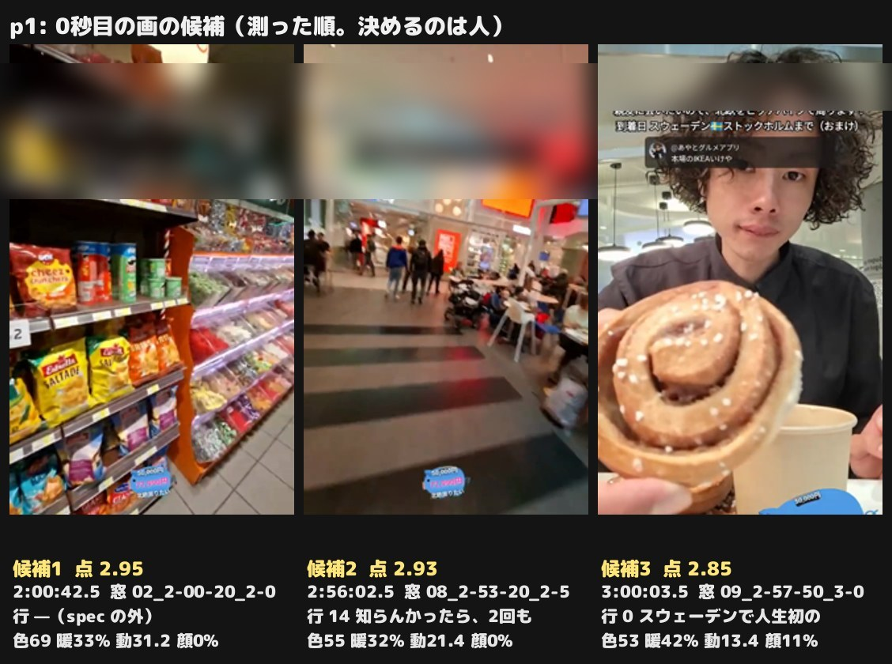
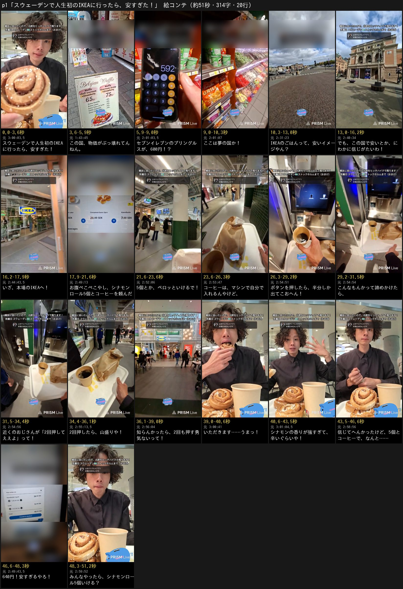

# スウェーデンで人生初の IKEA p1 — 「🇸🇪スウェーデンで人生初のIKEAに行ったら、安すぎた！」の原稿

あやとの依頼（2026-11-04・チャット「視聴者さんから届いたショート動画作って欲しい件、対応お願いします」。制作 issue は #1106）。
付箋の頼み（issue の要約）: スウェーデンに着いた日、IKEA の国で人生初の IKEA。物価の高さに驚いて「IKEA は安い」と聞いても疑っていたのが、行ってみたら安くて驚き、シナモンロールを5個食べ、コーヒーの入れ方が分からず最初は少なかった（2回押すと教わって飲めた）ところ。
**本編集・声はまだ作らない**（あやとが原稿に返事をしてから）。1次は原稿だけで出した。返事を待つあいだに素材を取り込み、行ごとの画・0秒目・絵コンテを足した（6章。原稿の字は1次のまま）。

| | |
| --- | --- |
| 配信 | [GBYHxJQGlCY](https://www.youtube.com/watch?v=GBYHxJQGlCY)（2026-09-20 16:38 JST「【到着日】…ストックホルム」）。**付箋の場面は全部この回の 2:44〜3:06 にある**（下の 5.1）。ほかの回の画は使っていない |
| 型 | 配信1本を本人の声で語る回（帳面の型をそのまま使う。F-052）。値段の落差で引っ張る型 |
| 題の札（0〜4.0秒・黒い箱） | **🇸🇪スウェーデンで人生初の／IKEAに行ったら、安すぎた！**（付箋の核「人生初の IKEA」をそのまま。F-063） |
| 1行目 | 題の札をそのまま読む（F-047） |
| 作る数 | 1案（付箋が場面を決めているので） |
| 原稿 | **20行・314字・見積もり 51.5秒**（上限の倍率で毎秒6.8字・行の間0.25秒） |
| 機械の検査 | `lint.py` **✕ 0**・△ 1（16行「いただきます」の「ます」に当たっただけ）／批評役1人目 `critic_gate.py` **✕ 0・△ 0** |

**入れなかった場面:** 同じ IKEA のトイレ 250円（3:39:30〜3:42:30。題「安すぎた」と逆の気持ちで終わるので F-025）・ミートボール4個 256円「ちょい高い」（2:46:30）・ソフトクリーム（2:50:00）・島カード作り（2:57:00〜2:59:00）・次の日のカフェのコーヒー 720円（nGgoJ753rBw 1:27:00）・2回目の IKEA（fuNbxQyO2Sw 3:45:00〜4:30:00）。どれも題の答え（640円）の外か、別の日の話なので入れていない（F-025・F-037・F-056）。

## 0. 伝えたいこと・前提・参考

- **伝えたいこと（1行）:** スニッカーズもプリングルスも高すぎる国で、IKEA のフードコートだけは、腹ぺこの僕がシナモンロール5個とコーヒーを頼んでも640円やった
- **見る人とそろえる前提（`script_writing.md` 0.7）:** 見る人の常識は「IKEA のごはんは安い」。それだけだと「安かった」は驚きにならないので、先に「この国は物価がぶっ壊れてる」（2〜4行）を置き、5行で常識（安いイメージやん？）、6行で「この国でそれは信じがたい」とずらす。19行の640円は、その疑いへの答え。もう1つ、コーヒーを自分でマシンから入れる形は、店で手渡される日本の常識と違うので 10行で先に言う
- **筋（`planning.md` 1.7）:** 高い国（旧市街・セブンイレブン）→ 常識と疑い（街を歩く）→ 本場の IKEA へ → 腹ぺこで5個とコーヒー（メニュー板）→ コーヒーが半分 → おじさんの一言 → 山盛り（コーヒーマシン）→ 味（シナモンロール）→ 全部で640円（トレー）→ 問い。段ごとに場面が違う
- **土台 → 山 → 結末 → 問い（F-022）:** 土台 2〜9行（物価に驚き、疑ったまま、腹ぺこで5個を頼む僕）／山 10〜17行（コーヒーが半分 → おじさん → 山盛り、強すぎるシナモン）／結末 18〜19行（19行が【答】）／問い 20行
- **値段を最後に置いた理由:** 配信では、値段は頼む前（2:48:00〜2:49:30）に言っている。原稿は、6行の疑いの答えとして 19行に置いた（言った額と時刻は変えていない）。答えのあとに締めまで2行以上置かない決まり（F-037・lint の L-AFTER）とも合う

### 写す参考（`script_writing.md` 7.1）: HPJ（グランクラス）と vJo（伊勢海老）

どちらも「値段の落差で引っ張る」型。HPJ からは値段の溜めと「見せてもらおか」の審査の枠、vJo からは「思てたら」で状況が動く所と、画に居る人の一言を「」でそのまま入れる所を借りた。

| 秒 | 参考のその拍で起きること | この原稿の行 | 写すもの | 写さないもの |
| --- | --- | --- | --- | --- |
| 0〜2 | HPJ・vJo: 題の札＝やりたい事。画は対象そのもの | 1 | 0秒目に答え（トレーのシナモンロールと山盛りのコーヒー）を見せる | 「〜したい」の札（あやとの題は場所と出来事で言い切る） |
| 3〜5 | HPJ: 溜め → 数 → 自分の口調で構える（「ほほーん強気やん？」） | 2〜4 | 「物価ぶっ壊れてる」→ 600円 →「ここは夢の国か！」 | 言い回し |
| 6〜7 | HPJ: 見続ける枠を一言で決める（審査する） | 5〜6 | 「安いイメージやん？」→「にわかに信じがたいわ！」で、本当に安いかを見る枠を立てる | — |
| 16〜20 | vJo: 前 →「思てたら」→ 状況が動く（取消ではない） | 10〜12 | 「入れるんやけど」→「半分しか出てこおへん」→「諦めかけたら」 | 現金のみの話 |
| 51〜56 | vJo: 人の言葉を「」でそのまま → ツッコミ | 13〜15 | おじさん「2回押してええよ」→ 山盛り →「2回も押す勇気ないって！」 | — |
| 3〜5（溜め） | HPJ:「お値段なんと」→ 次の行で数 | 18〜19 | 「5個とコーヒーで、なんと……」→「640円！安すぎるやろ！」 | 大字の「2倍」（こちらは円の額だけ） |
| 59〜61 | HPJ・vJo:「みんな」への問い（二択） | 20 | 9行の意気込みを「5個いける？」で返す | 「あり？なし？」の言い回し |

## 1. 原稿（20行）

```
スウェーデンで人生初のIKEAに行ったら、安すぎた！
この国、物価がぶっ壊れてんねん。
セブンイレブンのプリングルスが、600円！？
ここは夢の国か！
IKEAのごはんって、安いイメージやん？
でも、この国で安いとか、にわかに信じがたいわ！
いざ、本場のIKEAへ！
お腹ぺこぺこやし、シナモンロール5個とコーヒーを頼んだ！
5個とか、ペロッといけるで！
コーヒーは、マシンで自分で入れるんやけど、
ボタンを押したら、半分しか出てこおへん！
こんなもんかって諦めかけたら、
近くのおじさんが「2回押してええよ」って！
2回押したら、山盛りや！
知らんかったら、2回も押す勇気ないって！
いただきます……うまっ！
シナモンの香りが強すぎて、辛いぐらいや！
信じてへんかったけど、5個とコーヒーで、なんと……
640円！安すぎるやろ！【答】
みんなやったら、シナモンロール5個いける？
```

## 2. 1行ずつ4欄（＋画）

秒は声を上限の速さで読んだ見積もり。時刻はどれも GBYHxJQGlCY の中の時刻。**画は 2026-11-04 に取り込んだ clips・zoom のコマで、名指す物が写っているのを見た秒**（F-014。6章）。

| # | 秒（見積もり） | 元の出来事（配信の時刻） | 見る人に届く文（読み上げる字） | 残した本人の言葉 | 選んだ理由 | 画（clips・zoom のコマで確かめた秒） |
| ---: | --- | --- | --- | --- | --- | --- |
| 1 | 0.0–3.4 | 題の札をそのまま読む。2:45:00「僕IKEA行ったことないんけど」・3:16:00「人生初です」・2:48:00「シナモンロール5個入り448円。安いよ」・2:49:30「5個とコーヒーで640円ぐらいか」 | スウェーデンで人生初のIKEAに行ったら、安すぎた！ |  | F-047: 1行目は札の字のまま。0秒目に答えの画（5個のシナモンロールと山盛りのコーヒー）を出し「どれだけ安い？」を立てる | 【0秒目・hook.py の候補3（点 2.85・暖色 42%）】3:00:02.5〜3:00:05 ひと口目の前に、シナモンロールを1個カメラの前へ持ち上げる（渦とあられ糖が画面の半分。奥に本人とコーヒーのカップ）→ 2:44:21〜2:44:22.2 青い IKEA の看板のある建物の角。題の札の下 |
| 2 | 3.6–5.7 | 1:44:00 ワッフル1個 1000円を見て「スウェーデンって物価ぶっ壊れてる」 | この国、物価がぶっ壊れてんねん。 | 物価ぶっ壊れてる | 方針2・HPJ 3〜5秒: 先に「この国は高い」を本人の言い方で言い切り、題の「安すぎた」が驚きになる前提を置く（F-008） | 1:43:44〜1:43:46.3 旧市街のワッフル屋の立て看板（Belgian Waffle 65kr・75kr の値段が大きく写る。人は写らない） |
| 3 | 5.9–8.7 | 2:00:30〜2:01:00 旧市街のセブンイレブンで、背の高いプリングルスが「37×16。600円」 | セブンイレブンのプリングルスが、600円！？ |  | 数は1つだけ（F-056）。日本の人が値段を知っている店と物なので、日本の物差しのまま高さが伝わる（方針5）。4〜8秒の2つ目の山 | 2:00:48〜2:00:50 セブンイレブンの棚の背の高いプリングルスを手で指す → 2:01:02.9〜2:01:04 プリングルスの前で電卓に 37×16＝592 が出る（値段の数が画で見える） |
| 4 | 9.0–10.2 | 2:01:00「ここはディズニーランドです」・2:00:30「夢の国価格」 | ここは夢の国か！ | 夢の国 | 方針4の3拍目: 事実にすぐ本人の例えでツッコむ。「夢の国」は本人の口から出た物差し（F-035） | 2:01:06〜2:01:07.3 同じ店の量り売りのお菓子の棚（赤・緑・白の色とりどりが通路の奥まで続く。hook.py の候補1に近い画）。この店では自撮りをしていないので、ツッコミは色の多い棚で受ける |
| 5 | 10.4–12.9 | 見る人の常識（日本でも IKEA のごはんは安いことで知られる）。配信では 2:08:30・2:44:30 に「IKEA は安い」と聞いて「え、IKEAってそんな安いの？」と返している（聞いた先は書き込み） | IKEAのごはんって、安いイメージやん？ |  | 方針7・F-048: 書き込みで聞いた話を、見る人の常識に置き換える（誰に聞いたかは言わない）。「やん？」で同意を取り、次で疑う | 2:31:22〜2:31:24.7 石畳の広場と雲の多い空、奥に王宮側の建物（IKEA へ向かって歩く所） |
| 6 | 13.2–16.1 | 2:31:00「スウェーデンは100円でパン1個食える国ではないと思うよ…にわかに信じがたいよ」・2:44:30「スウェーデンに安いものがあるなんて。僕は信じない」 | でも、この国で安いとか、にわかに信じがたいわ！ | にわかに信じがたい | HPJ 6〜7秒の「見続ける枠」: 本当に安いかを確かめる枠を本人の口ぐせで立てる。18〜19行で拾う前ふり | 2:40:32〜2:40:34.5 王立オペラ座の正面（青空・石畳。物価の高い国の立派な街並み）→ 2:40:58〜2:40:59 黄葉の木と古い建物の広場 |
| 7 | 16.4–17.8 | 2:44:00〜2:44:30「本場のIKEAにやってきました」「本場のIKEAはこんな感じ」 | いざ、本場のIKEAへ！ | 本場 | 「いざ」で場面を移し、疑いを抱えたまま店に入る。店の外の画で、スウェーデンの IKEA だと見せる | 2:44:43〜2:44:44.7 入口の大きな青い IKEA の看板の下をくぐる（0秒目の2カット目の建物の角とは別の画） |
| 8 | 18.1–21.5 | 2:49:00「シナモンロール5個とコーヒーにしよ」・2:51:30「めちゃくちゃお腹減ってます」・2:57:00「やっと朝ご飯や。もうお昼やけど」 | お腹ぺこぺこやし、シナモンロール5個とコーヒーを頼んだ！ |  | 何を頼んだかと、5個にした理由（腹ぺこ）を1行に。値段は言わず 19行まで溜める（HPJ の溜め） | 2:49:12〜2:49:14 注文の画面のデザートの欄（Cinnamon buns 5pcs の写真と 28,00 SEK の札。字を読ませる寄せ）→ 2:45:17〜2:45:18.7 フードコートの客席とカウンターの引き（人は小さい） |
| 9 | 21.7–23.5 | 2:51:30「シナモンロール5個とかペロ。ペロです」 | 5個とか、ペロッといけるで！ | ペロ | 方針4: 調子に乗った一言を前に置く。20行の問いで拾う前ふり | 2:52:03.5〜2:52:05.5 番号の入ったレシートを手に、フードコートで待つ（人は遠くて小さい。2:52:00〜2:52:03 は手前を男の人が横切るので使わない。自撮りはこの間に無い） |
| 10 | 23.7–26.2 | 2:53:30「コーヒーが入ってないから…もらいに行きますけど、どれがやろ？」・2:54:00 英語で取り方を聞く・2:54:30「これでコーヒーがゲットできるらしい」 | コーヒーは、マシンで自分で入れるんやけど、 |  | 場面をコーヒーへ移し、「けど」で開けて困りごとへ渡す（方針3）。自分で入れる形を先に言う（F-008） | 2:53:46〜2:53:48 受け取ったトレーの空のカップと紙袋（5個入りはこの袋。コーヒーはまだ入っていない）→ 2:54:37〜2:54:37.8 コーヒーマシンの前 |
| 11 | 26.5–29.1 | 2:55:00「おじさんが教えてくれへんかったら僕半分なってた」・2:55:30「僕も少ないなと思ったけど」 | ボタンを押したら、半分しか出てこおへん！ | 半分 | 前の行の「けど」にすぐ結果で答える。量の少なさは「半分」の1語で、画のカップに任せる | 2:54:42〜2:54:43.8 マシンの画面を指で押し、注ぎ始める（画面に緑の輪）→ 2:54:50.5〜2:54:51.6 1回目を取り出して持ち上げたカップの寄り（内側の壁が見えて、量は半分ほど。clips の mp4 の原寸で確かめた） |
| 12 | 29.4–31.4 | 2:55:30「ああ、残念。あんなもんか。コップに騙されたと思って」 | こんなもんかって諦めかけたら、 | あんなもんか | vJo 16〜20秒:「〜たら」で開けて、次の行の人の一言へ渡す。諦めを先に置くと一言が効く | 2:54:52.7〜2:54:55 半分のカップをトレーに置いて、マシンの前を離れかける（トレーと紙袋の引き） |
| 13 | 31.7–34.3 | 2:55:00「センキュー。おじさんが教えてくれて」「おじさんが2回押していいよって教えてくれたから」（その場のおじさん。書き込みではない） | 近くのおじさんが「2回押してええよ」って！ | 2回押していいよ | vJo 51〜56秒: 画に居る現地の人の言葉を「」でそのまま（関西弁に吹き替え）。本当にあった人とのやり取り（F-056） | 2:54:56〜2:54:56.6 トレーの横に立つおじさんの腕と脚（顔は写らない。自動字幕の「タイム」＝2:54:56.2 はこのあたり。12行の引きと合わせて似た画が3秒を越えないよう 0.6秒）→ 2:55:00.3〜2:55:02.7 カップを注ぎ口の下に戻し、もう一度画面を押す |
| 14 | 34.6–36.1 | 2:55:00「コーヒーが山盛りになりました」 | 2回押したら、山盛りや！ | 山盛り | 一言にすぐ結果で答える。山盛りのカップの画が説明を要らなくする（方針6） | 2:55:13〜2:55:14.7 縁までいっぱいになったカップ（トレーの上・紙袋の横） |
| 15 | 36.3–39.0 | 2:55:30「あれ2回押すのはさ、結構さ、勇気いるくない？」 | 知らんかったら、2回も押す勇気ないって！ | 勇気いる | 3拍目のツッコミ。自分の気の小ささを笑い、見る人の「自分も押されへん」に寄せる。持って帰れる一言（2回押してよい）も残る（方針5） | 2:56:03.5〜2:56:06.4 山盛りのカップを持って席を探しに出た所の、IKEA City の店の入口（青い看板と赤い札。人は小さい。hook.py の候補2）。コーヒーの画が続かないよう、ここで場所を変える |
| 16 | 39.2–40.5 | 2:59:30「いただきます」・3:00:00「うん。うま。めっちゃ美味しい」 | いただきます……うまっ！ | うま | 場面をシナモンロールへ戻す。ひと口の反応は1語で。元の声の候補（3:00:00〜3:00:30。秒は素材の音で） | 3:00:41〜3:00:42.7 シナモンロールにかぶりつく（食べた瞬間なので顔。手前にロールの山とカップ） |
| 17 | 40.8–43.4 | 3:01:00「シナモンの香りが強すぎて辛いです」・3:04:30「シナモンの香りがすごい強くて…辛いぐらい」 | シナモンの香りが強すぎて、辛いぐらいや！ | 香りが強すぎて辛い・辛いぐらい | 方針6: 見た目は画に任せ、声は画に映らない本人の味の言い方だけ。本場らしさが伝わる一言 | 3:01:03.6〜3:01:05 手を振って香りの強さを言う顔 → 2:58:41〜2:58:42.5 トレーのシナモンロールの寄り（渦とあられ糖。顔の画を3秒続けないための寄り） |
| 18 | 43.7–46.5 | 6行の疑い（2:31:00・2:44:30）を拾う。額は 2:49:30 に言っている | 信じてへんかったけど、5個とコーヒーで、なんと…… |  | 取消の印（けど）と溜め（なんと……）を同じ行に。6行の疑いを声で拾ってから答えを1拍待たせる（HPJ「お値段なんと」） | 2:55:56〜2:55:57.5 フードコートの客席の引き → 2:44:22.2〜2:44:23.8 青い IKEA の看板のある建物の角（0秒目の2カット目の続き）。席の画をここに入れると、席の場面が4回目になる（F-026）ので入れない |
| 19 | 46.7–48.6 | 【答】2:49:30「40セック。…シナモンロール5個とコーヒーで…640円ぐらいか」（本人の換算 1クローナ＝16円） | 640円！安すぎるやろ！ |  | 題「安すぎた」の答え。円だけで1回（F-007）。3行の600円を覚えている人には、言わなくても差が分かる。すぐ問いで締める（F-037） | 2:49:42.5〜2:49:44.2 注文の確かめの欄の寄り（Kanelbulle 5 pack 28,00・Kaffe 12,00・Total 40,00 SEK。原寸で読める）。字幕で強調: 640円 |
| 20 | 48.9–51.5 | 9行「5個とかペロッといける」を問いで返す | みんなやったら、シナモンロール5個いける？ |  | F-032: 最後は「みんな」への問い。9行の意気込みを、いける／無理で答えられる問いにして返す | 2:59:51.5〜2:59:54 手前にシナモンロールの山とコーヒーのカップ、奥で食べる前の本人→ 2:59:47.4〜2:59:48 カップをトレーに置く手元（0秒目と同じ席の別の画。呼び戻しは同じ場面の数に入れる。F-026）。5個を食べ切った空のトレー（3:31:00〜3:32:35）は clips に無いので、使うなら取り込み直す |

- **自撮り（話す顔）は 16・17行だけ**（食べた瞬間とその反応。F-058）。1・20行は席の画に本人が奥に写る。1次で顔の狙いだった 4・9・15行は、その時間に自撮りが無かったので、量り売りの棚・レシート・店の入口に替えた
- **元の声（F-051）の候補は 16行の「うま」（2口目のあとの 3:00:43.5〜3:00:44.0）。** 約0.5秒のこもった声なので、見込みは AI の声のまま（6.2）

### (e) 出てくる人・場所・物

| 人・場所・物 | どこで紹介したか |
| --- | --- |
| スウェーデン | 題・1行（2・6行は「この国」） |
| セブンイレブン・プリングルス | 誰でも知っている（3行） |
| 夢の国 | 誰でも知っている（ディズニーランドの呼び名） |
| IKEA・本場 | 題・5行・7行（本場＝IKEA の国） |
| シナモンロール・コーヒー | 8行で頼んだ物として |
| マシン・ボタン | 10〜11行（コーヒーの機械） |
| おじさん | 13行「近くの」で、その場の知らない人と分かる |
| 640円 | 19行（18行の「5個とコーヒーで」の額） |

### (i) つなぎ（批評役1人目が全部の行に付けたもの）

| 行 | 1 | 2 | 3 | 4 | 5 | 6 | 7 | 8 | 9 | 10 | 11 | 12 | 13 | 14 | 15 | 16 | 17 | 18 | 19 | 20 |
| --- | --- | --- | --- | --- | --- | --- | --- | --- | --- | --- | --- | --- | --- | --- | --- | --- | --- | --- | --- | --- |
| つなぎ | 題 | 前 | 足 | 反 | 転 | 外 | 転 | 転 | 反 | 転 | 答 | 反 | 答 | 足 | 反 | 転 | 足 | 前 | 答 | 締 |

- 開けた問い・溜めは4か所（5「やん？」→6・10「けど」→11・12「たら」→13・18「なんと……」→19）。どれも次の行で答える
- 取消は1回（6「信じがたい」を 19「安すぎるやろ」で打ち消す。印は 18行の「けど」、理由は 19行の640円）。11〜14行は外の出来事（おじさんの一言）で状況が動くだけ
- あとで拾う数: 14行の「2回」は 13行、18行の「5個」は 8〜9行で声に出している

## 3. 当て表（約束のカード35枚。作文者が書き、批評役1人目が全部当て直した）

| ID | 当たる行 | どう直したか／当たらない理由 |
| --- | --- | --- |
| F-004 | 2, 4, 6, 9, 11, 12, 15, 17, 19 | 全20行を僕の一人称・関西弁（ねん・やん・やし・おへん・やろ）で、帰ってから見る人に語る形にした。「あやとは」「〜だそうです」の外の説明は0。本人の言葉（物価ぶっ壊れてる・夢の国・にわかに信じがたい・ペロ・あんなもんか・勇気いる・うま・香りが強すぎて辛い）は配信の言い方のまま残し、文の形は組み直した |
| F-005 | 3, 6, 13, 18, 19, 20 | 企画の型（物価の国で値段の落差に驚く）・伝えたいこと・山（コーヒーが半分 → おじさんの一言 → 山盛り）とオチ（全部で640円）は企画のまま。HPJ から値段の溜め（18行）と見続ける枠（6行）、vJo から人の一言を「」でそのまま（13行）と最後の問いの拍だけ借りた。サマス・ザマスなどの言い回しは借りていない |
| F-006 | 8, 10, 11, 14 | 「頼んだ」「マシンで自分で入れる」「半分しか出てこおへん」「山盛り」と、ふだん口で言う言葉にした。「セルフサービス」「抽出」のような書き言葉・店の用語は使わない |
| F-007 | 3, 19 | お金は円だけで、1行に1回（600円・640円）。クローナ（セック）は読まない。448円・192円・256円は題の答えに要らない数なので言わない（F-056）。換算は本人の 1クローナ＝16円のまま |
| F-008 | 2, 3, 5, 7, 10, 13 | 2行で「この国は高い」、3行は日本の人が値段を知っているセブンイレブンとプリングルスで高さを見せる。5行で日本の常識（IKEA のごはんは安いイメージ）を置いてから、6行でこの国では疑う、とずらす。7行「本場」でスウェーデンの IKEA だと分かるようにし、10行はコーヒーを自分で入れる形だと先に言う。13行のおじさんは「近くの」で、その場の知らない人と分かる。呼び名・身内の言葉は使わない |
| F-014 | 1〜20 | visual に、その行が名指す物（ワッフル屋の看板・プリングルスの前の電卓・IKEA の看板・注文の画面・コーヒーマシン・半分のカップ・おじさんの腕・山盛りのカップ・シナモンロール）が写る配信の時刻を書いた。2026-11-04 に clips・zoom を取り、行ごとにコマを見て、写っている秒に差し替えた（src・still。6章）。顔の狙いだった 4・9・15行は、その時間に自撮りが無かったので写っている物の画に替えた。書き出したあとも行ごとに3〜4コマ見て確かめる。visual の狙いを写っている証拠にしない |
| F-015 | 0 | title_card は「🇸🇪スウェーデンで人生初の／IKEAに行ったら、安すぎた！」の2行、title_card_seconds 4.0、地は黒い箱。0秒目から出来上がった形で出して4秒で消す |
| F-019 | 1〜20 | 20行・314字（350字・22行の内）。毎秒6.8字と行の間0.25秒で約51.5秒。倍率は1.4を越えない。入らなければ build_edit.py が止まって減らす字数を出すので、その数だけ削る（説明の行から: 10行・5行） |
| F-022 | 2, 6, 11, 13, 14, 19, 20 | 1案だけ。土台＝物価がぶっ壊れた国で腹ぺこのまま疑う僕（2〜9行）→ 山＝コーヒーが半分 → 諦めかけたらおじさんの一言 → 山盛り（10〜15行）と、強すぎるシナモン（16〜17行）→ 結末＝全部で640円（18〜19行）→ 問い（20行）。削ったのは途中の経緯（ミートボールの値段・番号の呼び出し・ソフトクリーム）で、勝負の場面（コーヒー・値段）は残した |
| F-025 | 19, 20 | 結末は題の「安すぎた」の側で閉じる（19「640円！安すぎるやろ！」→ 20 の問い）。このあとのトイレ250円（3:40:30。題と逆の気持ち）・次の日のカフェ（9/21）・2回目の IKEA（9/26）は足さない |
| F-030 | 0 | 題の札の国の名前の前に 🇸🇪（`flags.py emoji スウェーデン` の字）。国旗は読み上げない |
| F-031 | 0, 1 | 題は「スウェーデンで人生初のIKEAに行ったら、安すぎた！」。場所（スウェーデン）と本当に起きたこと（人生初の IKEA に行った）を言い、終わりは気持ちの言葉（安すぎた）で言い切る。比喩・見立ては無い。題の前提（物価が高い国）から山（コーヒー）と答え（640円）までを筋にした |
| F-032 | 20 | 最後の20行は「みんな」への問い1行（9行の「5個とかペロッといける」を、いける／無理で答えられる問いにした）。そのあとに何も足さない。次の配信の時刻は決まっていないので配信には誘わない |
| F-033 | 2, 3, 7, 8, 10, 16, 19 | 筋は「高い国で、IKEA は本当に安いか」の1本。旧市街のワッフル屋（2）→ セブンイレブンの棚（3〜4）→ 街を歩く（5〜6）→ IKEA の入口（7）→ メニュー板（8）→ コーヒーマシン（10〜15）→ シナモンロール（16〜17）→ トレーと値段（18〜19）と、段ごとに違う場面が載る。衛兵交代・世界一細い道・トイレ・ビッグマックなど筋に乗らない場面は入れない |
| F-034 | 3, 4, 6, 13, 18, 19, 20 | 書く前に写す参考を決めた: HPJ 3〜5秒（数 → 自分の口調で構える）を3〜4行、HPJ 6〜7秒（見続ける枠）を5〜6行、vJo 16〜20秒（思てたら）を11〜12行、vJo 51〜56秒（人の言葉を「」でそのまま → ツッコミ）を13〜15行、HPJ の溜め「お値段なんと」を18行、問いを20行に当てた。要の行の reason に使った手を書いた。書いたあと頭から声に出すつもりで読み、35枚を当て直した |
| F-035 | 4, 15, 17 | 比べは本人の口から出た物（夢の国・勇気いる・香りが強すぎて辛い）だけ。「〜に見えてきた」の見立ては0。640円をプリングルス1本と並べる言い方（動画の中で作った物差し）はしない |
| F-036 | 1, 9, 11, 19, 20 | 「安すぎた」は、見る人が受け取る範囲（その日の IKEA のフードコート）で本当: 5個入り448円・コーヒー192円で計640円（2:48:00・2:49:30）。次の日も本人が「昨日のIKEAが異常やった」「スウェーデンで圧倒的最安コーヒー」と言う（nGgoJ753rBw 1:28:30〜1:29:00）。同じ IKEA のトイレは250円で高かった（3:40:30）ので「IKEA は何でも安い」とは言わない（題も19行もごはんの話）。11行「半分」は本人の「教えてくれへんかったら僕半分なってた」から。5個を食べ切ったかは字幕で言い切れないので「食べ切った」とは言わない（9行は意気込み・20行は問い） |
| F-037 | 19, 20 | 答え（19行）が出たら、20行の問いへすぐ渡す。答えのあとに気持ちの言い直しやもう一段の落ち（トイレ250円）は足さない。コーヒーの話（10〜15行）は6拍、シナモンロールの味（16〜17行）は2拍で次へ移る |
| F-039 | 5, 6, 10, 12, 18 | 起きた順の字幕をつながず「高い国 → 常識 → 疑う → 店へ → 頼む → コーヒーの困りごと → 人の一言 → 山盛り → 味 → 値段」に組み直した。5行は「やん？」、10・12・18行は「けど・たら・……」で開けて、次の行で返す。値段は配信では頼む前（2:49:30）に言っているが、疑い（6行）の答えとして最後に置いた（事実は変えていない） |
| F-040 | 6, 18, 19 | 本人の言い切りを打ち消すのは、6行「信じがたい」→ 19行「安すぎるやろ」の1回だけ（題の答えに向かう1回）。印（18行「信じてへんかったけど」）と理由（19行「640円」）を声に入れた。11〜14行は外の出来事で状況が動くだけで、取消ではない。謝る・言い直す段は無い |
| F-043 | — | 旅の手段と日数で回る「参考にしたい」の回ではなく、1つの店で値段に驚く回なので当たらない。同行者も出ない |
| F-047 | 1, 4, 6, 9, 12, 15, 16, 17 | 1行目は札の字そのまま（国旗と改行を除く）。出来事は本人の言い方で書き、動きの行（10・11・14・16）は画とそろえる。配信に無い決め台詞・意気込みだけの行は置いていない（7行「いざ」は場面を移す印）。次の配信の時刻は未定なので最後は問い |
| F-048 | 5, 13 | コメント・チャット・視聴者の書き込みで動く話は0。IKEA は安い、と配信で聞いた先は書き込み（2:08:30・2:44:30）なので、5行は見る人の常識（安いイメージやん？）に置き換えて、誰に聞いたかは言わない。13行の「2回押してええよ」はその場にいたおじさんの言葉（2:55:00「おじさんが教えてくれて」。その時間のチャットに2回押す話は無い）。あだ名・常連の言葉は使わない |
| F-049 | 0, 1, 8, 10, 11 | 題・全行とも助詞を入れた形（「スウェーデンで」「IKEAに行ったら」「コーヒーを頼んだ」「マシンで自分で入れる」「ボタンを押したら」）。詰めた言い方は使わない |
| F-050 | 3, 6, 11, 13, 15, 17, 19 | この1枚から筋を考えて組んだ。面白い（4 夢の国・15 勇気ない）・ハラハラ（6 本当に安い？・11 半分しか出えへん）・海外の有益（13 IKEA のコーヒーは2回押してよい）・海外の空気（17 本場のシナモンの強さ、旧市街・フードコートの画）を1つずつ置いた。字幕の文を起きた順に並べた行は無い |
| F-051 | 16 | 16行の「うまっ」の元の声の候補は 3:00:43.5〜3:00:44.0（2口目のあと。語の時刻つきの字幕と音で測った。ひと口目のあとは 3:00:18.4〜3:00:18.9）。約0.5秒のこもった声なので、見込みは AI の声のまま。ほかの声（2:54:58「おお、やった」）は英語のやり取りと重なるので AI の声 |
| F-052 | 1, 20 | 配信アーカイブを本人の声で語る回なので、帳面の型（関西弁の一人称・題の札・最後の問い）をそのまま使う |
| F-054 | 10, 11, 12, 13 | トラブル（コーヒーが半分）の原因＝自分で入れるマシンで、2回押すと知らなかったこと。10行で形を言い、13行で解けるまでを4行に畳んだ。席に着いてからの話を引っ張らない |
| F-055 | 7, 8, 16, 17 | 店で食べる回だが、題の答えが値段（安すぎた）なので、値段は答えの1つ（19行の640円）と土台の1つ（3行の600円）だけにした。448円・192円・256円・150円は言わない。店の空気は7行の入口・8行のメニュー板の画と、何を頼んだか（シナモンロール5個とコーヒー）で入れる。題は「〇〇食べてみた」ではなく、付箋の核の「人生初のIKEA」と気持ち（安すぎた）で言う（F-063） |
| F-056 | 3, 8, 11, 13, 19 | 数字は3行の600円・8行の5個・11行の半分・13行の2回・19行の640円だけ（どれも本人のツッコミか題の答えが乗る）。ワッフル1000円・スニッカーズ330円・コーラ400円・ミートボール256円・コーヒー192円・ソフトクリーム150円は削った。1行に出来事1つ。本当にあった人とのやり取り（13行のおじさん）を残した |
| F-057 | 0, 7 | 題は国（スウェーデン）の大きい枠で引き、街の名前（ストックホルム）は出さない（話は IKEA の1店なので要らない）。7行「本場のIKEA」で、IKEA の国だと分かるようにした |
| F-059 | — | あやとの「〜は要らない」の指定はまだ無い（1次）。付箋が頼んだ場面（物価の高さ・疑う・安さ・シナモンロール5個・コーヒー2回）だけで組み、トイレ・ビッグマック・花屋は入れていない |
| F-061 | — | 題の気持ちは「簡単」ではなく「安すぎた」なので当たらない。レシピの手順は無い |
| F-063 | 0, 1, 7 | 付箋の核（IKEA の国で、人生初の IKEA。安くて驚く）を、題で「スウェーデンで人生初のIKEAに行ったら、安すぎた！」とそのまま言う。題材の外の話（衛兵交代・世界一細い道・ビッグマック）は入れない |
| X2 | 2, 3, 8, 9, 11, 13, 14, 16, 17, 19 | 各行の why に配信の時刻を書いた（どれも GBYHxJQGlCY）。値段は本人が言った額（600円 2:01:00・640円 2:49:30）で、換算も本人の1クローナ16円のまま。5個を食べ切ったか・おじさんが画に写るか・1回目が半分だったかは字幕だけでは言い切れないので、素材で確かめる（9行は意気込み、11行は本人の「半分なってた」）。盛った数・起きていない危険は無い |

## 4. 尺の見積もり

| | |
| --- | --- |
| 字（記号を除く） | 314字（350字まで） |
| 行 | 20行（22行まで） |
| 見積もり | **51.5秒**（314 ÷ 6.8 ＋ 行の間 0.25秒 × 19。最短の行は1.2秒に切り上げ）。60秒未満 |
| 2つ目の山 | 3行目（5.9〜8.7秒）「セブンイレブンのプリングルスが、600円！？」→ 4行目（9.0秒）「ここは夢の国か！」 |
| 題の答え | 19行目（46.7秒）。答えから締めまで0行（F-037） |

声を作ったら実物の長さで測り直す（`script_writing.md` 6）。

## 5. 確かめた事実

### 5.1 付箋の場面は、どの回の何分か（字幕で確かめた）

**4つとも 9/20 の GBYHxJQGlCY にある。** 9/21・9/26 の回は、同じ話の続き（次の日の比べ・2回目の IKEA）があるだけで、付箋の場面の代わりにはしていない。

| 付箋の場面 | 回と時刻 | 字幕で言っていること | 原稿の行 |
| --- | --- | --- | --- |
| 物価の高さに驚く | GBYHxJQGlCY 1:37:30（革の鞄 約4.8万円）・1:44:00（ワッフル1個 1000円「物価ぶっ壊れてる」）・1:58:00〜2:01:00（セブンイレブン: スニッカーズ330円「物価が高いとかいうレベルじゃない」・コーラ400円「羽田空港価格」・プリングルス600円「ここはディズニーランド」）・2:02:30（いちばん安いケーキ1000円・紅茶600円） | 本人が値札を見て言っている | 2〜4 |
| 「IKEA は安い」と聞いても疑う | GBYHxJQGlCY 2:08:30（「え、IKEAってそんな安いの？ IKEAで僕飯食ったことないねんけど」）・2:30:30〜2:31:00（「にわかに信じがたいよ」）・2:44:30（「僕は信じてへんよ。スウェーデンに安いものがあるなんて」） | **「安い」と言ったのは視聴者さんの書き込み**（本人がそれに答えている）。原稿は誰に聞いたかを言わず、見る人の常識「安いイメージ」に置き換えた（F-048） | 5〜6 |
| 行ってみたら安くて驚く | GBYHxJQGlCY 2:44:30（「本場のIKEAにやってきました」）・2:46:30（ミートボール4個 256円「ちょい高い」）・2:47:30（コーヒー 192円「マシや」）・2:48:00（シナモンロール5個入り 448円「安いよ。ええ、いいやん」）・2:49:30（「シナモンロール5個とコーヒーで…640円ぐらいか」）・2:50:30（ソフトクリーム 150円ぐらい「安いね」） | その場の反応は「安いよ」「マシや」くらい。「異常」「圧倒的最安」と強く言うのは次の日（nGgoJ753rBw 1:28:30〜1:29:00） | 7・8・18・19 |
| シナモンロールを5個食べる | GBYHxJQGlCY 2:49:00（5個に決める）・2:51:30（「5個とかペロ」）・2:53:30（受け取り「5個はペロリだね」）・2:59:30（「いただきます。全部行っちゃうよ。もちろん行きます」）・3:00:00〜3:05:30（「うま。めっちゃ美味しい」「香りが強すぎて辛い」） | 字幕では食べ切ったと言っていないが、**画で食べ切っている**（3:30:25〜3:30:55 に最後の1個、3:31:00〜3:32:35 はトレーにカップだけ。zoom 5秒に1コマ）。原稿は「食べ切った」とは言っていない | 8・9・16・17・20 |
| コーヒーが最初は少なく、2回押すと教わる | GBYHxJQGlCY 2:53:30（「コーヒーが入ってないから…どれがやろ？」）・2:54:00（英語で取り方を聞く）・2:54:30（「これでコーヒーがゲットできるらしい」）・2:55:00（「おじさんが教えてくれへんかったら僕半分なってた。おじさんが2回押していいよって教えてくれたから…山盛りになりました」）・2:55:30（「少ないと思ったけど…ああ、残念。あんなもんか」「2回押すのは勇気いるくない？」）・3:10:00〜3:10:30（おかわり自由かと思ったら「2回のところだった…2回ポチポチって押せた」） | **教えたのはその場のおじさん**（本人が「センキュー」と直接お礼を言っている）。2:52:00〜2:58:00 のチャットに「2回押す」の書き込みは無い。画に居る人の言葉なので F-048 の外。画にはトレーの横の腕と脚だけ（2:54:55〜2:54:57）。1回目が半分（2:54:50.5）→ 2回目で縁までいっぱい（2:55:13）も画で確かめた | 10〜15 |

ほかの回で見たところ（使っていない）:

| 回と時刻 | 中身 | 使わない理由 |
| --- | --- | --- |
| nGgoJ753rBw（9/21）1:27:00〜1:31:30 | 街のカフェでいちばん安いコーヒー720円・ケーキ1000〜1300円 →「昨日のIKEAが異常やったんよ」「IKEAがスウェーデンの中で最安コーヒーよ。圧倒的」「1週間、街歩きとIKEAだけにしよう」 | 次の日の別の場面。答え（640円）のあとに足すと F-037、筋が広がる（F-033）。「安すぎた」が本人の見立てだという裏付けとして事実の表にだけ使う |
| fuNbxQyO2Sw（9/26・月末配信）3:33:00・3:50:00・4:26:30〜4:30:00 | 2回目の IKEA。「IKEA はまだ耐えれる」・またシナモンロール5個入りとコーヒー・焼きたてのシナモンロール「シナモンの香りがめっちゃ強い」 | 別の日。4:15:00 の「2回押す」は視聴者さんの書き込みの読み上げ（F-048）。9/20 の画が暗い・ぶれるときだけ、焼きたての寄り（4:26:30〜4:30:00）を**違う日の画と印を付けて**代わりに使う候補 |

### 5.2 行ごとの事実

| 行 | 言っていること | 根拠 | 見る人が受け取る範囲と合うか（F-036） |
| --- | --- | --- | --- |
| 1 | スウェーデンで人生初の IKEA。安すぎた | 2:45:00「僕IKEA行ったことないんけど」・3:16:00「人生初です」・2:48:00〜2:49:30 の値段 | 「安すぎた」はフードコートのごはんの話。トイレ（250円）は入れていない |
| 2 | この国、物価がぶっ壊れてる | 1:44:00（ワッフル1000円を見て） | 本人の見立て。旧市街の店なので本人は「旧市街価格かも」とも言う（2:00:30）が、次の日の街のカフェも高い（nGgoJ753rBw 1:27:00） |
| 3 | セブンイレブンのプリングルスが600円 | 2:00:30〜2:01:00「37×16。600円」（背の高いプリングルス） | 本人の換算（1クローナ16円）。画は値札ではなく、プリングルスの前で電卓に 37×16＝592（2:01:03） |
| 4 | ここは夢の国か | 2:00:30「夢の国価格」・2:01:00「ここはディズニーランドです」 | 本人のツッコミ |
| 5 | IKEA のごはんは安いイメージ | 見る人の常識（日本の IKEA のフードコートは安いことで知られる）。配信で本人が聞いたのは書き込みから | 本人は IKEA で食べたことが無かった（2:08:30）。行は見る人の常識として言っていて、本人が前から知っていたとは言っていない |
| 6 | この国で安いとか、信じがたい | 2:31:00「にわかに信じがたいよ」・2:44:30「僕は信じない」 | 合う |
| 7 | 本場の IKEA へ | 2:44:30「本場のIKEAにやってきました」 | 街の中の店（本人「本店みたいな感じではない」3:08:30）。原稿は「本場」（IKEA の国）とだけ言い、本店とは言わない |
| 8 | 腹ぺこで、シナモンロール5個とコーヒーを頼んだ | 2:49:00・2:51:30「めちゃくちゃお腹減ってます」・2:57:00「やっと朝ご飯や」 | 合う |
| 9 | 5個とかペロッといける | 2:51:30「シナモンロール5個とかペロです」 | 意気込みとして言う（食べ切ったとは言わない） |
| 10 | コーヒーはマシンで自分で入れる | 2:53:30〜2:54:30 | 合う（受け取ったトレーのカップは空 2:53:46、マシンで入れる 2:54:42） |
| 11 | 押したら半分しか出てこない | 2:55:00「教えてくれへんかったら僕半分なってた」・2:55:30「少ないなと思ったけど」 | 合う。1回押して取り出したカップは半分ほど（2:54:50.5）で、いったんトレーに置いて離れかけてから、戻ってもう一度押している（2:54:53〜2:55:01） |
| 12 | こんなもんかと諦めかけた | 2:55:30「ああ、残念。あんなもんか。コップに騙されたと思って」 | 合う |
| 13 | 近くのおじさんが「2回押してええよ」 | 2:55:00「おじさんが2回押していいよって教えてくれた」・「センキュー」 | その場の人（画には腕と脚だけ）。自動字幕の「タイム」（2:54:56.2）がこの人の「two times」とも。原稿は関西弁に吹き替え |
| 14 | 2回押したら山盛り | 2:55:00「コーヒーが山盛りになりました」 | 合う |
| 15 | 知らんかったら2回も押す勇気ない | 2:55:30「2回押すのは結構さ、勇気いるくない？」 | 本人のツッコミ |
| 16 | いただきます……うまっ | 2:59:30・3:00:00「うま。めっちゃ美味しい」 | 合う |
| 17 | シナモンの香りが強すぎて、辛いぐらい | 3:01:00「シナモンの香りが強すぎて辛いです」・3:04:30「辛いぐらい」 | 合う |
| 18 | 信じてへんかったけど、5個とコーヒーで | 6行の疑い・2:49:30 | 合う |
| 19 | 640円【答】 | 2:49:30「40セック…シナモンロール5個とコーヒーで…640円ぐらいか」（5個入り 448円 2:48:00 ＋ コーヒー 192円 2:47:30） | 本人の換算。はじめに「600円」と言ってから「640円ぐらい」に直している。640円で言う |
| 20 | みんなやったら5個いける？ | 9行の意気込みを問いに | 問いなので事実は言っていない |

## 6. 画（2026-11-04 に素材を取り込んで確かめた）

取り込んだもの: run 41789567271（clips 10区間・計17.5分、zoom 1fps 6区間、zoom 5秒に1コマ 2区間）と run 41796782343（字幕を1文ずつの秒で。captions）。どれも GBYHxJQGlCY。
回まるごとは取っていない。暗号文は開いたあと作業枝から下ろした。行ごとの画は 2章の表と spec.json の `src`・`still`・`visual`。

- **20行とも、名指す物が写る秒を見つけた**（F-014）。行の秒に区間を前から当てて、どのカットも 3秒未満・区間の長さは行の長さに足りる（いちばん長いカットは 15行の 2.9秒）
- **カクつき（`tools/shorts/qa/stutter.py`）: 使う30区間すべて ○**（同じ絵の繰り返しは最大 30%・実質 21fps 以上。線は 60%）。コーヒーの場面（2:53〜2:56）は 0〜3% で、ほぼ 30fps のまま
- **画の種類（F-024）: 16種類**（ワッフル屋の看板・セブンイレブンの棚・電卓・量り売りの棚・石畳の広場・オペラ座・IKEA の看板・注文の画面・フードコートの引き・レシート・トレー・コーヒーマシン・カップの寄り・おじさんの腕・IKEA City の入口・席の本人とシナモンロール）
- **自撮り（話す顔）は 16・17行の2つと、席の画に本人が写る 1・20行**（食べた瞬間とその反応。F-058）。1次で顔の狙いだった 4・9・15行は、その時間に自撮りが無かったので、量り売りの棚・レシート・店の入口に替えた
- **同じ場面の使い回し（F-026）:** 席の画（シナモンロールとカップ）が 1・16〜17・20行。0秒目・食べる所・呼び戻しの3回で約 10.2秒（尺の約 20%）。上限（3回・25%）の内。18行は席の画を入れると4回目になるので、フードコートの引きと IKEA の看板の建物（1行の2カット目の続き。2回目）にした
- **似た画の続き（F-029）:** コーヒーマシンの前が 10〜13行で続くので、マシンの正面（10行の終わり 0.8秒＋11行の頭 1.8秒）・カップの寄り（11行）・トレーの引き（12行 2.3秒＋13行の頭 0.6秒）・注ぎ口（13行）と見た目を替え、似た画が続くのは長くて 2.9秒。16〜17行の顔は合わせて 2.8秒で、17行の後半をシナモンロールの寄りに替えた。**本編集で `check.py` の `similar_run` を必ず当てる**（色の分布の線の近くは人の目で）
- **絵コンテの上の帯:** 2〜6行（1:43〜2:40）は配信の固定コメントに視聴者さんの名前と書き込みが出るので、絵コンテではぼかした（spec の `blur`）。書き出しでは、ほかの行も含めて上の帯を窓の外に出す

### 6.1 0秒目の画（`tools/shorts/plan/hook.py` で測った）



候補は clips の1秒ごと 950コマ。回まるごとの archive は取っていないので、zoom の変わりめ（6窓で1つしか出なかったので窓の頭も切れ目に足した）と動きを archive の代わりに渡した（道具は書き換えていない）。

| 候補 | 時刻 | 点 | 何が写っているか | 選ぶか |
| --- | --- | ---: | --- | --- |
| 1 | 2:00:42.5 | 2.95 | セブンイレブンの量り売りのお菓子とポテチの棚（色の強さ 69 でいちばん） | 色は強いが、題の答え（IKEA が安い）ではなく前提（この国は高い）の画。4行で使う |
| 2 | 2:56:02.5 | 2.93 | IKEA City の店の入口（青い看板・赤い札） | 場所は分かるが、何が安いのかが写らない。15行で使う |
| 3 | 3:00:03.5 | 2.85 | ひと口目の前に、シナモンロールを1個カメラの前へ持ち上げる（暖色 42% でいちばん・顔 11%） | **選んだ。** 640円の中身（シナモンロール）を先に見せる答えの画（F-020）。2カット目は IKEA の看板の建物（2:44:21） |

### 6.2 確かめたこと（1次で「素材で確かめる」と書いたもの）

| 確かめたこと | 結果 | 根拠（配信の時刻） |
| --- | --- | --- |
| 5個を食べ切ったか | **食べ切った。** 3:24〜3:29 にトレーに残りが1個、3:30:25〜3:30:55 に最後の1個を手に持ち、3:31:00〜3:32:35 はトレーにカップだけ | zoom 5秒に1コマ（3:06〜3:36）。原稿は「食べ切った」と言っていない（20行は問い）ので、字は変えない |
| 1回目が半分だったか | **半分だった。** 1回押して（2:54:42）取り出したカップは内側の壁が見えて半分ほど（2:54:50.5）。いったんトレーに置いて離れかけ（2:54:53〜55）、戻ってもう一度押すと（2:55:01）縁までいっぱい（2:55:13） | clips の mp4 の原寸のコマで見比べた。11行「半分しか出てこおへん」・12行「諦めかけたら」は画と合う |
| おじさんが写るか | **顔は写らない。** 2:54:55〜2:54:57 にトレーの横に立つ人の腕と脚だけ。自動字幕の「タイム。あ、タイム。」（2:54:56.2・2:54:56.8）が、この人の「two times」とも聞こえる（声の主は音で確かめていない）。本人の「センキュー」は 2:55:03.6 | 13行の画はこの腕と脚（0.6秒）と、もう一度押す手元。顔をぼかす必要は無い |
| 値札の字 | ワッフル屋の看板 65kr・75kr（1:43:45）、プリングルスは値札ではなく電卓の 37×16＝592（2:01:03）、注文の画面の Cinnamon buns 5pcs 28,00 SEK（2:49:13）、注文の確かめの欄 Kanelbulle 5 pack 28,00・Kaffe 12,00・Total 40,00 SEK（2:49:43.5。原寸で読める） | 448円＝28×16・640円＝40×16 が画面の数と合う（本人の換算 1クローナ16円） |
| 16行の元の声の秒 | 「うま」は 2回: **3:00:18.4〜3:00:18.9**（ひと口目のあと）と **3:00:43.5〜3:00:44.0**（2口目のあと。16行の画 3:00:41〜42.7 のすぐあと）。どちらも約0.5秒、口に物が入ったままのこもった声で、話している所の大きさは −13〜−15dB、まわりのフードコートの音は −25dB 前後 | 語の時刻つきの字幕（captions）と、clips の音を 0.1秒ごとに測った。**1次の見込みは AI の声のまま**（短くこもっていて、臨場感より聞き取りにくさが勝つ）。元の声にするなら 2口目の 3:00:43.5〜3:00:44.0 |

### 6.3 絵コンテ

各コマの下に、動画の中の秒・元の配信の時刻・その行の原稿。表は `table_p1.md`。



### 6.4 本編集で取る素材（clips）

今回取った10区間（1:43:20-1:44:40・2:00:20-2:01:40・2:31:20-2:32:10・2:39:50-2:41:10・2:44:20-2:45:20・2:47:20-2:50:00・2:51:20-2:52:10・2:53:20-2:56:10・2:57:50-3:01:30・3:04:20-3:06:00）で、20行の画が全部そろう。
足すなら、5個を食べ切った空のトレー（3:30:20-3:31:40）。20行の問いの画にすると「5個いける？」の前に答えを見せられる（使うかは返事のあとに決める）。

## 7. 気をつけること

- **「IKEA は安い」は視聴者さんの書き込みから聞いた話。** 原稿は見る人の常識（安いイメージやん？）に置き換え、誰に聞いたかを言わない（F-048）
- **コーヒーを教えたのはその場のおじさん**で、書き込みではない（2:55:00。2:52〜2:58 のチャットに2回押す話は無い）。画には腕と脚しか写らない
- **5個は食べ切っている**（3:31 にトレーが空）。原稿は「食べ切った」とは言っていないので、字はそのまま
- **「安すぎた」はごはんの話。** 同じ IKEA のトイレは 250円（3:40:30）で、本人は「IKEA の手のひらの上で転がされた」と言っている。入れると題と逆の気持ちで終わるので入れていない（あやとがアーカイブへの1行で渡したいと言えば、「IKEA のトイレの罠は、アーカイブ見てな！」の形が候補）
- **画面の表示:** 上の帯（配信の題と固定コメント。1:43〜2:40 は視聴者さんの名前と書き込み）・投げ銭の貯金箱・PRISM Live の透かしは書き出しで隠す。2:57:15〜2:57:44 は島カードの絵が画面に重なるので使わない
- **第三者の顔:** 2:44:20（横断歩道の男の人）・2:52:00〜2:52:03（手前を横切る男の人）・2:53:31〜2:53:39（店員）は使う区間から外した。フードコートの引き（2:45:17・2:55:56）の人は小さい
- 最後の画には「※YouTubeで毎日22時から配信」（F-042）を本編集で入れる

## 8. 自己評価（書いた側の見込み。出すかどうかは決めない。結果で判断する）

| 冒頭の引き | 初見の分かりやすさ | 意外性 | 画の魅力 | 物語 | テンポ | 見終わった満足 | 狙いとの合い |
| ---: | ---: | ---: | ---: | ---: | ---: | ---: | ---: |
| 4 | 4 | 3 | 3 | 4 | 4 | 4 | 4 |

意外性が3なのは、「IKEA は安い」が見る人の常識で、答え（640円）を題で先に言っているから。代わりに、山を値段ではなくコーヒーの半分 → おじさん → 山盛りに置き、値段は疑いの答えとして最後まで溜めた。画の魅力が3なのは、山（コーヒー）の画がマシンとカップの手元ばかりで、顔のリアクションが無いから（素材を見て確かめた。自撮りはフードコートの席に着いてからだけ）。

## 9. レビューの記録（`script_writing.md` 7.3・7.6）

| 回 | 誰 | (a) | (b) | (c) | (d) | (e) | (f) | 離れる行 | (h) 帳面 | (i) つなぎ | 直したこと |
| --- | --- | ---: | ---: | ---: | ---: | ---: | ---: | --- | --- | --- | --- |
| 0 | lint（1稿目 20行・314字） | | | | | | | | ✕ 0・△ 1（16行 L-DESU。「いただきます」） | | —（定型のあいさつで、です・ます調の語りではない） |
| 1 | 批評役1人目（gate: ✕ 0・△ 0） | 4 | 4 | 4 | 4 | 4 | 4 | なし | なし（35枚を当てた） | 跳 0/20・取消 1（19行。印「けど」・理由あり）・その行だけで通らない 0/20・画に居ない人の言葉 0 | — |

- **批評役は1人・直しは0回**（上限は2人・2回。F-044）。1人目に ✕ が無いので2人目は呼んでいない（7.3）
- 作文者はこの担当（`brief.py writer` の1枚を読んで書いた）。批評役は `critic.py`（`claude -p`・道具なし・`brief.py critic` の1枚だけ）。渡した原稿は 1稿目のコミット `0a115c43` から `git show` で書き出した写し。字幕は spec の why の時刻の前後30秒
- 批評役で割れた所: なし
- 使ったもの: 批評役 1回（62秒・約3.7万トークン）

lint の最後の出力（`lint.txt`）:

```
原稿: shorts/videos/GBYHxJQGlCY/p1/script.txt（20行・314字）  題: spec.json の title_card
△ F-004 L-DESU 16行目「いただきます……うまっ！」 です・ます調（「ます」）。ふざけている所か（説明口調・振り返り口調になっていないか）
結果: ✕ 0・△ 1（当てた規則 24/24）。字で拾える指摘には当たっていない（面白いかは批評役の (h) で）
```

△ の行: 16行「いただきます」は食べる前の決まった言葉で、本人も 2:59:30 にそう言っている。です・ます調の語りではない。

`critic_gate.py`（1人目。`critic_gate_r1.txt`）:

```
点: a4 b4 c4 d4 e4 f4  つなぎ: 跳 0/20・取消 1  その行だけで通らない: 0/20  当てた約束: 35  批評役の一言: 通る
結果: 通る（✕ 0・△ 0）
```

批評役の点の理由（`critic_r1.json`）: (a)「札『安すぎた』とトレーの5個で、値段への期待が立つ」(b)「1〜2行ごとに値段・機械・おじさん・味と動き、説明の行が続かない」(c)「『夢の国か！』『2回も押す勇気ない』が短く、自分の言動に刺さる」(d)「6行の『信じがたい』を18で、9の『ペロッと』を20で拾う」(e)「セブンイレブン・IKEA・近くのおじさんで、初見でも通じる」(f)「640円で題の答えが出て、9の前ふりを拾う問いで答えやすい」

控え: `critic_r1.json`（批評役の返事）・`critic_gate_r1.txt`・`lint.txt`（この置き場）。渡した1枚（字幕が入るので置かない）は作業場所。
