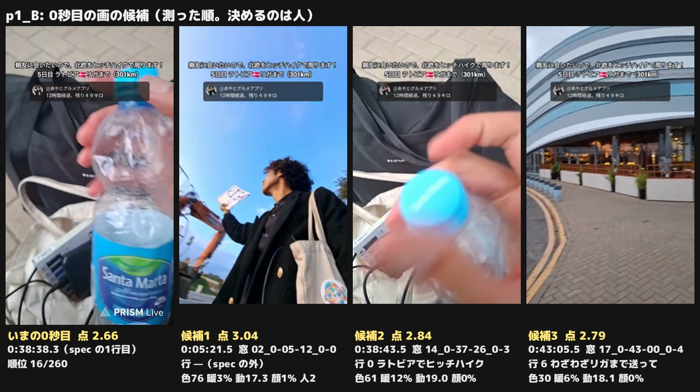
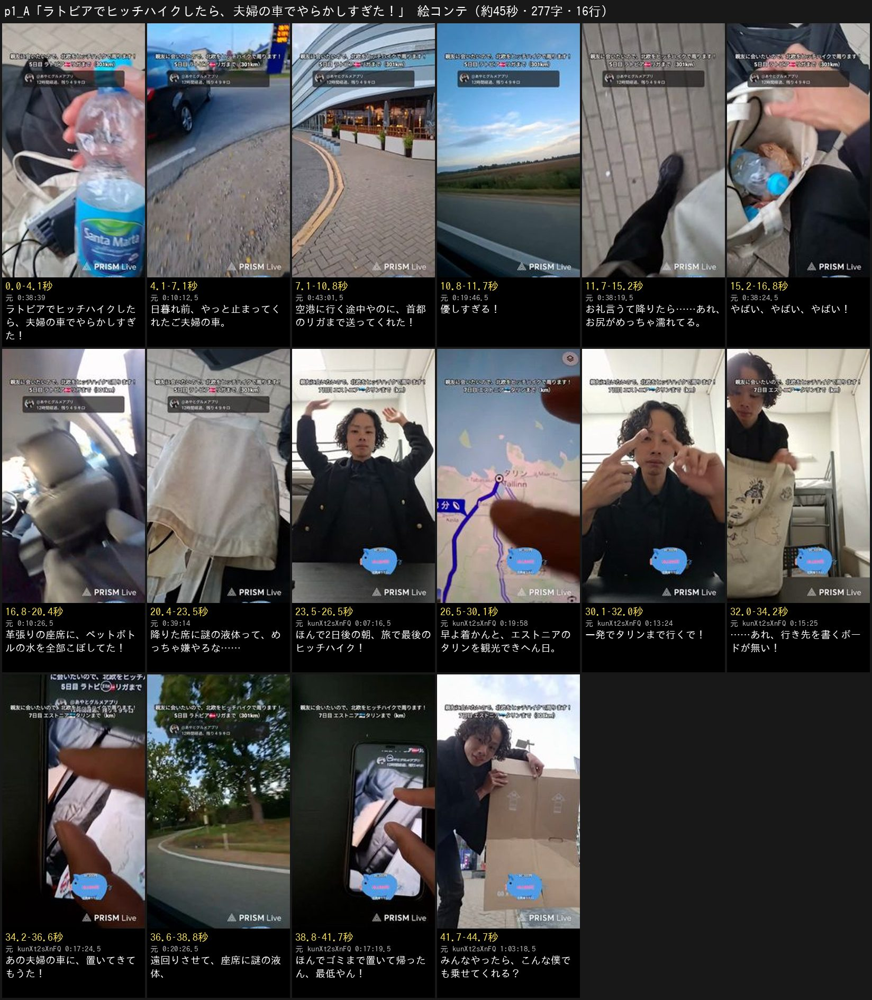
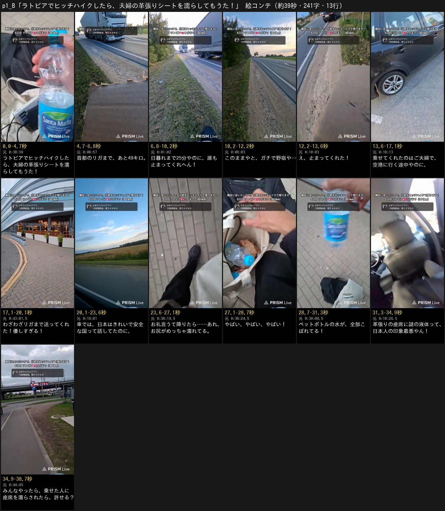

# Xvdk_P4gKoU p1 — 北欧ヒッチハイクで夫婦の車を濡らした件の原稿2案（1次レビュー: 原稿だけ）

制作 issue は #1105。あやとの依頼（2026-11-04・チャット）: 視聴者さんの付箋で届いた頼みを、「この人の提案版といつもの版の両方」で。
**本編集・声はまだ作らない**（あやとが原稿に返事をしてから）。1次は原稿だけで出した。返事を待つあいだに素材を取り込み、行ごとの画・0秒目・絵コンテを足した（5章。原稿の字は1次のまま）。

| | |
| --- | --- |
| 配信（2本） | 5日目 [Xvdk_P4gKoU](https://www.youtube.com/watch?v=Xvdk_P4gKoU)（2026-09-17 00:35 JST 開始。現地は 09-16 の夕方 18:35 ごろ）→ 7日目の朝 [kunXt2sXnFQ](https://www.youtube.com/watch?v=kunXt2sXnFQ)（2026-09-18 13:03 JST 開始。現地は 09-18 の朝 7:03 ごろ） |
| 付箋の頼み（要約） | 5日目に最後に乗せてもらったご夫婦の革張りの車でやらかした件。降りるところに加えて、7日目の朝に手書きのボードを車に置いてきたと気づくところまで |
| 案A（提案版） | 「🇱🇻ラトビアでヒッチハイクしたら、夫婦の車でやらかしすぎた！」——付箋の流れ（降りるところ → 2日後の朝に全部気づく）をそのまま骨にした。**16行・277字・見積もり 46.4秒** |
| 案B（いつもの版） | 「🇱🇻ラトビアでヒッチハイクしたら、夫婦の革張りシートを濡らしてもうた！」——こちらが見どころから組んだ。1本で伝えるのは5日目の1件だけ。**13行・241字・見積もり 40.5秒** |
| 機械の検査 | A: `lint.py` ✕ 0・△ 0／批評役1人目 `critic_gate.py` **✕ 0・△ 0**。B: `lint.py` ✕ 0・△ 1（題の札の行が 4.4秒）／批評役1人目 **✕ 0・△ 0** |

## 0. 字幕で確かめたこと（依頼の「確かめる」）

- **何が濡れたのか: 革張りの座席に、ペットボトルの水を全部こぼした。** 本人の言葉は Xvdk_P4gKoU 0:38:00「なんかお尻がめっちゃ濡れてると思ったら水こぼしちゃった…人の車で水こぼしちゃった」・0:39:00「（ボトル）から水が全部こぼれちゃった」・1:32:00「ペットボトル全部こぼれたし」。
  **付箋の言い方（お漏らし）は事実ではない。** 本人が「そう思われてるかも」と冗談で言った言い方（0:39:00・0:40:00）と、同じ時刻の書き込みの冗談。2案とも「水をこぼした」で書き、相手から見た困りごとは本人の言葉「謎の液体」（0:41:00）で止めた。下品な言い方は声にも字にも出さない
- **7日目の朝にボードが無いと気づく場面は kunXt2sXnFQ にある。** 0:14:00「ヒッチボードとかないよ」→ 0:14:30「え、ちょっと待って…ヒッチハイクボードないねんけど」→ 0:15:00「あの車に忘れてきた」→ 0:17:00 前の日の録画を見返して「これヒッチボード…取らなかった」。
  6日目の2本（k4DxGQlkD6U・oBN2tNEj3wA）の字幕には、ボードの話は無い（6日目はリガの観光の日で、ヒッチハイクをしていない）
- **ボードは5日目の夕方に「リガ」と書いて使っていたもの**（7puIEFev1a4 9:54:00「もうリガって書くわ…ヒッチハイク（ボード）に書いて」）。原稿では「行き先を書くボード」と言い、手書きかどうか・字が何かは声にしない（タリンへ行く日に「リガ」の字を言うと「？」になる）
- **ご夫婦は良い人のまま。** 空港へ向かう途中だったのに、下ろすわけにいかないとリガまで送ってくれた（0:27:30 本人の訳）。2案とも「優しすぎる！」で置き、最後のツッコミ（最低やん・印象最悪やん）は全部本人に向けている。ご夫婦の気持ちは決めつけない（本人の「あの夫婦めっちゃ後悔してるよ」は声にしていない）
- **議事録の書き違い:** `streams/2026/09/2026-09-17_0035_Xvdk_P4gKoU.md` の [0:13:00]「運転手からも『変な場所に連れていかれて身ぐるみ剥がされることも』と注意される」は、運転手さんではなく書き込みの読み上げ（チャット 0:13:07 と同じ字）。原稿には使っていない

### 外した範囲（F-059 の書きかたで）

- **書き込みの読み上げで動く所は、段ごと外した（F-048）。** Xvdk_P4gKoU 0:01:00 の「かわいそう度」、0:04:30〜0:06:00 の作戦（泣いてるふり・倒れてるふり）、0:13:00 の「気をつけて」、0:28:30「優しい人よかったよね」、0:32:00 の「止まるまで20分ぐらい」（問いへの返事）、0:39:00〜0:42:30 のうち下品な疑い・「後ろ座らん限り分からへん」・匂いの話・「奥さんいた」、kunXt2sXnFQ 0:15:30〜0:16:00 の「見た」「車に残ってた」、0:18:30〜0:19:00 の「何回か見た」「後部座席に乗せるから」
- **別の筋は外した（F-025）。** バスの無賃乗車ピンチ（Xvdk_P4gKoU 0:50:00〜1:01:00。書き込みの助言で動く段でもある）、レビュー最悪のホステルが神ホステルだった話（1:12:00〜1:28:00）、7日目に段ボールで作り直したボードで、開始15分でタリンまで4時間乗せてもらえた続き（kunXt2sXnFQ 2:31:30〜）、テザリングの故障・SIM（0:39:30〜）
- **B 案は、7日目のボードの話も外した。** 1本で伝えるのは1つ（`planning.md` 1.5）で、別の日の話を足すと答えのあとに行を重ねることになる（F-037）。付箋の流れは A 案で使う

## 1. 見どころ（付箋が指す場面を秒つきで。F-062）

字幕（30秒ごとの自動字幕）とチャットの時刻で突き合わせた（1次）。コマは素材を取り込んで 5章で確かめた。

| # | 回・時刻 | 何が起きるか（本人の言葉） | 前後の文脈・気をつけること | 使う案 |
| ---: | --- | --- | --- | --- |
| 1 | Xvdk_P4gKoU 0:00:00〜0:09:30 | 日暮れまであと25分（0:01:00）・あと49km（0:07:00）で「お願いします」を繰り返す。「遭難するよ」（0:05:00）「これガチの野宿」（0:08:00） | 12時間のヒッチハイクの終わり。トラックばかりで止まらない。間に書き込みの読み上げが多い | B 2〜4 |
| 2 | Xvdk_P4gKoU 0:10:00 | 「え、止まってくれた。止まってくれたんじゃ」 | 叫びは元の声の候補 | A 2・B 5（元の声） |
| 3 | Xvdk_P4gKoU 0:19:00 | 運転手さんと英語で、日本は clean・safe・expensive の話 | 誰がどちらを言ったかは字幕では分けられない。「話してた」で言う | B 8 |
| 4 | Xvdk_P4gKoU 0:27:30〜0:28:00 | 本当は空港へ行く途中だったが、下ろすわけにいかないと街まで送ってくれた（本人の訳）→「優しすぎる」 | 降ろしてもらったのはリガのモールの前（0:43:00）。そこからバス | A 3〜4・B 6〜7 |
| 5 | Xvdk_P4gKoU 0:37:00〜0:39:30 | お礼を言って「バイバイ」→「あれ、ちょっと待って…お尻がめっちゃ濡れてる…水こぼしちゃった。やばい、やばい、やばい、やばい」「人の車で水こぼしちゃった」「この水がこぼれてる…水が全部こぼれちゃった」 | 「やばい」は元の声の候補。0:39:00 の30秒には下品な疑いの言葉も入るので、元の声にはしない | A 5〜7・B 9〜11 |
| 6 | Xvdk_P4gKoU 0:40:00〜0:41:30 | 「日本人の印象下がりました」「革張りやから痛むんちゃう」「めちゃくちゃ申し訳ないねんけど悪気はないです」「降りた席から謎の液体出てきたらめっちゃ嫌やろな」「夫婦で乗ってたから」 | 「革張り」は書き込みに本人が「そう」と応えた形。0:41:30 の後半と 0:42:30 は書き込みの読み上げが混ざる | A 7〜8・B 12 |
| 7 | kunXt2sXnFQ 0:12:30〜0:14:00 | 「今日はこの旅で1番落とさない日」「早く着かないとタリンで何も観光できなくなる」「1発でタリンまで行きます」 | 7日目の朝、リガの宿。最後のヒッチハイクの日 | A 9〜11 |
| 8 | kunXt2sXnFQ 0:14:00〜0:15:00 | 「ヒッチボードとかないよ…え、ちょっと待って。ヒッチハイクボードないねんけど」→「あの車に忘れてきた」 | 0:14:30 の30秒に視聴者さんへの挨拶が入るので、元の声にはしない | A 12〜13 |
| 9 | kunXt2sXnFQ 0:16:00〜0:18:30 | 「事実確認しよう」→ 前の日の録画を見返して「取らなかった」（0:17:00）→「空港まで遠回りさして」「僕ゴミ置いてったん。最低じゃない？」「謎の液体を…座席に…ゴミまで捨てて帰られて」「あの夫婦めっちゃ後悔してるよ」 | 0:18:30〜0:19:00 は書き込みの読み上げ（何回か見た・後部座席）が混ざる | A 14〜15 |
| 10 | kunXt2sXnFQ 0:18:30・0:49:30・1:02:00 | 「スーパーで段ボールもらいましょう」→ 段ボールをもらって（0:49:30）、切ってボードに（1:02:00） | 声にはしない（別の筋に入る手前） | A 16 の画だけ |
| 11 | kunXt2sXnFQ 2:31:30 | 開始15分で、タリンまで4時間乗せてくれる車 | 新しい人・別の筋 | 使わない（F-025） |
| 12 | Xvdk_P4gKoU 0:50:00〜1:01:00・1:12:00〜1:28:00 | バスの無賃乗車ピンチ／神ホステル | 別の筋。前者は書き込みの助言で動く | 使わない |

## 2. 2案の比べ

| | A（提案版） | B（いつもの版） |
| --- | --- | --- |
| 題の札 | 🇱🇻ラトビアでヒッチハイクしたら、夫婦の車でやらかしすぎた！ | 🇱🇻ラトビアでヒッチハイクしたら、夫婦の革張りシートを濡らしてもうた！ |
| 骨 | 付箋のとおり: 降りる所 → 2日後の朝に全部気づく | 日暮れの道端 → 止まってくれた → 降りたら濡れてる（5日目の1件だけ） |
| 土台（F-022） | 2〜4行（日暮れ前にやっと拾ってくれて、遠回りまでしてくれた） | 2〜8行（あと49キロ・日暮れ・野宿・元の声「止まってくれた」・遠回り・日本の話） |
| 山 | 5〜8行（水を全部こぼしてた）＋ 11〜13行（ボードも置いてきた） | 9〜11行（お尻が濡れてる → 水が全部こぼれてる） |
| 答え | 15行「ほんでゴミまで置いて帰ったん、最低やん！」（やらかしを3つ並べる） | 12行「革張りの座席に謎の液体って、日本人の印象最悪やん！」（8行の前ふりを拾う） |
| 問い | みんなやったら、こんな僕でも乗せてくれる？ | みんなやったら、乗せた人に座席を濡らされたら、許せる？ |
| 写す参考 | f8t（意気込み → 外れ）・OEF（前ふり → あとで拾う） | ael（無理と言い切る → 手が来る）・OEF（前ふり → あとで拾う） |
| 元の声 | 6行「やばい、やばい、やばい！」 | 5行「え、止まってくれた！」・10行「やばい、やばい、やばい！」 |
| 尺 | 16行・46.4秒 | 13行・40.5秒 |

**どちらを出すかは決めない**（あやとが両方を見て選ぶ）。書いた側の見込みは、付箋の頼みに合うのは A、初見に1回で通じるのは B（話が1日・1件で、時間が跳ばない）。自己採点は予想で、結果で判断する。

---

## A案「🇱🇻ラトビアでヒッチハイクしたら、夫婦の車でやらかしすぎた！」（提案版）

### 概要

- **伝えたいこと（1行）:** 日暮れ前に拾ってくれて遠回りまでしてくれた優しいご夫婦に、僕は水・遠回り・忘れ物と、やらかしを重ねてしまった
- **狙う視聴者:** 旅とハプニングが好きな初見。誰でも一度はある「降りてから気づく」「置き忘れ」の身に覚えで止まらせる
- **感情の流れ:** ほっとする（拾ってもらえた・優しい）→ 「え？」（お尻が濡れてる）→ 青ざめる（革張りに全部）→ 気を取り直す（最後のヒッチハイク）→ もう一回「え？」（ボードが無い）→ 自分に呆れる（最低やん）
- **筋（`planning.md` 1.7）:** 夕暮れの道端（2）→ 車窓（3〜4）→ 降りた所（5〜8）→ 2日後の宿の朝（9〜12）→ まとめ（13〜15）→ 問い（16）。段ごとに場面が違う
- **2つ目の山（4〜8秒）:** 2〜3行（4.1〜10.6秒）「やっと止まってくれた → 空港に行く途中やのに、リガまで送ってくれた！」

### 題の札

**🇱🇻ラトビアでヒッチハイクしたら、夫婦の車でやらかしすぎた！**（0〜4.0秒・黒い箱）。付箋の核の言葉「夫婦の車」「やらかした」で言う（F-063）。場所（ラトビア）と起きたことを、気持ちの言葉「すぎた」で言い切る（F-031）。何をやらかしたかは伏せて、15行で3つ並べて答える。1行目は国旗を外して同じ字を読む（F-047）。26字・3.8秒。

### 写す参考と写し表（F-034・F-005。写すのは拍とつなぎだけ）

f8t（インド料理を素手で）の「？付きの意気込み → 思ってたら → ツッコミ」が「一発でタリンまで行くで！ → ボードが無い → 置いてきてもうた」に、OEF（パラグライダー）の「前ふりを先に置いて、8行あとで拾う」が「遠回り（3行）・謎の液体（8行）→ 14行で拾う」に重なる。

| 秒 | 参考のその拍で起きること | この原稿の行 | 写すもの | 写さないもの |
| --- | --- | --- | --- | --- |
| 0〜4 | 題の札＝やりたい事 | 1 | 題の札を1行目で読む | 札の中身（あやとの回は場所と出来事で言い切る） |
| 4〜12 | OEF 5〜6: 前ふりを先に置く | 2〜4 | ご夫婦の優しさ（空港に行く途中やのに）を先に置き、「優しすぎる！」で受ける | 同意書の言い回し |
| 12〜25 | OEF 29〜40: 体験 → 驚き → 自分を落とす | 5〜8 | 降りたら → 叫び（元の声）→ 何が起きたか → 相手の気持ちで自分を落とす | 例え（ジェットコースター・赤べこ） |
| 25〜38 | f8t 35〜40: ？付きの意気込み → 思ってたら → ツッコミ | 9〜13 | 「一発でタリンまで行くで！」→「……あれ、ボードが無い！」→「置いてきてもうた！」 | 講座の枠（初級・中級） |
| 38〜43 | OEF 18〜22: 前ふりを拾うツッコミ | 14〜15 | 3・8行の前ふり（遠回り・謎の液体）を拾って3つ並べ、自分に刺す | 「〜言わんかい！」の言い回し |
| 43〜46 | OEF 59〜62: 二択 | 16 | 乗せる・乗せないの二択 | — |

### 見る人とそろえる前提

- **「水をこぼしただけで、何がやらかし？」** を残さない。7行で「革張りの座席に」と言い（ただの水でも傷む）、8行で相手から見た「謎の液体」を言う。理由の説明の行は足さない（F-056）
- 知らない地名は国でそろえる: リガは「首都の」（3行）、タリンは「エストニアの」（10行）。ボードは12行で「行き先を書く」と、何の物かを同じ行で言う（F-008）
- 「2日後」は、間の日がリガの観光でヒッチハイクをしていないので、そのまま言える（何日目かは言わない）

### 0秒目の画の候補（1次の見込み。`hook.py` で測って選んだ結果は 5.1）

| 候補 | 回・時刻 | 何が写るはずか | 選ぶ理由 |
| --- | --- | --- | --- |
| 1（第一） | Xvdk_P4gKoU 0:38:00〜0:38:15 | 降りた直後、気づいて慌てる本人 | 題の答え「やらかし」を先に見せる。叫びの元の声（6行）と同じ場面を後でもう一度見せないよう、ここは音なしの寄り |
| 2 | Xvdk_P4gKoU 0:39:00〜0:39:30 | 空になったペットボトルを見せる（「この水がこぼれてる」） | 何が起きたかが1枚で分かる。7行と重なるので、0秒目に使うなら7行は別の秒に |
| 3 | kunXt2sXnFQ 0:17:00〜0:17:30 | 前の日の録画を見返し、座席に残ったボードを見つける所 | 2つ目のやらかしの証拠。録画の写しにチャット欄が写っていれば使わない |

**刺し素材（`tools/shorts/hookmap/`）の案:** 9〜10行の「2日後の朝、エストニアのタリンへ」で、リガ → タリンの道のりを地図で伸ばす。時間と場所が跳ぶ所を、字と声だけでなく画でもそろえられる（F-060 の「場所や道のりを見せると伝わる回」）。

### 原稿（全文）

```
ラトビアでヒッチハイクしたら、夫婦の車でやらかしすぎた！
日暮れ前、やっと止まってくれたご夫婦の車。
空港に行く途中やのに、首都のリガまで送ってくれた！
優しすぎる！
お礼言うて降りたら……あれ、お尻がめっちゃ濡れてる。
やばい、やばい、やばい！
革張りの座席に、ペットボトルの水を全部こぼしてた！
降りた席に謎の液体って、めっちゃ嫌やろな……
ほんで2日後の朝、旅で最後のヒッチハイク！
早よ着かんと、エストニアのタリンを観光できへん日。
一発でタリンまで行くで！
……あれ、行き先を書くボードが無い！
あの夫婦の車に、置いてきてもうた！
遠回りさせて、座席に謎の液体、
ほんでゴミまで置いて帰ったん、最低やん！【答】
みんなやったら、こんな僕でも乗せてくれる？
```

### 1行ずつ4欄（＋画）

秒は声を上限の速さ（毎秒6.8字）で読んだ見積もり（元の声の行は2.0秒で置いた）。画の列は、2026-11-04 に素材で確かめた秒（5章。回を書かない時刻は Xvdk_P4gKoU）。

| # | 秒（見積もり） | 元の出来事（配信の時刻） | 見る人に届く文（読み上げる字） | 残した本人の言葉 | 選んだ理由 | 画（確かめた秒） |
| ---: | --- | --- | --- | --- | --- | --- |
| 1 | 0.0–3.8 | 題の札をそのまま読む（F-047）。やらかしは Xvdk_P4gKoU 0:38:00〜0:41:00（降りた席に水をこぼした）と kunXt2sXnFQ 0:15:00〜0:18:30（ボードを車に置いてきた） | ラトビアでヒッチハイクしたら、夫婦の車でやらかしすぎた！ | やらかした（Xvdk_P4gKoU 0:39:00） | F-063: 付箋の核「乗せてくれた夫婦の車でやらかした」を題でそのまま言う。F-031: 場所（ラトビア）と起きたことを、気持ちの言葉「すぎた」で言い切る。何をやらかしたかは伏せ、15行で3つ並べて回収する | 【0秒目・hook.py の候補（下の 5.1）】0:38:38.3〜0:38:40.9 降りた歩道で、空になった Santa Marta のペットボトルを手に取ってカメラの前へ上げる（青いラベル。上半分は空）→ 0:05:33〜0:05:34.5 その日の夕方、道端で空へボードを掲げてヒッチハイクする本人（下からのあおり）。題の札の下 |
| 2 | 4.1–6.9 | Xvdk_P4gKoU 0:01:00「日暮れまであと25分」→ 0:00:00〜0:09:30 道端で「お願いします」を繰り返す → 0:10:00「え、止まってくれた」。乗っていたのが夫婦なのは 0:41:30「夫婦で乗ってたから」 | 日暮れ前、やっと止まってくれたご夫婦の車。 | 止まってくれた | 土台（F-022）: 日暮れ前にやっと拾ってもらえた有り難さを1行で置き、あとのやらかしを重くする。乗っていた人をここで紹介して、13行「あの夫婦」の前提にする（F-008） | 0:10:07.8〜0:10:09.6 夕方の道端を走る足元の先、ガソリンスタンドの入口にご夫婦の車（黒いワゴン）が止まって待っている（ナンバーは小さくて読めない。0:10:10〜0:10:11.5 は後ろのナンバーが読めるので使わない）→ 0:10:12〜0:10:13.2 車の横に追いつく（後ろの扉とタイヤ。ナンバー・車内の人は写らない） |
| 3 | 7.2–10.6 | Xvdk_P4gKoU 0:27:30「本当は空港に行きたかったから別の道にそれなあかんかったらしいけど、下ろすわけにいかへんかったから街中まで連れて行ってくれたらしい」（運転手さんの話を本人が訳した）。降ろしてもらったのはリガのモールの前（0:43:00）なので「リガまで」と言い、街の真ん中とは言わない | 空港に行く途中やのに、首都のリガまで送ってくれた！ |  | OEF 5〜6秒の前ふり: ご夫婦の優しさ（遠回り）を先に置き、14行「遠回りさせて」で拾う。リガは「首都の」を添えて初見に場所をそろえる（F-008・F-057。国は題で言った） | 0:27:31〜0:27:33 車窓の高速（ガードレールと森。空港の話を訳した所）→ 0:43:01〜0:43:02.6 降ろしてもらったリガのモール（RIGA PLAZA）の曲がった壁とテラス。看板の RIGA PLAZA が大きく写る 0:36:23〜0:36:25 はカクつく（繰り返し 70〜80%）ので、なめらかなこちら |
| 4 | 10.9–12.1 | Xvdk_P4gKoU 0:28:00「優しすぎる」 | 優しすぎる！ | 優しすぎる | 前の行の事実に、本人の反応を1語で返す（2〜3秒ごとに反応）。ご夫婦をはっきり良い人として置き、あとの「最低やん」を自分に向けた落ちにする | 0:19:46〜0:19:47.1 車窓に夕日の当たる広い畑と青空 |
| 5 | 12.4–15.6 | Xvdk_P4gKoU 0:37:00〜0:37:30 お礼を言って「バイバイ」→ 0:38:00「あれ、ちょっと待って…なんかお尻がめっちゃ濡れてると思ったら」 | お礼言うて降りたら……あれ、お尻がめっちゃ濡れてる。 | お尻がめっちゃ濡れてる | 方針3: 「〜たら……」で開けて、次の行の叫びで返す。降りてから気づいた順のまま、見る人も一緒に「え？」となる | 0:38:16〜0:38:18 降りて歩き出した歩道（車道との境の黄色い線）→ 0:38:19〜0:38:20.6 立ち止まって自分の脚と足元を見下ろす（気づいた所）。降りる瞬間と車の横腹（0:37:26〜0:38:15）は回線が詰まってカクつく（繰り返し 70〜83%）ので使わない |
| 6 | 15.9–17.9 | 【元の声 Xvdk_P4gKoU 0:38:00〜0:38:30】「水こぼしちゃった。やばい、やばい、やばい、やばい」 | やばい、やばい、やばい！ | やばい、やばい、やばい | F-051: 気づいた瞬間の本人の叫びを、AI の声でなく元の音で流して臨場感を出す。この30秒に視聴者さんの名前や読み上げは無い | 【元の声 0:38:24.2〜0:38:25.4】トートバッグの中をのぞき込むと、ペットボトル（青いキャップ）が見える |
| 7 | 18.2–21.6 | Xvdk_P4gKoU 0:38:00「人の車で水こぼしちゃった」・0:39:00「（ボトル）から水が全部こぼれちゃった」・1:32:00「ペットボトル全部こぼれたし」。革張りは 0:40:30「革張りだったよね…革張りやから痛むんちゃう」（車内のコマで座席を確かめる） | 革張りの座席に、ペットボトルの水を全部こぼしてた！ | 全部こぼれちゃった | 叫びの答え（何が起きたか）を1行で。やらかしの1つ目。革張りを同じ行に入れ、ただの水でも困ることを、理由の行を足さずに伝える（F-056） | 0:10:26〜0:10:27.6 乗った直後の車内、前の座席の背もたれ（黒い革。縫い目と頭当て。運転席の人は肩だけで顔は写らない）→ 0:39:08〜0:39:10 空になったペットボトルを歩道の上にかざして見せる（「この水がこぼれてる」） |
| 8 | 21.9–24.7 | Xvdk_P4gKoU 0:41:00「ヒッチで乗せた人が降りた席から謎の液体出てきたらめっちゃ嫌やろな」 | 降りた席に謎の液体って、めっちゃ嫌やろな…… | 謎の液体・めっちゃ嫌やろな | ご夫婦の側から見た困りごとを、本人の言葉で言う。配信の中の下品な冗談は使わず「謎の液体」で止める。14行「座席に謎の液体」の前ふり（OEF） | 0:39:13.3〜0:39:15 濡れてしみになったトートバッグの底の寄り → 0:41:01〜0:41:02.4 降ろしてもらったモールの前の歩道を歩く（夕方の曇り空） |
| 9 | 25.0–27.8 | kunXt2sXnFQ 0:03:30「ついに僕たちの旅も7日目に来ました」・0:04:00「今日と明日で終わり」・1:07:30「ラストは最後のヒッチ先」。車は 09-16 の夕方（現地）、この朝は 09-18。間の日（k4DxGQlkD6U）はリガの観光でヒッチハイクをしていない | ほんで2日後の朝、旅で最後のヒッチハイク！ |  | 「ほんで」で場面を移す（転）。何日目かは常連向けなので言わず「2日後の朝」で時間だけそろえる。「最後の」で、この日に懸かっているものを先に置く（方針2） | kunXt2sXnFQ 0:07:15.8〜0:07:17.8 宿の部屋で準備を終え、両手を上げて「行きましょうか」（7日目の朝7時）→ kunXt2sXnFQ 1:01:39.8〜1:01:40.8 同じ朝、外に出て曇り空の下で笑う |
| 10 | 28.1–31.5 | kunXt2sXnFQ 0:13:00「早くつかないとエストニアが…もう何もできなくなっちゃう」・0:14:00「タリンにつくのが遅くなると何も観光できなくなる」 | 早よ着かんと、エストニアのタリンを観光できへん日。 |  | 方針2: 失うもの（タリンの観光）を、ボードが無いと分かる前に言う。タリンは国の名前を添えて初見にそろえる（F-008） | kunXt2sXnFQ 0:13:09.8〜0:13:11.2 宿で「早く着かないと」と話す自撮り → kunXt2sXnFQ 0:19:57〜0:19:59.2 スマホの地図にリガ → タリンの道のり（4時間13分）。本編集で刺し素材の地図に替える案 |
| 11 | 31.8–33.4 | kunXt2sXnFQ 0:14:00「今回の作戦はもう1発でタリンまで行きます」 | 一発でタリンまで行くで！ | 1発でタリンまで | f8t 35〜40秒: 調子に乗った意気込みを前に置き、次の行で外す。意気込みなので、外れても取消ではなく状況が動くだけ（F-040） | kunXt2sXnFQ 0:13:23〜0:13:24.9 宿で両手を振って意気込む自撮り（意気込みの行なので顔）。「1発でタリン」と言う 0:14:15〜0:14:20 は回線が詰まってカクつく（繰り返し 70〜77%）ので、同じ話の続きのなめらかなこちら |
| 12 | 33.7–35.6 | kunXt2sXnFQ 0:14:00「ヒッチボードとかないよ」→ 0:14:30「え、ちょっと待って…ヒッチハイクボードないねんけど」。ボードは前の日まで行き先（リガ）を書いて使っていたもの（7puIEFev1a4 9:54:00） | ……あれ、行き先を書くボードが無い！ |  | f8t の外し。ボードが何かを同じ行の「行き先を書く」で言い、前置きなしで初見に通じるようにする（F-008）。「リガ」の字だったことは言わない（タリンへ行く日に、リガの字で「？」になる） | kunXt2sXnFQ 0:15:24〜0:15:26.2 トートバッグを開いて中を探す（ボードが無いと気づいて荷物を探す所。0:14:22〜0:14:39 の最初に探す所はカクつくので使わない） |
| 13 | 35.9–38.1 | kunXt2sXnFQ 0:15:00「あの車に忘れてきた」→ 0:17:00 前の日の録画を見返して「これヒッチボード…取らなかった」 | あの夫婦の車に、置いてきてもうた！ | 忘れてきた | 前の行の問い（どこ？）にすぐ答える。「あの夫婦」は2行目で紹介済み。見返して確かめたことは声に入れず、置いてある座席の画で見せる | kunXt2sXnFQ 0:17:23.5〜0:17:26 前の日の録画をスマホで見返し、降りる直前の後ろの座席を指さす（黒い革の座席に、ボードの段ボールとトートバッグ。録画の 37:43〜37:44） |
| 14 | 38.4–40.3 | kunXt2sXnFQ 0:16:00「空港まで行こうとしてたところを軌道変更してもらって」・0:16:30「空港まで遠回りさして」・0:18:00「謎の液体を…座席にばらまかれて」 | 遠回りさせて、座席に謎の液体、 | 遠回りさして・謎の液体 | OEF 18〜22秒: 3行と8行の前ふりを拾って並べる。言いさしの「、」で開けて、次の行の3つ目で落とす（方針3） | 0:20:26〜0:20:27.1 車窓の曲がり道と大きな木（遠回りの呼び戻し）→ kunXt2sXnFQ 0:17:26.5〜0:17:27.6 見返す録画の、自分が座っていた黒い革の座席 |
| 15 | 40.6–43.3 | 【答】kunXt2sXnFQ 0:16:30「僕ゴミ置いてったん。最低じゃない？」・0:18:00「ゴミまで捨てて帰られて」 | ほんでゴミまで置いて帰ったん、最低やん！ | ゴミ置いてった・最低 | 題「やらかしすぎた」の答え: やらかしの3つ目を、自分を落とすツッコミで言い切る。答えが出たらすぐ問いへ渡す（F-037） | kunXt2sXnFQ 0:17:18.6〜0:17:20.2 録画を拡大して、座席に置いたままのボード（段ボール）を指で示す → kunXt2sXnFQ 0:17:38〜0:17:39.4 カメラに顔を寄せて苦笑い（ツッコミの行なので顔） |
| 16 | 43.6–46.4 | 本人の「あの夫婦めっちゃ後悔してるよ、僕のしたこと」（kunXt2sXnFQ 0:17:30・0:18:30）を、見る人への問いにした | みんなやったら、こんな僕でも乗せてくれる？ |  | F-032: 題の気持ち（やらかした僕）のまま、乗せる・乗せないの二択で答えやすい問いにして返す。ご夫婦の気持ちを決めつけない | 0:05:38〜0:05:39.4 5日目の夕方、ボードを空へ掲げて車を待つ（呼び戻し）→ kunXt2sXnFQ 1:03:17.6〜1:03:19.3 新しいボードにする大きな段ボールの陰から顔を出す |

### 約束のカードの当て表

| ID | 約束 | 当たる行 | どう直したか／当たらない理由 |
| --- | --- | --- | --- |
| F-004 | 外の語り手の説明口調にしない。あやとの一人称・あやとの言葉（関西弁）で書く | 2, 3, 4, 5, 7, 8, 10, 13, 15, 16 | 全16行を僕の一人称・関西弁（やのに・言うて・やろな・早よ着かんと・できへん・もうた・やん）で、帰ってから見る人に語る形にした。「あやとは」「〜だそうです」の外の説明は0。本人の言葉（止まってくれた・優しすぎる・お尻がめっちゃ濡れてる・やばい・謎の液体・最低）は配信のまま |
| F-005 | 参考の骨組みに企画を入れ替えない。借りるのは構成の原則だけ | 3, 8, 11, 12, 14, 15, 16 | 企画の型（ハプニング）・伝えたいこと（優しいご夫婦に、やらかしを重ねた）・山（水）とオチ（ボードとまとめ）は付箋の流れのまま。f8t から「意気込み → 外れ」（11→12）、OEF から「前ふり → 8行あとで拾う」（3・8→14）と最後の二択だけ借りた。言い回しは借りていない |
| F-006 | ふだん人が言わない言い回しを使わない | 2, 5, 9, 12, 13 | 「止まってくれた」「お礼言うて降りたら」「2日後の朝」「行き先を書くボード」「置いてきてもうた」と、口で言う言葉にした。「ヒッチハイクボード」「乗車」「降車」のような書き言葉・用語は使わない |
| F-007 | お金は円だけで言う。1行に同じ中身を2回入れない | — | お金の行は無い。宿代・バス代・ビッグマックの値段（Xvdk_P4gKoU 1:07:00）は題の答えに要らないので言わない |
| F-008 | 見る人の頭に「？」を残さない。知らない名前・番号、日本の常識と食い違う前提、前… | 2, 3, 10, 12, 13 | 人（ご夫婦）は2行目で紹介し、13行は「あの夫婦」で受ける。場所はリガを「首都の」、タリンを「エストニアの」で初見にそろえた。ボードは12行で「行き先を書く」と何の物かを同じ行で言う。配信の中の呼び名・あだ名は使わない |
| F-014 | ナレーションが名指す物が、その行の画に写っている | 2, 3, 5, 7, 12, 13, 16 | visual に、その行が名指す物・動き（止まる車・車窓・降りる所・空のペットボトル・荷物を探す手元・座席のボード・段ボール）が写る配信の時刻を書いた。2026-11-04 に字幕・1秒1コマ・clips で行ごとに名指す物が写る秒を確かめて差し替えた（5章）。狙いの秒を写っている証拠にしない |
| F-015 | 題の札は 0秒目から開始4秒まで。地は黒い箱 | 0 | title_card_seconds 4.0。0秒目から出来上がった形で出して4秒で消す。地は黒い箱（title_card_bg black） |
| F-019 | ナレーションを早送りにしない。声の倍率は 1.4 まで、入らないなら字を減らす | 1, 2, 3, 5, 7, 8, 9, 10, 12, 13, 14, 15, 16 | 16行・277字（lint の数え。6行の元の声9字を含む。AI が読むのは268字）。350字・22行の内。倍率は1.4を越えない。入らなければ build_edit.py が止まって減らす字数を出すので、その数だけ削る |
| F-022 | 案ごとに話の強みを分けない。どの案にも土台 → 山 → 結末 → 問い | 2, 3, 7, 12, 15, 16 | 1案の中に全部: 土台＝日暮れ前にやっと拾ってくれて、遠回りまでしてくれたご夫婦（2〜4行）→ 山＝降りたら座席に水を全部こぼしていた（5〜8行）→ 結末＝2日後、ボードまで置いてきたと気づき、やらかしを3つ並べる（9〜15行）→ 問い（16行）。削ったのは途中の経緯（バスの無賃乗車・宿のレビュー・7日目の電波の故障） |
| F-025 | 結末に別の筋を足さない。題の気持ちで終える | 15, 16 | 結末は題の「やらかしすぎた」の側で閉じる（15「最低やん」→16「こんな僕でも」）。段ボールで作り直してタリンまで乗せてもらえた続き（kunXt2sXnFQ 2:31:30）・神ホステルの話は、別の筋なので足さない |
| F-030 | 題の札に、国の名前の前に国旗を付ける | 0 | 題の札の国の名前（ラトビア）の前に 🇱🇻（flags.py emoji ラトビア の字）。国旗は読み上げない（1行目の字には入れない） |
| F-031 | 題は、場所と、そこで本当に起きたこと（出来事・数字）で言い切る。比喩を題にしない | 0, 1 | 「〈場所〉でヒッチハイクしたら、〈本当に起きたこと〉」の形で、場所（ラトビア）と出来事（夫婦の車でやらかした）を言い、終わりを気持ちの言葉「すぎた」で言い切る。比喩・見立ては無い。題の前提（乗せてもらった）から答え（やらかし3つ）までを筋にした |
| F-032 | 最後の行は「みんな」への問いか、入りきらなかった見どころを渡す「アーカイブ見て… | 16 | 最後は「みんな」への問い1行（乗せる・乗せないの二択）。そのあとに何も足さない。次の配信の時刻は決まっていないので配信には誘わない |
| F-033 | 話の幅は、狭すぎず広すぎず | 2, 5, 9, 12, 15 | 筋は「やらかし」の1本で、夕暮れの道端（2）→ 車窓（3〜4）→ 降りた所（5〜8）→ 2日後の宿の朝（9〜12）→ まとめ（14〜15）と、段ごとに違う場面が載る。無賃乗車・ホステル・電波の故障など筋に乗らない場面は入れない |
| F-034 | 1本目で研究した構成（どの参考を、どの拍で写すか）を毎回当て、自分のレビューを… | 3, 8, 11, 12, 14, 15, 16 | 書く前に写す参考を決めた: f8t 35〜40秒（？付きの意気込み → 思てたら → ツッコミ）を 11〜13行、OEF 5〜6秒の前ふり → 18〜22秒の拾い（3・8行 → 14行）、OEF 59〜62秒の二択を16行。要の行の reason に使った手を書いた。lint と往復を知らない批評役の関所を通し、もう一度頭から声に出すつもりで読んで35枚を当て直した |
| F-035 | 作った見立て（「〇〇に見えてきた」）を言わない。比べるなら、見る人の物差しと数… | 8, 15 | 見立て・「〜に見えてきた」は0。比べも使っていない。「謎の液体」「ゴミ」は本人が配信で言った言い方（Xvdk_P4gKoU 0:41:00・kunXt2sXnFQ 0:16:30） |
| F-036 | 映像の枠の中でだけ正しい事実を、落ちに使わない | 3, 7, 9, 13 | 「リガまで」は降ろしてもらったのがリガのモールの前（Xvdk_P4gKoU 0:43:00）なので、街の真ん中とは言わない。「全部」は本人の言葉（0:39:00）。「2日後」は 09-16 の夕方 → 09-18 の朝で、その間にヒッチハイクはしていない。「最後のヒッチハイク」は、この日のあとは船と飛行機だけ（kunXt2sXnFQ 1:07:30・6:19:00）で、旅の範囲で正しい。13行は本人が録画を見返して確かめている（kunXt2sXnFQ 0:17:00） |
| F-037 | 答えが出たら、すぐ締める。同じ話の行を重ねない | 15, 16 | 答え（15行）が出たら16行の問いへすぐ渡す。「あの夫婦めっちゃ後悔してるよ」「段ボールもらいに行こ」は答えのあとに重ねない。水の話（5〜8）は4拍、ボードの話（11〜13）は3拍で次へ移る |
| F-039 | 配信をなぞらない。前の行から次の行へ、見る人が自分で渡れるように書く（行間を空… | 3, 5, 9, 11, 12, 14 | 起きた順の字幕をつながず「拾ってくれた → 優しい → 降りたら → 叫び → 何が起きたか → 相手の気持ち → 2日後 → 懸かっているもの → 意気込み → 外れ → どこに → まとめ」と、前の行を聞いた人の問いに次の行が応える形に組んだ。5・14行は「〜たら……」「、」で開けて次の行で返す。13行は前の行の「どこ？」に答える |
| F-040 | 話を二転三転させない。見る人が受け取った結論をひっくり返すのは、1本に1回まで | 4, 11, 12, 15 | 本人の言い切りを取り消す行は0。11「一発で行くで！」→12「ボードが無い」は、外の出来事で状況が動いただけ（意気込みは本当のまま）。4「優しすぎる」は最後まで打ち消さない（15「最低やん」は自分に向けたツッコミ）。謝る行も無い |
| F-043 | 「参考にしたい」の型では、題の札は旅の手段と日数で言う。同行者の話は入れない | — | 手段と日数で回る「参考にしたい」の回ではなく、ハプニングの回なので当たらない。同行者も出ない |
| F-047 | 冒頭は原則、題をそのまま読む。原稿は急がされても時間をかけて質を上げる | 1, 4, 5, 6, 8, 15 | 1行目は札の字そのまま（国旗だけ外す）。出来事は本人の言い方（優しすぎる・お尻がめっちゃ濡れてる・やばい・謎の液体・最低）で書いた。配信に無い決め台詞・意気込みだけのつなぎは足していない（11行は本人の「1発でタリンまで行きます」）。次の配信の時刻は未定なので最後は問い |
| F-048 | 配信の内輪（コメント・チャット・あだ名・常連の言葉）を持ち出さない。ショートを… | 2, 7, 12, 13 | コメント・チャット・視聴者の書き込みで動く話は0。字幕のうち書き込みの読み上げ（Xvdk_P4gKoU 0:13:00 の「気をつけて」、0:39:00〜0:42:30 の下品な疑いと「後ろ座らん限り」、kunXt2sXnFQ 0:15:30・0:18:30・0:19:00）は材料にしていない。7行の「ペットボトル」「革張り」は本人の言葉の所を根拠にした。配信の中の呼び名も出さない |
| F-049 | 題も原稿も、助詞を抜いた詰めた日本語にしない。早口で曖昧な日本語は聞き手のスト… | 0, 3, 7, 10, 12 | 題・全行とも助詞を入れた形（「ラトビアでヒッチハイクしたら」「首都のリガまで」「座席に、ペットボトルの水を」「タリンを観光できへん」「行き先を書くボード」）。「見に行く」「来たら」の詰めた形は無い |
| F-050 | 字幕をつなげて並べない。推論に時間とトークンを使い、面白く・ハラハラして・海外… | 2, 5, 7, 8, 10, 11, 12, 15 | この1枚から筋を考えて組んだ。面白い（8 謎の液体・15 ゴミまで…最低やん）・ハラハラ（2 日暮れ前・10〜12 時間の無い朝にボードが無い）・海外の空気（3 リガへの車窓・10 エストニアのタリン）を置いた。海外の有益は、この回の型（ハプニング）では無理に足さない。字幕を順につないだ行は無い。35枚は直したあとにもう一度1枚ずつ当てた |
| F-051 | 叫び・驚きの声（うわー・やばい）は、臨場感が出るなら配信の本人の声をそのまま使… | 6 | 6行は、水に気づいた瞬間の「やばい、やばい、やばい」を元の声で流す（Xvdk_P4gKoU 0:38:00〜0:38:30 の中。秒は素材の音で合わせ、話している所だけで大きさを測って上げる）。字幕もその字。kunXt2sXnFQ 0:14:30 の叫びは、同じ30秒に視聴者さんへの挨拶が入るので AI の声 |
| F-052 | 型の違うショートに、配信の回の型を持ち込まない。雰囲気の型は、ゼロから決める | 1, 16 | 配信アーカイブを本人の声で語る回なので、帳面の型（関西弁の一人称・題の札・最後の問い）をそのまま使う。型の違う回ではない |
| F-054 | トラブルの原因を伝え、次の場所に着いたら説明を引っ張らない | 7, 13 | トラブルの原因を声で言う: 水は「ペットボトルの水を全部こぼしてた」（7）、ボードは「あの夫婦の車に置いてきた」（13）。どちらも1行で、そのあと説明を引っ張らない |
| F-055 | グルメの回は、店の空気（行列・相席の人が頼んだ物・目の前で焼いている物）と「何… | — | グルメの回ではないので当たらない。ビッグマックの値段・LIDO の話は使わない |
| F-056 | 細部を詰め込まない。数字・比べ・理由を削って、出来事を1行1つで進める。本当に… | 2, 7, 9, 14 | 数字は9行の「2日後」だけ（時間の跳びを初見にそろえるのに要る）。日暮れまでの25分・残り49km・止まるまでの約20分・リガからタリンまでの距離は削った。理由の説明（革張りやから傷む）は7行の「革張りの」に畳んだ。1行に出来事1つ |
| F-057 | 題は大きい枠（国・本場・「めちゃくちゃ美味しい」）で引き、街の名前は2行目で出… | 0, 3 | 題は国（ラトビア）の大きい枠で引き、知られていない街の名前（リガ）は3行目で「首都の」を添えて出した。グルメの名物の題ではない |
| F-059 | 「〜は要らない」と言われた場面は、そこから続く出来事（そこで買った物を食べる話… | — | あやとから「〜は要らない」と言われた場面は、この回にはまだ無い（1次）。付箋の流れの外にある段（無賃乗車・ホステル・段ボールで作り直したあとの4時間の車）は、題の気持ちと別の筋なので段ごと外した |
| F-061 | 題が「簡単」なら、失敗を山にしない。手順を温度・時間の数字つきで並べ、見た人が… | — | 題が「簡単」の回ではないので当たらない |
| F-063 | 題は、依頼の核の言葉で言う。題材が決まった回に、題材の外のもの（犬の回の猫）を… | 0, 2, 13 | 付箋の核「乗せてくれた夫婦の車でやらかした」を題で「夫婦の車でやらかしすぎた」と言う。題材の外（バス・ホステル・鳩）は入れない。夫婦は2行目で紹介し、13行で同じ言葉で受ける |
| X2 | 煽らない・事実と違うことを言わない。1行ずつ、元動画の時刻か外の出典を持つ | 3, 7, 9, 10, 13, 14, 15 | 各行の why に「videoId H:MM:SS」で配信の時刻を書いた。3行は降りた場所がモールの前なので「リガまで」。7行の革張りは、車内のコマで座席が黒い革（縫い目のある背もたれ）なのを確かめた（0:10:26・0:37:33）。14行の「謎の液体」は本人の言い方で、中身は水だと7行で言っている。下品な疑い（配信の中の冗談）は声にしない。盛った数・起きていない危険は無い |

### 尺の見積もり（`script_writing.md` 6）

16行・277字（lint の数え）・AI が読む字 268・**46.4秒**（毎秒6.8字・行の間0.3秒・元の声は1行2.0秒で置いた）。60秒未満・350字・22行の内。声を作ったら実物の長さで測り直す

### 自己評価（書いた側の見込み。出すかどうかは決めない。結果で判断する）

| 冒頭の引き | 初見の分かりやすさ | 意外性 | 画の魅力 | 物語 | テンポ | 見終わった満足 | 狙いとの合い |
| ---: | ---: | ---: | ---: | ---: | ---: | ---: | ---: |
| 4 | 4 | 4 | 3 | 4 | 4 | 4 | 5 |

画の魅力が3なのは、車内・道端・宿の自撮りが多く、景色はリガへの車窓と夕暮れくらいだから（画の種類はおよそ8: 夕暮れの道端・止まる車・高速の車窓・リガの街並み・降りた所・ペットボトル・宿の朝・荷物を探す手元）。初見の分かりやすさが4なのは、9行で2日跳ぶから（刺し素材の地図でそろえる案）。

### 気をつけること

- **ご夫婦の顔:** 乗る所・降りる所・車内でご夫婦が写れば、ぼかすか別の画にする（第三者の顔。大きく写るならぼかさず別の画）
- **下品な言い方を出さない:** Xvdk_P4gKoU 0:39:00〜0:42:30 は本人と書き込みの冗談で下品な疑いが続く。元の声に使うのは 0:38:00〜0:38:30 の「やばい」だけで、その秒に別の言葉が入っていないかを音で確かめる
- **配信の画面の写し:** kunXt2sXnFQ 0:10:30〜0:12:30（旅の道のりのサイト）と 0:17:00（前の日の録画）は、視聴者さんのキャラクターやチャット欄が写るなら使わない
- 配信の透かし・固定コメントの帯・投げ銭の表示は、書き出しで隠す
- 15行「ゴミ」はボードのこと（相手から見た言い方）。字幕の大きい字にするなら「最低やん！」の方（ツッコミ）

### A案 レビューの記録（`script_writing.md` 7.3・7.6）

| 回 | 誰 | (a) | (b) | (c) | (d) | (e) | (f) | 離れる行 | (h) 帳面 | (i) つなぎ | 直したこと |
| --- | --- | ---: | ---: | ---: | ---: | ---: | ---: | --- | --- | --- | --- |
| 0 | lint（16行・277字） | | | | | | | | ✕ 0・△ 0 | | —（下書きの段で題を30字 → 26字に縮めて L-SEC の △ を消した） |
| 1 | 批評役1人目（gate: ✕ 0・△ 0） | 4 | 4 | 4 | 4 | 4 | 4 | なし | なし（35枚とも当てた） | 跳 0/16・取消 0・その行だけで通らない 0/16・画に居ない人の言葉 0 | — |

- **批評役は1人・直しは0回**（上限は2人・2回。F-044）。1人目に ✕ が無いので2人目は呼んでいない（7.3）
- 批評役の点の理由のうち、直していないもの: (b)「9〜11行目は準備の行が3つ続く」、(d)「タリンの前ふりは拾われない」。どちらも 4 で △ でもない。まとめ役が直すと決めるなら案は、9・10行を「ほんで2日後の朝、エストニアのタリンへ最後のヒッチハイク！」「早よ着かんと観光できへんし、一発で行くで！」の2行に畳み（11行と合わせて準備が2行）、lint と批評役を回し直す
- 回しかた: `critic.py` を、2本の回をまたぐ原稿のために**字幕の入れかただけ**差し替えた包み（spec の why・src の「videoId H:MM:SS」から回ごとに前後30秒を切り、それぞれの回のチャットで読み上げを伏せる。`brief.critic_source` の差し替え。リポジトリの道具は書き換えていない）で回した。渡した原稿は下書きのコミット 78b0cfbb から `git show` で書き出した写し
- 批評役で割れた所: なし
- 使ったもの: 批評役1回（68秒・39,514トークン、うち出力 6,629）

lint の最後の出力:

```
原稿: shorts/videos/Xvdk_P4gKoU/p1/script_A.txt（16行・277字）  題: spec_A.json の title_card
結果: ✕ 0・△ 0（当てた規則 24/24）。字で拾える指摘には当たっていない（面白いかは批評役の (h) で）
```

`critic_gate.py`（1人目）:

```
点: a4 b4 c4 d4 e4 f4  つなぎ: 跳 0/16・取消 0  その行だけで通らない: 0/16  当てた約束: 35  批評役の一言: 通る
結果: 通る（✕ 0・△ 0）
```

控え: `critic_A1.json`（批評役の返事）・`critic_gate_A1.txt`・`lint_A.txt`（この置き場）。渡した1枚（字幕が入るので置かない）は作業場所。

---

## B案「🇱🇻ラトビアでヒッチハイクしたら、夫婦の革張りシートを濡らしてもうた！」（いつもの版）

### 概要

- **伝えたいこと（1行）:** 日暮れに野宿しかけた僕を、遠回りしてまで送ってくれた優しいご夫婦の革張りの座席に、僕は水を全部こぼしていた（降りた瞬間に気づいた）
- **狙う視聴者:** 旅とハプニングが好きな初見。「拾ってもらえた安心」から「降りた瞬間の青ざめ」への落差で止まらせる
- **感情の流れ:** ハラハラ（あと49キロ・日暮れ・野宿）→ ほっとする（止まってくれた・優しすぎる）→ 「え？」（お尻が濡れてる）→ 青ざめる（全部こぼれてる）→ 自分に呆れる（日本人の印象最悪やん）
- **筋（`planning.md` 1.7）:** 夕暮れの道端（2〜5）→ 車窓とリガの街並み（6〜8）→ 降りた所（9〜12）→ 問い（13）
- **2つ目の山（4〜8秒）:** 2〜3行（4.7〜10.0秒）「首都のリガまで、あと49キロ。→ 日暮れまで25分やのに、誰も止まってくれへん！」
- **いつもの版で決めたこと:** 1本で伝えるのは1つ（`planning.md` 1.5）にして、5日目の1件に絞った。土台（なぜ応援したくなるか）を厚くし、答えを3分の2あたり（33〜37秒）に置いて、すぐ問いで締める（F-037）

### 題の札

**🇱🇻ラトビアでヒッチハイクしたら、夫婦の革張りシートを濡らしてもうた！**（0〜4.0秒・黒い箱）。付箋の核「乗せてくれた夫婦の、革張りの車」を題で言い（F-063）、場所と本当に起きたこと（座席を濡らした）を、悔やむ本人の言い方「〜してもうた」で言い切る（F-031）。何で濡れたかは伏せて、11〜12行で答える。30字・4.4秒で lint の L-SEC が △（4秒を越える行）。縮めるなら「…濡らした！」（27字）だが、気持ちの言葉が消えるので残した。

### 写す参考と写し表（F-034・F-005。写すのは拍とつなぎだけ）

ael（地球一周）の「見る人の常識の数で『無理』と言い切る → 次の行で手が来る」が「あと49キロ・日暮れ・野宿 → え、止まってくれた！」に、OEF の「前ふりを先に置いてあとで拾う」が「日本はきれいで安全な国（8行）→ 日本人の印象最悪やん（12行）」に重なる。

| 秒 | 参考のその拍で起きること | この原稿の行 | 写すもの | 写さないもの |
| --- | --- | --- | --- | --- |
| 0〜4 | 題の札＝やりたい事 | 1 | 題の札を1行目で読む | 札の中身 |
| 4〜12 | ael 3〜5: 数で「無理」と言い切る | 2〜4 | 「あと49キロ」「日暮れまで25分」→「ガチで野宿や」 | 値段の話 |
| 12〜21 | ael 5〜8: 手が来る → すぐ反応 | 5〜7 | 「え、止まってくれた！」（元の声）→ 空港に行く途中やのに → 優しすぎる | 「思てたら」の字（外の出来事で動くので要らない） |
| 21〜24 | OEF 5〜6: 前ふりを先に置く | 8 | 「日本はきれいで安全な国って話してたのに、」 | — |
| 24〜33 | OEF 29〜40: 体験 → 驚き | 9〜11 | 降りたら → 叫び（元の声）→ 何がこぼれたか | 例え |
| 33〜37 | OEF 18〜22: 前ふりを拾うツッコミ | 12 | 8行の前ふりを「日本人の印象最悪やん！」で拾う | 「〜言わんかい！」の言い回し |
| 37〜40 | ael 59〜61: 二択 | 13 | 許せる・許せへんの二択 | 値段の二択 |

### 見る人とそろえる前提

- **「水をこぼしただけで？」** を残さない。題で「革張りシート」と言っておき、12行で「革張りの座席に謎の液体」と、相手から見た困りごとを本人の言葉で言う
- 知らない地名は国でそろえる: リガは「首都の」（2行）。人（ご夫婦）は6行で紹介してから、13行で「乗せた人」に
- 12行の「日本人の印象」は、8行で「日本はきれいで安全な国って話してた」を先に置いてから拾う（前ふりの無い「印象」にしない）

### 0秒目の画の候補（1次の見込み。`hook.py` で測って選んだ結果は 5.1）

| 候補 | 回・時刻 | 何が写るはずか | 選ぶ理由 |
| --- | --- | --- | --- |
| 1（第一） | Xvdk_P4gKoU 0:39:00〜0:39:30 | 空になったペットボトルを見せる所 | 題「濡らしてもうた」の答え（何で濡れたか）を先に見せる。11行と同じ場面なので、11行は別の秒（手元の寄り）に |
| 2 | Xvdk_P4gKoU 0:38:00〜0:38:15 | 降りた直後、気づいて慌てる本人 | 答えの瞬間の顔。10行の元の声と同じ場面になるので、どちらかを別の秒に |
| 3 | Xvdk_P4gKoU 0:09:30〜0:10:10 | 夕暮れの道端に車が止まる所 | 画としていちばん映えるはず（夕焼けと道）。答えではなく前提の画なので第三 |

**刺し素材の案:** 2行「首都のリガまで、あと49キロ」で、ラトビアの地図にリガと今いる所を出し、残りの道のりを線で見せる（F-060）。

### 原稿（全文）

```
ラトビアでヒッチハイクしたら、夫婦の革張りシートを濡らしてもうた！
首都のリガまで、あと49キロ。
日暮れまで25分やのに、誰も止まってくれへん！
このままやと、ガチで野宿や……
え、止まってくれた！
乗せてくれたのはご夫婦で、空港に行く途中やのに、
わざわざリガまで送ってくれた！優しすぎる！
車では、日本はきれいで安全な国って話してたのに、
お礼言うて降りたら……あれ、お尻がめっちゃ濡れてる。
やばい、やばい、やばい！
ペットボトルの水が、全部こぼれてる！
革張りの座席に謎の液体って、日本人の印象最悪やん！【答】
みんなやったら、乗せた人に座席を濡らされたら、許せる？
```

### 1行ずつ4欄（＋画）

秒は声を上限の速さ（毎秒6.8字）で読んだ見積もり（元の声の行は2.0秒で置いた）。画の列は、2026-11-04 に素材で確かめた秒（5章。回を書かない時刻は Xvdk_P4gKoU）。

| # | 秒（見積もり） | 元の出来事（配信の時刻） | 見る人に届く文（読み上げる字） | 残した本人の言葉 | 選んだ理由 | 画（確かめた秒） |
| ---: | --- | --- | --- | --- | --- | --- |
| 1 | 0.0–4.4 | 題の札をそのまま読む（F-047）。出来事は Xvdk_P4gKoU 0:38:00〜0:41:00（降りたら、座席に水を全部こぼしていた）。革張りは 0:40:30 | ラトビアでヒッチハイクしたら、夫婦の革張りシートを濡らしてもうた！ |  | F-063: 付箋の核「乗せてくれた夫婦の革張りの車」をそのまま題に。F-031: 場所（ラトビア）と本当に起きたこと（座席を濡らした）を、悔やむ本人の言い方「〜してもうた」で言い切る | 【0秒目・hook.py の候補（下の 5.1）】0:38:38.3〜0:38:40.5 降りた歩道で、空になった Santa Marta のペットボトルをカメラの前へ上げる（答えの画を先に）→ 0:05:33〜0:05:35.5 その日の夕方、道端で空へボードを掲げてヒッチハイクする本人（下からのあおり）。題の札の下 |
| 2 | 4.7–6.6 | Xvdk_P4gKoU 0:07:00「やばいよ、マジで。あと49km」 | 首都のリガまで、あと49キロ。 | あと49km | ael 3〜5秒: 数で「届かない」を先に言い切る（2つ目の山を4〜8秒に）。街の名前（リガ）は2行目で「首都の」を添えて出す（F-057・F-008） | 0:00:56〜0:00:58.2 道端で手前にボード（段ボール）、横をトラックが走り去る（上の帯はチャンネルの持ち主の固定の書き込み「12時間経過、残り49キロ」） |
| 3 | 6.9–10.0 | Xvdk_P4gKoU 0:01:00「日暮れまであと25分」・0:00:00〜0:09:30「お願いします」を繰り返しても止まらない・0:02:00「トラック多いね」 | 日暮れまで25分やのに、誰も止まってくれへん！ | 日暮れまであと25分 | 方針2: 失うもの（明るいうちに着くこと）を先に置き、「〜のに」で困りごとを言う。土台（F-022）: 見る人が応援したくなる、ひとりの道端 | 0:01:01〜0:01:03 草の道端の横を、トラックが止まらずに通り過ぎる → 0:05:30〜0:05:31.4 空へボードを掲げて車を待つ（下からのあおり） |
| 4 | 10.3–12.1 | Xvdk_P4gKoU 0:08:00「ガチでやばいわ。どうすればいいんやろ。これガチの野宿」・0:05:00「遭難するよ」 | このままやと、ガチで野宿や…… | ガチの野宿 | ael 3〜5秒の「無理」の言い切り。次の行の「止まってくれた」を、ひっくり返しとして効かせる（ael 5〜8秒の手） | 0:08:02〜0:08:04 暮れていく空の下、車の来ない道 |
| 5 | 12.4–14.4 | 【元の声 Xvdk_P4gKoU 0:10:00〜0:10:05】「え、止まってくれた。止まってくれたんじゃ」 | え、止まってくれた！ | え、止まってくれた | F-051: 車が止まった瞬間の本人の声を元の音で流す。前の行の「野宿や」を、外の出来事で動かす（取消ではない） | 【元の声 0:10:01.9〜0:10:03.6】トラックが通り過ぎた先に車が止まり、道端を走り出す（足元とガソリンスタンドの入口） |
| 6 | 14.7–17.9 | Xvdk_P4gKoU 0:41:30「夫婦で乗ってたから」・0:27:30「本当は空港に行きたかったから別の道にそれなあかんかったらしいけど」（運転手さんの話を本人が訳した） | 乗せてくれたのはご夫婦で、空港に行く途中やのに、 |  | 乗せてくれた人をここで紹介する（F-008）。「〜のに、」で開けて、次の行の優しさで返す（方針3） | 0:10:12〜0:10:14 ご夫婦の黒い車の横に追いつき、後ろの扉に手をかける（ナンバー・車内の人は写らない）→ 0:27:31〜0:27:32.6 車窓の高速（空港の話を訳した所） |
| 7 | 18.2–21.0 | Xvdk_P4gKoU 0:27:30「下ろすわけにいかへんかったから街中まで連れて行ってくれたらしい」・0:28:00「優しすぎる」。降ろしてもらったのはリガのモールの前（0:43:00）なので「リガまで」と言う | わざわざリガまで送ってくれた！優しすぎる！ | 優しすぎる | 前の行の「〜のに」の答えと、本人の反応を1行に。ご夫婦をはっきり良い人として置き、あとのやらかしを重くする（土台） | 0:28:00〜0:28:01 「優しすぎる」と言った所の車窓の森 → 0:43:01〜0:43:03 降ろしてもらったリガのモール（RIGA PLAZA）の曲がった壁とテラス（看板が写る 0:36:23〜0:36:25 はカクつく）。車窓が3秒以上続かないよう、車窓の森を前に置いた |
| 8 | 21.3–24.5 | Xvdk_P4gKoU 0:19:00 運転手さんとの英語の会話（in Japan is very good country… clean, safe… expensive） | 車では、日本はきれいで安全な国って話してたのに、 |  | OEF 5〜6秒の前ふり: 日本の良い印象を先に置き、12行「日本人の印象最悪やん」で拾う。「〜のに、」で開けて、次の行で落とす | 0:19:00〜0:19:02 日本の話をしていた間の車窓（金色の畑と青空）→ 0:10:18〜0:10:19.5 乗り込む時の後ろの扉の内張りと足元（車の中の話。運転席・助手席は写らない） |
| 9 | 24.8–28.1 | Xvdk_P4gKoU 0:37:00〜0:37:30 お礼を言って「バイバイ」→ 0:38:00「あれ、ちょっと待って…なんかお尻がめっちゃ濡れてると思ったら」 | お礼言うて降りたら……あれ、お尻がめっちゃ濡れてる。 | お尻がめっちゃ濡れてる | 方針3: 「〜たら……」で開けて、次の行の叫びで返す。降りてから気づいた順のまま、見る人も一緒に「え？」となる | 0:38:16〜0:38:18 降りて歩き出した歩道 → 0:38:19〜0:38:20.6 立ち止まって自分の脚と足元を見下ろす（気づいた所）。降りる瞬間と車の横腹はカクつくので使わない |
| 10 | 28.4–30.4 | 【元の声 Xvdk_P4gKoU 0:38:00〜0:38:30】「水こぼしちゃった。やばい、やばい、やばい、やばい」 | やばい、やばい、やばい！ | やばい、やばい、やばい | F-051: 気づいた瞬間の本人の叫びを、AI の声でなく元の音で流して臨場感を出す。この30秒に視聴者さんの名前や読み上げは無い | 【元の声 0:38:24.2〜0:38:25.4】トートバッグの中をのぞき込むと、ペットボトル（青いキャップ）が見える |
| 11 | 30.7–33.0 | Xvdk_P4gKoU 0:38:00「人の車で水こぼしちゃった」・0:39:00「え、この水がこぼれてる…（ボトル）から水が全部こぼれちゃった」・1:32:00「ペットボトル全部こぼれたし」 | ペットボトルの水が、全部こぼれてる！ | 全部こぼれちゃった | 叫びの答え（何が濡れたのか）を、手に持ったペットボトルの画と一緒に1行で。原因を声で言う（F-054） | 0:39:07.5〜0:39:10.1 空になったペットボトルを持ち上げ、歩道の上にかざして見せる（「この水がこぼれてる」。2.6秒の1カット） |
| 12 | 33.3–36.7 | 【答】Xvdk_P4gKoU 0:40:30「革張りだったよね…革張りやから痛むんちゃう」・0:41:00「降りた席から謎の液体出てきたらめっちゃ嫌やろな」・0:40:00「日本人の印象下がりました」・0:41:00「最悪や」 | 革張りの座席に謎の液体って、日本人の印象最悪やん！ | 謎の液体・日本人の印象・最悪や | 題「革張りシートを濡らしてもうた」の答え: ご夫婦の側から見た座席を本人の言葉（謎の液体）で言い、8行の前ふり（日本はきれいで安全）を「印象最悪」で拾う。答えが出たらすぐ問いへ（F-037） | 0:10:26〜0:10:27.5 乗った直後の車内、前の座席の背もたれ（黒い革。縫い目と頭当て。運転席の人は肩だけで顔は写らない）→ 0:39:13.3〜0:39:15.4 濡れてしみになったトートバッグの底の寄り |
| 13 | 37.0–40.5 | 本人の「めちゃくちゃ申し訳ないねんけど悪気はないです」（Xvdk_P4gKoU 0:40:30）を、見る人への問いにした | みんなやったら、乗せた人に座席を濡らされたら、許せる？ |  | F-032: 題の気持ち（濡らしてもうた）のまま、乗せる側に立って答えやすい二択（許せる・許せへん）で返す。ご夫婦の気持ちを決めつけない | 0:41:01〜0:41:02.8 降ろしてもらったモールの前の歩道を歩く → 0:44:44〜0:44:46 高架の下の道を、バス停へ歩く（夕方の曇り空） |

### 約束のカードの当て表

| ID | 約束 | 当たる行 | どう直したか／当たらない理由 |
| --- | --- | --- | --- |
| F-004 | 外の語り手の説明口調にしない。あやとの一人称・あやとの言葉（関西弁）で書く | 2, 3, 4, 6, 7, 9, 11, 12, 13 | 全13行を僕の一人称・関西弁（止まってくれへん・ガチで野宿や・やのに・言うて・最悪やん）で、帰ってから見る人に語る形にした。外の説明は0。本人の言葉（あと49キロ・ガチの野宿・止まってくれた・優しすぎる・お尻がめっちゃ濡れてる・やばい・謎の液体・日本人の印象）は配信のまま |
| F-005 | 参考の骨組みに企画を入れ替えない。借りるのは構成の原則だけ | 2, 4, 5, 8, 12, 13 | 企画の型（ハプニング）・伝えたいこと（優しいご夫婦の車で、やらかした）・山（降りたら濡れてる）とオチ（謎の液体・印象最悪）は企画のまま。ael から「無理と言い切る → 外の出来事で手が来る」（2〜5行）、OEF から「前ふり → あとで拾う」（8→12）と最後の二択だけ借りた。言い回しは借りていない |
| F-006 | ふだん人が言わない言い回しを使わない | 3, 5, 9 | 「止まってくれへん」「止まってくれた」「お礼言うて降りたら」と、口で言う言葉にした。「乗車」「降車」「ドライバー」のような書き言葉は使わない |
| F-007 | お金は円だけで言う。1行に同じ中身を2回入れない | — | お金の行は無い。バス代・宿代の話（Xvdk_P4gKoU 0:50:00〜）は題の答えに要らないので言わない |
| F-008 | 見る人の頭に「？」を残さない。知らない名前・番号、日本の常識と食い違う前提、前… | 2, 6, 8, 12 | 場所（リガ）は2行目で「首都の」を添えて出す。人（ご夫婦）は6行目で紹介してから「乗せた人」に。12行の「日本人の印象」は8行で前ふりを置いてから拾う。配信の中の呼び名は使わない |
| F-014 | ナレーションが名指す物が、その行の画に写っている | 2, 3, 5, 7, 9, 11, 13 | visual に、その行が名指す物・動き（手を挙げる道端・通り過ぎる車・止まった車・リガの街並み・降りる所・空のペットボトル）が写る配信の時刻を書いた。2026-11-04 に字幕・1秒1コマ・clips で行ごとに名指す物が写る秒を確かめて差し替えた（5章） |
| F-015 | 題の札は 0秒目から開始4秒まで。地は黒い箱 | 0 | title_card_seconds 4.0。0秒目から出来上がった形で出して4秒で消す。地は黒い箱（title_card_bg black） |
| F-019 | ナレーションを早送りにしない。声の倍率は 1.4 まで、入らないなら字を減らす | 1, 3, 6, 7, 8, 9, 12, 13 | 13行・241字（lint の数え。5・10行の元の声17字を含む。AI が読むのは224字）。350字・22行の内。倍率は1.4を越えない。入らなければ build_edit.py が止まって減らす字数を出すので、その数だけ削る |
| F-022 | 案ごとに話の強みを分けない。どの案にも土台 → 山 → 結末 → 問い | 3, 4, 7, 9, 12, 13 | 土台＝日暮れ前に誰も止まらず、野宿しかけた僕を拾い、遠回りまでしてくれたご夫婦（2〜8行）→ 山＝降りたらお尻が濡れていた（9〜11行）→ 結末＝ご夫婦から見た座席と、日本の印象（12行）→ 問い（13行）。削ったのは車内の長い会話と、降りたあとのバス・宿 |
| F-025 | 結末に別の筋を足さない。題の気持ちで終える | 12, 13 | 結末は題の「濡らしてもうた」の側で閉じる（12「印象最悪やん」→13「許せる？」）。2日後にボードも車に置いてきた話（kunXt2sXnFQ 0:14:30〜）・神ホステルの話は、別の日・別の筋なので足さない（付箋の流れは A 案で使う） |
| F-030 | 題の札に、国の名前の前に国旗を付ける | 0 | 題の札の国の名前（ラトビア）の前に 🇱🇻（flags.py emoji ラトビア の字）。国旗は読み上げない |
| F-031 | 題は、場所と、そこで本当に起きたこと（出来事・数字）で言い切る。比喩を題にしない | 0, 1 | 「〈場所〉でヒッチハイクしたら、〈本当に起きたこと〉」の形で、場所（ラトビア）と出来事（夫婦の革張りシートを濡らした）を言い切る。終わりは悔やむ本人の言い方「〜してもうた」。比喩・見立ては無い。題の前提（ヒッチハイクで乗せてもらう）から答え（座席に謎の液体）までを筋にした |
| F-032 | 最後の行は「みんな」への問いか、入りきらなかった見どころを渡す「アーカイブ見て… | 13 | 最後は「みんな」への問い1行（許せる・許せへんの二択）。そのあとに何も足さない。次の配信の時刻は決まっていないので配信には誘わない |
| F-033 | 話の幅は、狭すぎず広すぎず | 2, 6, 9, 12 | 筋は「乗せてもらって、濡らした」の1本で、夕暮れの道端（2〜5）→ 車窓（6〜8）→ 降りた所（9〜12）と、段ごとに違う場面が載る。2日後の話・無賃乗車・ホステルは筋に乗らないので入れない |
| F-034 | 1本目で研究した構成（どの参考を、どの拍で写すか）を毎回当て、自分のレビューを… | 2, 4, 5, 8, 12, 13 | 書く前に写す参考を決めた: ael 3〜8秒（数で無理と言い切る → 外の出来事で手が来る）を2〜5行、OEF 5〜6秒の前ふり → 18〜22秒の拾い（8→12行）、OEF 59〜62秒の二択を13行。要の行の reason に使った手を書いた。lint と往復を知らない批評役の関所を通し、もう一度頭から声に出すつもりで読んで35枚を当て直した |
| F-035 | 作った見立て（「〇〇に見えてきた」）を言わない。比べるなら、見る人の物差しと数… | 12 | 見立て・「〜に見えてきた」は0。比べも使っていない。「謎の液体」「日本人の印象」は本人が配信で言った言い方（Xvdk_P4gKoU 0:41:00・0:40:00） |
| F-036 | 映像の枠の中でだけ正しい事実を、落ちに使わない | 2, 3, 7, 11 | 「あと49キロ」「日暮れまで25分」は本人がその時に言った数（0:07:00・0:01:00）。「リガまで」は降ろしてもらったのがリガのモールの前（0:43:00）なので、街の真ん中とは言わない。「全部」は本人の言葉（0:39:00）。「誰も止まってくれへん」はこの配信の10分間のことで、旅全体の話には読めない |
| F-037 | 答えが出たら、すぐ締める。同じ話の行を重ねない | 12, 13 | 答え（12行）が出たら13行の問いへすぐ渡す。「悪気はないんです」「後悔してるやろな」は答えのあとに重ねない。止まらない道端は3拍（2〜4）、車の中は3拍（6〜8）で次の場面へ移る |
| F-039 | 配信をなぞらない。前の行から次の行へ、見る人が自分で渡れるように書く（行間を空… | 3, 5, 6, 8, 9, 11, 12 | 起きた順の字幕をつながず「届かない → 止まらない → 野宿 → 止まった → 誰が・どこへ → 優しい → 日本の話 → 降りたら → 叫び → 何がこぼれた → 座席と印象」と、前の行を聞いた人の問いに次の行が応える形に組んだ。6・8・9行は「〜のに、」「〜たら……」で開けて次の行で返す |
| F-040 | 話を二転三転させない。見る人が受け取った結論をひっくり返すのは、1本に1回まで | 4, 5, 7, 12 | 本人の言い切りを取り消す行は0。4「野宿や」→5「止まってくれた」は外の出来事で状況が動いただけ。7「優しすぎる」は最後まで打ち消さない。謝る行も無い |
| F-043 | 「参考にしたい」の型では、題の札は旅の手段と日数で言う。同行者の話は入れない | — | 手段と日数で回る「参考にしたい」の回ではなく、ハプニングの回なので当たらない。同行者も出ない |
| F-047 | 冒頭は原則、題をそのまま読む。原稿は急がされても時間をかけて質を上げる | 1, 4, 5, 7, 9, 10, 12 | 1行目は札の字そのまま（国旗だけ外す）。出来事は本人の言い方（ガチの野宿・止まってくれた・優しすぎる・お尻がめっちゃ濡れてる・やばい・謎の液体・印象）で書いた。配信に無い決め台詞は足していない。次の配信の時刻は未定なので最後は問い |
| F-048 | 配信の内輪（コメント・チャット・あだ名・常連の言葉）を持ち出さない。ショートを… | 3, 4, 11, 12 | コメント・チャット・視聴者の書き込みで動く話は0。字幕のうち書き込みの読み上げ（0:01:00 の「かわいそう度」、0:04:30〜0:05:30 の作戦、0:13:00 の「気をつけて」、0:39:00〜0:42:30 の下品な疑いと「後ろ座らん限り」）は材料にしていない。11行の「ペットボトル」、12行の「革張り」「日本人の印象」は本人の言葉の所を根拠にした |
| F-049 | 題も原稿も、助詞を抜いた詰めた日本語にしない。早口で曖昧な日本語は聞き手のスト… | 0, 2, 6, 11, 12 | 題・全行とも助詞を入れた形（「ラトビアでヒッチハイクしたら」「首都のリガまで」「空港に行く途中」「ペットボトルの水が」「革張りの座席に」）。詰めた形は無い |
| F-050 | 字幕をつなげて並べない。推論に時間とトークンを使い、面白く・ハラハラして・海外… | 2, 3, 4, 7, 8, 12 | この1枚から筋を考えて組んだ。ハラハラ（2〜4 日暮れ・あと49キロ・野宿）・面白い（12 謎の液体と印象最悪）・海外の空気（7 リガに入る車窓の街並み）を置いた。海外の有益は、この回の型（ハプニング）では無理に足さない。字幕を順につないだ行は無い。35枚は直したあとにもう一度1枚ずつ当てた |
| F-051 | 叫び・驚きの声（うわー・やばい）は、臨場感が出るなら配信の本人の声をそのまま使… | 5, 10 | 5行（車が止まった瞬間の「え、止まってくれた」0:10:00〜0:10:05）と10行（水に気づいた「やばい、やばい、やばい」0:38:00〜0:38:30 の中）を元の声で流す。秒は素材の音で合わせ、話している所だけで大きさを測って上げる。字幕もその字 |
| F-052 | 型の違うショートに、配信の回の型を持ち込まない。雰囲気の型は、ゼロから決める | 1, 13 | 配信アーカイブを本人の声で語る回なので、帳面の型（関西弁の一人称・題の札・最後の問い）をそのまま使う |
| F-054 | トラブルの原因を伝え、次の場所に着いたら説明を引っ張らない | 11, 12 | トラブルの原因（ペットボトルの水が全部こぼれた）を11行で1行に言い、12行で結果へすぐ進む。説明を引っ張らない |
| F-055 | グルメの回は、店の空気（行列・相席の人が頼んだ物・目の前で焼いている物）と「何… | — | グルメの回ではないので当たらない |
| F-056 | 細部を詰め込まない。数字・比べ・理由を削って、出来事を1行1つで進める。本当に… | 2, 3, 8 | 数字は「あと49キロ」「日暮れまで25分」の2つだけ（どちらも本人の焦りが乗る数）。止まるまでの約20分・12時間の移動・バス代は削った。8行は会話の中身を1つ（きれいで安全）に絞った。1行に出来事1つ |
| F-057 | 題は大きい枠（国・本場・「めちゃくちゃ美味しい」）で引き、街の名前は2行目で出… | 0, 2 | 題は国（ラトビア）の大きい枠で引き、街の名前（リガ）は2行目で「首都の」を添えて出した |
| F-059 | 「〜は要らない」と言われた場面は、そこから続く出来事（そこで買った物を食べる話… | — | あやとから「〜は要らない」と言われた場面は、この回にはまだ無い（1次）。2日後のボードの話・無賃乗車・ホステルは、題の気持ちと別の日・別の筋なので段ごと外した |
| F-061 | 題が「簡単」なら、失敗を山にしない。手順を温度・時間の数字つきで並べ、見た人が… | — | 題が「簡単」の回ではないので当たらない |
| F-063 | 題は、依頼の核の言葉で言う。題材が決まった回に、題材の外のもの（犬の回の猫）を… | 0, 6, 12 | 付箋の核「乗せてくれた夫婦の、革張りの車でやらかした」を、題で「夫婦の革張りシートを濡らしてもうた」と言う。題材の外（バス・ホステル）は入れない |
| X2 | 煽らない・事実と違うことを言わない。1行ずつ、元動画の時刻か外の出典を持つ | 2, 3, 7, 8, 11, 12 | 各行の why に「videoId H:MM:SS」で配信の時刻を書いた。8行の会話は英語のやり取り（0:19:00）で、中身を「きれいで安全」の1つにした。12行の革張りは、車内のコマで座席が黒い革（縫い目のある背もたれ）なのを確かめた（0:10:26・0:37:33）。「謎の液体」は本人の言い方で、中身は水だと11行で言っている。下品な疑い（配信の中の冗談）は声にしない。盛った数・起きていない危険は無い |

### 尺の見積もり（`script_writing.md` 6）

13行・241字（lint の数え）・AI が読む字 224・**40.5秒**（毎秒6.8字・行の間0.3秒・元の声は1行2.0秒で置いた）。60秒未満・350字・22行の内。声を作ったら実物の長さで測り直す

### 自己評価（書いた側の見込み。出すかどうかは決めない。結果で判断する）

| 冒頭の引き | 初見の分かりやすさ | 意外性 | 画の魅力 | 物語 | テンポ | 見終わった満足 | 狙いとの合い |
| ---: | ---: | ---: | ---: | ---: | ---: | ---: | ---: |
| 4 | 5 | 3 | 3 | 4 | 4 | 3 | 4 |

意外性が3なのは、題で「濡らした」と言っているので、山の中身（水）が予想の内に入るから。代わりに「日本はきれいで安全」の前ふりを拾う落ちで締める。見終わった満足が3なのは、40秒と短く、ボードの2つ目のやらかし（A 案の答え）が無いから。狙いとの合いが4なのは、付箋の頼みの後半（7日目の朝）を入れていないから（いつもの版として外した）。

### 気をつけること

- **ご夫婦の顔:** 止まる所（5行）・車内（6〜8行）・降りる所（9行）でご夫婦が写れば、ぼかすか別の画にする
- **下品な言い方を出さない:** A 案と同じ。元の声は 0:10:00〜0:10:05 の「え、止まってくれた」と 0:38:00〜0:38:30 の「やばい」だけ。どちらの秒にも視聴者さんの名前の読み上げが入っていないかを音で確かめる（0:10:00 の30秒の後半は運転手さんとの挨拶）
- 8行の会話の画は、話している間の車窓にする（運転席を映さない）
- 配信の透かし・固定コメントの帯・投げ銭の表示は、書き出しで隠す

### B案 レビューの記録（`script_writing.md` 7.3・7.6）

| 回 | 誰 | (a) | (b) | (c) | (d) | (e) | (f) | 離れる行 | (h) 帳面 | (i) つなぎ | 直したこと |
| --- | --- | ---: | ---: | ---: | ---: | ---: | ---: | --- | --- | --- | --- |
| 0 | lint（13行・241字） | | | | | | | | ✕ 0・△ 1（1行目 L-SEC 4.4秒） | | —（題の札の字なので残した。上の「題の札」） |
| 1 | 批評役1人目（gate: ✕ 0・△ 0） | 4 | 4 | 4 | 4 | 4 | 4 | なし | なし（35枚とも当てた） | 跳 0/13・取消 0・その行だけで通らない 0/13・画に居ない人の言葉 0 | — |

- **批評役は1人・直しは0回**（上限は2人・2回）。1人目に ✕ が無いので2人目は呼んでいない
- lint の △（1行目・30字・4.4秒）の添え書き: 題の札を読む行で、本人の言い方（「〜してもうた」）。字は正しい（革張りは車内のコマで確かめる）
- 回しかたと渡した原稿は A 案と同じ（コミット 78b0cfbb の写し・字幕の入れかただけ差し替えた包み）
- 批評役で割れた所: なし
- 使ったもの: 批評役1回（48秒・35,668トークン、うち出力 5,045）

lint の最後の出力:

```
原稿: shorts/videos/Xvdk_P4gKoU/p1/script_B.txt（13行・241字）  題: spec_B.json の title_card
△ F-034 L-SEC 1行目「ラトビアでヒッチハイクしたら、夫婦の革張りシートを濡らしてもうた！」 30字（4.4秒）。4秒を越える行は、関所で離れる行に挙がりやすい
結果: ✕ 0・△ 1（当てた規則 24/24）。字で拾える指摘には当たっていない（面白いかは批評役の (h) で）
```

`critic_gate.py`（1人目）:

```
点: a4 b4 c4 d4 e4 f4  つなぎ: 跳 0/13・取消 0  その行だけで通らない: 0/13  当てた約束: 35  批評役の一言: 通る
結果: 通る（✕ 0・△ 0）
```

控え: `critic_B1.json`・`critic_gate_B1.txt`・`lint_B.txt`（この置き場）。

---

## 3. 確かめた事実（2案で声に出すこと）

時刻は各回の中の時刻。現地（ラトビア・エストニア）は9月は UTC+3 で、日本より6時間遅い。

| 言っていること | 案と行 | 根拠（配信の時刻） | 見る人が受け取る範囲と合うか（F-036） |
| --- | --- | --- | --- |
| ラトビアでヒッチハイク | A1・B1 | Xvdk_P4gKoU（配信の題「ラトビア・リガまで」）・0:00:00〜0:10:00 の道端 | 合う |
| リガはラトビアの首都 | A3・B2 | 外の事実 | 合う |
| リガまであと49キロ | B2 | Xvdk_P4gKoU 0:07:00「あと49km」（本人） | その時点の数。合う |
| 日暮れまで25分 | B3 | Xvdk_P4gKoU 0:01:00「日暮れまであと25分」（本人） | その時点の数。合う |
| 誰も止まってくれへん・ガチで野宿や | B3・B4 | 0:00:00〜0:09:30 の「お願いします」・0:08:00「これガチの野宿」・0:05:00「遭難するよ」 | この道端の間のこと。止まるまで約20分（0:32:00）は書き込みへの返事なので根拠にしない |
| え、止まってくれた | A2・B5 | Xvdk_P4gKoU 0:10:00 | 合う。B5 は元の声 |
| 乗せてくれたのはご夫婦 | A2・B6 | Xvdk_P4gKoU 0:41:30「夫婦で乗ってたから」（本人。書き込みより前） | 合う。0:42:30「奥さんいた」は書き込みの読み上げなので根拠にしない |
| 空港に行く途中やのに、リガまで送ってくれた | A3・B6〜7 | Xvdk_P4gKoU 0:27:30（運転手さんの話を本人が訳した）・kunXt2sXnFQ 0:16:30「空港まで遠回りさして」 | 降ろしてもらったのはリガのモールの前（Xvdk_P4gKoU 0:43:00）。「街の真ん中まで」とは言わない |
| 優しすぎる | A4・B7 | Xvdk_P4gKoU 0:28:00（本人） | 合う |
| 車で日本はきれいで安全な国って話してた | B8 | Xvdk_P4gKoU 0:19:00 英語の会話（in Japan is very good country… clean, safe… expensive） | どちらが言ったかは分けられないので「話してた」 |
| お礼言うて降りたら、お尻がめっちゃ濡れてる | A5・B9 | Xvdk_P4gKoU 0:37:00〜0:37:30「thank you so much… バイバイ」→ 0:38:00 | 合う |
| やばい、やばい、やばい | A6・B10 | Xvdk_P4gKoU 0:38:00（本人の叫び） | 元の声。秒は素材の音で合わせる |
| ペットボトルの水を全部こぼした | A7・B11 | Xvdk_P4gKoU 0:39:00「（ボトル）から水が全部こぼれちゃった」・1:32:00「ペットボトル全部こぼれたし」 | 1:32:00 は書き込みへの返事の中の本人の言葉。瓶は Santa Marta のペットボトル（青いキャップ）と画で確かめた（5.2） |
| 座席は革張り | A7・B1・B12 | Xvdk_P4gKoU 0:40:30「革張りだったよね…革張りやから痛むんちゃう」 | 書き込みに本人が「そう」と応えた形（本人が座った席の話）。車内のコマで、前後の座席とも黒い革（縫い目のある背もたれ）と確かめた（5.2）。1次で用意した言い直し（「座席に」だけ・B の題「夫婦の車の座席を濡らしてもうた！」）は要らない |
| 降りた席に謎の液体って、めっちゃ嫌やろな | A8・B12 | Xvdk_P4gKoU 0:41:00（本人） | 中身は水だと A7・B11 で先に言っている |
| 日本人の印象最悪 | B12 | Xvdk_P4gKoU 0:40:00「日本人の印象下がりました」・0:39:00「絶対最悪やと思われてる」・0:41:00「最悪や」 | 本人の言い方を1つにまとめた |
| 2日後の朝 | A9 | 車を降りたのは 09-16 の 19:12 ごろ（現地。Xvdk_P4gKoU の開始 18:35＋37分）、ボードに気づいたのは 09-18 の 7:17 ごろ（kunXt2sXnFQ の開始 7:03＋14分） | 合う。間の 09-17 はリガの観光（k4DxGQlkD6U・oBN2tNEj3wA）でヒッチハイクなし |
| 旅で最後のヒッチハイク | A9 | kunXt2sXnFQ 1:07:30「ラストは最後のヒッチ先」・6:19:00 以降は飛行機とフェリーだけ（議事録） | 旅の範囲で正しい |
| 早よ着かんとタリンを観光できへん日・一発でタリンまで | A10・A11 | kunXt2sXnFQ 0:13:00・0:14:00（本人） | 合う |
| 行き先を書くボードが無い | A12 | kunXt2sXnFQ 0:14:00〜0:14:30（本人） | 合う |
| あの夫婦の車に置いてきた | A13 | kunXt2sXnFQ 0:15:00「あの車に忘れてきた」→ 0:17:00 前の日の録画を見返して「取らなかった」 | 本人が録画で確かめている |
| 遠回りさせて、座席に謎の液体、ゴミまで置いて帰った・最低 | A14・A15 | kunXt2sXnFQ 0:16:00〜0:18:00（本人） | 「ゴミ」はボードのことを相手から見た本人の言い方 |

## 4. 確かめられなかったこと・次にすること（あやとが作る案を言うまで）

1次で挙げた「素材を取り込んで確かめる」こと（画の全行・革張りとペットボトル・元の声 A6・B5・B10 の秒と大きさ・座席のボードの秒・0秒目・絵コンテ）は、2026-11-04 に取り込んで確かめた（5章）。残っているのは次の3つ。

1. **B5 の元の声（「え、止まってくれた」）がトラックの音に負けていないか。** この箱では音を聞けないので、本編集で聞いて決める（5.2・5.5）
2. **A6・B10 の元の声は「やばい」が5つ（1.2秒）。** 字幕の字（3つ）とそろえかたを本編集で決める（5.5）
3. **似た見た目の続き（F-029）:** B4〜B5 の道端と、A5〜A6・B9〜B11 の降りた歩道の足元・トートバッグ・ペットボトル。本編集で `check.py` の `similar_run` を必ず当てる（5章）

## 5. 画（2026-11-04 に素材を取り込んで確かめた）

取り込んだもの: run 41815635041（字幕 2本・1秒1コマの zoom 9区間。5日目 0:00:30-0:11:00・0:18:00-0:22:00・0:27:00-0:29:00・0:32:30-0:34:00・0:36:00-0:42:30・0:43:00-0:47:00、7日目 0:06:30-0:08:00・0:12:30-0:22:00・1:01:30-1:03:30）と run 41823179061（clips 29区間。5日目 18区間・約4.3分、7日目 11区間・約2.9分）。
回まるごとは取っていない。暗号文は開いたあと作業枝から下ろした。行ごとの画は A・B の「1行ずつ4欄（＋画）」の表と spec_A.json・spec_B.json の `src`・`still`・`visual`（回を書かない時刻は Xvdk_P4gKoU、7日目は `kunXt2sXnFQ H:MM:SS–H:MM:SS`）。

- **A 16行・B 13行とも、名指す物が写る秒を見つけた**（F-014）。行の秒に区間を前から当てて、どのカットも 3秒未満（いちばん長いのは B11 の 2.6秒）。区間が行の見積もりより短いのは元の声の行（A6・B10 は声が 1.2秒、見積もりは 1.6秒）だけで、元の声の長さで決まる
- **カクつき（`tools/shorts/qa/stutter.py`）: 使う区間は A 27・B 21 すべて ○**（同じ絵の繰り返しは最大 55%・実質 13.4fps 以上。線は 60%）。カクつく所は、同じ物がなめらかに写る別の秒に替えた:
  - 5日目 0:37:26〜0:38:15（降りる前の座席・ボード・車の横腹・車が去る所）は回線が詰まって **70〜83%（実質 5〜9fps）**。座席とボードは7日目に本人がスマホで見返す画（kunXt2sXnFQ 0:17:18〜0:17:27、0〜30%）と、乗った直後の前の座席（0:10:26〜0:10:27.6、13%）に、降りた所は歩き出した歩道（0:38:16〜0:38:21、50〜55%）にした
  - 5日目 0:36:21〜0:36:28（RIGA PLAZA の看板）は 70〜80%。リガは、降ろしてもらったモールの壁とテラス（0:43:01〜0:43:03、17〜23%）にした
  - 7日目 0:13:12〜0:13:21・0:14:12〜0:14:39 は 60〜80%、0:15:19〜0:15:21・0:16:01〜0:16:07 は止まった画。A11 は同じ話の続き（0:13:23〜0:13:25）、A12 は戻ってきて探す所（0:15:24〜0:15:26）にした
- **5日目のこの間（0:00〜0:47）は、カメラがずっと外を向いていて自撮りが無い。** 本人が写るのは 0:05:14〜0:05:47 の、道端でボードを空へ掲げる下からのあおりだけ。1次で顔を狙った B4（0:08:00）・B12（0:40:00〜0:41:00）は、暮れていく道と車内の革の座席に替えた。7日目の A14（頭を抱える自撮り）・A15（うなだれる自撮り）の秒は、荷物を探す手元とスマホの画面だったので、見返す画面と苦笑いの顔（0:17:38）にした
- **画の種類（F-024）:** A は約19種類（ペットボトル・ボードを掲げる本人・ガソリンスタンドで待つ車・車の横腹・高速の車窓・モールの壁・夕日の畑・歩道と足元・トートバッグの中・前の座席の革・濡れたトートバッグ・モールの前の歩道・宿の自撮り・外の顔・地図・荷物を探す所・見返すスマホの画面・曲がり道の車窓・段ボール）、B は約16種類
- **同じ場面の使い回し（F-026）:** A はボードを掲げる本人が 1・16行（呼び戻し）の2回、見返すスマホの画面が 13〜15行の3回で約 5.2秒（尺の 12%）。B はボードを掲げる本人が 1・3行の2回、拾ってもらう所の車（扉・横腹）が 6・8行の2回。上限（3回・25%）の内
- **似た見た目の続き（F-029）:** 車窓が続くのは B6 の2カット目〜B7 の1カット目で 2.6秒（B7 は森 → モールの順にして、車窓が 3秒を越えないようにした）。線の近くは2か所あるので、**本編集で `check.py` の `similar_run` を必ず当てる**: (1) B4 の暮れていく道（2.0秒）と B5 の元の声の道端（1.7秒。トラックが大きく横切る）、(2) A5〜A6・B9〜B11 の、降りた歩道の足元 → トートバッグの中 → 歩道の上のペットボトル（同じ場所の引きと寄り）。越えるなら (1) は B4 を、ボードを掲げる本人の別の秒（0:05:40〜0:05:42）に、(2) は B9 の1カット目を、モールの前の歩道（0:41:01〜）に替える手がある
- **絵コンテのぼかし:** 視聴者さんの名前・書き込みが写るコマは無い（上の帯はチャンネルの持ち主の固定の書き込み「12時間経過、残り49キロ」と、7日目の題の帯。右下の豚の貯金箱は投げ銭の目標の額だけ）。書き出しでは、上の帯・PRISM Live の透かし・7日目の豚の貯金箱を隠す。7日目の画面の写し（0:12:30〜0:13:00 のあやと島のサイト）は使っていない
- **5日目 0:04:58〜0:05:46 は、本人が「泣いてる振り作戦」と言って始めた所**（書き込みの案）。その声と言葉は使わず、ボードを空へ掲げる画（A1・A16・B1・B3）だけを使った。0:05:45〜0:05:47 の泣き顔は使っていない

### 5.1 0秒目の画（`tools/shorts/plan/hook.py` で測った）




候補は 5日目の clips の1秒ごと（A 238コマ・B 260コマ）。回まるごとの archive は取っていないので、1秒1コマの zoom の変わりめと動きを archive の代わりに渡した（zoom の窓の頭も切れ目に足した。道具は書き換えていない）。
A は 7日目の回の区間を道具が読めないので、7日目の `src` を外した写しで測った。左端の「いまの0秒目」は、書き出し前なので、選んだ秒（0:38:39）の clips から切った1秒。2案とも上位3つは同じ画。

| 候補 | 時刻 | 点（A / B） | 何が写っているか | 選ぶか |
| --- | --- | ---: | --- | --- |
| 1 | 0:05:21.5 | 3.02 / 3.04 | 道端で行き先を書いたボードを空へ掲げる本人（下からのあおり。青空・色の強さ 76 でいちばん） | 題の前提（ヒッチハイクしたら）の画で、答えではない。2カット目に使った（A1・B1 は同じ場面の 0:05:33〜） |
| 2 | 0:38:43.5 | 2.83 / 2.84 | ペットボトルの青いキャップの寄り（手ぶれで字が読めない） | 答えに近いが、ぶれていて何の瓶か分からない。2秒前の、ラベルが読める秒にした |
| 3 | 0:43:05.5 | 2.76 / 2.79 | 降ろしてもらったモールの壁とテラス | 場所の画。A3・B7 で使う |
| 選んだ | 0:38:38.3〜0:38:40.9（B は 〜0:38:40.5） | 2.64 / 2.66（A 238コマ中15位・B 260コマ中16位） | 降りた歩道で、空になった Santa Marta のペットボトルをカメラの前へ上げる（青いラベルが画面の半分。上半分は空） | **選んだ。** 何をやらかしたか（水をこぼした）を先に見せる答えの画（F-020）。2カット目は、その日の夕方に道端でボードを掲げる本人（0:05:33〜）で、題の「ヒッチハイクしたら」を画でそろえる |

### 5.2 確かめたこと（1次で「素材で確かめる」と書いたもの）

| 確かめたこと | 結果 | 根拠（配信の時刻） |
| --- | --- | --- |
| 「革張り」の座席が画で分かるか | **分かる。** 前の座席の背もたれと頭当て（0:10:25〜0:10:29）、後ろの座席（乗る時 0:10:17・降りる前 0:37:30〜0:37:44）とも黒い革で、縫い目のある背もたれ。7日目に見返す録画にも同じ座席が写る（kunXt2sXnFQ 0:17:23〜0:17:31）。本革か合成の革かは画では分からない | 本人の言葉「革張り」（0:40:35）と画が合うので、A7・B1・B12 の字も B の題も変えない |
| 「ペットボトル」が画で分かるか | **分かる。** Santa Marta（ポーランドの水。NIEGAZOWANA＝炭酸なし）の透明なボトルに青いキャップ。トートバッグの中（0:38:23〜0:38:25）→ 取り出してかざす（0:38:38〜0:38:41）→ キャップを確かめる（0:38:44〜0:38:50）→ 歩道の上にかざす（0:39:08〜0:39:09。「この水がこぼれてる」）。トートバッグの底は濡れてしみになっている（0:39:13〜0:39:17）。ボトルの上半分は空。底に少し残っているかは、ラベルの青と重なって画では言い切れない | 「ペットボトル」は画と合う。「全部」は本人の言葉（0:39:16「水が全部こぼれちゃった」）で支える。字は変えない |
| 元の声 A6・B10「やばい」の秒と大きさ | **0:38:24.2〜0:38:25.4（約1.2秒）。** 語の時刻つきの字幕で「やばい」が早口で5つ続く（0:38:24.24〜0:38:25.44）。6つ目は 0:38:27.0〜0:38:27.3。clips の音を 0.1秒ごとに測ると、話している所は −13〜−16dB、前後の間は −31〜−44dB で、声ははっきりしている。前の 0:38:22.5〜0:38:23.4 は「水こぼしちゃった」 | 字幕と clips の音。前後 0:37:50〜0:38:40 に視聴者さんの名前の読み上げは無い。画は同じ秒のトートバッグの中（青いキャップのボトルが見える）。字幕の字は「やばい」3つで音は5つ（下の 5.5） |
| 元の声 B5「え、止まってくれた」の秒と大きさ | **0:10:01.9〜0:10:03.6 の見当（約1.7秒）。** 字幕は 0:10:01.92〜0:10:17 を1かたまりにしていて語の時刻が無い。声の帯域（300〜3400Hz）と周期性で見ると、声らしい所は 0:10:02.1〜0:10:02.2 と 0:10:03.1〜0:10:03.5。0:10:00.5〜0:10:02.4 は横を通るトラックの音（帯域 −19〜−23dB）と重なり、声（−15〜−16dB）との差が小さい。続く「止まってくれたんじゃ」は 0:10:05.1〜0:10:06.0 で、まわり −25〜−30dB に対して −15dB 前後とはっきりしている | 字幕と clips の音。**この箱では音を聞けないので、本編集で聞いて決める**（5.5）。前後 0:09:30〜0:10:30 に名前の読み上げは無い（0:10:13〜0:10:15 は運転手さんとの挨拶） |
| 座席にボードが写っている秒（A13） | **0:37:42.9〜0:37:44.4。** 降りる直前、後ろの黒い革の座席に、段ボールのボードがトートバッグの横に立てかけてある。7日目に本人が見返したのはこの秒（kunXt2sXnFQ 0:17:29〜0:17:31 の画面に 37:43・37:44 と出る）。1次の狙い 0:37:00〜0:37:30 は、モールの駐車場とドアの内張りで、ボードは写らない | 0:37:26〜0:38:15 はカクつく（70〜83%）ので、A13・A15 は7日目に同じ座席をスマホで見返す画（kunXt2sXnFQ 0:17:18〜0:17:27。録画を拡大してボードを指す）にした |
| 7日目の朝にボードが無いと気づく所の画 | **ある。** kunXt2sXnFQ 0:14:22〜0:14:39 にまわりを見回し、トートバッグの中を探す（0:14:25「ヘッチボードとかないよ」）→ 0:14:42〜0:14:58 カメラの前を離れる（空の二段ベッドだけ）→ 0:14:59〜0:15:30 戻ってきて探し、「あの車に忘れてきた」（0:15:22）、トートバッグから同じ Santa Marta のボトルを出す（0:15:27）→ 0:15:37〜0:16:30 黒いバッグを探す → 0:17:12〜0:17:36 前の日の録画をスマホで見返す → 0:17:38 苦笑い | 1秒1コマと clips。最初に探す 0:14:12〜0:14:39 はカクつくので、A12 は戻ってきて探す 0:15:24〜0:15:26 |
| ご夫婦の顔・ナンバー | **どれも使っていない。** 顔が写るのは、乗る時 0:10:17（助手席の人がこちらを向く）・0:10:22、走行中 0:10:30〜0:10:33（運転席の帽子の人の後ろ姿〜横顔）、降りる時 0:37:45.5〜0:37:46.5（前の席の人が振り向く）。ナンバーが読めるのは、拾ってもらう時 0:10:10〜0:10:11.5（後ろ）、去って行く時 0:37:53〜0:37:54.5（後ろ）、モールの駐車場のほかの車 0:37:00〜0:37:06 | 使った車内（0:10:18〜0:10:19.5 扉の内張り、0:10:26〜0:10:27.6 前の座席の背もたれ）は、運転席の人の肩だけで顔は写らない（原寸で確かめた）。車が去って行く所は、ナンバーとカクつきの両方で使えない |

### 5.3 絵コンテ

各コマの下に、動画の中の秒・元の配信の時刻・その行の原稿。表は `table_A.md`・`table_B.md`。





### 5.4 本編集で取る素材（clips）

今回取った29区間で、2案の行の画と元の声が全部そろう。5日目 0:00:50-0:01:05・0:05:12-0:05:44・0:06:59-0:07:05・0:08:00-0:08:08・0:09:55-0:10:30・0:18:58-0:19:06・0:19:43-0:19:50・0:20:24-0:20:30・0:21:03-0:21:11・0:27:29-0:27:36・0:27:59-0:28:03・0:33:34-0:33:40・0:36:21-0:36:28・0:37:26-0:38:44・0:39:05-0:39:19・0:41:00-0:41:06・0:43:00-0:43:06・0:44:43-0:44:50、7日目 0:07:11-0:07:27・0:13:08-0:13:28・0:14:12-0:14:40・0:15:17-0:15:30・0:15:58-0:16:08・0:17:14-0:17:42・0:18:13-0:18:21・0:19:50-0:20:08・1:01:38-1:01:44・1:02:18-1:02:36・1:03:12-1:03:22。
B5 の元の声を「止まってくれたんじゃ」に替えるなら 0:10:05.1〜0:10:06.0 も同じ窓に入っている。

### 5.5 原稿の字を変えたほうがいい行（字は1次のまま。変えるかは返事のあとに決める）

- **A6・B10「やばい、やばい、やばい！」:** 元の声は「やばい」が5つ（0:38:24.2〜0:38:25.4、1.2秒）。字幕を音に合わせるなら「やばい、やばい、やばい、やばい、やばい！」、字のとおり3つにするなら頭の3つ（0:38:24.2〜0:38:24.9 の約0.7秒）で切る
- **B5「え、止まってくれた！」:** トラックの音に負けて聞き取れないなら、はっきりしている「止まってくれたんじゃ」（0:10:05.1〜0:10:06.0）を元の声にして字幕もその字にするか、AI の声にする
