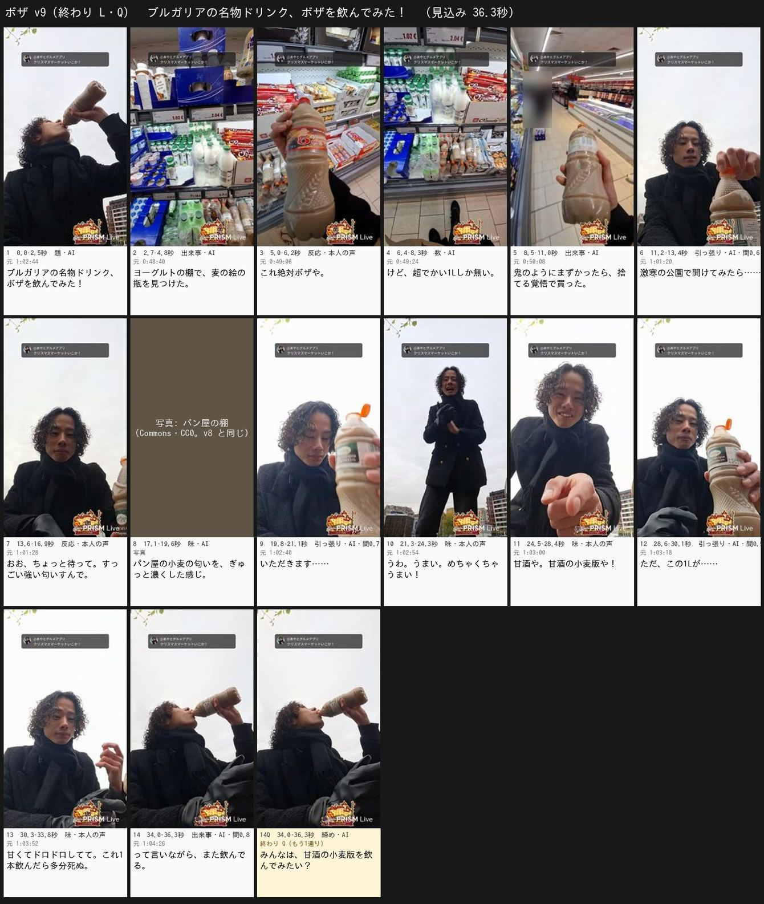

# ボザの回 p1 v9（boz-p1-v9）— 新しい作りかたの原稿と絵コンテ（#1403 の試し・帳面 F-093）

**段3（声と編集）へ進めた。** 終わりは L（main の決め 2026-11-23。Q は作らない。`script_Q.txt`・`spec_Q.json` は d755a0ab で下ろした）。声・カットの割り・書き出しの記録は [`qa.md`](qa.md)。いまの予約（v8c・11/26）には触っていない（`../spec.json`・`../script.txt` ほかは v8c のまま）。

- 下敷き: あやとの書き直し（#1267 [6978871346](https://github.com/Ayato-kosaka/live-streaming/issues/1267#issuecomment-6978871346)）の字と言い回し（「→ここらへん、本人の声」も）
- 当てた決まり: あやとの答え（#1403 [7106707630](https://github.com/Ayato-kosaka/live-streaming/issues/1403#issuecomment-7106707630)）の Q2〜Q5 と F-091、診断 `diagnosis_2026-11-23.md` の4章、C の R1〜R15。v8c で決まった「本人の声の所は本人の映像」（F-087）はそのまま
- 置いたもの: `script_L.txt`・`spec_L.json`（終わり L＝輪）・`overrides_L.json`（行ごとの画の割り）・`polish_L.json`（上下の帯・色・場所の札）・`qa.md`（声と編集の記録）／`storyboard.jpg`（段2の絵コンテ。L の14コマ＋Q の終わり。2・4・8行目の画はそのあと写真に替えた＝qa.md）
- 秒は見込み（AI の行は毎秒8.0字・行の間0.2秒・hold、本人の声は区間の長さ）。**見込み 約36秒**（v8c は 40.7秒）。声を入れて組んだ実際は 35.4秒

## 原稿（L＝輪で終える版）

| # | 秒 | 行（字幕＝声） | 種類・開け閉め | 声 | 画（配信の時刻） | 間 |
| ---: | --- | --- | --- | --- | --- | --- |
| 1 | 0.0 | ブルガリアの名物ドリンク、ボザを飲んでみた！ | 題・o | AI | 1:02:43.8 公園で1Lの瓶を傾けて一気に飲む → 1.2秒で 1:02:47.5 飲み終えてカメラを見る顔（うまいかは伏せる） | |
| 2 | 2.7 | ヨーグルトの棚で、麦の絵の瓶を見つけた。 | 出来事・oc | AI | 0:48:40 ヨーグルトの冷蔵棚の下に薄茶色の瓶 → 0:48:50 取った瓶。札「◆ソフィアのスーパー」「ボザ＝小麦を発酵させた飲み物」 | |
| 3 | 5.0 | これ絶対ボザや。 | 反応・c | **本人** 0:49:05.7〜0:49:06.9 | 同じ秒の「Боза」と麦の絵のラベルの瓶を掲げる所 | |
| 4 | 6.4 | けど、超でかい1Lしか無い。 | 数・o | AI | 0:49:22 小さい瓶を探して棚を見回す | |
| 5 | 8.5 | 鬼のようにまずかったら、捨てる覚悟で買った。 | 出来事・o | AI | 0:50:06 1Lの瓶を手に通路を歩く（奥の買い物客はぼかす） | |
| 6 | 11.2 | 激寒の公園で開けてみたら…… | 引っ張り・o | AI | 1:01:00.5 灰色の公園で瓶を振る → 1:01:20 橙のふたを開ける。札「◆公園」 | 0.6秒 |
| 7 | 13.6 | おお、ちょっと待って。すっごい強い匂いすんで。 | 反応・oc | **本人** 1:01:26.4〜1:01:27.75＋1:01:35.4〜1:01:37.3 | 同じ秒の、瓶を鼻に近づけてのけぞる本人 | |
| 8 | 17.1 | パン屋の小麦の匂いを、ぎゅっと濃くした感じ。 | 味・c | AI | 写真 パン屋の棚（v8 と同じ）→ 1:01:38 瓶をもう一度鼻へ | |
| 9 | 19.8 | いただきます…… | 引っ張り・o | AI | 1:02:38 瓶を持ち上げる | 0.7秒 |
| 10 | 21.3 | うわ。うまい。めちゃくちゃうまい！ | 味・oc | **本人** 1:02:49.35〜1:02:49.85＋1:02:54.55〜1:02:56.95 | 同じ秒（カメラに寄る顔 → 下がって手を叩く） | |
| 11 | 24.5 | 甘酒や。甘酒の小麦版や！【答】 | 味・c | **本人** 1:02:59.5〜1:03:01.5＋1:03:06.85〜1:03:08.6 | 同じ秒（カメラを指さす → 下がって言う） | |
| 12 | 28.6 | ただ、この1Lが…… | 引っ張り・o | AI | 1:03:18 1Lの瓶をカメラに見せる | 0.5秒 |
| 13 | 30.3 | 甘くてドロドロしてて。これ1本飲んだら多分死ぬ。 | 味・c | **本人** 1:03:33.45〜1:03:35.05＋1:03:52.15〜1:03:53.95 | 同じ秒（立って話す → 顔の寄り） | |
| 14L | 34.0 | って言いながら、また飲んでる。 | 出来事・c | AI | 1:04:25.5 また瓶を傾けて飲む → **0秒目の一気に飲む画へ戻る** | 0.8秒 |
| 14Q | 34.0 | みんなは、甘酒の小麦版を飲んでみたい？ | 締め・o | AI | 1:04:25.5 また飲む → 写真 日本の甘酒（v8 と同じ）→ 終わりの札 | |

行ごとの根拠の秒・残した本人の言葉・選んだ理由は `spec_L.json` の `why`・`kept`・`reason`。

## 0〜8秒の前と後

| | v8c（いまの予約） | v9 |
| --- | --- | --- |
| 0秒目 | あやと島カードの瓶の写真（物）→ 1.15秒で飲む所 | 1Lを一気に飲む最中（出来事）→ 飲み終えた顔（うまいかまずいかは伏せる） |
| 題の直後（2.7秒〜） | やってきたのは、首都ソフィア！（前置き） | ヨーグルトの棚で、麦の絵の瓶を見つけた。（出来事）。ソフィアと「小麦を発酵させた飲み物」は札へ |
| 4〜8秒 | 個人的に気になってたのが、小麦を発酵させた飲み物、ボザ！（説明）→ スーパーを探し回ったら…… | 〔本人の声〕これ絶対ボザや。→ けど、超でかい1Lしか無い。（数） |
| 0〜8秒の本人の声 | 無（最初は 18.7秒） | 5.0秒 |
| 数 | 3〜8秒に無し | 1L（6.4秒） |
| 「まずいかも」の懸け | 14.6秒 | 8.5秒 |

## 答えのあとと終わり

- 「うまい」の外しは尺の約60%、題の答え（11行目「甘酒の小麦版や！」）は約70〜78%。答えの1秒後に12行目「ただ、この1Lが……」で、4行目の1Lを呼び戻して次を開く（v8c は答えのあと味・反応の3行で閉じていた）。13行目の本人の声「これ1本飲んだら多分死ぬ」で、1Lの懸けが「まずくて捨てる」から「うますぎて危ない」へ裏返る
- **終わり L（輪）**: 「って言いながら、また飲んでる。」＋また飲む画（1:04:26）。あやとの「これはハマるわ！」を、言わずに画で見せる。そのまま0秒目の一気に飲む画へ戻る
- **終わり Q（問い）**: あやとの字「みんなは、甘酒の小麦版を飲んでみたい？」（13行目のあと。「これはハマるわ！」を挟むと答えのあとが3行になって lint の L-AFTER が ✕ になるので、Q では外した）
- こちらの推し: **L**。「死ぬ」と言った直後にまた飲む、の落ちがこの回でいちばん笑える所で、0秒目の飲む画にそのままつながる

## 話し方の数字

| | v8c | v9 |
| --- | --- | --- |
| 行 | 16 | 14（L・Q とも） |
| 「！」で終わる行（題を除く） | 12/14 | 2/13（めちゃくちゃうまい・甘酒の小麦版） |
| 起きたことの言い切り（〜た。〜てる。） | — | 2・5・14行目 |
| 行の間 | 全部 0.27秒 | ふつう 0.2秒、山の前 0.6・0.7・0.5秒（6・9・12行目のあと） |
| 本人の声 | 4か所（最初 18.7秒） | 5か所（最初 5.0秒）。v8c で本人の映像にした4か所はそのまま |
| 速さ | tempo 1.4 | 変えない（1.4） |

## あやとの書き直しから変えた所

| あやとの行 | v9 | なぜ |
| --- | --- | --- |
| やってきたのは、首都ソフィア！ | 場所の札「◆ソフィアのスーパー」 | Q2（題の直後に前置きを置かない） |
| 個人的に気になってたのが、小麦を発酵させた飲み物、ボザ！ | 札「ボザ＝小麦を発酵させた飲み物」。気になってた（なぜ）は題の「名物ドリンク」に任せる | Q2。中身は2行目の麦の絵と、8・11行目（パン屋の小麦・甘酒の小麦版）でも伝わる |
| スーパーを探し回ったら……／ヨーグルトの棚に、麦の絵の瓶！ | ヨーグルトの棚で、麦の絵の瓶を見つけた。 | 2行を1行の出来事に |
| これ絶対ボザや！ | 〔本人の声〕これ絶対ボザや。 | 0〜8秒に本人の声（R14）。あやとの字と同じ言葉 |
| けど、超でかい1Lしか無い！／鬼のようにまずかったら、捨てる覚悟で買った！ | 同じ字（「！」→「。」） | 数（Q5）と懸け。起きたことは「〜た。」で |
| 激寒の公園で開けてみたら、 | 激寒の公園で開けてみたら…… | 匂いの前の溜め（間 0.6秒） |
| おお、すっごい強い匂いすんで！ | 〔本人の声〕おお、ちょっと待って。すっごい強い匂いすんで。 | 最中の声「ちょっと待って」で懸けを強める（R14） |
| パン屋の小麦の匂いを、ぎゅっと濃くした感じ！ | 同じ字（「！」→「。」） | |
| いただきます……うわ、うまい！ | いただきます……／〔本人の声〕うわ。うまい。めちゃくちゃうまい！ | v8c と同じ区間。「！」は山のここ |
| 甘酒や！甘酒の小麦版や！ | 〔本人の声〕甘酒や。甘酒の小麦版や！ | 題の答え |
| 甘くてドロドロやから、1本飲んだらたぶん死ぬ！ | ただ、この1Lが……／〔本人の声〕甘くてドロドロしてて。これ1本飲んだら多分死ぬ。 | 答えのあと1秒で次を開く（Q3）。1Lを呼び戻す |
| これはハマるわ！ | L: って言いながら、また飲んでる。（画で見せる）／Q: 外す | 言うより見せる（R6）。Q は答えのあとを2行までにするため |
| みんなは、甘酒の小麦版を飲んでみたい？ | Q はそのまま／L は輪 | F-091 |

## 関所

- **lint**（いまの `tools/shorts/script/lint.py`）: L・Q とも ✕ 0。△ 7: L-WIDE（2・5・8行目と Q の14行目が16字を越える。どれもあやとの字の長さのまま）・L-DESU（9行目「いただきます」は決まり文句）・L-AFTER（12・13行目は答えのあとの行＝Q3 の試しで置いた行。2行なので ✕ ではない）・L-END（L の終わりは問いではない＝F-091）
- **批評役**（`critic.py`・claude -p・high。L）: 1人目で ✕ 0・△ 0、点 a4 b4 c4 d4 e4 f4、跳 0・取消 0・その行だけで通らない 0、当てた約束 45。2人目は呼ばない（7.3）。答えの直後の行（(m)）は「『この1Lが……』で、4行目の1Lがどうなるかを待てる」
- 批評役のあとに、こちらで画だけ替えた: 0秒目を「瓶を振る → 飲む」から「一気に飲む → 飲み終えた顔」へ（字は同じ）。瓶を振る画は6行目へ移した

## 本人の声の区間

| 行 | 区間 | 確かめ |
| ---: | --- | --- |
| 3 | 0:49:05.7〜0:49:06.9 | 新しい区間。自動字幕の語の時刻（これ 0:49:05.76 〜 や。0:49:06.76）で切った。声の段で whisper「これ絶対ボザやん」・自動字幕「ボザや」→ 本人の声のまま（qa.md） |
| 7 | 1:01:26.4〜1:01:27.75＋1:01:35.4〜1:01:37.3 | 後ろは v8c で突き合わせ済み。前の「おお、ちょっと待って」は新しい区間で、声の段の whisper でも聞き取れた（qa.md） |
| 10・11・13 | spec のとおり | v8c で whisper と自動字幕を突き合わせ済み |

## 迷った所（あやとに見本で聞くなら）

1. ~~終わり: L（輪）か Q（問い）か~~ → main の決めで L（2026-11-23）
2. ~~本人の声が5か所になった（帳面 F-078 の目安は2〜3か所、v8c は4か所）~~ → main の決めで5か所のまま（合計が15秒を超えたら3行目を AI に戻す。組んだら 14.98秒で内側）
3. テロップ・効果音は、F の軸（`teko/F_axis.md`）を当てる段で決める。spec の `big` の印は v8c のまま仮
