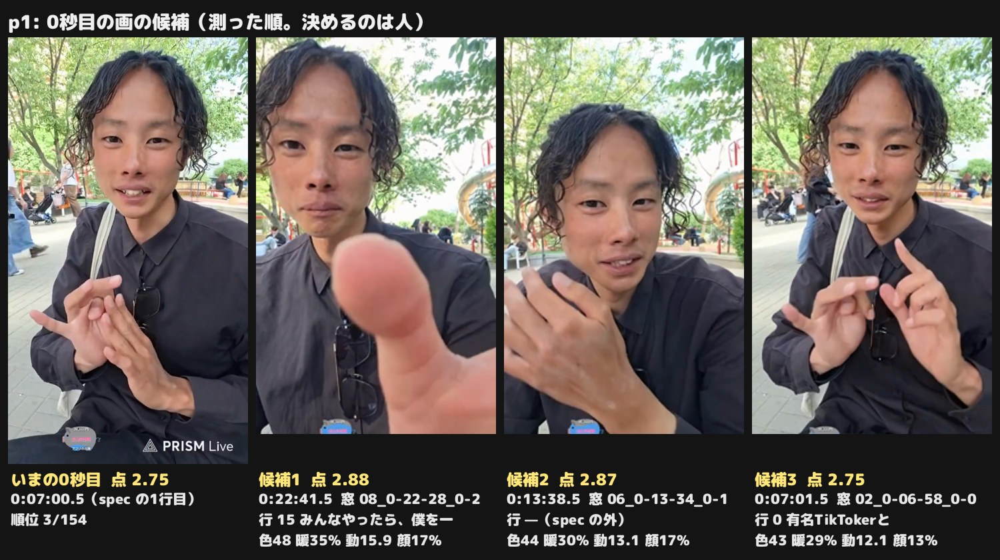
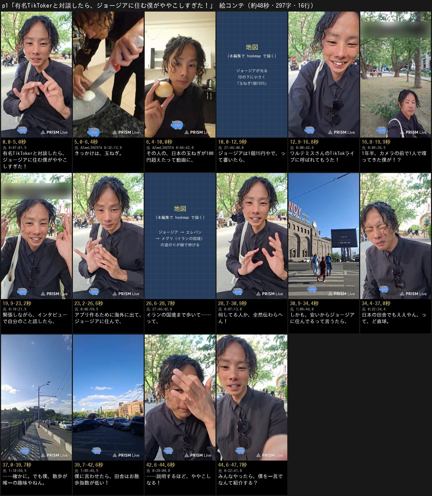

# ワルテミスさんとの対談 p1 — 「有名TikTokerと対談したら、ジョージアに住む僕がややこしすぎた！」の原稿

制作 issue #1104。あやとの依頼（2026-11-04・チャット）「視聴者さんから届いたショート動画作って欲しい件、対応お願いします」。
島の付箋の頼みの要約は issue の本文（TikToker のワルテミスさんと対談した件をショートに。リンク2本）。
**1次は原稿だけ。本編集・声はまだ作らない**（あやとが原稿に返事をしてから）。

| | |
| --- | --- |
| 型 | 配信アーカイブを本人の声で語る回（関西弁の一人称・最後の問い・題の札・最後の札）。**案は1つ**（付箋が場面を決めているので） |
| 配信（素材） | [gHTWAMKCITo](https://www.youtube.com/watch?v=gHTWAMKCITo)（2026-05-14 22:00 JST・2:14:00。アルメニア・エレバンの公園 → 街歩き）。ワルテミスさんの TikTok ライブに、イランの国境まで歩いた件で出た直後の振り返り。玉ねぎの画だけ [AZwmL3H25TA](https://www.youtube.com/watch?v=AZwmL3H25TA)（日本時間 2026-05-16 01:21、エレバンの宿の台所の料理配信） |
| 付箋のもう1本 | `LxrbXwHssF0`。こちらの配信の一覧（`streams/manifest.tsv`・BigQuery の videos）に無い（まとめ役が確かめた。manifest.tsv はこの担当でも引いて無かった）。この段では取り込んでいないので、誰の動画で何が写っているかは分からない。**素材を取り込んで確かめる（よそのチャンネルの動画なら画は使わない）**。原稿は gHTWAMKCITo の文字起こしだけで書いた |
| 題の札 | **有名TikTokerと対談したら、🇬🇪ジョージアに住む僕がややこしすぎた！**（0〜4.0秒・黒い箱・2行に割る:「有名TikTokerと対談したら、」／「🇬🇪ジョージアに住む僕がややこしすぎた！」） |
| 1行目 | 題の札をそのまま読む（F-047。国旗は読まない） |
| 原稿 | **16行・297字（記号を除く）・見積もり約47秒**（毎秒6.8字、行の間0.25秒） |
| 声 | 全部 AI の声。元の声は使わない（叫びの場面が無い回。F-051） |
| 機械の検査 | `lint.py` **✕ 0**・△ 2（7章）／関所: 批評役1人目 ✕ 2 → 直し1 → 批評役2人目 ✕ 1 → 直し2（最後）。批評役2人・直し2回の上限を使い切った（10章） |

## 0. 伝えたいこと・筋

- **伝えたいこと（1行）:** 1年半カメラの前で1人で喋ってきた僕が、玉ねぎの書き込み1つで人気 TikToker と対談したら、「何してる人？」「なんでジョージア？」に答えるほど自分のややこしさが出た——みんな、僕を一言で言うて
- **土台 → 山 → 結末 → 問い（F-022）:** 土台 2〜7行（玉ねぎの書き込みで呼ばれる・1年半1人で喋ってきた僕が緊張して話す）／山 8〜12行（肩書き3つが伝わらない → 安いから住んでる →「日本の田舎でもええやん」のど直球）／結末 13〜15行（散歩が唯一の趣味 → お散歩指数 →【答】説明するほどややこしなる）／問い 16行
- **筋の段（F-033）:** ①きっかけ（玉ねぎ）②呼ばれたのは1人喋りの僕 ③何者か伝わらない ④住む理由を突っ込まれる ⑤ややこしい。段ごとに画の種類を変える（玉ねぎの手元 → 地図 → 公園の自撮り → 地図の道のり → 街歩き → 顔）
- **見る人とそろえる前提（F-008）:** 「ジョージア」は米国の州や缶コーヒーと取り違えやすいので、題の札で国旗と「ジョージアに住む僕」として先に出し、4行目の画を国の地図にする。日本の玉ねぎの値段（100円）を見る人の物差しとして先に置いてから、15円の落差を見せる
- **外したもの（F-033・F-048・F-056）:** 視聴者のコメントで動く段（0:17:30〜0:20:30 の「ワルテミスさんの話に興味持ってや」・0:22:30 の視聴者の答え）、サングラスを無くした騒ぎ（1:01:30）、トビリシ行きバスの予約（1:25:30）、ホステルの子猫（1:42:00）、パン屋（1:51:00）、相手のライブの人数・開始の遅れ・海外旅行保険。どれも題の「ややこしい」を強めない
- **相手の発言の扱い（依頼の注意）:** 相手の言葉は12行目「日本の田舎でもええやん」の1つだけで、本人が配信で振り返った字（1:10:30）のまま「って」で言う。相手の考え・人柄を本人の外から言い切る行は無い。対談そのもの（相手の字・話の順番）は確かめていない

### 写した参考の拍（`OEF` パラグライダー・`qumq` 裁判傍聴。`reference_beats.md`）

この回は「対談そのものが画に無い」ので、撮れない題材を段で持たせる qumq と、人の一言を「って」で声にして返す OEF を選んだ。

| 参考の拍 | 参考で起きること | この原稿の行 | 写すもの | 写さないもの |
| --- | --- | --- | --- | --- |
| OEF 3〜6秒 | 枠を決め、前ふりを先に置く（8行あとで拾う） | 2「きっかけは、玉ねぎ。」 | 1拍の溜めで前ふりを置き、次の3行で拾う | 「〜に来たらやるべき事と言えば」の言い回し |
| OEF 13〜17秒 | 画に居る案内役の一言を「って」で声に | 11〜12 | 人の一言を本人の「って」で声にし、すぐ本人が返す | 物騒な話の中身・「天国」の笑い |
| OEF 18〜22秒 | 前ふりを拾うツッコミ → 腹をくくる | 13「……確かに。でも僕、」 | 一言を受けてから返す | 言い回し |
| qumq 全体 | 撮れない題材（裁判）を、段のある説明で持たせる | 8〜10（段1: 何者か）・11〜14（段2: なぜジョージア） | 対談は画に無いので、肩書き → 住む理由と段を上げる | 「その1」「その2」の番号・講座の型 |
| qumq 終わり | 自分への戒め → 見る人への問い | 15〜16 | 自分に突っ込んでから、見る人に問いで返す | 「近くに裁判所ある？」の形 |

## 1. 原稿（16行）

```
有名TikTokerと対談したら、ジョージアに住む僕がややこしすぎた！
きっかけは、玉ねぎ。
その人の、日本の玉ねぎが100円超えたって動画に、
ジョージアは1個15円やで、って書いたら、
ワルテミスさんのTikTokライブに呼ばれてもうた！
1年半、カメラの前で1人で喋ってきた僕が！？
緊張しながら、インタビューで自分のこと話したら、
アプリ作るために海外に出て、ジョージアに住んで、
イランの国境まで歩いて……って、
何してる人か、全然伝わらへん！
しかも、安いからジョージアに住んでるって言うたら、
日本の田舎でもええやん、って、ど直球。
……確かに。でも僕、散歩が唯一の趣味やねん。
僕に言わせたら、田舎はお散歩指数が低い！
……説明するほど、ややこしなる！【答】
みんなやったら、僕を一言でなんて紹介する？
```

### 1稿目 → 3稿目で直した所

| 行 | 1稿目（8b006c45） | いま | 理由 |
| --- | --- | --- | --- |
| 題・1 | 海外から有名TikTokerと対談したら、僕がややこしすぎた！ | 有名TikTokerと対談したら、**ジョージアに住む僕が**ややこしすぎた！ | 批評役1人目の ✕（F-031: 場所が「海外から」だけで国が無い）。山が「なぜジョージアに住むか」なので、その国を題に入れた（直し1） |
| 4 | 僕が住んでる国、ジョージアは1個15円やで、って書いたら、 | ジョージアは1個15円やで、って書いたら、 | 題で「ジョージアに住む僕」と言ったので重ねない。画は「確認中」だったジョージアの玉ねぎをやめ、コードで描く地図にした（批評役1人目の ✕ F-014。直し1） |
| 6〜8 | 1年半、カメラの前で1人で喋ってきた僕が！？／人とビデオ通話するのも何ヶ月ぶりで、めっちゃ緊張した。／インタビューで自分のこと話したら、 | 1年半、カメラの前で1人で喋ってきた僕が！？／**緊張しながら、**インタビューで自分のこと話したら、 | 批評役1人目の △（緊張の行が題の「ややこしい」から外れる）。緊張を自己紹介の行に畳み、ややこしさへまっすぐ渡す（直し1）。直し2のとき、事実の表と突き合わせて「めっちゃ」を外した（本人は「ちょっと緊張しました」0:10:00。盛らない・X2） |
| 15（2稿目 212a1e4e） | 田舎って、夜は街灯が無くて歩かれへんやん。 | （削った） | 批評役2人目の ✕（F-014: 配信は明るい時間で街灯が写らない恐れ）。理由の行は画で見せられないので削り、14行目「田舎はお散歩指数が低い」の1行に畳んだ（F-056。直し2・最後） |

## 2. 1行ずつ4欄（＋画）

秒は見積もり（毎秒6.8字、行の間0.25秒）。画の列は、2026-11-04 に原稿が使う区間だけを取り込んで、名指す物が写っているのを確かめた秒（12章。spec.json の `src`・`still`・`visual` と同じ）。翌日の料理の回の画は「AZwmL3H25TA の」、地図は「[27:46:40.0] 刺し素材の地図」（本編集で hookmap で描く）と書いた。

| # | 秒（見積もり） | 元の出来事（配信の時刻） | 見る人に届く文（読み上げる字） | 残した本人の言葉 | 選んだ理由 | 画（2026-11-04 に clips で確かめた秒。spec の `src`） |
| ---: | --- | --- | --- | --- | --- | --- |
| 1 | 0.0–4.7 | 題。[0:00:30]〜[0:01:30]「5分前ぐらいまで TikToker のワルテミスさんと、イランまで歩いた件について対談してました」。ジョージアに住む＝[0:22:30]「ジョージアっていう国に住んでて、いまアルメニアに旅行に来てる」。ややこしい＝[0:22:00]「僕ややこしいんよ」・[0:24:00]「アプリ作ってて海外いてイランまで歩いたりして、繋がりがない」。人気＝本人の見立て [0:19:30]「結構人気な TikToker やと思ったけど」（フォロワー数は外の出典で未確認） | 有名TikTokerと対談したら、ジョージアに住む僕がややこしすぎた！ | ややこしい | F-047: 題をそのまま読む。F-063: 付箋の核「TikToker と対談」を題の頭で言い、F-031: 場所（ジョージアに住む僕）と起きたこと（ややこしすぎた）を気持ちの言葉で言い切る | 【0秒目・hook.py の候補3（点 2.75・154コマ中3位）】0:07:00.5〜0:07:03.0 自分の肩書きを指を折って数えながら話す本人（「アプリ作るために海外行って…ジョージアに滞在して…イランで歩きました」。答えの「ややこしい僕」を先に見せる）→ 0:14:19.0〜0:14:21.46 スマホの地図（Google マップ）に「ジョージア」「アゼルバイジャン」の字と、いまいるエレバンの青い点を指が指しに来る（題の「ジョージアに住む僕」の場所）。題の札の下 |
| 2 | 5.0–6.1 | [0:03:30] 対談のきっかけを話し出す（玉ねぎの話） | きっかけは、玉ねぎ。 |  | 方針3: 4〜8秒の2つ目の山。「玉ねぎ？」と1拍だけ溜め、次の2行で答える。TikToker と玉ねぎの組み合わせの違和感で止める | 翌日の夜の料理の回 AZwmL3H25TA の 0:32:12.0〜0:32:13.5 まな板の丸ごとの玉ねぎに包丁を入れる手元（顔は写らない） |
| 3 | 6.4–9.8 | [0:03:30]〜[0:04:00]「日本の玉ねぎが…ホルムズ海峡の…100円超えたみたいな動画をあげてた」。相手の動画の中身は本人の説明（別の配信 qDZgufMBneg [0:40:30] でも「TikTok で見た、日本の玉ねぎ1個100円」） | その人の、日本の玉ねぎが100円超えたって動画に、 |  | F-008: 「その人の」で題の TikToker と動画をつなぎ、日本の物差し（100円）を先に置いて、次の行の15円で落差を見せる（方針5） | AZwmL3H25TA の 0:04:41.0〜0:04:43.0 丸ごとの玉ねぎを1個、顔の横でカメラに見せる（エレバンの宿の台所。本人「玉ねぎ1個10円ぐらい」）→ 0:32:48.0〜0:32:49.7 みじん切りにした玉ねぎの山と包丁の手元。1次の見当「0:34:30 鍋で炒める玉ねぎ」は、0:33:42〜0:35:58 カメラが床と台所の壁を向いていて鍋が写らないので使わない。相手の動画の画は使わない |
| 4 | 10.0–12.7 | [0:04:00]「僕がそれに対して、いや、ジョージアは1個15円やでってコメントした」。別の配信 qDZgufMBneg [1:10:00] でも「ジョージアで玉ねぎ1個15円」 | ジョージアは1個15円やで、って書いたら、 | 1個15円やで | 方針5・F-007: 円だけで、日本の100円と並べて落差を作る。「コメント」は配信のチャットと聞き違えるので、ふだんの「書いたら」 | [27:46:40.0] 刺し素材の地図（tools/shorts/hookmap。コードで描く。帳面 F-060）: 国の段 GEO・ARM・TUR・AZE・IRN。ジョージアを光らせて印を打ち、名前の下に小さく「玉ねぎ1個15円」（2.9秒。1カット） |
| 5 | 12.9–16.6 | [0:04:00]「じゃあ対談してくださいみたいになって、それが1ヶ月前ぐらい」・[0:05:00]「イランのショート動画を見てくださって、今回予定を組んだ」・[0:10:00]「TikTok ライブのコラボ」 | ワルテミスさんのTikTokライブに呼ばれてもうた！ | 呼ばれてもうた | 方針3: 開けた「書いたら、」に結果で返す。相手の名前はここで初めて出し、題の「人気 TikToker」と結ぶ（F-008）。呼ばれるまでの1ヶ月の経緯は削る（F-056） | 0:22:45.5〜0:22:47.0 公園の向かいの通り（灰色の石の建物と植え込み。人は写らない）→ 0:00:42.0〜0:00:44.5 対談の直後に配信をつけた本人が、かばんの紐に手をやって笑う（「呼ばれてもうた！」の顔。0:00:42.0〜0:00:43.25 に笑い声か短い一言〔字幕に無い〕が入り、0:00:43.5〜 は黙っている。話し続ける画ではない） |
| 6 | 16.8–19.6 | [0:10:30]「普段もう1年半ぐらい、1人でカメラの前で喋ってるから、誰かと喋ることほぼない」 | 1年半、カメラの前で1人で喋ってきた僕が！？ |  | 土台（F-022）: 1人で喋ってきた人が急に人気者のライブへ、で応援したくなる。前の行の「呼ばれた」に本人が驚き返す（つなぎ: 反） | 0:09:35.5〜0:09:37.5 公園の芝と木の引き。下の端に本人が小さく写り、カメラに向かって1人で喋っている（顔の画には数えない）→ 0:10:44.5〜0:10:45.6 手を動かして話す本人（「1人でカメラの前で喋ってる」の所）。どちらも上に固定の書き込みが出るので、本編集で上の帯を窓の外に出す |
| 7 | 19.9–23.0 | [0:10:00]〜[0:11:00]「ちょっと緊張しました」「何ヶ月ぶりかぐらいにビデオ通話しました。緊張した」・[0:06:00]「結構インタビューみたいな感じ。質問されてそれに答える」 | 緊張しながら、インタビューで自分のこと話したら、 | 緊張 | 方針2: 失うもの（人前でうまく話せるか）を、本番の話の頭に置く。緊張と自己紹介を1文にして、題のややこしさへまっすぐ渡す（批評役1人目の△） | 0:10:20.5〜0:10:22.3 照れて髪に手をやる本人（「ちょっと緊張しました」の所。上に固定の書き込み）→ 0:22:47.3〜0:22:48.9 公園の向かいの通りの建物（5行目の1カット目と同じ場面の別の秒。顔を3秒続けないため） |
| 8 | 23.2–26.3 | [0:06:30]〜[0:07:00]「アプリ作るために海外行って…ジョージアに滞在して」 | アプリ作るために海外に出て、ジョージアに住んで、 |  | qumq の「段のある説明」: 肩書きを1つずつ足して、つながらなさを積む1段目と2段目 | 0:06:58.5〜0:07:00.5 自分の肩書きを指を折って数え始める本人（「アプリ作るために海外行って…ジョージアに滞在して」の所。0秒目の画〔0:07:00.5〜〕のすぐ前の秒で、答えの画がここで話につながる呼び戻し）→ 0:22:52.0〜0:22:53.44 スマホの地図の「ジョージア」の字を指で指す（「ジョージアっていう国に住んでて」0:22:55） |
| 9 | 26.6–28.5 | [0:07:00]「イランで歩きました、みたいな話をすると」・[0:23:00]「この前イランの国境まで歩いて」（エレバンから国境の町メグリまで。2026-04-29〜05-08 の回） | イランの国境まで歩いて……って、 |  | 3段目でいちばん強い肩書きを置き、「……って、」で言いさして次のツッコミに渡す。歩いた道は声ではなく画で見せる（方針6） | [27:46:42.9] 刺し素材の地図の続き: ジョージア → エレバン → メグリ（イランの国境）の道のりが線で伸びる（1.46秒。前の行のスマホの地図と合わせて地図が続くのは 2.9秒）→ 0:07:11.5〜0:07:12.2 手を広げて話し出す本人（「……って、」の間。次の行と1つのカット） |
| 10 | 28.7–30.6 | [0:07:00]「ごちゃごちゃしすぎてて、全然何してる人なのかっていうのが伝わらへんよね、って思いました」 | 何してる人か、全然伝わらへん！ | 伝わらへん | 方針4: 前ふり（肩書き3つ）→ 結果 → ツッコミの3拍の締め。本人の反省を、そのまま自分へのツッコミにした | 0:07:12.2〜0:07:14.4 両手を広げて身ぶりで話す本人（「ごちゃごちゃしすぎてて、全然何してる人なのかが伝わらへん」と言った所。前の行の終わりから続けて 2.9秒。奥を人が小さく横切る） |
| 11 | 30.9–34.1 | [1:10:30]「ジョージアに住んでるのが、安いのが理由だから住んでますって言ったら」 | しかも、安いからジョージアに住んでるって言うたら、 |  | 「しかも」で同じ対談の2段目（なぜ住んでいるか）へ上げる。「言うたら、」で開けて、次の行の相手の返しへ渡す（OEF 13〜17秒の、人の一言を待つ拍） | 1:09:43.0〜1:09:45.0 ブランデー工場（NOY の看板のアーチの石の建物）の前の横断歩道を、人が向こうへ渡っていく（後ろ姿だけ）→ 1:10:55.0〜1:10:56.5 橋の歩道を歩く（手すりの影。「安い理由だから住んでますって言ったら」1:10:59 の直前） |
| 12 | 34.4–36.7 | [1:10:30]〜[1:11:00]「日本の田舎でもええやんて言われました」「率直な疑問を直にぶつけてくれた」。相手の字そのものは本人の振り返り（対談の録画では確かめていない） | 日本の田舎でもええやん、って、ど直球。 | 日本の田舎でもええやん | OEF 13〜17秒: 人の一言を「って」で声に。初見がいちばん「確かに」と思う問いなので山に置く。相手の言葉は本人が振り返った字のまま | 0:22:32.4〜0:22:35.0 手を振ってから、目をぎゅっとつぶって顔をしかめる本人（「僕ややこしいんよ」の続き。ど直球を食らった顔） |
| 13 | 37.0–39.5 | [1:12:30]「確かにみんなそうやなと思って、勉強になりました」・[1:11:00]「1番の理由は散歩が趣味やから」・[1:14:00]「僕、散歩が結構唯一の趣味やから」 | ……確かに。でも僕、散歩が唯一の趣味やねん。 | 確かに／散歩が唯一の趣味 | 方針3: 「確かに」で見る人の気持ちを本人が先に言い、「でも」で返す。安いのも本当のまま理由を1つ足すので、取消ではない | 1:10:57.5〜1:11:00.3 橋の歩道を歩き続ける（青空・街灯・手すりの影。人は遠くに小さく。「日本の田舎でもええやん」1:11:02 の直前） |
| 14 | 39.7–42.4 | [1:11:00]「日本の田舎やと…1番の理由は散歩が趣味やから、その散歩指数が低いんすよ。田舎、街灯ないから夜に散歩できへん」・[1:13:00]「僕は、お散歩指数、お散歩指数って呼んでんのよ」 | 僕に言わせたら、田舎はお散歩指数が低い！ | お散歩指数が低い | 本人だけの物差しを、本人の言い方のまま落ちの手前に置く。「僕に言わせたら」で自分で作った言葉だと分かる（F-008）。夜に街灯が無いという理由の行は、画で見せられないので削り、この1行に畳んだ（F-056。批評役2人目の ✕） | 1:05:46.0〜1:05:47.5 駐車場の向こうに並ぶピンクの石の建物（本人「この街並アニメの世界みたい」1:05:25）→ 1:20:59.5〜1:21:01.0 歩道の壁に並ぶ昔のエレバンの写真（馬車と石の建物。歩いていて見つけた所。「田舎」は比べる相手で画には出さない） |
| 15 | 42.6–44.4 | 【答】[0:22:00]「僕ややこしいんよ」・[0:23:30]「もうちょっと分かりやすくなりたいの」・[0:24:00]「言ってることが分かりにくいんやろな」 | ……説明するほど、ややこしなる！ | ややこしなる | 題の答え（終わりの手前。10行目で一度見せたややこしさを、ここで閉じる）。肩書きと物差しを足すほどややこしくなる、を本人が自分で突っ込んで閉じる（F-025）。このあとは問いの1行だけ（F-037） | 0:29:07.0〜0:29:09.5 額に手を当てて顔を覆う本人（ゴリスの危険レベルの話のあと。題の答え「ややこしなる」の顔） |
| 16 | 44.6–47.4 | 【足】締めの問い（出来事ではない）。[0:22:30]「僕をもっと一言で表せる人おらへん？」 | みんなやったら、僕を一言でなんて紹介する？ |  | F-032: 「みんな」への問い。題の気持ち（ややこしい）のまま、見る人が1語で答えられる形にしてコメントを誘う | 0:28:09.5〜0:28:11.0 スマホの地図で、歩いたアルメニアの南（イランの国境の方）を指でなぞる（0秒目の地図の呼び戻し。別の秒）→ 0:22:41.5〜0:22:43.1 カメラの方へ指を向けて「誰かさ、僕をもっと一言で…」と見る人に投げる本人 |

## 3. 当て表（約束のカード35枚。spec の promises と同じ中身）

| ID | 当たる行（題の札は 0） | どう直したか／当たらない理由 |
| --- | --- | --- |
| F-004 | 1, 5, 6, 7, 10, 13, 14, 15 | 全行が「僕」の関西弁の一人称（もうた・やねん・やん・ややこしなる）。「ワルテミスさんは〜」「〜だそうです」の外からの説明は1行も無い |
| F-005 | 2, 11, 12, 15 | OEF からは「人の一言を『って』で声に → ツッコむ」の拍だけ、qumq からは「撮れない題材を段で持たせる」だけを借りた。言い回し・企画の型・山とオチは写していない |
| F-006 | 4, 12 | 「コメントした」は配信のチャットと聞き違えるので、ふだん言う「書いたら」に。「ど直球」はふだんの言い方 |
| F-007 | 3, 4 | 値段は円だけ（100円・15円）、1回ずつ。現地の通貨は出さない |
| F-008 | 0, 1, 3, 5, 15 | 相手は題で「人気 TikToker」、3行目「その人の」、5行目で名前。ジョージアは題の札で国旗と「ジョージアに住む僕」として先に出す。お散歩指数は14行目で「僕に言わせたら」を付けて出す。配信の中の呼び名は使わない |
| F-014 | 2, 3, 4, 8, 9, 14 | 名指す物の写る秒を visual に書いた。玉ねぎはこの回に無いので翌日の夜（日本時間 05-16 01:21）の料理の回 AZwmL3H25TA の手元。ジョージアと国境までの道は配信に画が無いので、コードで描く地図（hookmap）で見せる（批評役1人目の ✕ を受けて、4行目の『確認中』を地図に替えた）。夜の街灯の行は画で見せられないので削った（批評役2人目の ✕）。14行目の「田舎」は比べる相手で、画は散歩している側。相手の動画の画は使わない |
| F-015 | 0 | 題の札は0秒目から4.0秒、黒い箱（title_card_seconds 4.0） |
| F-019 | 1, 7, 11, 13 | 16行・297字。上限の倍率（毎秒6.8字）で約47秒、60秒未満。声の倍率は上げない（plan.md 4章） |
| F-022 | 6, 7, 10, 12, 15, 16 | 1案で、土台（6・7 1年半1人で喋ってきた僕が緊張して）→ 山（8〜12 何者か伝わらない・田舎でええやん）→ 結末（15）→ 問い（16）を全部持たせた |
| F-025 | 15, 16 | 結末は題の「ややこしすぎた」の側で閉じる。「対談が楽しかった」「勉強になった」の別の気持ちや、バスの予約・猫の話は足さない |
| F-030 | 0 | 題の札の国の名前（ジョージア）の前に 🇬🇪。原稿の1行目には国旗を書かない |
| F-031 | 0, 1 | 場所（ジョージアに住む僕）と本当に起きたこと（自己紹介が伝わらなかった。0:07:00）を「〜したら、〜すぎた！」の気持ちの言葉で言い切る（批評役1人目の ✕「場所が『海外から』だけ」を受けて国の名前を入れた）。比喩・見立ては無い |
| F-032 | 16 | 最後は「みんなやったら、僕を一言でなんて紹介する？」の問い1行で終え、そのあとに足さない |
| F-033 | 2, 5, 7, 11, 13 | 筋は「玉ねぎで呼ばれる → 緊張して自己紹介 → 何者か伝わらない → 住む理由を突っ込まれる → ややこしい」の1本。画は玉ねぎの手元・地図・公園・街並みと種類を変える。サングラス・バス・猫・パン屋の段は入れない |
| F-034 | 2, 8, 12, 15 | 写す参考（OEF・qumq）を書く前に決め、OEF 13〜17秒を12行目、qumq の段を8〜9・11〜14行目に当てた（plan.md 3章）。頭から3回読み直した |
| F-035 | 3, 4, 14 | 比べは日本の物差し（100円と15円）だけ。「〜に見えてきた」の見立ては無い。お散歩指数は本人が配信で使った言葉で、作った物差しではない |
| F-036 | 5, 6, 7 | 「呼ばれた」は1ヶ月前の書き込みから（0:04:00）。「1年半」は本人の言葉の範囲。「人気」は題だけで本人の見立て（0:19:30）。数を広げて言っていない |
| F-037 | 15, 16 | 答え（15）のあとは問い（16）へすぐ渡す。対談の感想・言い直しは足さない。肩書きの話は8〜10の3拍、住む理由は11〜14で移る |
| F-039 | 3, 5, 7, 11, 13 | 配信の順（対談の話 → 雑談 → 1時間後の振り返り）をなぞらず、玉ねぎ → 呼ばれる → 緊張して自己紹介 → 伝わらない → 突っ込まれる → ややこしい、と前の行の問いに次が答える並びに組み直した。字幕の文はそのまま使っていない |
| F-040 | 13 | 打ち消しは無い。13行目は相手の問いに「確かに」で応えてから「でも」で理由を足す（安いのも本当のまま）。本人の言い切りを本人で引っ込める行は無い |
| F-043 | — | 「参考にしたい」の旅の型ではない（対談の振り返り）。同行者も出ない |
| F-047 | 1, 16 | 1行目は題の札の字（国旗を除く）をそのまま読む。配信に無い意気込みや決め台詞は足していない。次の配信には誘わず問いで閉じる |
| F-048 | 4, 5, 12 | 話を動かすのは本人と対談の相手（題と5行目で紹介した人）だけ。視聴者のコメント・チャット（0:18:30 の「みんな知らんの？」の段・0:22:30 の視聴者の答え）は入れない。「コメント」の字は使わない |
| F-049 | 0, 1, 3, 5, 8 | 題も本文も「が・に・と・を」を入れて書いた（TikToker と対談したら・ジョージアに住む僕が・ライブに・海外に出て） |
| F-050 | 2, 6, 12, 14 | 字幕の順はつながず、玉ねぎのきっかけ → 1人で喋ってきた僕 → 伝わらない → 突っ込まれる → ややこしい、の筋に組み直した。海外の空気は公園・街並み・地図の画で出す |
| F-051 | — | 叫びの場面が無い（座って話す・歩きながら振り返る回）ので、元の声は使わない。対談直後の高い声（0:00:30）は喋り続けで、視聴者への返事も混ざるので外した |
| F-052 | 1, 16 | 配信アーカイブを本人の声で語る回なので、帳面の型（関西弁の一人称・最後の問い・題の札・最後の札）をそのまま使う |
| F-054 | — | トラブルの回ではない。移動先への到着も無い |
| F-055 | — | グルメの回ではない。玉ねぎは値段の比べで、食べる話はしない |
| F-056 | 5, 7, 14 | 呼ばれるまでの1ヶ月の経緯・相手のライブの人数・開始の遅れ・何ヶ月ぶりのビデオ通話・お散歩指数の3つの条件・夜に街灯が無いという理由は削り、1行1つの出来事で進めた。田舎を選ばない理由は14行目の1行に畳んだ |
| F-057 | 0 | 題は「人気 TikToker」と国（ジョージア）の大きい枠で引き、エレバン・トビリシの街の名前は出さない |
| F-059 | — | この回に「〜は要らない」と言われた場面の指定がまだ無い |
| F-061 | — | 題が「簡単」の回ではない。手順やレシピの話は無い |
| F-063 | 0, 5 | 付箋の核「TikToker のワルテミスさんと対談」を題（人気 TikToker と対談）と5行目（名前）で言った。題材の外（サングラス・バス・猫・パン）は入れない |
| X2 | 1, 3, 4, 5, 6, 7, 9, 12, 14, 15 | 全行の why に配信の時刻を書いた。相手の発言（12行目）と相手の動画の中身（3行目）は本人の振り返りの字のまま。16行目だけ【足】で、出来事ではなく問い |

## 4. 尺の見積もり

| | |
| --- | ---: |
| 行 | 16行 |
| 字（記号を除く。`readtime.py` の `chars`） | 297字 |
| 声（上限の倍率 1.4 で読んだ速さ＝毎秒6.8字） | 約43.7秒 |
| 行の間（0.25秒 × 15） | 約3.8秒 |
| **合計** | **約47秒**（60秒未満。声の倍率は上げない。F-019） |

- 2つ目の山（4〜8秒）: 2行目「きっかけは、玉ねぎ。」が 5.0〜6.1秒、3行目の「100円」が 7〜9秒
- 題の答え【答】は15行目（43〜44秒。全体の約9割）。題の約束（ややこしい）を10行目（29〜31秒）で一度見せ、15行目で閉じる
- 声を作ったら実物の長さで測り直す（`script_writing.md` 6）

## 5. 確かめた事実（配信の時刻つき）

時刻は gHTWAMKCITo の自動字幕（30秒ごと）の頭の時刻。ほかの回は videoId を書いた。

| 行 | 事実 | 出典 | 言い切れるか |
| --- | --- | --- | --- |
| 題・5 | 配信の5分前まで、TikToker のワルテミスさんと、イランまで歩いた件で対談していた | 0:00:30〜0:01:30 | 言える（本人の話） |
| 題 | 「人気」TikToker | 0:19:30 本人「結構人気な TikToker やと思ったけど」。0:03:30 に相手のライブの人数らしき数（「100、120人、100、200人ぐらいの閲覧がいる方の配信」）を言うが、何の数か字幕から読み切れない | **本人の見立て。フォロワー数などの外の出典は確かめていない**（この箱から TikTok に届かない）。言い切りを避けるなら「世界情勢系TikToker」に替えられる（9章） |
| 題・7〜10・15 | 自己紹介がごちゃごちゃで、何をしている人か伝わらなかった（本人の反省） | 0:06:00〜0:07:30「アプリ作るために海外行って…ジョージアに滞在して…イランで歩きました、みたいな話をすると、全然何してる人なのか伝わらへん」・0:22:00「僕ややこしいんよ」・0:24:00「繋がりがないもんね」 | 言える（本人の振り返り）。0:22:00 に「ワルテミスさんにも言われたけど」とあるが、相手の言葉としては使っていない |
| 2〜3 | きっかけは、日本の玉ねぎが100円を超えたという相手の動画 | 0:03:30〜0:04:00（ホルムズ海峡の影響で、と本人の説明）。qDZgufMBneg（2026-04-02 トビリシ）0:40:30〜0:41:30 でも「TikTok で見てんけど、日本で玉ねぎ1個100円するらしい」 | 動画の中身は本人の説明。日本の実際の値段は確かめていない（声は「〜って動画」と、動画の話として言う） |
| 4 | ジョージアは玉ねぎ1個15円、と書き込んだ | 0:04:00。qDZgufMBneg 1:10:00「ジョージアで玉ねぎ1個15円」 | 本人の書き込みと本人の値段 |
| 5 | それで対談に呼ばれ、TikTok ライブで話した | 0:04:00「じゃあ対談してください、みたいになって。それが1ヶ月前ぐらい」・0:05:00「イランのショート動画を見てくださって、今回予定を組んだ」・0:10:00「TikTok ライブのコラボ」 | 言える。書き込みから実際の対談まで約1ヶ月あいた（声では言わない） |
| 6 | 1年半、カメラの前で1人で喋ってきた | 0:10:30「普段もう1年半ぐらい、1人でカメラの前で喋ってるから」 | 本人の言葉（「1年半ぐらい」） |
| 7 | 緊張した。インタビューの形だった | 0:10:00〜0:11:00「ちょっと緊張しました」「何ヶ月ぶりかぐらいにビデオ通話しました」・0:06:00「結構インタビューみたいな感じ」 | 言える |
| 8 | アプリを作るために海外へ出て、ジョージアに住んでいる | 0:06:30〜0:07:00・0:22:30「ジョージアっていう国に住んでて」・0:56:30（海外生活は1年半ほど、最初はイギリス） | 言える |
| 9 | イランの国境まで歩いた | 0:23:00「この前イランの国境まで歩いて、今戻ってきました」。徒歩旅は 2026-04-29〜05-08（エレバン → 国境の町メグリ。`streams/2026/05.md` の目次） | 言える |
| 11 | 安いからジョージアに住んでいる、と言った | 1:10:30「ジョージアに住んでるのが、安い理由だから住んでますって言ったら」 | 本人の振り返り |
| 12 | 「日本の田舎でもええやん」と返された | 1:10:30〜1:11:00「日本の田舎でもええやんて言われました」「率直な疑問を直にぶつけてくれた」。字は本人の関西弁の言い直しで、相手の字そのものではない | **本人の振り返りとしてだけ言う。** 対談の録画で確かめていない（LxrbXwHssF0 が対談の録画なら、そこで確かめる） |
| 13 | 散歩が唯一の趣味 | 1:11:00「1番の理由は散歩が趣味やから」・1:14:00「僕、散歩が結構唯一の趣味やから」 | 言える |
| 13 | 「確かに」 | 1:12:30「確かにみんなそうやなと思って、勉強になりました」 | 本人の言葉。配信では「みんなが思う疑問を率直に聞いてくれた」への「確かに」で、原稿では相手の問いへの返しの頭に置いた |
| 14 | 田舎はお散歩指数が低い（本人の物差し） | 1:11:00「その散歩指数が低いんすよ。田舎、街灯ないから夜に散歩できへん」・1:13:00〜1:14:00「お散歩指数って呼んでんのよ…路地裏ごとに新しい発見…野良犬も少なくて、街灯も多くて」 | 本人の考え（「僕に言わせたら」） |
| 16 | 僕を一言で表せる人おらへん？ | 0:22:30（配信の中では見ている人への問い。原稿ではショートを見る人への問いにした） | 【足】の問い（出来事ではない） |

## 6. 冒頭（0秒目）の画の候補

**2026-11-04 に素材で測った結果と、選んだ画は 12.1。** 下の表は1次（字幕と議事録だけ）の見当のまま残す。

`hook.py` で測るのは素材を取り込んでから。いまは字幕と議事録から、時刻の候補だけを挙げる（F-020: 答え＝「ややこしい僕」を先に見せる画）。

| 候補 | 配信の時刻 | 写っていそうなもの（字幕・議事録から） | 選ぶなら |
| --- | --- | --- | --- |
| A | 0:13:30〜0:14:00 | 対談のために「気合を入れた」髪型の自撮り（本人「今日ちょっと気合入れました。ワルテミスさんと対談してたから」） | 「人気TikTokerと対談した僕」の顔。題の札の下に合う。**いまの第一候補** |
| B | 0:14:00〜0:14:30 | いまいる国を説明する所（「トルコの右、イランの上で、ロシアの下、アゼルバイジャンの左」）。地図を画面に出しているかは未確認 | 答え（ややこしい）を先に見せる。地図が写っていれば A より上 |
| C | 0:27:30〜0:28:30 | 歩いた国境の道の危険度を説明する所（ゴリス・カパン、アゼルバイジャンの飛び地に囲まれる）。地図を指しているかは未確認 | 国と国の位置のややこしさ。B に地図が無ければこちら |
| 次点 | 1:01:30〜1:02:30 | サングラスを無くしたと慌てて引き返す所 | 動きは強いが題の答えと関係が無い。使わない見込み |

刺し素材の地図（8〜9行目のジョージア → 国境の道のり）を0秒目に呼ぶ手もある（F-060 は街を回る回の決まりで、この回は当たらない。素材の画の強さを見て決める）。

## 7. lint の △（1行ずつ、本人の言い方か・正しいか）

`python3 tools/shorts/script/lint.py shorts/videos/gHTWAMKCITo/p1/script.txt` の最後の結果は `lint.txt`（✕ 0・△ 2・当てた規則 24/24）。

- **1行目 32字（4.7秒）:** 題の札と同じ字（T-READ）。札は4秒で消え、読み上げは0.7秒はみ出す。縮めるなら「人気」を落として30字（4.4秒）にできるが、初見を止める字なので残した。札は2行に割って字を大きくする（猫 p2 と同じ）
- **16行目【足】:** 締めの問いで、出来事ではない。本人が配信で見ている人に投げた「僕をもっと一言で表せる人おらへん？」（0:22:30）を、ショートを見る人への問いにした。題と同じ「ややこしい」の気持ちのまま、1語で答えられる

## 8. 画と、本編集への申し送り（本編集はあやとの返事のあと）

**下の申し送りを素材で確かめた結果は 12章。** 1次の見当のまま残す。

- **取り込む区間（clips・zoom）:** gHTWAMKCITo 0:00:30〜0:01:30・0:06:00〜0:07:30・0:09:30〜0:11:00・0:13:30〜0:14:30・0:22:00〜0:24:30・0:27:30〜0:28:30・0:29:00〜0:29:30・1:05:00〜1:14:30・1:21:30〜1:22:00。AZwmL3H25TA 0:31:30〜0:35:00（玉ねぎを切って炒める手元）
- **刺し素材（`tools/shorts/hookmap`、コードで描く地図）:** 国の段は GEO・ARM・TUR・AZE・IRN。4行目はジョージアを光らせ、印の下に小さく「玉ねぎ1個15円」。8〜9行目はジョージア → エレバン → メグリ（イランの国境）の道のりを線で伸ばす。1つのカットは3秒未満（F-028）。座標は取り込みと別に調べる
- **付箋のもう1本 LxrbXwHssF0 を取り込んで確かめる。** ワルテミスさんのチャンネルの動画（対談の録画など）なら、画は使わず、12行目の相手の言葉と対談の流れを確かめるだけにする。あやとのチャンネルの動画なら、対談の画を山の行（7〜12）に当てられる
- アプリ「なに食べよ」の画面を触っている録画があれば、8行目の画に（F-024。止め絵にしない）
- 本人が画面で喋り続ける画（0:00:30〜）にナレーションを長く重ねない（`script_writing.md` 6）。5行目で使うなら2秒まで
- 配信の飾り（右の貯金箱の目標の札・右下の PRISM Live）は窓で外す。視聴者さんの名前やチャットが画面に出ているコマは使わない
- 同じカットは3秒未満（F-028）: 1・3・5・7・8・11行目（3秒を越える）は、表の画の2つの秒を切り替える
- 最後の札「※YouTubeで毎日22時から配信」（F-042）と BGM（F-038）は様式どおり

## 9. 気をつけること・確かめられなかったこと

**素材で確かめたあと、まだ残っていることは 13章。**

- **「人気」TikToker は本人の見立て。** フォロワー数を外で確かめていない（この箱から TikTok に届かない）。言い切りを避けるなら、題を「世界情勢系TikTokerと対談したら、…」に替える（字数は2字増える）
- **相手の発言は12行目の1つだけで、本人の振り返りの字のまま。** 相手の口調・話の順番（自己紹介と住む理由のどちらが先だったか）は確かめていない。原稿は「しかも」で並べただけで、順番を言い切っていない
- **LxrbXwHssF0 は何か分からない。** 素材を取り込んで確かめる（よそのチャンネルの動画なら画は使わない）
- 4行目「書いたら」: 本人は「コメントした」と言っている。配信のコメント欄の話と聞き違えないよう（F-048・lint の L-INNER）、ふだんの「書いたら」にした。事実は変えていない
- 14行目「田舎はお散歩指数が低い」は本人の考え。「僕に言わせたら」を付けて、日本の田舎を笑う言い方にはしていない。夜の街灯の理由（1:11:00）は画で見せられないので削った。見る人に「田舎こそ散歩向きやろ」と思われる余地は残るが、15行目の「説明するほど、ややこしなる！」がそこを自分で拾う
- 玉ねぎの画は翌日の夜の料理の回（アルメニアの宿の台所）から。ジョージアの玉ねぎではないので、4行目（ジョージアの15円）には当てず、2〜3行目（玉ねぎの話）だけに使う
- **画の弱さ（自己評価の低い所）:** 対談そのものの画が無く、公園の自撮りと街歩きが多い。玉ねぎの手元と地図で種類を足したが、山の行（7〜12）は喋る顔と歩く画になりやすい

### 自己評価（書いた本人の見込み。出すかどうかは決めない。結果で判断する）

| 冒頭の引き | 初見の分かりやすさ | 意外性 | 画の魅力 | 物語 | テンポ | 見終わった満足 | 狙いとの合い |
| ---: | ---: | ---: | ---: | ---: | ---: | ---: | ---: |
| 4 | 4 | 3 | 2 | 3 | 4 | 3 | 4 |

- 意外性 3: 玉ねぎのきっかけと「お散歩指数」は意外だが、対談で大事件が起きたわけではない
- 画の魅力 2: 上の「画の弱さ」
- 見終わった満足 3: 落ちが本人の自虐で、山（ど直球の一言）の高さはほどほど。問いがコメントを呼ぶかで埋める

## 10. レビューの記録（`script_writing.md` 7.3・7.6）

| 回 | 誰 | (a) | (b) | (c) | (d) | (e) | (f) | 離れる行 | (h) 帳面 | (i) つなぎ | 直したこと |
| --- | --- | ---: | ---: | ---: | ---: | ---: | ---: | --- | --- | --- | --- |
| 0 | lint（1稿目 8b006c45） | | | | | | | | ✕ 0・△ 2 | | — |
| 1 | 批評役1人目（gate: ✕ 2・△ 1）。`claude -p` 61秒・38,172トークン | 4 | 4 | 4 | 4 | 4 | 4 | 7（緊張の話が題から少し外れる） | ✕ 題の札 F-031（場所が「海外から」だけ）・✕ 4行目 F-014（ジョージアの玉ねぎの画がこの回に無い） | 跳 0/18・取消 0 | 直し1: 題に「ジョージアに住む僕」・4行目の画を地図に・緊張の2行を1行に（△ を採った） |
| 2 | 批評役2人目（gate: ✕ 1・△ 0）。`claude -p` 67秒・38,328トークン。1人目の JSON は渡していない | 4 | 4 | 4 | 4 | 4 | 4 | なし | ✕ 14行目 F-014（街灯の画が明るい時間の配信に写らない恐れ） | 跳 0/17・取消 0 | 直し2（最後）: 街灯の理由の行を削り、「僕に言わせたら、田舎はお散歩指数が低い！」の1行に畳んだ |
| 3 | lint（3稿目） | | | | | | | | ✕ 0・△ 2 | | — |

- **関所の合否:** 2人目の ✕ 1 は、画が写るか（F-014）だけ。直し2で、写るか分からない物（夜の街灯）を名指す行ごと消した。**3人目は呼ばない決まり**（7.3）なので、直したあとの字を批評役にかけ直していない。まとめ役が裁く
- 批評役で割れた所: なし（1人目と2人目の ✕ は別の行。どちらも F-014・F-031 の (h) で、点・つなぎ・その行だけで通るか（(j)）・画に居ない人の言葉（(k)）は2人とも当たり無し）
- 12行目（相手の一言）は、2人とも (k)「画に居ない人の言葉」に当てなかった（題と5行目で紹介した対談の相手で、視聴者のコメントではない）
- 控え: `review/critic_r1.json`・`review/gate_r1.txt`・`review/critic_r2.json`・`review/gate_r2.txt`（批評役に渡した1枚は配信の字幕を含むので置かない。スクラッチパッドにだけある）
- 2人目のつなぎ（17行・2稿目）: 題・前・答・足・答・反・足・足・足・答・足・答・反・足・反・反・締

## 11. まとめ役の追記（2026-11-04）

- **付箋のもう1本のリンク `LxrbXwHssF0` を確かめた**（EC2 からログインしない oEmbed）: 題はワルテミスさんの TikTok のアカウント名で、上げたのはあやとでもワルテミスさんでもない別のチャンネル（名前は書かない）。ワルテミスさんの TikTok ライブを、YouTube に上げ直したもの。**よその人の動画なので、画も音も使わない。** このショートは、あやとの振り返り配信 `gHTWAMKCITo` だけで作る（12行目の相手の言葉も、あやとが振り返って言った字のまま）
- 題と1行目の「人気」を、付箋の言葉どおり「有名」にした（F-063 題は依頼の核の言葉。「人気」は本人の見立てで、外の出典で確かめていない）。lint ✕ 0 のまま
- 担当の「決めてほしいこと」: 14行目（2人目の批評役の ✕ を直したあとの字）はまとめ役が読んで、このまま出す。1行目の 4.7秒は、題の札を 4.7秒出すことにして字は減らさない

## 12. 画（2026-11-04 に素材を取り込んで確かめた）

取り込んだもの: run 41847540050（字幕を1文ずつの秒で〔captions。gHTWAMKCITo・AZwmL3H25TA〕と、2秒に1コマの zoom。gHTWAMKCITo 0:00:00-0:15:00・0:21:30-0:30:00・1:04:30-1:15:00・1:20:00-1:24:00、AZwmL3H25TA 0:03:30-0:06:00・0:30:00-0:36:00）と run 41854547917（clips。gHTWAMKCITo 16区間・計160秒、AZwmL3H25TA 3区間・計20秒）。
回まるごとは取っていない。付箋のもう1本 `LxrbXwHssF0`（よその人が上げ直したワルテミスさんの TikTok ライブ）は取り込んでいない。暗号文は開いたあと作業枝から下ろした。行ごとの画は 2章の表と spec.json の `src`・`still`・`visual`。

- **16行とも、名指す物が写る秒を見つけた**（F-014）。地図の2行（4・9行）は刺し素材（`tools/shorts/hookmap`。本編集で描く）で、絵コンテは仮のコマ。行の秒に区間を前から当てて、どのカットも 3秒未満（いちばん長いのは 4行の地図 2.9秒と、9行の終わりから 10行へ続く 0:07:11.5〜0:07:14.4 の 2.9秒）、区間は行の見積もりに足りる
- **カクつき（`tools/shorts/qa/stutter.py`）: 使う 24区間すべて ○**（同じ絵の繰り返しは最大 28%〔11行のお酒の工場の前・実質 21.7fps〕。線は 60%）。地図の2区間は刺し素材なので測っていない
- **画の種類（F-024）: 17種類**（指を折って数える本人・スマホの地図〔3か所〕・まな板の玉ねぎ・玉ねぎを掲げる本人・刺し素材の地図・公園の向かいの建物・笑う本人・公園の芝の引き・手ぶりで話す本人・照れる本人・お酒の工場の前の横断歩道・橋の歩道・顔をしかめる本人・ピンクの石の建物・昔のエレバンの写真の壁・顔を覆う本人・カメラを指す本人）。1次で「画の弱さ」に書いた山の行（7〜12）に、地図・建物・街・橋を挟んだ
- **顔（自撮りの寄り）が続くのは長くて 2.9秒**（帳面 F-029。6行の終わり 0:10:44.5〜＋7行の頭 0:10:20.5〜 の 1.1＋1.8秒、9行の終わり〜10行の 0:07:11.5〜0:07:14.4）。顔の行は、顔が話の中身の所だけ（F-058）: 1行（肩書きを数える＝答え）・5行（呼ばれた反応）・6行（1人でカメラに喋ってきた）・7行（緊張）・8行（肩書きを数える）・10行（伝わらへん）・12行（ど直球を食らう）・15行（ややこしなる）・16行（見る人への問い）。3行の玉ねぎを掲げる画にも顔が写るが、中身は玉ねぎ
  - **6行の頭の公園の芝の引き（0:09:35.5〜0:09:37.5）は、顔の画に数えていない。** 本人は下の端に小さく写り、顔の面積は画面の 3〜4%（YuNet で 0.25秒ごとに測った。自撮りの寄りは 13〜27%）。数えると 5行の終わりから 7行の頭まで本人が 7.4秒続くので、本編集で見て寄りに見えるなら、ここを建物（0:22:45〜0:22:49 の残り）に替える
- **似た見た目の続き（F-029）:** 地図が続くのは 8行の終わりのスマホの地図（1.44秒）＋9行の刺し素材の地図（1.46秒）で 2.9秒。まな板の玉ねぎ（2行・3行の終わり）の間には玉ねぎを掲げる画、橋の歩道（11行の終わり・13行）の間には顔をしかめる画を挟んだ。**本編集で `check.py` の `similar_run` を必ず当てる**（スマホの地図と刺し素材の地図を機械が似ていると数えるかは、書き出しで見る）
- **同じ場面の使い回し（F-026）の見当:** 3回は2つ。スマホの地図（1・8・16行。0:14:19・0:22:52・0:28:09.5 と別の秒・別の地図。計 5.4秒・11%）と、指を折って話す所の同じ窓 0:06:58〜0:07:16（1・8・9〜10行。0:07:00.5〜・0:06:58.5〜・0:07:11.5〜。計 7.4秒・16%。自撮りで話す画なので `shot_reuse` は束ねないが、見た目は同じ場面）。2回は、公園の向かいの建物（5・7行・3.1秒）・刺し素材の地図（4・9行・4.4秒）・まな板の玉ねぎ（2・3行・3.2秒）・橋の歩道（11・13行・4.3秒）。どれも上限（3回・25%）の内だが、3回の2つは上限ちょうど
- **第三者の顔:** 使うカットに大きく写る人はいない。1行の 0:07:00.5〜 と 10行の 0:07:12〜 は奥を人が小さく通る、11行のお酒の工場の前は渡る人の後ろ姿、13行の橋は遠くに小さく。1次の見当の 1:05:00〜1:05:45 は 1:05:36〜1:05:40 にバス停の人の顔が大きく写るので、ピンクの建物は 1:05:46〜 にした。地下道（1:23:38〜）は出てくる人の顔が写るので使っていない
- **画面に出る、使ってはいけないもの:**
  - **ワルテミスさんの TikTok のアカウントの画面**（0:02:32〜0:02:40。本人がスマホで見せる）。使わない。区間も取り込んでいない
  - **固定の書き込み（視聴者さんの名前と本文）が上の帯に出る:** 0:07:48〜・0:09:16〜0:09:54・0:10:16〜0:11:16。使うのは 6行（0:09:35.5〜・0:10:44.5〜）と 7行（0:10:20.5〜）で、**絵コンテはその帯をぼかした**（spec の `blur`）。本編集では上の帯（縦 8〜21%）を窓の外に出す。出せなければ、6行は芝の引きを建物に、6・7行の顔は 0:10:00〜0:10:14（書き込みの出る前）の顔に替える
  - **投げ銭のキャラクターの表示**（0:12:26〜0:13:08。視聴者さんのキャラクターの絵が画面いっぱいに出る）。使わない
  - 下の左の貯金箱の札と右下の PRISM Live の透かしは、どのカットにも出る。書き出しで隠す

### 12.1 0秒目の画（`tools/shorts/plan/hook.py` で測った）



候補は clips の1秒ごと 154コマ（回まるごとの archive は取っていないので、2秒に1コマの zoom の変わりめと動きを archive の代わりに渡した。zoom の窓の頭も切れ目に足した。道具は書き換えていない）。翌日の料理の回と地図の行は道具が読めないので、その src を外した写しで測った。左端の「いまの0秒目」は、書き出し前なので、選んだ秒から clips で切った1秒。

| 候補 | 時刻 | 点 | 何が写っているか | 選ぶか |
| --- | --- | ---: | --- | --- |
| 1 | 0:22:41.5 | 2.88 | カメラの方へ指を向ける本人（「誰かさ、僕をもっと一言で…」） | 動きはいちばん強いが、最後の問い（16行）の画で、題の答えではない。16行で使う |
| 2 | 0:13:38.5 | 2.87 | 「今日ちょっと気合入れました」で髪に手をやる本人（1次の第一候補 A） | 対談の直後の顔だが、ややこしさは写らない。使わない |
| 3 | 0:07:01.5 | 2.75 | 自分の肩書きを指を折って数えながら話す本人（「アプリ作るために海外行って…ジョージアに滞在して…イランで歩きました」の所） | **選んだ（0:07:00.5〜0:07:03.0。154コマ中3位）。** 題の答え「ややこしい僕」（肩書きが多すぎて数え出す）を先に見せる（F-020）。2カット目はスマホの地図の「ジョージア」（0:14:19.0〜0:14:21.46。題の「ジョージアに住む僕」の場所）。8行で、すぐ前の秒（0:06:58.5〜）に話が追いつく |
| 1次の B | 0:14:19.0 | 0.74 | スマホの地図（Google マップ）の「ジョージア」「アゼルバイジャン」とエレバンの青い点を、指が指しに来る | 145位。画面の色が薄く、顔も暖色も無い。答えの場所は写るので、1行目の2カット目にした |
| 1次の C | 0:28:08〜0:28:13 | 20位の外 | スマホの地図で、歩いたアルメニアの南（ナヒチェヴァンとの境のあたり。本人「ゴリス、カパン」0:27:59）を指でなぞる | 16行の呼び戻しに使う（0:28:09.5〜0:28:11.0） |

### 12.2 確かめたこと（1次で「素材を取り込んで確かめる」と書いたもの）

| 確かめたこと | 結果 | 根拠（配信の時刻） |
| --- | --- | --- |
| 2〜3行の玉ねぎの画（1次の見当: AZwmL3H25TA 0:32:00〜0:32:30 切る手元・0:34:30 鍋で炒める玉ねぎ） | **切る手元は写る。鍋で炒める玉ねぎは写らない。** 0:32:12〜 に丸ごとの玉ねぎへ包丁を入れ、0:32:28〜0:33:40 にみじん切り。0:33:42〜0:35:58 はカメラが床と台所の壁・本人を向いていて、鍋の中は写らない（字幕の「今玉ねぎとニンニクと鶏肉を炒めてます」0:34:52 も、画はコンロから戻ってきた本人）。代わりに、丸ごとの玉ねぎを1個カメラに見せる 0:04:41〜0:04:43 を3行に足した（本人「玉ねぎ1個…10円ぐらいです」0:04:48。エレバンの宿の台所） | 2秒に1コマの zoom と clips の 0.5秒ごと。翌日の回の画はこの2区間（0:04:39〜0:04:47・0:32:10〜0:32:52 の中）だけ |
| 0秒目の候補 A・B・C | 12.1。A（髪）は 2位・B（スマホの地図）は 145位・C（南の地図）は 20位の外。選んだのは、1次に挙げていなかった肩書きを数える画（3位） | hook.py |
| 5行の、対談の直後に話し出す本人（1次: 0:00:30〜0:01:30。「口の動く長い画には重ねないので2秒まで」） | 0:00:42.0〜0:00:44.5 の 2.5秒にした。かばんの紐に手をやって笑う所で、**話し続ける画ではない**。字幕は 0:00:22 の1かたまりのあと 0:00:50.4「すいません。緊急で配信回してんですけど」まで無く、音を 0.25秒ごとに測ると、0:00:42.0〜0:00:43.25 に笑い声か短い一言（−19〜−26dB。話している所と同じくらい）が入り、0:00:43.5〜0:00:44.5 は −32〜−34dB で黙っている。ナレーションを重ねると頭の 1.25秒だけ口が動いて見えうるので、本編集で気になれば 0:00:43.0〜 から使う（その分、建物を長くする） | clips の 0.5秒ごと・captions |
| 6行の「公園で自撮りで1人で喋る本人」（1次: 0:09:30〜0:10:30） | 0:09:23〜0:09:40 はカメラを高く上げて、公園の木と芝の中に本人が下の端に小さく写る。いちばん引いた 0:09:35.5〜0:09:37.5 を使い、2カット目は「1人でカメラの前で喋ってる」と手を動かす 0:10:44.5〜（字幕 0:10:42・0:10:47）。どちらも上に固定の書き込みが出る（12章の「使ってはいけないもの」） | zoom・clips・YuNet で顔の面積 |
| 7行の「公園を歩きながら振り返る本人 → 0:29:00 子どもの遊ぶ公園」（1次の見当） | **歩いていない・子どもは写らない。** 2秒に1コマで見た 0:00〜0:15:00・0:21:30〜0:30:00 は、ベンチに座ったままの自撮り（ときどき向かいの建物とスマホの地図を写す）で、0:29:03「ちびっこ楽しそうなお声」の所もカメラは本人を向いたまま。7行は「ちょっと緊張しました」（0:10:21）で照れて髪に手をやる 0:10:20.5〜 と、公園の向かいの建物 0:22:47.3〜 にした | zoom |
| 8行のアプリ「なに食べよ」を触る録画 | **取り込んで見た範囲には見当たらない**（0:05:18 にアプリの名前を口で言うだけ）。8行は肩書きを指を折って数える本人（0:06:58.5〜）と、スマホの地図の「ジョージア」を指す所（0:22:52.0〜。本人「ジョージアっていう国に住んでて」0:22:55） | zoom。あやとに録画を頼むかは 13章 |
| 10・15行の「顔（コマで確かめる）」（1次: 0:23:30〜0:24:00・0:22:30〜0:23:00） | 10行は、本人が「ごちゃごちゃしすぎてて、全然何してる人なのかが伝わらへん」と言ったその所（0:07:09〜0:07:21）の身ぶり 0:07:12.2〜 にした。15行は額に手を当てて顔を覆う 0:29:07〜（ゴリスの危険レベルの話のあとの身ぶり）。「僕ややこしいんよ」（0:22:21〜）の顔しかめ 0:22:32.4〜 は 12行の「ど直球」に回した。字幕は 0:22:20.9〜0:22:41 を1かたまりにしていて語の時刻が無いので、「ややこしいんよ」を言った秒そのものは言い切れない | zoom・captions |
| 11〜14行の街の画（1次: 1:10:00〜1:11:30 歩きながら振り返る本人・1:05:00〜1:09:30 アニメの世界みたいな街並み・1:21:30〜1:22:00 柵沿いと地下道） | **2秒に1コマで見た 1:04:30〜1:13:30・1:20:00〜1:24:00 は、ほとんど外カメラ**（本人の顔が写るのは 1:07:08〜1:07:32 のサングラスの自撮りと 1:23:22〜1:23:30 の一瞬）。対談の振り返り（1:10:17〜）の間は橋を渡っていて（1:10:30〜1:12:40）、橋の歩道が写る。11行はお酒の工場（NOY の看板。本人「ブランディ ワインウォッカファクト」1:08:49）の前の横断歩道 1:09:43〜 と橋 1:10:55〜、13行は橋 1:10:57.5〜（「日本の田舎でもええやん」1:11:02 の直前）、14行はピンクの石の建物 1:05:46〜（「この街並アニメの世界みたい」1:05:25）と昔のエレバンの写真の壁 1:20:59.5〜（本人「昔のエレバンこんな感じでした」1:20:30・「馬車文化やったんや」1:21:00）。柵（1:22:00〜1:22:04）は車の向こうの柵で何か分かりにくく、地下道（1:23:38〜）は人の顔が写るので使っていない | zoom・clips |
| 「有名」TikToker（9章。外の出典で確かめていない） | **配信の中に、ワルテミスさんのアカウントの画面が写る**（0:02:32〜0:02:40。本人がスマホで見せる）。2秒に1コマのコマの小さな字で、フォロワーは 12.2万と読める。**画は使わない・区間も取り込んでいない。** 題の「有名」は、この数で言える範囲と見る（数は声にも札にも出さない） | zoom の 0:02:32・0:02:34 のコマ（1コマの長辺 320） |
| 12行の相手の言葉と、対談の流れ | **確かめられない。** 対談の録画は付箋のもう1本（よその人が上げ直した動画）だけで、使わない・取り込まない決まり。字は本人の振り返り（1:11:02「日本の田舎でもええやんて言われました」）のまま | captions（語の時刻つき） |
| 配信の飾り・視聴者さんの名前やチャットが写るコマ | 12章の「使ってはいけないもの」。使うコマで書き込みが出るのは 6・7行だけ | zoom・clips |

### 12.3 絵コンテ

各コマの下に、動画の中の秒・元の配信の時刻・その行の原稿。表は `table_p1.md`。4行と9行の地図は仮のコマ（本編集で `tools/shorts/hookmap/` で描く）。6・7行の上の帯は、視聴者さんの名前と書き込みが出るのでぼかした。



### 12.4 本編集で取る素材（clips）

今回取った区間で、地図の2行のほかの画は全部そろう。gHTWAMKCITo: 0:00:40-0:00:47・0:06:58-0:07:16・0:09:22-0:09:40・0:10:18-0:10:25・0:10:42-0:10:48・0:13:34-0:13:42・0:14:18-0:14:30・0:22:28-0:22:56・0:23:52-0:23:58・0:28:06-0:28:14・0:29:04-0:29:12・1:05:44-1:05:50・1:09:42-1:09:48・1:10:54-1:11:04・1:20:58-1:21:04・1:23:38-1:23:44。AZwmL3H25TA: 0:04:39-0:04:47・0:32:10-0:32:16・0:32:46-0:32:52。
使っていない区間（0:13:34〜・0:23:52〜・1:23:38〜）は、0秒目と15行の候補として取ったもの。

地図の刺し素材（`hookmap.json`）は、まだ書いていない。国の段は GEO・ARM・TUR・AZE・IRN、印はトビリシ（ジョージア）・エレバン・メグリ（イランの国境）。4行は2.9秒の1カットで、ジョージアを光らせて名前の下に「玉ねぎ1個15円」。9行は 1.46秒で、ジョージア → エレバン → メグリの道のりを線で伸ばす（1つの mp4 を 4行と9行で切り分ける。8行の終わりのスマホの地図と合わせて 2.9秒なので、9行の地図は 1.5秒を越えない）。

### 12.5 原稿の字を変えたほうがいい行

**字を変えないと画が合わない行は無い。** 原稿の字は1次のまま。気づいたことだけ書く。

- **3行目「その人の、日本の玉ねぎが100円超えたって動画に、」:** 画の玉ねぎは、エレバンの宿で本人が「1個10円ぐらい」と言って見せたアルメニアの玉ねぎ。すぐ次の4行目が「ジョージアは1個15円やで」なので、見る人はこの玉ねぎを日本かジョージアの玉ねぎと受け取りうる。字はどこの玉ねぎとも言っていないので変えなくてよい
- **15行目「……説明するほど、ややこしなる！」:** 画の顔を覆う身ぶり（0:29:07〜）は、ゴリスの危険レベルを話したあとの身ぶりで、ややこしさの話の所ではない。気持ち（あちゃー）は合うので、字は変えない
- **16行目の問い:** 画（0:22:41.5〜。カメラへ指を向けて「誰かさ、僕をもっと一言で…」）が、配信でも見ている人に同じことを聞いた所なので、字と画がいちばん合う

## 13. 確かめられなかったこと・残っていること（2026-11-04 に素材を取り込んで確かめたあと）

1次で挙げた「素材を取り込んで確かめる」こと（全行の画・0秒目・玉ねぎの画・5行の話し出す顔・アプリの録画・配信の飾りと書き込み）は、2026-11-04 に取り込んで確かめた（12章）。残っているのは次の5つ。

1. **4行と9行の地図は、まだ描いていない。** `hookmap.json`（国・街の緯度経度・秒）を本編集で書く。絵コンテは仮のコマ
2. **12行の相手の言葉は、本人の振り返りの字のまま。** 対談の録画で確かめる道は無い（付箋のもう1本はよその人の動画なので使わない）
3. **6・7行の上の帯（視聴者さんの名前と書き込み）を、書き出しの窓の外に出せるか。** 出せなければ 12章の替えの秒にする
4. **6行の頭の公園の芝の引きを顔の画に数えるか。** 数えるなら建物に替える（12章）
5. **似た見た目の続きと同じ場面の使い回しは、元のコマで付けた見当。** 3回の束（スマホの地図・指を折って話すベンチ）は上限ちょうど。本編集で `check.py` の `similar_run`・`shot_reuse` を必ず当てる
