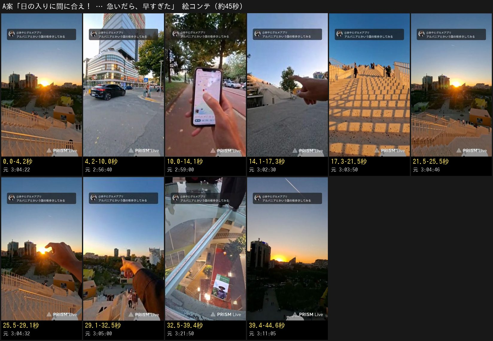
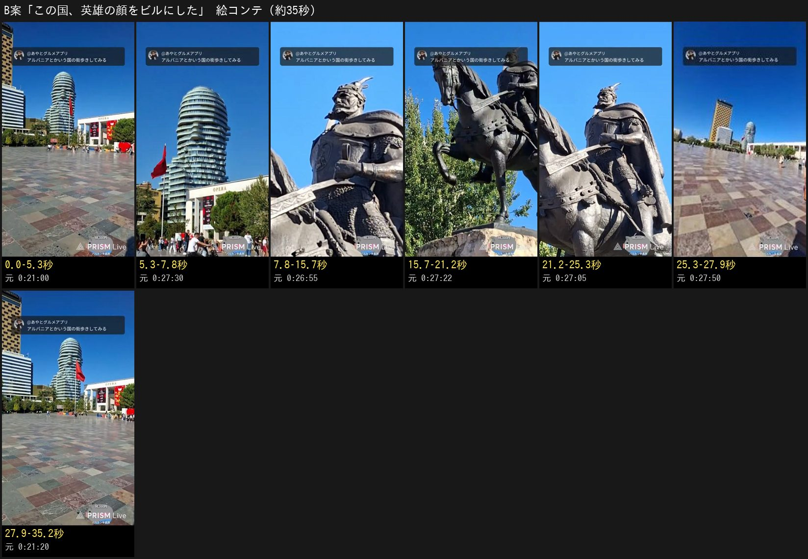
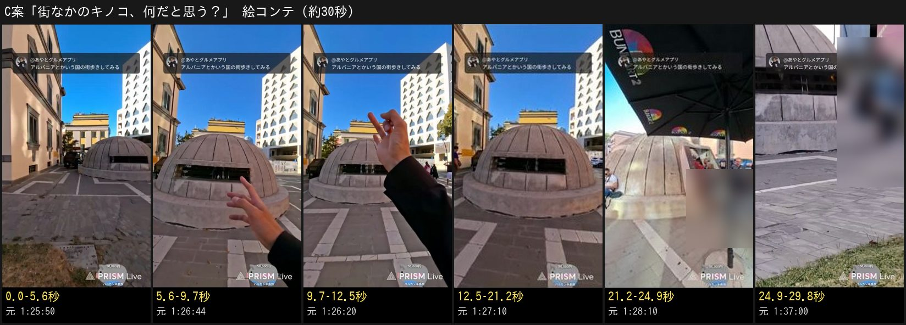

# ティラナ（アルバニアの首都）の街歩きの回 — 企画 p1（3案）

元動画: [アルバニアの首都を待ち歩きや！](https://www.youtube.com/watch?v=hK0SwIeAxg0)（2026-10-03、3時間29分53秒、縦長の配信）

## 決めてほしいこと

**3案から1つ選んで、承認してください。** この issue にコメントで1行です（スマホで打てます）。

- 承認: `/approve plan p1 A`（B案なら最後を `B`。日本語なら `/承認 企画 1 A` でも通ります）
- 直してほしい: `/revise 冒頭をもっと短く` のように1行で
- やめる: `/reject plan p1 理由`

承認が記録されるまで、本編集には進みません。

**おすすめは A案**（下に理由）。

## 先に知らせること（元動画で確かめた結果）

- 3時間半のうち、半分ほどは顔と話だけです（次の国の相談・ベンチでの雑談）。使える画は、昼の広場・教会・シェルター・城の通りと、**最後の15分の夕日**に集まっています
- 料理を食べる場面はありません。お土産の値段は本人の発言だけで、値札はコマで読めませんでした（車の値札「23,900 EURO」だけは読めた）
- 全コマの上に、配信の固定コメントの帯が映っています。右下には配信ソフトの透かし「PRISM Live」があります。どちらも書き出しで隠します
- 頂上・城の中では、観光客の顔が大きく映ります。使う場面はぼかします

## 3案の比べ

| | A案（おすすめ） | B案 | C案 |
| --- | --- | --- | --- |
| 型 | 物語・ハプニング | 発見・文化 | クイズ・歴史 |
| 仮タイトル | 日の入りに間に合え！ 急いだら、早すぎた | この国、英雄の顔をビルにした | 街なかのキノコ、何だと思う？ |
| 尺（見込み） | 約45秒 | 約35秒 | 約30秒 |
| 冒頭1〜2秒 | ビルの間に沈みかける夕日 ＋「日の入りまであと10分！？」 | 頭の形の高層ビル ＋「何に見える？」 | 街なかのコンクリのドーム ＋「これ、何？」 |
| 山 | 白い大階段が夕日で金色に | 像の顔とビルの見比べ | 正解はシェルター（国を閉ざしていた歴史） |
| オチ | 急ぎすぎて早く着きすぎた | 本人「全然似てへん」 | いまではベンチ代わり |
| 自己採点（40点） | **37** | 34 | 32 |
| 今回確かめる仮説 | 定番の名所の絶景を結末に置く物語は、24時間→7日の伸び（2026年の中央値 1.1〜1.6倍）を上回る | 問い→5秒で答え、の型は3→8秒の残りと視聴を継続した割合が基準を上回る | クイズ形式はコメント数が基準を上回る |

自己採点は事前の予想です。当たるかどうかは、出したあとの数字で決めます。

---

## A案「日の入りに間に合え！ 急いだら、早すぎた」（物語・ハプニング型）

### 概要

| 項目 | 内容 |
| --- | --- |
| 狙い | 「間に合うか」で最後まで引っぱり、金色の大階段と夕日で応える。最後に「早く着きすぎた」で笑って終わる |
| 狙う視聴者 | 主: 家にいながら海外の絶景を見たい 30〜50代の女性。サブ: ドタバタの展開 |
| 尺 | 約45秒 |
| 感情の流れ | 焦り（あと10分）→ 心配（地図がずれる）→ 感動（金色の階段）→ 笑い（早すぎた）→ 余韻（沈む太陽） |
| 伸びると考えた理由 | 0秒目にこの配信でいちばん強い画（ビルの間に沈みかける夕日）。4〜8秒に「午後4時には『時間が余りそう』と言っていたのに」のねじれ。舞台は首都の定番の名所で、あやとの過去でいちばん伸びた形（2024年の有名都市の定番の一日。ウィーンの定番の回は約6.8万回で、同じ都市の寄り道の回の4〜8倍）に近い |

### 原稿（全文・10文・188字）

1. 本人の計算では、日の入りまで、あと10分。
2. 午後4時には「時間が余りそう」と言っていたのに、気づけばこの時間。
3. スマホの地図は現在地がずれて、ほぼ勘で急ぐ。
4. 見えてきたのは、白い大階段。
5. 夕日を浴びて、階段が金色に。
6. 頂上に着くと……まだ、沈んでいない。
7. 本当の日の入りまで、まだ16分あった。
8. 急ぎすぎて、早く着きすぎた男。
9. ここはティラナのピラミッド。昔の独裁者の博物館が、いまは誰でも登れる展望台に。
10. 午後6時11分。太陽は、ビルの向こうへ。

**尺の確認:** 無料の読み上げで測りました。1.15倍（想定）で 39.7秒／1.0倍（遅め）で 45.5秒。画だけの間を足しても60秒未満に収まります。

### 絵コンテ

| 動画内 | 元動画 | 映像 | ナレーション | テロップ | 演出 |
| --- | --- | --- | --- | --- | --- |
| 0.0–4.2秒 | 3:04:20–3:04:25 / 2:56:40–2:57:10 | 頂上から、高層ビルの間に沈みかける太陽 → 急ぎ足の通り | 本人の計算では、日の入りまで、あと10分。 | 上（全編）: 日の入りに間に合え！アルバニアの首都で ／ 中央: 日の入りまで あと10分！？ | 夕日を1.5秒見せてから、通りへカット |
| 4.2–10.0秒 | 1:04:19 / 2:57:30 | 夕方の通りを急ぐ（歩く人の顔はぼかす） | 午後4時には「時間が余りそう」と言っていたのに、気づけばこの時間。 | 中央: 午後4時「時間が余りそう」 |  |
| 10.0–14.1秒 | 2:59:00–2:59:50 | 手のスマホの地図アプリ | スマホの地図は現在地がずれて、ほぼ勘で急ぐ。 |  | 地図に寄る |
| 14.1–17.3秒 | 3:02:19–3:02:50 | 白い段々を指さす | 見えてきたのは、白い大階段。 |  | カット |
| 17.3–21.5秒 | 3:03:00–3:03:53 | 夕日で金色に光る階段と、手すりの格子の影 | 夕日を浴びて、階段が金色に。 |  | BGM を少し上げて、画を2秒見せる |
| 21.5–25.5秒 | 3:04:22–3:04:49 | 頂上から、ビルの間の太陽と黄色い箱 | 頂上に着くと……まだ、沈んでいない。 |  | 間を置く |
| 25.5–29.1秒 | 3:04:30–3:04:33 | 太陽をつまむように手をかざす | 本当の日の入りまで、まだ16分あった。 | 中央: 日の入りまで まだ約16分 |  |
| 29.1–32.5秒 | 3:04:25 / 3:05:00 | 夕日を指さすあやとの手と、下の階段 | 急ぎすぎて、早く着きすぎた男。 | 中央: 早く着きすぎた | （元の声「早くつきすぎた」を残す候補） |
| 32.5–39.4秒 | 3:21:50 / 3:03:00 | 頂上のガラスの天窓から、下の展示を見下ろす | ここはティラナのピラミッド。昔の独裁者の博物館が、いまは誰でも登れる展望台に。 | 中央: ティラナのピラミッド |  |
| 39.4–44.6秒 | 3:11:00–3:11:12 | 太陽が建物の向こうへ入っていく | 午後6時11分。太陽は、ビルの向こうへ。 |  | ゆっくり終わる |

合計 **44.6秒**（ナレーションは Open JTalk を1.15倍速で読ませた長さ。1.0倍なら約15%長い）

### 自己評価

| 冒頭の引き | 初見の分かりやすさ | 意外性 | 画の魅力 | 物語 | テンポ | 見終わった満足 | 狙いとの合い | 計 |
| --- | --- | --- | --- | --- | --- | --- | --- | --- |
| 5 | 5 | 4 | 5 | 5 | 4 | 4 | 5 | **37** |

- 画5: 金色の大階段と格子の影、ビルの間の夕日は、この配信でいちばん強い画
- テンポ4: 原因（時間を使いすぎた）から結末まで実際は15分。ナレーションで詰める
- 満足4: 太陽は一瞬で消えるのではなく、建物の陰にゆっくり入る。最後の決め手は「早く着きすぎた」のほうに置いた

### 確かめた事実（元動画の時刻）

| ナレーション | 根拠 |
| --- | --- |
| 本人の計算では、あと10分 | 2:56:54「あと10分に沈んじゃう」。**実際はこの時点で約23分あった**ので、「本人の計算では」と言う |
| 午後4時に「時間が余りそう」 | 1:04:19「なんか時間が余る気がする」。現地時刻は配信開始 14:59:53 ＋動画の時刻。本人の「16時を迎えました」（1:01:21）と合う |
| 地図の現在地がずれる | 2:59:00「位置情報がバグってて今どこか分からへん…結構勘です」。コマに地図アプリ |
| 白い大階段・金色 | 3:02:19〜3:03:53 のコマ。本人「階段が白くて夕日に照らされて」 |
| まだ16分あった | 頂上（3:04:25「早くつきすぎた」）は現地 18:04。日の入りは 18:20（2026-10-03 のティラナを計算。本人の言う「18時19分」と合う） |
| ティラナのピラミッド | 外観・頂上のガラスの天窓・色の箱が、2023年に改修された建物の写真と一致（[Dezeen](https://www.dezeen.com/2023/10/23/pyramid-of-tirana-albania-mvrdv/amp/)、[Wikipedia](https://en.wikipedia.org/wiki/Pyramid_of_Tirana)）。**本人は名前を言っていないので推定** |
| 午後6時11分、ビルの向こうへ | 3:11:05「3、2、1。夕日が行っちゃいました」（現地 18:10:58）。コマでも太陽が建物の陰に入る |

### 気をつけること

- 頂上の観光客の顔はぼかす（3:05:20〜3:05:50 などは使わない）
- 「この空が毎日」（本人の感想）は言わない
- 「早くつきすぎた」は本人の声を残す候補（1秒ほど）

---

## B案「この国、英雄の顔をビルにした」（発見・文化型）

### 概要

| 項目 | 内容 |
| --- | --- |
| 狙い | 「このビル、何に見える？」の問いで止めて、英雄の像と見比べる答え合わせ。本人の「全然似てへん」で笑って終わる |
| 狙う視聴者 | 主: 知らない国の文化を知りたい人 |
| 尺 | 約35秒 |
| 感情の流れ | ？（何に見える）→ へえ（英雄の顔）→ くすっ（似てへん）→ なるほど（国じゅうの石） |
| 伸びると考えた理由 | 0秒目の問い「何に見える？」に、**5秒で「正解は人の顔」**と答える。2つ目の山がちょうど人の離れる4〜8秒に来る。首都の中心の広場という定番の場所 |

### 原稿（全文・7文・154字）

1. アルバニアの首都の広場。このビル、何かに見えませんか？
2. 正解は、人の顔。
3. モデルは、この騎馬像の人。15世紀にオスマン帝国と戦い続けた、アルバニアの英雄スカンデルベグ。
4. 高さ85メートル。ベランダの形で、鼻やひげを表している。
5. 本人、像とビルを見比べてみた結果……
6. 「全然似てへん」。
7. ちなみに足元の石畳は、国じゅうから集めた石。英雄の広場は、国ぜんぶでできている。

**尺の確認:** 1.15倍で 31.9秒／1.0倍で 36.6秒。

### 絵コンテ

| 動画内 | 元動画 | 映像 | ナレーション | テロップ | 演出 |
| --- | --- | --- | --- | --- | --- |
| 0.0–5.3秒 | 0:21:00–0:21:30 | 色とりどりの石畳の広場と、頭の形の高層ビル | アルバニアの首都の広場。このビル、何かに見えませんか？ | 上（全編）: この国、英雄の顔をビルにした ／ 中央: 何に見える？ | ビルに寄る |
| 5.3–7.8秒 | 0:27:20–0:27:30 | 頭の形のビル（横顔）と国旗 | 正解は、人の顔。 | 中央: 人の顔 | カット |
| 7.8–15.7秒 | 0:26:50–0:27:10 | ヤギの角の兜の騎馬像を真下から | モデルは、この騎馬像の人。15世紀にオスマン帝国と戦い続けた、アルバニアの英雄スカンデルベグ。 | 中央: 英雄 スカンデルベグ（1405–1468） | 像の顔に寄る |
| 15.7–21.2秒 | 0:27:20–0:27:30 / 0:20:30 | 波打つベランダのアップ | 高さ85メートル。ベランダの形で、鼻やひげを表している。 | 中央: 高さ85m | ベランダの線に沿って上へ |
| 21.2–25.3秒 | 0:27:00–0:27:13 | 像の顔 → ビルを交互に | 本人、像とビルを見比べてみた結果…… |  | 左右に並べる |
| 25.3–27.9秒 | 0:27:26–0:27:34 | 広場の向こうに顔のビル（本人の声「全然似てへん」を残す候補） | 「全然似てへん」。 | 中央: 「全然似てへん」 |  |
| 27.9–35.2秒 | 0:16:10–0:16:50 / 0:21:20 | 色とりどりの石畳 | ちなみに足元の石畳は、国じゅうから集めた石。英雄の広場は、国ぜんぶでできている。 | 中央: 国じゅうの石でできた広場 | 足元から見上げて終わる |

合計 **35.2秒**（ナレーションは Open JTalk を1.15倍速で読ませた長さ。1.0倍なら約15%長い）

### 自己評価

| 冒頭の引き | 初見の分かりやすさ | 意外性 | 画の魅力 | 物語 | テンポ | 見終わった満足 | 狙いとの合い | 計 |
| --- | --- | --- | --- | --- | --- | --- | --- | --- |
| 5 | 5 | 5 | 4 | 3 | 4 | 4 | 4 | **34** |

- 意外5: 英雄の顔をビルにする、は日本の常識に無い
- 物語3: 出来事の流れではなく、知識の答え合わせ

### 確かめた事実

| ナレーション | 根拠 |
| --- | --- |
| 人の顔のビル・高さ85m・ベランダで鼻やひげ | 設計事務所 MVRDV の Skanderbeg Building（[Dezeen 2022-08-04](https://www.dezeen.com/2022/08/04/mvrdv-skanderbeg-building-albania-national-hero/)、[MVRDV](https://www.mvrdv.com/projects/461/skanderbeg-building)）。本人も 0:21:11「モアイ像みたいな顔」 |
| 15世紀にオスマン帝国と戦い続けた英雄 | スカンデルベグ（1405–1468）。約25年抵抗した（[Wikipedia](https://en.wikipedia.org/wiki/Skanderbeg_Monument)）。像の案内を本人が読む（0:24:31〜0:24:55） |
| 「全然似てへん」 | 0:27:26〜0:27:34 本人 |
| 国じゅうから集めた石 | 2017年の広場の改修で、国内各地の石を使った（[Public Space](https://publicspace.org/works/-/project/k056-skanderbeg-square)） |

### 気をつけること

- 本人が国旗について言った冗談（0:20:34〜0:21:05）と「監視している」（0:22:38）は使わない（相手の国を笑う形になる）
- 「ビルになった人物は世界初」とは言わない（確かめていない）

---

## C案「街なかのキノコ、何だと思う？」（クイズ・歴史型）

### 概要

| 項目 | 内容 |
| --- | --- |
| 狙い | 3択クイズで見る人を参加させ、答えの理由（国を閉ざしていた歴史）で「へえ」、最後に「いまはベンチ」で緩める |
| 狙う視聴者 | 主: 知らない国の暮らしと歴史を知りたい人 |
| 尺 | 約30秒 |
| 感情の流れ | ？（これ何）→ 考える（3択）→ へえ（シェルター）→ ほっこり（ベンチ） |
| 伸びると考えた理由 | 3択で見る人に考えさせ、9秒で答える。答えの理由（国を閉ざしていた歴史）が日本の常識と違う。30秒と短い |

### 原稿（全文・6文・139字）

1. アルバニアの街なかにある、このキノコのようなもの。何だと思いますか？
2. ピザ窯？　オブジェ？　それとも……
3. 正解は、シェルター。
4. かつて国を閉ざしていたアルバニアでは、攻めてこられるのを恐れて、国じゅうにシェルターが造られた。その数は数十万とも。
5. 地下の大きなシェルターは、いまは博物館。
6. そして街なかのこれは……いまでは、ベンチ代わり。

**尺の確認:** 1.15倍で 26.1秒／1.0倍で 29.9秒。

### 絵コンテ

| 動画内 | 元動画 | 映像 | ナレーション | テロップ | 演出 |
| --- | --- | --- | --- | --- | --- |
| 0.0–5.6秒 | 1:25:30–1:26:30 | 芝生と古典建築の前の、覗き窓のあるコンクリのドーム | アルバニアの街なかにある、このキノコのようなもの。何だと思いますか？ | 上（全編）: 街なかのキノコ、何だと思う？ ／ 中央: これ、何？ | ドームに寄る |
| 5.6–9.7秒 | 1:26:11–1:26:21 | ドームを指す手 | ピザ窯？　オブジェ？　それとも…… | 中央: ①ピザ窯 ②オブジェ ③？ | 選択肢を1つずつ出す |
| 9.7–12.5秒 | 1:26:31–1:26:47 | ドームのアップ | 正解は、シェルター。 | 中央: 正解 シェルター |  |
| 12.5–21.2秒 | 1:26:41–1:27:48 | ドームのアップ・覗き窓 → 街並み（座っている人の顔はぼかす） | かつて国を閉ざしていたアルバニアでは、攻めてこられるのを恐れて、国じゅうにシェルターが造られた。その数は数十万とも。 | 中央: 国じゅうに数十万とも |  |
| 21.2–24.9秒 | 1:25:00 / 1:28:10 | 博物館 BUNK'ART 2 の入口（人の顔はぼかす） | 地下の大きなシェルターは、いまは博物館。 | 中央: いまは博物館 |  |
| 24.9–29.8秒 | 1:36:44–1:37:07 | ドームに腰かける人（顔はぼかす） | そして街なかのこれは……いまでは、ベンチ代わり。 | 中央: いまは ベンチ代わり |  |

合計 **29.8秒**（ナレーションは Open JTalk を1.15倍速で読ませた長さ。1.0倍なら約15%長い）

### 自己評価

| 冒頭の引き | 初見の分かりやすさ | 意外性 | 画の魅力 | 物語 | テンポ | 見終わった満足 | 狙いとの合い | 計 |
| --- | --- | --- | --- | --- | --- | --- | --- | --- |
| 4 | 5 | 5 | 3 | 3 | 5 | 3 | 4 | **32** |

- 満足3: オチの「ベンチ」の画は、腰かけている人の顔をぼかすので弱くなる
- 画3: コンクリのドームは地味。青空と街並みで補う

### 確かめた事実

| ナレーション | 根拠 |
| --- | --- |
| 正解はシェルター | 1:26:31 本人。独裁者ホッジャの時代（1967–1986）に国じゅうに造られた（[Wikipedia: Bunkers in Albania](https://en.wikipedia.org/wiki/Bunkers_in_Albania)） |
| 国を閉ざしていた | 当時は西側とも東側とも縁を切っていた。初めての複数政党の選挙は1991年 |
| 数十万とも | 資料で約17万〜75万と割れるので、数は言い切らない |
| 地下の大きなシェルターは博物館 | BUNK'ART 2（内務省の核シェルター 1981–1986 を使った博物館）。1:28:10 の入口 |
| いまではベンチ代わり | 1:36:44〜1:37:07 本人「ほんまや、ベンチになってるやん」。1:37:00 のコマにドームに腰かける人 |

### 気をつけること

- 1:28:20〜1:29:50 は観光客の顔が大きく長く映るので使わない
- 本人のクイズの選択肢にあった漫画の名前は使わない（ナレーションの選択肢は作り直した）
- 「ミサイルが降ってくる」（本人の言い方）は「攻めてこられるのを恐れて」にした

---

## 3案に共通すること（暫定）

| 項目 | いまの扱い |
| --- | --- |
| ナレーションの声 | Fish Audio の Holiday Twist（#908 で決定）。尺はいまは無料の読み上げ（Open JTalk）で測った見込みで、本物の声で作ったら測り直す |
| BGM | 参考の曲を、投稿のときに各媒体の音源ライブラリから付ける（#909 で決定）。付けられない媒体は「Hiking Trail」を入れる。どちらも声より必ず小さくする |
| テロップ | 参考のスクショに合わせる。上のタイトルは黄色の地に黒の太い丸ゴシック、中央は白字に黒の縁取り（「文字枠」を縁取りと読みました。箱のことなら言ってください） |
| 元の音声 | 原則ミュート。本人の短い一言を残す候補には「残す候補」と書いた |
| 透かし・帯・ぼかし | 右下の「PRISM Live」と上の固定コメントの帯は隠す。第三者の顔はぼかす |
