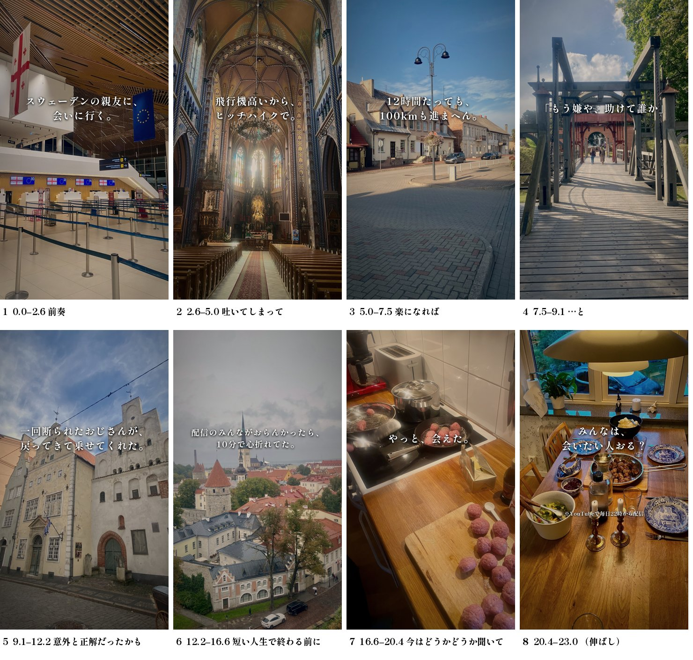

# 北欧周遊 × ハカネ「蜃気楼」（23秒・テロップだけ）p1

あやと（2026-10-23 チャット）: 北欧周遊の写真を、BGM のテンポに合わせてパラパラめくる。
ナレーションなし。テロップは添付の「時間を忘れるくらい」の形。北欧周遊で感じたことを、曲調に合う書き方で。
テロップがいちばん難しいところなので、予備を用意しながら書き出す。

## 伝えたいこと（1行）

**3年前に日本で出会った親友に、ポーランドから人の車を乗り継いで会いに行った。ひとりでは折れていた。**

旅の芯は `docs/nordic-fund.md` 1章「会いたい人がいるので、スウェーデンまでヒッチハイクで行きます」。
感じたことの芯は、議事録から拾った本人の言葉（下の事実の表）で、「人に助けられた／ひとりじゃなかった」。

## 曲

- ハカネ「蜃気楼」（ドラマ「ジョフウ」ED、ビクター）。公式 MV `pZYkT4Ugx88`
- 使う23秒は1番のサビ（MV の 49.69秒〜72.69秒）。句の頭: 吐いて +2.6 / 楽に +5.0 / 正解だったかも +9.1 / 短い人生で +12.2 / 今はどうか +17.0 / 聞いて の伸ばし +21.0〜23.0
- BPM 約96（1拍 0.627秒・1小節 2.5秒）。23秒で38拍
- 曲の温度: 「誰かが救ってくれるなんて」思えなかった人が、短い人生が終わる前に「今はどうか聞いて」と乞う。明るい応援歌ではなく、痛みのあとの静かな祈り
- **曲は動画に焼かない。** YouTube・TikTok の投稿のときに、アプリの音源ライブラリから付ける（帳面 F-001・#909）。書き出しは無音か、合わせ用の下見だけに曲を敷く

## 原稿

1行が歌の1句に乗る（句の区切りは下の表の「秒」）。
最後の画に注の札「※YouTubeで毎日22時から配信」（帳面 F-042）。

### A（本命）「会いに行く」— 目的 → 壁 → 意外な救い → 到着

| 秒 | 歌の句 | テロップ | 写真（旅の順） | 置いた理由 |
| --- | --- | --- | --- | --- |
| 0.0–2.6 | 前奏 | スウェーデンの親友に、会いに行く。 | 9/11 トビリシの空港 | 目的を最初に言い切る。初見が「会えるのか」を持って最後まで見る |
| 2.6–5.0 | 吐いてしまって | 飛行機高いから、ヒッチハイクで。 | 9/12〜9/14 | 「なんでヒッチハイク？」を2行目で消す |
| 5.0–7.5 | 楽になれば | 12時間たっても、100kmも進まへん。 | 9/15〜9/16 | 壁を数字で |
| 7.5–9.1 | …と | 「もう嫌や、助けて誰か」 | 9/16 | 「吐いてしまって楽になれば」の上に、本人が吐いた言葉そのもの |
| 9.1–12.2 | 意外と正解だったかも | 一回断られたおじさんが、戻ってきて乗せてくれた。 | 9/17 リガ | 「意外」の上に、旅でいちばん意外だったこと |
| 12.2–16.6 | 短い人生で終わる前に | 配信のみんながおらんかったら、10分で心折れてた。 | 9/17〜9/18 タリン | 本人の言葉。チャットに支えられた、の元の意味のまま |
| 16.6–20.4 | 今はどうかどうか聞いて | やっと、会えた。 | 9/19 フェリー → 9/20 ストックホルム → 親友の家の台所 | 静かに。乞う歌の上に宣言を置かない |
| 20.4–23.0 | （伸ばし） | みんなは、会いたい人おる？ | 親友の家の食卓（長めに置く） | 「短い人生で終わる前に」を、見る人の話に返す。注「※YouTubeで毎日22時から配信」 |

1行ずつの予備（同じ句に差し替えられるもの）:

- 1: 「会いに来てよ」って言うてくれた、スウェーデンの親友。
- 2: スウェーデン行き、飛行機高すぎて。／ポーランドから、人の車で北へ。
- 4: 「ああ、もう嫌や。助けて誰か。もう泣く」（言ったまま）
- 5: 駐車場のおじさんが、スープくれた。
- 7: 1,377km、人の車で会いに来た。
- 8: みんなにも、会いたい人おる？

### B（予備）「2年の迷い」— 海外2周年の日の迷いに、旅が答える

```
海外に出て、2年。
ほんまは、2年で日本に帰るつもりやった。
「この2年で、よかったんかな」
迷ったまま、ヒッチハイクで北へ。
一回断られたおじさんが、戻ってきて乗せてくれた。
「やらなかった2年より、やってきた2年」
配信で、そう言うてもろた。
スウェーデンで、親友に会えた。
みんなは、迷ってることある？
```

「短い人生で終わる前に」の上に「やらなかった2年より、やってきた2年」が乗るのが、3案でいちばん歌と重なる1行（批評役）。
ただしこの言葉は**視聴者さんのコメント**なので、本人の言葉に見せず「配信で、そう言うてもろた」と出どころを書く。

### C（予備）「ひとりじゃなかった」— 助けてくれた人の数で進む。カード（キャラクター入り）で出すならこれ

```
スウェーデンの親友に、ヒッチハイクで会いに行く。
「もう嫌や、助けて誰か」
駐車場のおじさんが、スープくれた。
一回断られたおじさんが、戻ってきて乗せてくれた。
配信のみんながおらんかったら、10分で心折れてた。
やっと、会えた。
連れてきてくれて、ありがとう。
みんなは、会いたい人おる？
```

あやと島カードは、その日に投げ銭してくれた人のキャラクターがその日の写真に立つもの。
「連れてきてくれて、ありがとう」の行でカードを見せると、言葉と画が同じことを言う。

## レビューの記録

- 機械の検査（`tools/shorts/script/lint.py`）: A ✕0 △0 ／ B ✕0 △1（L-QUOTE。3行目の「」に誰の言葉かの印が無い。前後で本人と分かるので残す）／ C ✕0 △1（同じ）
  - 1回目は3案とも ✕（F-032 L-END。締めが「みんな」への問いでない）→ 問いで締めた
- 批評役（往復を知らない読み手1人）。順位 A > C > B
  - A の 2行目「なんでヒッチハイク？」・5行目「ひとりちゃうかったん？」が「？」→ 2行目に「飛行機高いから」、5行目を「配信のみんながおらんかったら」に
  - A の 4行目「止まってくれたのは、知らん人やった」は当たり前で山にならない → 「一回断られたおじさんが、戻ってきて乗せてくれた」を「意外と正解だったかも」の上へ
  - 「吐いてしまって／楽になれば」の上には本人の叫び（C の素材）を移した
  - B は事実を越えていた2か所（「帰る日やった」→「帰るつもりやった」、「何回も」→ 削除）と、言った人の取り違え（視聴者さんのコメント）を直した
  - 「〜へ。」の体言止め・「配信の向こうにも」の作った詩は使わない
- 曲のテロップの見た目: 白の太い明朝（Shippori Mincho B1 ExtraBold、OFL）・柔らかい影・字の中心は高さ 36%。北欧の写真は昼の明るい空が多く白い字が溶けるので、写真を少し暗く・彩度を落とし・暖色に寄せ、周辺を沈める（曲の温度にも寄せる）

## 絵コンテ（A）



## 事実の表（議事録・字幕で確かめた）

| 原稿の言葉 | 根拠 |
| --- | --- |
| 3年前、日本で出会った親友 | `site/content/nordic.ts` の `WHY`（2023年8月1日、留学で3ヶ月日本に来ていた） |
| スウェーデンまで会いに行く／ヒッチハイク | `docs/nordic-fund.md` 1章。陸路 1,377km（9/12 議事録の冒頭） |
| 12時間で100kmも進まへん | 9/13 0034 [0:00:00]「12時間経って100kmも進んでない」 |
| もう嫌や、助けて誰か | 9/12 1321 [3:57:30]「ああ、もう嫌や。助けて誰か。もう泣く。」 |
| スープをくれたおじさん | 9/12 1321 議事録 81行（パーキングに住んでいるおじさん） |
| 一回断ったおじさんが戻ってきた | 9/13 1623 [3:30:00]「さっき断ったおじさんが戻ってきて」 |
| ひとりやったら10分で心折れてた | 9/13 1623 [5:22:00]「1人でやったらもう10分で心折れてる」（チャットに支えられて、の文脈） |
| やっと会えた | 9/20 1638・9/21 2115。親友の家に1週間。最後の写真は親友とお母さんと作ったミートボール |
| 海外に出て2年／ほんまは日本に帰る日 | 9/11 1940 [1:11:00]「2年で帰るって言ってた」「最後の日やなって思ってた」 |
| この2年で、よかったんかな | 9/11 1940 [1:04:00] 付近「この2年がこれで良かったのかな」 |
| やらなかった2年より、やってきた2年 | **視聴者さんのコメント**（9/11 議事録 33行）。本人が読んで「確実にいいもんな」。本人の言葉としては出さない |
| あと3年がんばる | 9/11 1940 [0:59:30]〜[1:00:00] |

## 写真

あやと島カードの北欧周遊の写真（`public/review/manifest.json` の68枚、元は 1200x1600）。
1拍に1枚、旅の順にめくる。最後の2句は1枚を長めに置き、締めは親友の家の食卓。
