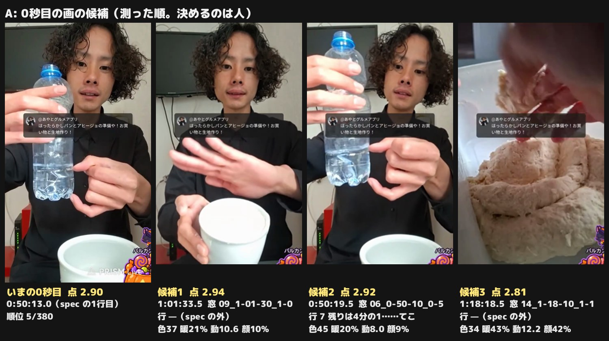
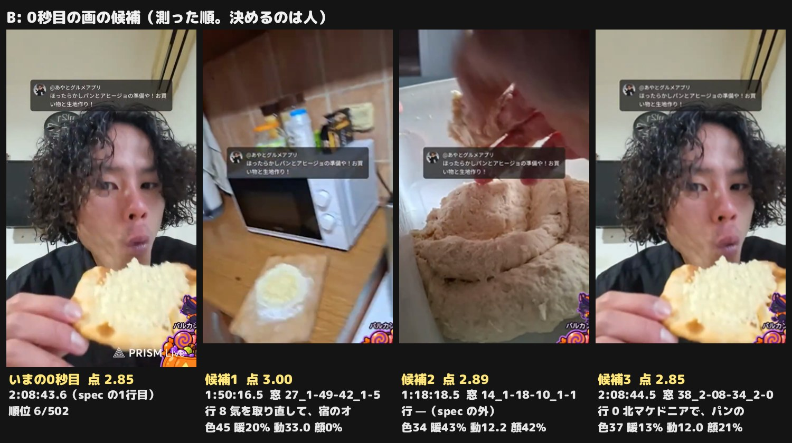
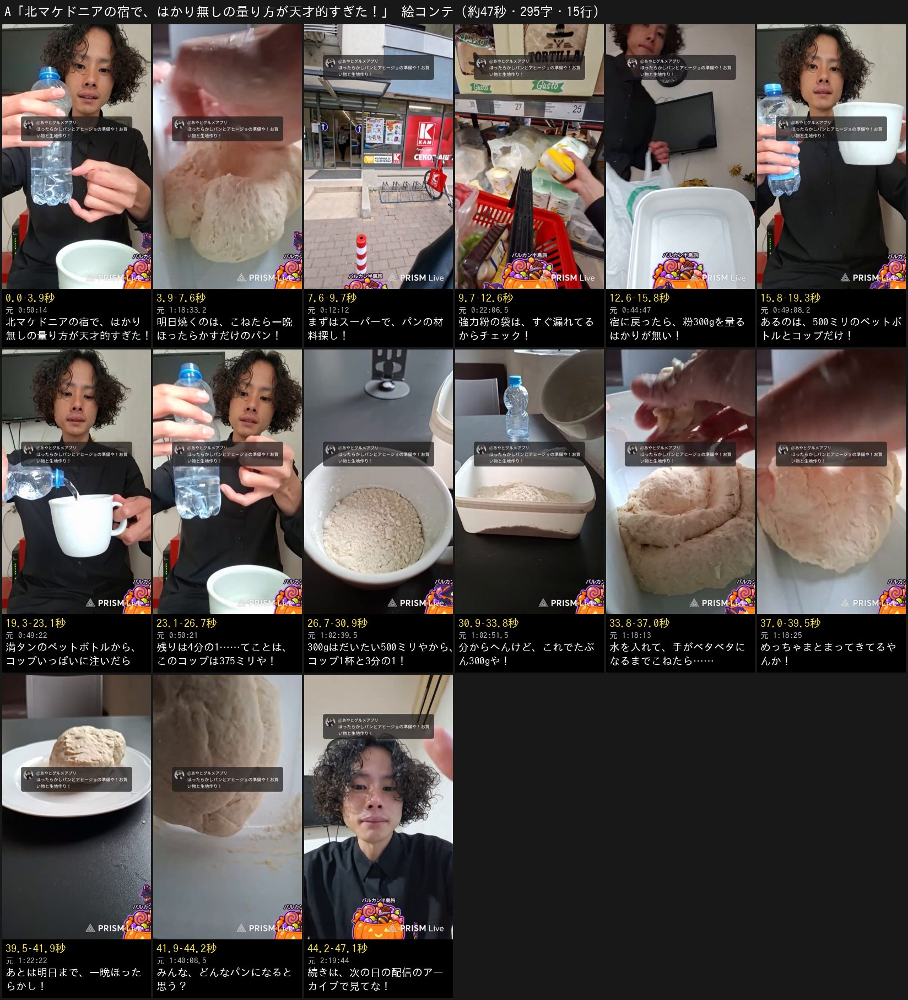
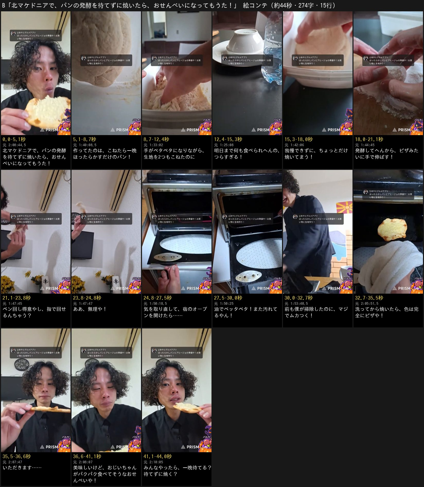

# 北マケドニアのほったらかしパンの準備 p1 — 提案版（A）といつもの版（B）の原稿

依頼（あやと 2026-11-04・チャット。制作 issue は #1107）: 視聴者さんの付箋で届いたショートの頼みを、「この人の提案版といつもの版の両方」で。付箋の添付画像は使わない。
付箋の頼み（要約）: 北マケドニアのほったらかしパン＆アヒージョの準備の回。海外のスーパーで材料を探し、はかりが無いのに量り方が天才的、生地を仕込んで翌日まで発酵を待つ——続きはライブで、という流れ。
**1次は原稿だけ。** 本編集・声はまだ作らない（あやとが原稿に返事をしてから）。画の秒は、2026-11-04 に原稿が使う区間だけを取り込んで確かめた秒に差し替えた（下の「画（2026-11-04 に素材を取り込んで確かめた）」）。原稿の字は、B13 だけ 2026-11-04 に直した（同じ章の「原稿の字を変えたほうがいい行」）。ほかは1次のまま。

| | |
| --- | --- |
| 配信 | [urwD3EmjTxs](https://www.youtube.com/watch?v=urwD3EmjTxs)（2026-10-29 22:00 JST「🇲🇰北マケドニアのほったらかしパン&アヒージョの準備や！」・2:19:30）。場所は北マケドニア・スコピエの、宿の近くのスーパーと宿の部屋・共用キッチン |
| 材料 | `streams/2026/10/2026-10-29_2200_urwD3EmjTxs.md`（議事録）・`.transcript.txt`（自動字幕 30秒ごと）・`.chat.txt`（491件。**時刻だけ**使い、本人の言葉が書き込みの読み上げかどうかを見分けた。本文と名前はここに写さない。F-048） |
| 作る数 | 2案。A＝提案版（付箋の流れを骨に）、B＝いつもの版（見どころから組む） |
| 題の札 | A「🇲🇰北マケドニアの宿で、はかり無しの量り方が天才的すぎた！」／B「🇲🇰北マケドニアで、パンの発酵を待てずに焼いたら、おせんべいになってもうた！」（0〜4.0秒・黒い箱） |
| 原稿 | A 15行・295字・約47秒／B 15行・274字・約44秒（上限の倍率で毎秒6.8字・行の間0.25秒。下の「尺の見積もり」が道具で出した値） |
| 機械の検査 | `lint.py` A ✕0・△2／B ✕0・△4（B は 13行を直したあと。直す前は △3）。批評役は1人目・2人目の結果を「レビューの記録」に |

## バゲットのショートとの違い（#1071、2026-11-04 21:30 公開）

バゲットは「海外旅行中に作ったバケットが簡単すぎた！」で、この回を含む4本の配信をまたいで、量る→こねる→一晩→二次発酵→焼く→味までを見せる**成功のレシピ**だった。量る場面は「500ミリのペットボトル満タンで強力粉300gや！」の1行で答えの数だけを言い、「うどんと一緒」「パン屋さんの動画で見る生地」「どんぶりを蓋に」を使った。
**A** は準備の回1本だけで、付箋の流れどおりスーパーの材料探し（強力粉の袋のチェック）から入り、量る場面は**「このコップが何ミリか」を満タンのペットボトルの残りから割り出す手順そのもの**（残り4分の1→375ミリ→1杯と3分の1）を山にして、焼き上がりは見せずに問いとアーカイブで渡す。バゲットの言い回し（Googleの試験・うどん・パン屋さんの動画・どんぶり）と、どんぶりの画は使わない。
**B** はバゲットがわざと外した**発酵なしの試し焼き**（我慢できずにちぎって焼く→ピザみたいに伸ばす→指で回して失敗→宿のオーブンが油まみれ→おせんべい）だけで組み、スーパーも量る場面も出さない。
題も、バゲットの「簡単すぎた」（成功）に対して、A は「量り方が天才的」、B は「待てずに焼いたらおせんべい」（失敗）で重ならない。
画は、バゲットが使った秒（0:21:58・0:27:04・0:48:30〜0:49:28・0:59:46・1:01:10〜1:01:38・1:06:44・1:08:02・1:13:46〜1:14:28・1:18:38〜1:20:06・1:24:06〜1:24:22・1:30:52）を避けて選んだ。同じ場面の別の秒を使うのは A の 4行（強力粉の袋）と 6〜9行（ペットボトルとコップ・粉）で、取り込んで、バゲット p2 のカット（`edit_p2.json` の in / out）と重ならない秒に決めた（4行は 0:22:04.5〜。1次の見当の 0:21:30〜 は袋が写らず、買い物客の顔が大きい）。

## 締めの「続きは毎日のライブで」を確かめた結果

- **毎日22時は言える。** `streams/manifest.tsv` と BigQuery の `youtube_chat.videos`（`actual_start_time`）で、**2026-09-28〜11-03 の37日すべてに配信があり、37日のうち33日が 21:50〜22:15 JST の開始**（外れたのは 10-12 13:41／23:07・10-23 18:59・10-24 21:23・10-31 19:01 の月末配信）。直近は 11-01 22:00・11-02 22:00・11-03 22:01。あやと本人も最後のテロップを「※YouTubeで毎日22時から配信」と決めている（帳面 F-042）。この回の議事録・字幕には、時刻を言った所は無い
- **ただし付箋の「続き」（どんなパンになったか）は、もうライブでは見られない。** 焼いたのは次の日 2026-10-30 の3本（12:28・20:10・21:58 JST）で、配信は終わっている。「続きはライブで」と言うと、見た人は今夜のライブで焼くと受け取る（帳面 F-036「映像の枠の中でだけ正しい事実を、落ちに使わない」）
- そこで **A の最後は「みんな、どんなパンになると思う？」→「続きは、次の日の配信のアーカイブで見てな！」**（F-032 の問い→アーカイブの形）にし、**毎日22時のライブは、最後の画の上の注の札「※YouTubeで毎日22時から配信」（F-042。読み上げない）で言う。** B は題の答えで閉じる話なので、最後は問いだけにした（札は同じ）
- 付箋の字に寄せたいときの差し替え（時刻は確かめた値。`lint.py` の L-NEXT も通る）: 15行を「旅の続きは、毎日22時からの配信で見にきてな！」。ただし「どんなパンに？」の答えはライブでは出ないので、問いの答えがどこで見られるかが声から消える。こちらは上の形を推す

## 外した範囲（F-059 の書きかたで）

- **両案とも:** オープニング（マフラー・猫のショートの話・時差・6万円）、帰り道の秋の話と次の国（ブルガリアかコソボか）・パソコンの受け取り、IT とパン屋の話、ポトフのコツ、強力粉1kg 約75円とバゲット1000〜1600円の値段（F-055・F-056）。書き込みの読み上げで動く段（量る途中の助言・塩や水の分量・どんぶりの案・焼くよう勧めた書き込み・共用のオーブンを笑う書き込み）は声に出さない（F-048）
- **A:** 試し焼きとオーブンの汚れ（B の山）。アヒージョの材料探し——腐ったニンニクを色で選ぶ（0:13:00）・パプリカか唐辛子かを翻訳で調べてピーマン（0:14:00〜0:15:00）・海鮮が置いていない（0:18:30）——は、量り方の筋に乗らないと批評役2人に ✕ で当てられたので段ごと外し、スーパーはパンの材料（強力粉）だけにした。水（ペットボトルの5分の2）と塩（小さじ3分の2）の量りかた——どちらも書き込みが出した数を本人が読んだもので、本人の手柄として言えないので声に出さない。どんぶりの蓋（バゲットで使った）
- **B:** スーパーと量る場面（A とバゲットで使う）。2つ目の生地のオリーブの話、洗剤の名前（赤も緑も同じだった）、オーブンが200度を超えないと点かない話、綿棒を使わない理由のクイズ（1:44:30〜1:46:30。耳を潰さないため——伸ばす行のあとに入れると説明が2行続くので外した。足すなら6行のあと）

## 2案の比べ

| | A 提案版 | B いつもの版 |
| --- | --- | --- |
| 型 | 発見・謎解き（はかり無しでどう量る？） | ハプニング（我慢できずに焼いたら） |
| 伝えたいこと | はかりが無い旅先の宿でも、ペットボトル1本とコップでパンの粉は量れる | パンは、発酵を待たずに焼くと、美味しいけどおせんべいになる |
| 土台 → 山 → 結末 → 問い | 道具も無い宿で材料探しから全部自分で（2〜6）→ 375ミリ→1杯と3分の1→たぶん300g（7〜10）→ 目分量でまとまった生地（12）→ どんなパンに？（14） | 2つもこねたのに明日まで食べられへん（2〜4）→ ちぎって焼く・回して失敗・油まみれのオーブン（5〜11）→ おせんべい（14）→ 待てる？待てずに焼く？（15） |
| 4〜8秒 | 2行「明日焼くのは、こねたら一晩ほったらかすだけのパン！」（前ふり。山は弱い） | 2行「作ってたのは、こねたら一晩ほったらかすだけのパン！」→ 3行「2つもこねたのに」（題の「待てず」への前ふり） |
| 0秒目の画（`hook.py` で測って選んだ） | 0:50:13〜0:50:15.6 残りが4分の1のペットボトルを掲げる（手前にマグ。380コマ中5位）→ 1:00:36.6〜 同じマグに粉を注ぐ | 2:08:43.6〜2:08:45.9 平たく焼けたパンをかじる（502コマ中6位）→ 2:07:04.2〜 皿の平たいパン |
| 尺 | 約47秒 | 約44秒 |
| 自己評価（予想。結果で判断する） | 引き3・分かりやすさ4・意外性3・画3・物語3・テンポ4・満足3・狙い5 | 引き4・分かりやすさ5・意外性4・画4・物語4・テンポ4・満足4・狙い4 |
| 低い点の理由 | 0〜13秒が前提とスーパーで、題の困りごと（はかりが無い）が5行目（約13秒）まで来ない。量る山に、本人の切れのある一言が無い（批評役2人とも (c) 3）。画が手元とテーブルに寄る。焼き上がりを見せないので見終わりの満足は問いに頼る | 試し焼きの画（ちぎる・伸ばす・オーブン）が手元とキッチンに寄るので、似た見た目が続かないかを素材で数える |
| 今回確かめる仮説 | 付箋の流れのまま（A）と、見どころから組んだ（B）の継続率・3→8秒の残りを、両方出したときに比べる（変えた1点: 骨組みを誰が決めたか） | 同じ配信の2本目を、1本目が外した失敗の場面だけで作っても継続が中央値に並ぶか（H1: 4〜8秒の前ふり・H2: 答えを先に見せる0秒目も一緒に見る） |

**推すのは B。** 題の答え（おせんべい）が1つで、0秒目にその画を置け、バゲットとは話も画も向きも重ならない。A は付箋の流れを守ったぶん、題の困りごとが5行目（約13秒）まで来ず、量る山に刺す一言が無い。どちらを作るかはあやとの返事で決める。

## A 提案版 — 「🇲🇰北マケドニアの宿で、はかり無しの量り方が天才的すぎた！」

### 0. 伝えたいこと・前提・参考

- **伝えたいこと（1行）:** はかりが無い旅先の宿でも、ペットボトル1本とコップでパンの粉は量れる
- **見る人とそろえる前提（`script_writing.md` 0.7）:** 「パンは重さで量る」は日本の常識どおりなので、ずらさない。そろえるのは2つだけ——呼び名「ほったらかしパン」を2行で中身（こねたら一晩）に言い換える、9〜10行で使う「300g」を5行で先に声に出す
- **筋（`planning.md` 1.7）:** 明日のパン（前提）→ スーパーで材料探し（強力粉の袋のチェック）→ 宿にはかりが無い → ペットボトルとコップで謎解き → たぶん300g → こねたらまとまった（答え）→ 一晩ほったらかし → 問い → アーカイブ。場面はスーパーの通路 → 粉の棚 → 宿のテーブル → ペットボトルとコップの手元 → こねる手 → 冷蔵庫
- **付箋の4拍との当て:** ①海外のスーパーで材料探し＝3〜4行 ②はかりが無くても量り方が天才的＝5〜10行 ③生地を仕込んで翌日まで発酵＝11〜13行 ④どんなパンになる？続きは＝14〜15行
- **写す参考（`script_writing.md` 7.1）:** HPJ（溜め→数→自分の口調で構える）と f8t（段を上げる講座・自分を落とす・最後の問い）

| 秒 | 参考のその拍で起きること | この原稿の行 | 写すもの | 写さないもの |
| --- | --- | --- | --- | --- |
| 0〜4 | 題の札＝やりたい事。画は対象そのもの | 1 | 札で「何が天才的か」を約束し、答えの画（まとまる生地）を0秒目に | 札の「〜したい！」の形（あやとの回は場所と出来事） |
| 4〜12 | f8t 13〜23: 枠を決めて初級の決まり → 難しい | 2〜4 | 前提（一晩ほったらかし）→ 材料探しの小さな注意（粉の袋はすぐ漏れる） | 講座の宣言・人に言われた片言 |
| 13〜27 | HPJ 3〜5: 溜めで切る → 数 → 自分の口調で構える | 5〜8 | 困りごと（5）→ 道具を2つだけ並べて溜め（6）→「〜たら」（7）→ 375ミリ（8） | 値段の溜め |
| 27〜34 | f8t 35〜40: 自分を落とす | 9〜10 | 計算のすぐあとで「分からへんけど、たぶん300g」と落とす | 爪楊枝の外し |
| 34〜39 | f8t 41〜44: 頂点の1語 | 11〜12 | 「〜たら……」→「めっちゃまとまってきてるやんか！」 | — |
| 42〜47 | HPJ 59〜61: 「みんな」への問い | 14〜15 | 予想を書きたくなる問い → アーカイブ | 二択の値段 |

### 1. 原稿（15行）

```
北マケドニアの宿で、はかり無しの量り方が天才的すぎた！
明日焼くのは、こねたら一晩ほったらかすだけのパン！
まずはスーパーで、パンの材料探し！
強力粉の袋は、すぐ漏れてるからチェック！
宿に戻ったら、粉300gを量るはかりが無い！
あるのは、500ミリのペットボトルとコップだけ！
満タンのペットボトルから、コップいっぱいに注いだら
残りは4分の1……てことは、このコップは375ミリや！
300gはだいたい500ミリやから、コップ1杯と3分の1！
分からへんけど、これでたぶん300gや！
水を入れて、手がベタベタになるまでこねたら……
めっちゃまとまってきてるやんか！【答】
あとは明日まで、一晩ほったらかし！
みんな、どんなパンになると思う？
続きは、次の日の配信のアーカイブで見てな！
```

### 2. 1行ずつ4欄（＋画）

秒は声を上限の速さで読んだ見積もり。画の列は、2026-11-04 に素材（clips・zoom）を取り込んで、名指す物が写っていることを確かめた秒（F-014。下の「画」の章）。元の声は使わない。

| # | 秒（見積もり） | 元の出来事（配信の時刻） | 見る人に届く文（読み上げる字） | 残した本人の言葉 | 選んだ理由 | 画（確かめた秒） |
| ---: | --- | --- | --- | --- | --- | --- |
| 1 | 0.0–3.7 | 題の札をそのまま読む（F-047）。付箋の核「はかりが無いのに量り方が天才的」（#1107 の要約） | 北マケドニアの宿で、はかり無しの量り方が天才的すぎた！ |  | F-063: 依頼の核の言葉（はかり無し・量り方・天才的）で題を言い切り、場所（北マケドニアの宿）を頭に置く（F-031）。札の字をそのまま読む（F-047） | 【0秒目・hook.py の候補2（plan.md の「0秒目の画」）】0:50:13〜0:50:15.6 宿の部屋で、残りの水が4分の1になった500mlのペットボトルを顔の横に掲げる（手前にマグ。量りかたの道具が2つとも写る）→ 1:00:36.6〜1:00:38 緑の強力粉の袋からマグへ粉を注ぐ（同じマグで粉を量る）。題の札の下 |
| 2 | 3.9–7.3 | 0:08:00「ほったらかしバケットとアヒージョを明日作ろうと思ってて」・0:08:30「1日ぐらい放置してたら勝手に生地の発酵が出来上がってる…生地こねてほったらかすだけ」 | 明日焼くのは、こねたら一晩ほったらかすだけのパン！ | ほったらかす | 前: 13〜14行の「一晩ほったらかし」「どんなパンになる？」の前提を先に置く。呼び名「ほったらかしパン」は使わず、中身（こねたら一晩）で言う（F-008） | 1:35:35〜1:35:36.4 容器の中で生地をこねる手元（2つ目）→ 1:18:33〜1:18:35.4 容器の中で1つ目の生地を折りたたんでこねる寄り。1次の見当の「スーパーへ歩く夜の道」（0:03:30〜0:04:30）は、昼の通りを歩く自撮りで、0:04:32〜0:04:56 は視聴者さんの名前の出る投げ銭の表示が重なるので使わない |
| 3 | 7.6–9.5 | 0:08:30〜0:09:00「今日は買い物をして、強力粉と…食材を買って」・0:12:00「買い物行こう」・0:21:30 粉の棚へ。スーパーの段（3〜4行）は、あやと #1107「この人の提案版といつもの版の両方欲しい」の提案版の骨（付箋の流れ: スーパーで材料探し→量る→仕込む→続き） | まずはスーパーで、パンの材料探し！ |  | 転: 付箋の1拍目（海外のスーパーで材料探し）へ移る。批評役2人目の ✕（アヒージョの材料は量り方の筋に乗らない・F-033）を受けて、探すのはパンの材料だけにした | 0:12:11.4〜0:12:12.9 赤い K の看板のスーパー（KAM）の入口（投げ銭の目盛りのかぼちゃが画面の下から消えたあと。入口の人は小さい）→ 0:12:27.6〜0:12:28.6 赤い買い物かごと棚の通路（奥の買い物客は小さく、顔は分からない） |
| 4 | 9.7–12.4 | 0:21:30「これが多分ね、強力粉…これすぐね、漏れてるからね。漏れてるかチェックします…大丈夫。オッケー」 | 強力粉の袋は、すぐ漏れてるからチェック！ | すぐ漏れてる・漏れてるかチェック | 方針5: 海外のスーパーで持って帰れる1行（粉の袋はすぐ漏れる→買う前に見る）。7〜10行で量る「粉」を、ここで画に出しておく（F-033 の筋に乗せる） | 0:22:04.5〜0:22:07.4 TORTILLA の札の下の棚から強力粉の袋を取り、カメラの前で回して見る（漏れていないかのチェック）。バゲットの 0:21:58〜0:21:59.3（棚へ手を伸ばす所）の6秒あと。この区間に買い物客は写らない（顔が大きいのは 0:21:18〜0:21:50） |
| 5 | 12.6–15.6 | 0:41:30「ただいま」（宿に戻る）・0:47:00 レシピは強力粉300g（流した動画の声）・0:44:30〜0:48:00 宿の部屋のテーブルで量る支度。量ったのは 0:48:00〜1:02:30 のペットボトルとコップだけで、はかりは出てこない（翌朝の nb2Cg9rmlM0 0:02:00「重さ分からへんか」） | 宿に戻ったら、粉300gを量るはかりが無い！ |  | 転: 題の困りごと（はかりが無い）を見る人に渡す。9〜10行の「300g」の前提をここで声に出す（F-008）。バゲットの「宿には、はかりが無い！」と同じ字にしない | 0:44:46〜0:44:48.4 宿の部屋に戻り、テレビとひまわりのあるテーブルに白い容器と買い物袋を置く（はかりは無い）→ 1:00:28〜1:00:29.2 緑の強力粉の袋を手に、マグの上で傾ける（粉300gを量る所） |
| 6 | 15.8–19.0 | 0:48:00「500mlのペットボトルあるよ」・0:49:00「これが500mlで、このコップ使いたいから」 | あるのは、500ミリのペットボトルとコップだけ！ |  | 前・HPJ 3〜5秒の溜め: 謎解きの道具を2つだけ並べて「これでどう量る？」を立てる。次の2行で答える | 0:49:06〜0:49:08.6 青いキャップの500mlのペットボトルを持ち上げ、続けて白いマグを持ち上げて見せる（道具はこの2つ）→ 0:51:20〜0:51:21 赤い棚の上に置いた白いマグ |
| 7 | 19.3–22.8 | 0:49:00「この500mlの水を使って、このコップが何lかっていうのを測ります…すり切りいっぱいで」・0:49:30「すり切りいっぱいプラスこのくらい」 | 満タンのペットボトルから、コップいっぱいに注いだら | すり切りいっぱい | 方針3: 「〜たら」で開けて、次の行で答える。何をしたかを1行に畳み、手順の説明を2行にしない | 0:49:20.6〜0:49:23.2 満タンのペットボトルからマグへ水を注ぐ（バゲットの 0:49:18〜0:49:19.6 のあと。マグが縁まで満ちていく所）→ 0:51:42〜0:51:43.4 黒いテーブルに置いたマグを真上から（脇にペットボトルの青いキャップ） |
| 8 | 23.1–26.5 | 0:50:00「1/4やから…375ぐらい」・0:50:30「ここに残ってるのが1/4で125やから、こっちは375です」・0:51:30「だから多分375や、これ」（本人が先に割り出した。書き込みはこのあと） | 残りは4分の1……てことは、このコップは375ミリや！ | てことは・375や | 答・HPJ 3〜5秒の手（溜め→数→本人の口調）: 題の「天才的」の1つ目の証拠。本人が自分で先に出した計算なので、本人の手柄として言える | 0:50:20〜0:50:22.4 マグに注いだあとのペットボトルを掲げ、底に残った水（4分の1）を指で示す→ 0:51:21.2〜0:51:22.6 残りの水をマグへ注いで確かめる（赤い棚の上） |
| 9 | 26.7–30.7 | 0:52:00「500mlで強力粉300g」・0:52:30「このペットボトル1杯分…このコップ1杯と1/3ぐらいを入れれば粉300gになるかな」・1:01:00「1杯プラス1/3」。外の目安は強力粉1カップ（200ml）≒110g＝500ml≒275g なので「だいたい」と言う | 300gはだいたい500ミリやから、コップ1杯と3分の1！ | 1杯と1/3 | 足: 375ミリから粉の量へ1歩で渡す。題の答え（量り方）の中身はこの行。数は「だいたい」で言い、盛らない（X2） | 1:00:34〜1:00:36.4 強力粉の袋からマグへ粉を注ぐ（1杯）→ 1:02:38.6〜1:02:40.6 黒いテーブルの上、底に粉が3分の1入ったマグの寄り。バゲットの 0:59:46（粉をマグに満たす）とは別の秒。バゲット p1（出していない版）の 1:01:10〜1:01:38 も外した |
| 10 | 30.9–33.6 | 1:02:30「分からへんけど入れちゃおう。オッケー。これが多分おそらく小麦粉300gぐらいです」 | 分からへんけど、これでたぶん300gや！ | 分からへんけど・たぶん | 反: 天才的な計算のすぐあとで自分を落とす（参考の「自分を落とす」）。目分量だと正直に言い、盛らない（X2・F-036） | 1:02:17〜1:02:18.6 粉が3分の1のマグを手にカメラを見る本人（自分を落とす行なので顔）→ 1:02:50.4〜1:02:52.4 マグの粉を白い容器へあける（奥にペットボトル。「分からへんけど入れちゃおう」の所） |
| 11 | 33.8–36.8 | 1:13:30「全部水入れる」・1:14:00「手がベタベタなってる」・1:16:30「手にいっぱいついたよ、生地が」 | 水を入れて、手がベタベタになるまでこねたら…… | 手がベタベタ | 前: 目分量の粉が本当にパンの生地になるかを「〜たら……」で溜める。「手ベタベタで」は助詞を戻した（批評役2人目が B で当てた F-049 と同じ形）。バゲットの「うどんと一緒」の言い方は使わない | 1:18:12.5〜1:18:14.3 生地がべったり付いた指を、容器の上でこそげる寄り → 1:33:01〜1:33:02.6 容器の中で粉と水を手で混ぜる（窓の明かり。2つ目の生地の同じ手順）。水を注ぐ画（1:13:30 前後）はバゲットが使ったので外した |
| 12 | 37.0–39.2 | 【答】1:17:30「めっちゃいい感じ…結構まとまってきたんじゃない？」・1:18:30「めっちゃまとまってきてるやんか」 | めっちゃまとまってきてるやんか！ | めっちゃまとまってきてるやんか | 題「量り方が天才的」の答え: 目分量の300gで、ちゃんと生地になった。バゲットの「パン屋さんの動画で見る生地やん！」と同じ一言にしない | 1:18:23.6〜1:18:26.2 容器の中でひとかたまりにまとまった生地を押す手（バゲットの 1:18:51〜1:18:53・1:19:54〜1:19:56 より前） |
| 13 | 39.5–41.7 | 1:24:30「これ明日まで放置しようか」・1:25:00「冷蔵庫入れてくるね」。付箋の3拍目（生地を仕込んで翌日まで発酵） | あとは明日まで、一晩ほったらかし！ | 放置→ほったらかし | 2行の前提を回収して、次の問い（どんなパンになる？）へ渡す。どんぶりの蓋はバゲットで使ったので出さない（答えのあとの1行。L-AFTER の △） | 1:22:20.3〜1:22:22.8 こね終えた生地を白い皿に乗せて黒いテーブルに置く（明日まで寝かせる）。冷蔵庫へ運ぶ画は配信に無い（1:25:12 に「冷蔵庫入れてくるね」と言ったあと、カメラは机のまま）。どんぶりの画（バゲットの 1:24:10）は使わない |
| 14 | 41.9–44.0 | 【足】付箋の締め「どんなパンになる？」を「みんな」への問いに（F-032） | みんな、どんなパンになると思う？ |  | F-032: 見る人に予想を書いてもらう問い。焼き上がりはこのショートでは見せない（付箋の流れ。バゲットのショートと結末を分ける） | 1:40:07.6〜1:40:10 こね終えてつるんと丸まった生地をカメラの前に持ち上げる（問いの相手に生地を見せる。2つ目の生地） |
| 15 | 44.2–46.9 | 焼いたのは次の日 2026-10-30 の配信（nb2Cg9rmlM0 12:28・C_AABuDPw1c 20:10・28Tcc0c5sNE 21:58 JST。streams/manifest.tsv と BigQuery の videos）。付箋の「続きはライブで」は、焼く回がもう終わっているので「アーカイブ」で渡す（F-036） | 続きは、次の日の配信のアーカイブで見てな！ |  | F-032: 入りきらなかった続き（焼き上がり）を渡す1行。毎日のライブは F-042 の終わりの札「※YouTubeで毎日22時から配信」で出す（読み上げない） | 2:19:43〜2:19:45.9 配信の終わり、カメラに手を振る本人（「バイバイ」の所）。この画の上に終わりの札（F-042） |

### 3. 尺の見積もり

- **15行・295字**（記号を除いた字数。`readtime.py` の `chars`）。上限の倍率 1.4 で読んだ毎秒6.8字・行の間0.25秒で **約46.9秒**（60秒未満・350字・22行の内）
- いちばん長い行は 9行目（27字・4.0秒）。声を作ったら実物の長さで測り直す

### 4. 確かめた事実

| 行 | 言っていること | 根拠 | 言い切れるか |
| --- | --- | --- | --- |
| 2 | 明日焼くのは、こねたら一晩ほったらかすだけのパン | 0:08:00〜0:09:00 本人の説明（明日作る・1日ぐらい放置で発酵・今日はこねて終わり）。実際に翌 10-30 に焼いた | 言える |
| 3 | スーパーで、パンの材料探し | 0:08:30〜0:09:00・0:12:00・0:21:30 | 言える |
| 4 | 強力粉の袋はすぐ漏れてるから、チェックする | 0:21:30 本人「これすぐね、漏れてるからね。漏れてるかチェックします…大丈夫」（書き込みの読み上げではない。前後の書き込みは 0:19:58・0:22:09） | 本人の経験の注意として言える（この店の袋の話。どの国でもとは言わない） |
| 5 | 宿に戻ったら、粉300gを量るはかりが無い | 0:41:30 宿に戻る・0:47:00 レシピの強力粉300g・0:48:00〜1:02:30 はかりを使わずに量る・nb2Cg9rmlM0 0:02:00「重さ分からへんか」 | 言える |
| 6 | あるのは500ミリのペットボトルとコップだけ | 0:48:00〜0:49:00 本人 | 言える（量る道具として。ほかに小さなスプーンはある） |
| 7・8 | 満タンからコップに注ぐと残りは4分の1、だからコップは375ミリ | 0:49:00〜0:51:30 本人の計算（「1/4で125やから、こっちは375」）。ほめる書き込みはこの計算のあと（0:50:25） | 本人の目分量の計算として言える |
| 9 | 300gはだいたい500ミリ、だからコップ1杯と3分の1 | 0:52:00〜0:53:00・1:01:00。外の目安: 強力粉1カップ（200ml）≒110g（[DELISH KITCHEN](https://delishkitchen.tv/articles/528)・[カロリーSlism](https://calorie.slism.jp/101020/)）なので 500ml≒275g。「500ml＝300g」は書き込み（0:51:25）を本人が読んだ数でもある | 「だいたい」で言える（ぴったりではない） |
| 10 | 分からへんけど、たぶん300g | 1:02:30 本人「これが多分おそらく小麦粉300gぐらいです」 | 本人の見込みとして言える |
| 11・12 | 水を入れて手がベタベタになるまでこねたら、まとまってきた | 1:13:30〜1:18:30 本人 | 言える |
| 13 | 明日まで一晩ほったらかし | 1:24:30「明日まで放置しようか」・1:25:00 冷蔵庫へ。翌朝 nb2Cg9rmlM0 0:00:30「12時間ぐらい」 | 言える |
| 15 | 続きは次の日の配信のアーカイブ | 10-30 の nb2Cg9rmlM0（12:28）・C_AABuDPw1c（20:10）・28Tcc0c5sNE（21:58 JST） | 言える |

### 5. 当て表（約束のカード35枚）

| ID | 当たる行 | どう直したか／当たらない理由 |
| --- | --- | --- |
| F-004 | 2, 4, 8, 10, 12, 13 | 全15行を僕の一人称・関西弁（や・へん・やんか）で、帰ってから見る人に語る形にした。「あやとは」「〜だそうです」の外の説明は0。本人の言葉（すぐ漏れてる・てことは375や・分からへんけど・まとまってきてるやんか）は配信のまま |
| F-005 | 1, 6, 8, 10, 14 | 企画の型（付箋の流れ: スーパー→量る→仕込む→続き）・伝えたいこと・山（量りかたの謎解き）は企画のまま。HPJ から溜め→数→口調（6〜8行）、f8t から自分を落とす（10行）と最後の問い（14行）の拍だけ借りた。言い回しは借りていない。伝えたいこと: はかりが無い旅先の宿でも、ペットボトル1本とコップでパンの粉は量れる |
| F-006 | 4, 5, 6, 7, 9 | 「袋は、すぐ漏れてる」「粉300gを量るはかり」「500ミリのペットボトル」「コップいっぱいに注いだら」「コップ1杯と3分の1」と、ふだん口で言う言葉。「体積」「容量」「計量」の書き言葉は使わない |
| F-007 | — | お金の行は無い（強力粉の値段は言わない）。円も現地の通貨も出ない |
| F-008 | 2, 5, 8, 9 | 呼び名「ほったらかしパン」は使わず2行で中身を言う。5行で「粉300g」と言ってから、9〜10行で300gを使う。375ミリは8行で、どう出したか（残り4分の1）と同じ行で言う。口ぐせ「テクノロジア」は使わない |
| F-014 | 3, 4, 5, 6, 7, 8, 9, 11, 12, 13 | visual に、名指す物（スーパーの入口と通路・強力粉の袋・はかりの無いテーブル・ペットボトルとマグ・残りの水・粉・べったりの指・まとまる生地・皿に置いた生地）が写る秒を書いた。2026-11-04 に clips のコマで行ごとに確かめて差し替えた（plan.md の「画（2026-11-04 に素材を取り込んで確かめた）」）。冷蔵庫へ運ぶ画は配信に無い（1:25:12 に言ったあと、カメラは机のまま）ので、13行は皿に置いた生地、15行は配信の終わりに手を振る本人にした。visual の狙いを写っている証拠にしない |
| F-015 | 0 | title_card_seconds 4.0。0秒目から出来上がった形で出し、4秒で消す。地は黒い箱（様式のまま） |
| F-019 | 1, 8, 9 | 15行・約290字（350字の内）。上限 1.4倍の見積もりで約46秒。いちばん長い8・9行も4秒前後。入らなければ倍率ではなく字を減らす |
| F-022 | 2, 3, 5, 8, 9, 12, 14 | 土台＝道具も無い旅先の宿で、材料探しから全部自分でやる僕（2〜6行）→山＝量りかたの謎解き（7〜10行）→結末＝目分量の粉がちゃんと生地になる（12行）→問い（14行）。弱いスーパーの棚の場面は2行だけ（批評役2人目の ✕ でピーマンの2行を消した）。B 案とは入りかた（スーパー）と山（量る）が違い、どちらにも土台・山・結末・問いがある |
| F-025 | 12, 13, 14, 15 | 結末は題の「量り方が天才的」の側（目分量でまとまった生地）で閉じる。焼き上がり・失敗・別の人の話は足さない。13行は付箋の3拍目（一晩ほったらかし）で、新しい筋ではない |
| F-030 | 0 | 題の札の国の名前の前に 🇲🇰（flags.py emoji 北マケドニア）。読み上げの1行目には旗を書かない |
| F-031 | 0 | 「北マケドニアの宿で」（場所）＋「はかり無しの量り方」（本当に起きたこと）＋「天才的すぎた」（気持ちの言葉）で言い切る。比喩・見立てではない。題の前提（はかりが無い）から山（375ミリ→1杯と3分の1）と答え（まとまった）までを筋にした |
| F-032 | 14, 15 | 14行で「みんな」への問い、15行で入りきらなかった続き（焼き上がり）をアーカイブへ渡す（#977 の形）。そのあとに何も足さない。付箋の「続きはライブで」は、焼いたのが10-30 の配信でもう終わっているので、ライブではなくアーカイブと言う |
| F-033 | 3, 4, 5, 8, 11, 13 | 筋は「はかりが無いのに量れた」の1本。スーパーの粉の棚（3〜4）→宿のテーブル（5〜6）→ペットボトルとコップ（7〜10）→こねる手（11〜12）→冷蔵庫（13）と、段ごとに違う場面が載る。スーパーは付箋の骨（あやと #1107 の提案版）で、量る「粉」を買う所だけにした（批評役1人目の ✕ で海鮮、2人目の ✕ でアヒージョとピーマンを消した）。帰り道・次の国・オーブン・試し焼きは入れない |
| F-034 | 6, 7, 8, 10, 14 | 書く前に写す参考を決めた: HPJ 3〜5秒（溜め→数→口調で構える）を6〜8行、f8t の段を上げる講座（材料探し→量る→こねる）を全体の順に、f8t の自分を落とす手を10行、HPJ 59〜61秒の問いを14行。要の行の reason に使った手を書いた。往復を知らない批評役2人の関所に回した |
| F-035 | 9, 10 | 比べは数字（500ミリ・375ミリ・3分の1・300g）だけで、作った見立て・「〜に見えてきた」は0。バゲットで使った「Googleの入社試験」の例えも使わない |
| F-036 | 4, 8, 9, 10, 15 | 4行の「すぐ漏れてる」は本人の経験の注意として言う（この店の袋の話）。8行は本人の目分量の計算（残り4分の1→375ミリ）、9行は外の目安（200ml≒110g）とずれるので「だいたい」、10行は本人の「たぶん300g」。15行は焼き上がりがもう配信済みなので「ライブで」と言わずアーカイブで渡す。「5分で終わる」（0:08:30 の見込み。実際は量るだけで約25分）は言わない |
| F-037 | 12, 13, 14 | 答え（12行）のあとは、付箋の3拍目の13行だけを挟んで14行の問いへ渡す（L-AFTER の △ 1行）。答えの言い直しや「最後にもう一笑い」は足さない。量る話（6〜10）も5拍で次へ移る |
| F-039 | 3, 4, 7, 8, 11, 12 | 起きた順の字幕をつながず「前提→スーパー→困りごと→道具→謎解き→自分を落とす→こねる→答え→問い」に組み直した。7・11行は「〜たら」で開けて次の行で答える。4行は理由（すぐ漏れてる）と出来事（チェック）を1文にした。字幕の文をそのまま行にしたものは無い |
| F-040 | 8, 10 | ひっくり返しは無い。10行「分からへんけど、たぶん300g」は8〜9行の計算を打ち消さず、目分量だと認めて同じ向きに進む（謝る・撤回する行は無い） |
| F-043 | 0 | 旅の手段と日数で回る「参考にしたい」の回ではない（宿で仕込む料理の回）ので当たらない。同行者も出ない |
| F-047 | 1, 4, 8, 10, 12 | 1行目は札の字そのまま。出来事は本人が言った言い方（すぐ漏れてる・てことは375や・分からへんけど・まとまってきてるやんか）で書いた。動きの行（7・9・11・13）は手元の画とそろえる。配信に無い決め台詞・意気込みや問いかけだけの行は無い。最後は次の配信に誘わずアーカイブで渡すので時刻は言わない（毎日22時の配信は F-042 の終わりの札で出す。2026-09-28〜11-03 の37日すべてに配信があり、33日が 21:50〜22:15 JST の開始） |
| F-048 | 8, 9 | コメント・チャット・視聴者の書き込みで動く話は0。量る途中の書き込み（残りの水をコップに・500ml＝300g・水は2/5・塩は小さじ2/3）のうち、本人が先に言った375ミリだけを本人の手柄として言い、水と塩の分量は声に出さない。呼び名「ほったらかしバケット」・口ぐせ「テクノロジア」は使わない |
| F-049 | 0, 3, 5, 6, 7, 11 | 題も行も助詞を入れた形（「宿で」「スーパーで」「粉300gを量る」「コップいっぱいに注いだら」「手がベタベタになるまで」）。11行の「手ベタベタで」は、批評役2人目が B の同じ形に当てた ✕（F-049）を受けて助詞を戻した |
| F-050 | 4, 8, 9, 10, 12 | 字幕を材料にして筋を組んだ。面白い（10 たぶん300g）・ハラハラ（11 これで生地になるか）・海外の有益（4 粉の袋はすぐ漏れる・6〜9 ペットボトルとコップで量る）・海外の空気（3〜4 北マケドニアのスーパー）を1つずつ置いた。35枚は直したあとに1枚ずつ当て直した |
| F-051 | — | 元の声は使わない。量る場面は喋り続けで、書き込みの読み上げも混じるので、AI の声で読む |
| F-052 | 1, 14 | 配信アーカイブを本人の声で語る回なので、帳面の型（関西弁の一人称・題の札・最後の問い・終わりの札）をそのまま使う |
| F-054 | 5 | 困りごと（はかりが無い）の原因は宿の道具の話で、5行に1行で言う。到着後の説明は引っ張らず、6行で道具に移る |
| F-055 | — | 店で食べるグルメの回ではない（宿で仕込む回）。値段は言わない（強力粉1kg 約75円・バゲット1000〜1600円は切った） |
| F-056 | 4, 8, 9, 10 | 数字は、題の答えに要る量りかたの数（500ミリ・4分の1・375ミリ・300g・1杯と3分の1）だけ。水の5分の2・塩の小さじ3分の2・イースト・砂糖・強力粉の値段は削った。1行に出来事1つ。4行は理由（すぐ漏れてる）と出来事（チェック）を1行に畳んだ |
| F-057 | 0 | 題は国（北マケドニア）の大きい枠で引く。知られていない街の名前（スコピエ）は出さない |
| F-059 | — | あやとから「〜は要らない」と言われた場面は、この回にはまだ無い（1次の原稿）。外したのはこちらの判断で、試し焼き・オーブンの汚れ（B 案の山）・アヒージョの材料（ニンニク・ピーマン・海鮮。批評役2人の ✕）・帰り道の話 |
| F-061 | 0 | 題は「簡単」ではない（量り方が天才的）。失敗は山に置かない。分量の数字は量りかたの答えとして言う（9行） |
| F-063 | 0, 5, 9 | 付箋の核の言葉（はかりが無い・量り方・天才的）をそのまま題にした。題材（パンの仕込み）の外の話（アヒージョ・次の国・パソコン・月末配信）は入れない |
| X2 | 2, 4, 8, 9, 10, 13, 15 | 各行の why に配信の時刻を書いた。9行の「だいたい500ミリ」は外の目安（強力粉1カップ200ml≒110g。delishkitchen・calorie.slism）と本人の「多分おそらく300gぐらい」から。15行の次の日の配信は manifest と BigQuery の開始時刻。盛った数・起きていない危険は無い |

### 6. 気をつけること

- スーパーの画（0:12:00〜0:22:30）に買い物客の顔が大きく写る秒がある（0:21:18〜0:21:20・0:21:36〜0:21:50）。4行は、人の写らない 0:22:04.5〜0:22:07.4（袋を取って回す）にした。ぼかしで済ませない
- 冷蔵庫へ運ぶ画は配信に無い（1:25:12 に言ったあと、カメラは机のまま）。13行は皿に置いた生地、15行は配信の終わりに手を振る本人
- 配信の画の端に、視聴者さんの名前（書き込み・投げ銭の表示）が出る秒は使わない
- 配信の透かし（PRISM Live）・固定コメントの帯は書き出しで隠す
- 「天才的」は題の札で言うだけ。本人が自分を「天才」と言う行は足さない（配信で本人は自分をそう言っていない）

## B いつもの版 — 「🇲🇰北マケドニアで、パンの発酵を待てずに焼いたら、おせんべいになってもうた！」

### 0. 伝えたいこと・前提・参考

- **伝えたいこと（1行）:** パンは、発酵を待たずに焼くと、美味しいけどおせんべいになる
- **見る人とそろえる前提:** 「パンは発酵させて膨らませる」は日本の常識どおり。そろえるのは、このパンが「こねたら一晩ほったらかす」作りかたで、待つのが一晩だということ（2行）。「おせんべい」は本人の口から出た日本の物で、言い換えない
- **筋:** 一晩待つパン（前提）→ 2つもこねたのに食べられへん（土台）→ 我慢できずにちょっとだけ焼く → 発酵してへんからピザみたいに伸ばす → 指で回せる？→ 無理（元の声）→ 気を取り直してオーブン → 油でベッタベタ → 前も掃除したのに → 洗って焼いたら色はピザ → いただきます → おせんべい（答え）→ 二択。場面はこねる手 → ちぎる手 → 伸ばす手 → 指の上の生地 → オーブンの中 → 拭く手 → 焼き色 → かじる顔
- **写す参考:** f8t（？付きの意気込み → 外れ）・vJo（困りごと → 気を取り直して → 次の困りごと）・HPJ（最後の二択）

| 秒 | 参考のその拍で起きること | この原稿の行 | 写すもの | 写さないもの |
| --- | --- | --- | --- | --- |
| 0〜5 | 題の札＝やりたい事。画は対象そのもの | 1 | 札で失敗の結末を先に言い、答えの画（平たい焼き上がり）を0秒目に | 札の「〜したい！」の形 |
| 5〜18 | vJo 3〜4: 飛びつく → 1語で決める | 2〜5 | 前提 →「〜のに」→ 我慢の一言 →「ちょっとだけ焼いてまう！」 | 値段 |
| 18〜25 | f8t 35〜40: ？付きの意気込み → 外れ → ツッコミ | 6〜8 | 「指で回せるんちゃう？」→ 元の声「ああ、無理や！」 | 爪楊枝の外し・講座の段 |
| 25〜33 | vJo 21〜37: 困りごと →「気を取り直して」→ 次の困りごと | 9〜11 | 「気を取り直して…開けたら……」→「油でベッタベタ！」→ 怒りの理由を1行 | 実用の ATM |
| 33〜42 | HPJ 45〜48: 前ふり → 頂点の1語 | 12〜14 | 色はピザ →「いただきます……」→ おせんべい | — |
| 42〜44 | HPJ 59〜61: 「みんな」への二択 | 15 | 「一晩待てる？待てずに焼く？」 | — |

### 1. 原稿（15行）

```
北マケドニアで、パンの発酵を待てずに焼いたら、おせんべいになってもうた！
作ってたのは、こねたら一晩ほったらかすだけのパン！
手がベタベタになりながら、生地を2つもこねたのに
明日まで何も食べられへんの、つらすぎる！
我慢できずに、ちょっとだけ焼いてまう！
発酵してへんから、ピザみたいに手で伸ばす！
ペン回し得意やし、指で回せるんちゃう？
ああ、無理や！
気を取り直して、宿のオーブンを開けたら……
油でベッタベタ！また汚れてるやん！
前も僕が掃除したのに、マジでムカつく！
洗ってから焼いたら、色は完全にピザや！
いただきます……
美味しいけど、おじいちゃんがパクパク食べてそうなおせんべいや！【答】
みんなやったら、一晩待てる？待てずに焼く？
```

### 2. 1行ずつ4欄（＋画）

秒は声を上限の速さで読んだ見積もり。8行は**元の声**（AI の声で読まず、配信の本人の叫びを流す。F-051。1:47:47.0〜1:47:47.75）。画の列は、2026-11-04 に素材を取り込んで確かめた秒（F-014。下の「画」の章）。

| # | 秒（見積もり） | 元の出来事（配信の時刻） | 見る人に届く文（読み上げる字） | 残した本人の言葉 | 選んだ理由 | 画（確かめた秒） |
| ---: | --- | --- | --- | --- | --- | --- |
| 1 | 0.0–4.9 | 題の札をそのまま読む（F-047）。1:41:00〜2:10:30 発酵させずに少しだけ焼いて「美味しいけど、おせんべいです」（2:08:00） | 北マケドニアで、パンの発酵を待てずに焼いたら、おせんべいになってもうた！ |  | F-031: 場所と本当に起きたこと（待てずに焼いた→おせんべい）を、本人の気持ち（〜てもうた）で言い切る。バゲットの「簡単すぎた」（成功）と向きの逆な話で、題が重ならない | 【0秒目・hook.py の候補3（plan.md の「0秒目の画」）】2:08:43.6〜2:08:45.9 平たく焼けたチーズのパンを両手で持ち、パリッとかじる本人（答えのおせんべいを食べる所）→ 2:07:04.2〜2:07:07 皿の上の、チーズの焼けた平たいパンの寄り（2:07:00〜2:07:02 は写真を撮っている止まった画で、2:07:02 はカクつくので外した）。題の札の下 |
| 2 | 5.1–8.5 | 0:08:30「1日ぐらい放置してたら勝手に生地の発酵が出来上がってる」・1:29:00「初めのこねる作業は必要なんよ。その後はほったらかすだけ」 | 作ってたのは、こねたら一晩ほったらかすだけのパン！ | ほったらかすだけ | 前: 題の「発酵を待てず」の前提（一晩待つパン）を、日本の見る人に先にそろえる（F-008）。呼び名「ほったらかしパン」は使わない | 1:35:35〜1:35:36.4 容器の中で生地をこねる手元（2つ目）→ 1:40:07.6〜1:40:10.2 こね終えてつるんと丸まった生地をカメラの前に持ち上げる。1:21:02〜1:22:12 の容器の中の生地はカメラを置いたままの止まった画なので外した |
| 3 | 8.7–12.1 | 1:14:00「手がベタベタなってる」・1:20:30〜1:21:00「もう1個作ろうか」・1:35:00〜1:36:30 2つ目をこねる（息が上がる。1:36:00「2個目作っちゃった」） | 手がベタベタになりながら、生地を2つもこねたのに | 手がベタベタ・2個目 | 方針2: 失うもの（2つ分の手間）を先に置き、「〜のに」で開けて次の行の我慢へ渡す。ここが土台（応援したくなる理由）。「手ベタベタで」は批評役2人目の ✕（F-049）で助詞を戻した | 1:18:12.5〜1:18:14.5 1つ目の生地がべったり付いた指をこそげる寄り → 1:33:01〜1:33:02.8 2つ目の生地を容器の中で手で混ぜる（窓の明かり） |
| 4 | 12.4–15.0 | 1:31:30〜1:32:00「お腹空いてきたよ。辛いな、これ。ここまでやって食べられへんって…こんだけ頑張って何も出てこへん」（本人が自分から。書き込みはこのあと）。言ったのは2つ目をこねる前で、事実は変えずに困る理由を危なくなる前の行へ寄せた（方針2） | 明日まで何も食べられへんの、つらすぎる！ | 辛いな・食べられへん | 反: 3行の「のに」に、本人の空腹で答える。「つらい」はかなで書き、声が「からい」と読まないようにする | 1:25:07.4〜1:25:09.4 皿に伏せたどんぶり（中は1つ目の生地。明日まで開けない）の横に、手がペットボトルを置く（1:25:04〜1:25:07 はカメラを置いたままの止まった画なので外した。バゲットのどんぶり 1:24:10.5〜1:24:13 より1分あと）→ 1:31:58〜1:31:59.2 「お腹空いてきた…辛いな」（1:31:55〜1:32:01）と言いながら、こぼれた粉を紙で拭く手。この間に顔の画は無い |
| 5 | 15.3–17.8 | 1:40:30「発酵するまで明日まで待ちます」→ 1:41:00「ちょっとだけ焼いちゃう」・1:42:00「ちょっとだけ…ミニパン作りする。ちょっとだけ食べてみる」 | 我慢できずに、ちょっとだけ焼いてまう！ | ちょっとだけ焼いちゃう | 答: 4行の我慢に1行で答える（題の「待てず」がこの行）。決めたのは本人の言葉。焼くよう勧めた書き込みは声に出さない（F-048） | 1:42:05〜1:42:07 容器の生地を指でちぎり取る → 1:42:33〜1:42:34.4 ちぎった小さな生地の玉を指先で丸める |
| 6 | 18.0–20.8 | 1:43:30〜1:44:00「バケットやったら発酵しな意味ないか…ピザみたいに伸ばせば」・1:44:30「ピザって綿棒で伸ばさへんのよ…こうやって」 | 発酵してへんから、ピザみたいに手で伸ばす！ | 発酵しな意味ない・ピザみたいに | 足: 発酵していない生地をどうするかを1行で。題の「発酵を待てず」を、伸ばす手の画でもう一度見せる | 1:44:44〜1:44:46 粉を振ったまな板の上で、生地の玉を手のひらで押し広げる → 1:45:10.4〜1:45:11.6 指で伸ばした丸い生地を両手で持ち上げる |
| 7 | 21.1–23.6 | 1:45:00「なんかこう回せるでしょ、ピザって。くるくるくるって」・1:47:00「指回しは僕ペン回し得意やからさ。ちょっとやってみていい？」 | ペン回し得意やし、指で回せるんちゃう？ | ペン回し得意 | 方針4・f8t 35〜40秒: ？付きの意気込みを前に置き、次の行で外す。問いの形にして、言い切りの取り消しにしない（F-040） | 1:47:16.2〜1:47:17.6 伸ばした生地の下に指を入れて持ち上げる → 1:47:44.4〜1:47:45.8 部屋の壁とテレビを背に、生地を指の上に構える（左の端） |
| 8 | 23.8–24.5 | 【元の声 1:47:30〜1:47:40】1:47:30「ああ、無理や。無理か…ああ、やばい」・1:48:00「でっかい声出してもた」（元の声: 1:47:30〜1:47:40 前後（30秒刻みの字幕から見当。素材の音で秒を合わせ、話している所の大きさで AI の声にそろえる。F-051 の2回目）） | ああ、無理や！ | ああ、無理や | F-051: くずれた瞬間の本人の叫びを元の声で流して臨場感を出す。7行の問いに1拍で答える | 【元の声 1:47:47.0〜1:47:47.9】1:47:46.8〜1:47:47.9 指で回した生地が宙に跳ね上がり、手からくずれる（画面の左上。カメラは部屋の壁を向いている） |
| 9 | 24.8–27.3 | 1:48:30「オリーブオイルとチーズ乗せようか」→ 1:50:00 オーブンに入れようとして中を見る | 気を取り直して、宿のオーブンを開けたら…… |  | 転・vJo 27〜37秒の「気を取り直して」: 失敗から次の場面へ印で移り、「〜たら……」で次の困りごとを溜める | 1:50:13.6〜1:50:14.8 宿の共用キッチン（冷蔵庫・流し・電子レンジ。人は写らない）→ 1:50:17.6〜1:50:19.2 小さなオーブンの扉を開ける手と、中の天板と白い網 |
| 10 | 27.5–29.8 | 1:50:00「オーブンが焦げてない？…汚れてない？めっちゃ油ぴったりあるやん。うわ、終わった…オーブンがまた汚れてるわ」・1:50:30「最悪なんですけど」 | 油でベッタベタ！また汚れてるやん！ | また汚れてる | 答: 9行の溜めに答える。みんなで使う海外の宿のオーブンの空気を、本人のツッコミで（方針6） | 1:51:41〜1:51:42.4 流しで水をかけた黒い天板、焦げ付きと油の茶色い汚れ → 1:50:24.6〜1:50:25.8 開けたオーブンの中（黒い天板と白い網。扉の内側の汚れ） |
| 11 | 30.0–32.5 | 1:51:30「マジでムカつくなあ。汚れてるよ。この前言ったのに」・1:53:00「前もこれあったんよ。で、イライラしながら綺麗にしたんよ」 | 前も僕が掃除したのに、マジでムカつく！ | マジでムカつく・前もこれあった | 反: 怒りの理由（前も自分が掃除した）を同じ1行に入れ、何に怒っているかを初見に渡す（F-054） | 1:53:40〜1:53:41.4 北マケドニアの国旗を描いた壁の前で、流しの天板を洗剤でこする本人 → 1:54:07.6〜1:54:09 洗った天板を持ってカメラを見る顔（怒りの行なので顔） |
| 12 | 32.8–35.2 | 1:53:30〜1:54:00 オーブンを洗う → 1:56:30 火を入れる → 2:04:30「ピザみたいな色してる…完全に色はピザでした」 | 洗ってから焼いたら、色は完全にピザや！ | 完全に色はピザ | 転→足: 掃除から焼き上がりへ1行で渡す。6行の「ピザみたいに伸ばす」を、見た目で回収する（温度や点かない話は削った。F-056） | 2:05:21.5〜2:05:23.2 赤い熱線の下で焼ける平たい生地（オーブンの奥）→ 2:05:51〜2:05:52.6 引き出した、こんがり黄金色の平たいパン |
| 13 | 35.5–36.4 | 2:07:45.6「いただきます」（字幕の語の時刻 2:07:45.64〜2:07:46.12。ちぎった平たいパンを手に、かじる直前）。1次の「どうやろか」（2:04:27〜2:04:30）は、オーブンを開けて焼け具合を見る所の言葉で、「完全に色はピザでした」（2:04:49）より前 | いただきます…… | いただきます | 前: 題の答えの直前に1拍だけ溜める。食べる直前に本人が言った言葉をそのまま、起きた順に置く（1次の「どうやろか」は焼け具合を見る所の言葉で、12行のあと・14行の前に置くと味の話に聞こえるので替えた。まとめ役の決定 2026-11-04） | 2:07:46.2〜2:07:48 ちぎった平たいパンを手に、口へ運ぶ前の本人（「いただきます」2:07:45.6〜2:07:46.1 の直後。食べる直前） |
| 14 | 36.6–40.9 | 【答】2:08:00「美味しいけど、あの、おせんべいです…ピザではない」・2:08:30「おじいちゃんがパクパク食べてるおせんべい」・2:09:00「ビヨーンともならへん」 | 美味しいけど、おじいちゃんがパクパク食べてそうなおせんべいや！ | 美味しいけど…おせんべい・おじいちゃんがパクパク食べてる | 題の答え: 発酵させないと膨らまない。本人の口から出た日本の物（おせんべい）で言い切り、答えのあとに行を足さない（F-037） | 2:08:06〜2:08:08.4 かじって噛みながら「美味しい」の顔（食べた瞬間なので顔）→ 2:07:43.2〜2:07:45.4 平たく焼けたパンをカメラの前に掲げる（ふくらまず、せんべいのように薄い） |
| 15 | 41.1–43.8 | 【足】題の「待てずに」を見る人への二択で返す（F-032）。2:10:30「明日はちゃんと発酵待って作るから」 | みんなやったら、一晩待てる？待てずに焼く？ |  | F-032・HPJ 59〜61秒の二択: 答えやすい二択で、題の気持ち（待てなかった）に戻して終える | 2:10:04〜2:10:06.4 パリパリのかけらをつまんで口に運ぶ本人 → 2:07:26〜2:07:27 皿の平たいパンを少し引いて（0秒目の皿の呼び戻し） |

### 3. 尺の見積もり

- **15行・274字**（記号を除いた字数。`readtime.py` の `chars`）。上限の倍率 1.4 で読んだ毎秒6.8字・行の間0.25秒で **約43.8秒**（60秒未満・350字・22行の内）。2026-11-04 に 13行を「いただきます……」に替えたあとの値（替える前は 278字・約44.4秒）
- いちばん長い行は 1行目（33字・4.9秒）。声を作ったら実物の長さで測り直す

- 8行は元の声なので、AI の声の長さからは外れる（叫びの実物の長さで割り付ける）

### 4. 確かめた事実

| 行 | 言っていること | 根拠 | 言い切れるか |
| --- | --- | --- | --- |
| 1 | 発酵を待てずに焼いたら、おせんべいになった | 1:41:00〜2:10:30（発酵させずに少しだけ焼いて、2:08:00「美味しいけど、おせんべいです」） | 言える（焼いたのは生地の一部。2:10:30「今回は発酵なしでやったから」） |
| 2 | こねたら一晩ほったらかすだけのパン | 0:08:30・1:29:00 本人 | 言える |
| 3 | 手がベタベタになりながら、生地を2つもこねた | 1:14:00・1:16:30（手がベタベタ）・1:20:30（もう1個作る）・1:35:00〜1:36:30（2つ目をこねる） | 言える |
| 4 | 明日まで何も食べられへんのがつらい | 1:31:30〜1:32:00 本人（書き込みより先） | 言える（言ったのは2つ目をこねる前。順は why に） |
| 5 | 我慢できずに、ちょっとだけ焼く | 1:40:30「明日まで待ちます」→ 1:41:00〜1:42:30「ちょっとだけ焼いちゃう…ミニパン」 | 言える（焼くよう勧めた書き込みはあったが、決めたのは本人の言葉。声には出さない） |
| 6 | 発酵してないから、ピザみたいに手で伸ばす | 1:43:30〜1:44:30 本人 | 言える |
| 7・8 | ペン回しが得意だから指で回そうとして、無理だった | 1:47:00「指回しは僕ペン回し得意やからさ」・1:47:30「ああ、無理や」 | 言える。何が起きたか（落ちた・破れた）は画で確かめる |
| 9・10 | 宿のオーブンを開けたら油でベッタベタ、また汚れていた | 1:50:00〜1:50:30 本人 | 言える |
| 11 | 前も自分が掃除したのに | 1:53:00 本人「前もこれあったんよ。で、イライラしながら綺麗にしたんよ」 | 言える |
| 12 | 洗ってから焼いたら、色は完全にピザ | 1:53:30〜1:54:00 洗う・2:04:30「完全に色はピザでした」 | 言える |
| 13 | いただきます（食べる直前） | 2:07:45.6 本人（字幕の語の時刻 2:07:45.64〜2:07:46.12）。続けて 2:07:49 にかじる | 言える |
| 14 | 美味しいけど、おじいちゃんが食べてそうなおせんべい | 2:08:00〜2:08:30 本人 | 言える |

### 5. 当て表（約束のカード35枚）

| ID | 当たる行 | どう直したか／当たらない理由 |
| --- | --- | --- |
| F-004 | 2, 3, 4, 5, 7, 10, 11, 14 | 全15行を僕の一人称・関西弁（へん・てまう・ちゃう・やん・や）で語る。外の説明は0。本人の言葉（食べられへん・ちょっとだけ焼いちゃう・ペン回し得意・ああ、無理や・また汚れてる・マジでムカつく・いただきます・おじいちゃんがパクパク食べてるおせんべい）は配信のまま |
| F-005 | 7, 8, 9, 15 | 企画の型（ハプニング: 待てずに焼いたらおせんべい）・伝えたいこと・山（回し失敗とオーブン）とオチ（おせんべい）は企画のまま。f8t の？付きの意気込み→外れ（7→8）、vJo の「気を取り直して」で次の困りごと（9〜11）、HPJ の二択（15）の拍だけ借りた。伝えたいこと: パンは、発酵を待たずに焼くと、美味しいけどおせんべいになる |
| F-006 | 5, 6, 9 | 「ちょっとだけ焼いてまう」「手で伸ばす」「オーブンを開けたら」と、ふだん口で言う言葉。「試作」「生地を成形」などの書き言葉は使わない |
| F-007 | — | お金の行は無い（強力粉1kg 約75円・バゲット1000〜1600円は言わない） |
| F-008 | 2, 3, 6, 9 | 2行で「一晩ほったらかすだけのパン」（呼び名を使わず中身）を先に言い、題の「発酵を待てず」を初見にそろえる。3行で生地が2つあることを言う。9行は「宿のオーブン」と言い、誰のオーブンかの「？」を消す。「テクノロジア」の口ぐせは使わない |
| F-014 | 3, 5, 6, 7, 8, 9, 10, 11, 12, 13, 14, 15 | visual に、名指す物・動き（こねる手・ちぎる・伸ばす・指に乗せる・宙に跳ねてくずれる・オーブンを開ける・油汚れ・こする・焼き色・かじる・手に持つ）が写る秒を書いた。2026-11-04 に clips のコマで行ごとに確かめて差し替えた（plan.md の「画（2026-11-04 に素材を取り込んで確かめた）」） |
| F-015 | 0 | title_card_seconds 4.0。0秒目から出し4秒で消す。地は黒い箱。1行目の声は4.9秒の見込みなので、札を消したあとは字幕で続ける |
| F-019 | 1 | 15行・約270字（350字の内）。上限 1.4倍で約43秒。1行目だけ4秒を越える（L-SEC の △）。入らなければ字を減らす |
| F-022 | 2, 3, 4, 5, 8, 10, 14, 15 | 土台＝手がベタベタになりながら2つもこねたのに、明日まで食べられへん僕（2〜4行）→山＝我慢できずに焼き、回すのに失敗し、オーブンは油まみれ（5〜11行）→結末＝おせんべい（14行）→問い（15行）。A 案とは入りかた（空腹）と山（試し焼き）が違い、どちらにも全部ある |
| F-025 | 14, 15 | 結末は題の「待てずに焼いたらおせんべい」の側で閉じる（14行）。次の日にちゃんと焼けた話（バゲットのショートの中身）・アヒージョ・パン屋になる話は足さない。問いも「待てる？待てずに焼く？」で題の気持ちに戻す |
| F-030 | 0 | 題の札の国の名前の前に 🇲🇰。読み上げの1行目には書かない |
| F-031 | 0 | 「北マケドニアで」（場所）＋「発酵を待てずに焼いたら、おせんべいになった」（本当に起きたこと）＋「〜てもうた」（気持ち）で言い切る。「おせんべい」は本人がかじって言った言葉（2:08:00）で、作った見立てではない |
| F-032 | 15 | 最後の15行は「みんな」への二択の問い1行。そのあとに何も足さない。次の配信には誘わない（毎日22時の配信は F-042 の終わりの札で出す） |
| F-033 | 3, 5, 6, 9, 12, 14 | 筋は「待てずに焼いた」の1本。こねる手（3）→ちぎる（5）→伸ばす（6〜8）→オーブン（9〜11）→焼き色（12）→かじる顔（14）と、段ごとに違う場面が載る。スーパー・量る場面・帰り道・次の国の話は入れない |
| F-034 | 7, 8, 9, 13, 15 | 書く前に写す参考を決めた: f8t 35〜40秒（？付きの意気込み→外れ）を7〜8行、vJo 21〜37秒（困りごと→気を取り直して→次の困りごと）を9〜11行、溜め（13）→答え（14）、HPJ 59〜61秒の二択を15行。reason に使った手を書いた |
| F-035 | 6, 12, 14 | 比べは本人の口から出た物（ピザ・おじいちゃんがパクパク食べてるおせんべい）だけ。作った見立て・「〜に見えてきた」は0 |
| F-036 | 3, 4, 5, 11, 14 | 3行「2つも」は配信で2つこねた数。4行は2つ目をこねる前の言葉を、事実は変えずに前へ寄せた（why に時刻）。5行「ちょっとだけ」は生地の一部（1:42:00）。11行「前も僕が掃除した」は 1:53:00 の本人の言葉。14行の「おせんべい」は発酵させずに焼いた試しの1枚の話で、次の日に焼いたパンの話ではないと題で分かる |
| F-037 | 14, 15 | 答え（14行）のすぐあとに15行の問いで締める。間に行は無い。「チーズおかき」「ビヨーンともならへん」の言い直しは足さない |
| F-039 | 3, 4, 7, 8, 9, 10, 13, 14 | 起きた順の字幕をつながず「前提→手間→我慢→焼く→伸ばす→回す→失敗→オーブン→汚れ→怒り→焼き色→溜め→答え→問い」に組み直した。3行は「〜のに」で開けて4行で答え、7行の？に8行、9行の「〜たら……」に10行が答える |
| F-040 | 7, 8 | 本人の言い切りの取り消しは0。7行は「〜ちゃう？」の問いで、8行「無理や」はその答え（f8t の？付きの意気込み）。12行「色は完全にピザ」と14行「おせんべい」は見た目と味の別の事実で、両方とも本当 |
| F-043 | 0 | 旅の手段と日数で回る「参考にしたい」の回ではないので当たらない。同行者も出ない |
| F-047 | 1, 5, 8, 10, 11, 13, 14 | 1行目は札の字そのまま。出来事は本人の言い方（ちょっとだけ焼いちゃう・ああ、無理や・また汚れてる・マジでムカつく・いただきます・おじいちゃんがパクパク食べてるおせんべい）で書き、動きの行（5・6・7・9・12）は手元の画とそろえる。配信に無い決め台詞は足さない。最後は問いで、次の配信に誘わないので時刻は言わない |
| F-048 | 5, 6, 12 | コメント・チャット・視聴者の書き込みで動く話は0。焼くよう勧めた書き込み（1:32:09〜）・伸ばしかたや温度の助言・共用のオーブンを笑う書き込みは声に出さず、本人の空腹（1:31:30）と本人の言葉だけで渡す。呼び名・口ぐせは使わない |
| F-049 | 0, 2, 3, 5, 9, 12 | 題も行も助詞を入れた形（「パンの発酵を待てずに」「手がベタベタになりながら」「宿のオーブンを開けたら」「洗ってから焼いたら」）。3行の「手ベタベタで」は、批評役2人目の ✕ で助詞を戻した |
| F-050 | 4, 7, 8, 10, 11, 14 | 字幕を材料にして筋を組んだ。面白い（8 無理や・14 おじいちゃんのおせんべい）・ハラハラ（7 回せるか・9 オーブンの中）・海外の空気（9〜11 みんなで使う宿のオーブン）・役に立つこと（発酵させないと膨らまない）を1つずつ置いた。35枚は書いたあとに当て直した |
| F-051 | 8 | 8行は、くずれた瞬間の「ああ、無理や」を元の声で流す（1:47:47.0〜1:47:47.75。字幕の語の時刻と clips の音で測った。話している所 −17〜−19dB・まわり −52〜−61dB）。字幕もその字。ほかの行は喋り続けか書き込みへの返事が混じるので AI の声 |
| F-052 | 1, 15 | 配信アーカイブを本人の声で語る回なので、帳面の型（関西弁の一人称・題の札・最後の問い・終わりの札）をそのまま使う |
| F-054 | 4, 11, 14 | 待てなかった理由（空腹と2つ分の手間）を4行に、怒った理由（前も自分が掃除した）を11行に、おせんべいの理由（発酵してない）は題と6行に入れた。原因探しは引っ張らない |
| F-055 | — | 店で食べるグルメの回ではない（宿で焼く回）。値段は言わない |
| F-056 | 3, 11, 12 | 数字は3行の「2つ」だけ。温度（180度・200度・250度）・焼いた分数（7分）・強力粉の値段は削った。洗剤の名前の話・綿棒のクイズも削った。理由は1行に畳んだ（11行） |
| F-057 | 0 | 題は国（北マケドニア）の大きい枠で引く。街の名前（スコピエ）は出さない |
| F-059 | 2 | あやとから「〜は要らない」と言われた場面は、この回にはまだ無い（1次の原稿）。こちらの判断で、スーパーと量る場面（A 案とバゲットで使う）を声にも画にも出さない。2行の画が量る手元になっていたのを、批評役1人目の ✕ で、こね終えた生地に替えた（素材で確かめた秒は、2つ目をこねる手 1:35:35 → つるんと丸まった生地 1:40:07.6。1:21:02〜1:22:12 の容器の中の生地は止まった画なので外した） |
| F-061 | 0 | 題は「簡単」ではない（待てずに焼いた失敗の話）ので、失敗を山にしてよい。手順のレシピにはしない |
| F-063 | 0, 2, 14 | 依頼の核（ほったらかしパンの準備の回）のうち、バゲットのショートで使っていない山（試し焼き）を題にした。題材（パン）の外の話（次の国・パソコン・アヒージョ）は入れない |
| X2 | 3, 4, 5, 8, 11, 12, 14 | 各行の why に配信の時刻を書いた。4行は言った時刻（1:31:30）が2つ目をこねる前なので why に書き、事実は変えていない。8行の元の声は 1:47:47.0〜1:47:47.75（字幕の語の時刻と clips の音で測った）。盛った数・起きていない危険は無い |

### 6. 気をつけること

- 8行の元の声は 1:47:47.0〜1:47:47.75（約0.75秒・−17〜−19dB）。書き込みの読み上げは混ざっていない（下の「画」の章）。話している所の大きさで AI の声にそろえる（F-051 の2回目）
- 共用キッチンに、ほかの泊まり客の顔が写る秒は使わない。電子レンジの上の棚にほかの泊まり客のものらしい瓶や箱が写る 1:50:16〜1:50:17.4 も外した。ほかの泊まり客が話しかけてくるのは 2:12:09〜2:12:19
- 試し焼きの画は手元とキッチンが続く。素材の元のコマで数えた見当では、似た見た目の連続は最長 2.8秒（9行のキッチン → オーブン）、使い回しは最大3回（9・9・10行）で線の内。本編集で `check.py` の `similar_run`・`shot_reuse` を必ず当てる
- 4行の「つらすぎる」はかなで書いた（「辛すぎる」だと声が「からすぎる」と読む）

## レビューの記録

関所は `script_writing.md` 7.3 の上限のとおり、**1案あたり批評役2人・直し2回**（2人目は、1人目の ✕ が帳面の (h) に当たったので呼んだ）。批評役には毎回、作文者のコミットから `git show` で書き出した写しを渡した（1人目 9e61a2ba・2人目 4a5b15ec）。批評役は `critic.py`（claude-opus-5-5・high、1枚 約3.1万字、1人 約3.8万トークン・40〜70秒）。控えは `critic_A_r1.json`・`critic_gate_A_r1.txt` ほか、この置き場の `critic_*`。

### A 提案版

| 回 | 誰 | (a) | (b) | (c) | (d) | (e) | (f) | 離れる行 | (h) 帳面 | (i) つなぎ | 直したこと |
| --- | --- | ---: | ---: | ---: | ---: | ---: | ---: | --- | --- | --- | --- |
| 0 | lint（1稿目・18行） | | | | | | | | ✕ 0 | | — |
| 1 | 批評役1人目（gate: ✕ 1・△ 2） | 4 | 4 | 3 | 4 | 4 | 4 | 7（海鮮の棚で題の量りが来ない） | F-033 7行目「海鮮無しは量り方の筋に乗らない」 | 跳 0/18・取消 0 | 7行目「エビも探したけど、海鮮はどこにも無い！」を消した |
| 2 | 批評役2人目（gate: ✕ 2・△ 3） | 4 | 4 | 3 | 3 | 4 | 4 | 5（ピーマン選びで話がそれる） | F-033 3行目「アヒージョの材料探しは筋に乗らない」・F-022 5行目「弱い棚の場面に2行」 | 跳 0/17・取消 0 | スーパーの段をパンの材料だけにした（3行「パンの材料探し」・4行「強力粉の袋は、すぐ漏れてるからチェック！」）。ニンニク・パプリカ？・ピーマンの3行を消した。11行「手ベタベタで」を「手がベタベタになるまで」に（B の2人目が当てた F-049 と同じ形） |
| — | lint（最後の版・15行） | | | | | | | | ✕ 0・△ 2 | | — |

処分表（A）:

| 指摘 | 採った／外した |
| --- | --- |
| 1人目 ✕ (h) F-033 7行目 | 採った: 7行目を消した |
| 1人目 △ (c) 3「量りの山に刺す一言が無い」 | 外した: この場面で本人が自分から言った切れのある一言は「Googleの試験に出る」（0:49:00）だけで、それはバゲットの p1 で使い、あやとが分量の数字に置き換えた行（帳面 F-061 の2回目の直しの例）。同じ行を戻さない。配信に無い決め台詞も足さない（F-047）。10行の「分からへんけど、たぶん300g」で自分を落として受ける |
| 1人目 △ (g) 7行目 | 採った: 行ごと消した（上と同じ） |
| 2人目 ✕ (h) F-033 3行目・F-022 5行目 | 採った: スーパーは付箋の1拍目（あやとが頼んだ提案版の骨）なので段は残し、中身をパンの材料（強力粉）だけにして、量る「粉」へ渡る筋に乗せた。アヒージョ・ニンニク・ピーマンは消した |
| 2人目 △ (c) 3 | 外した（1人目の (c) と同じ理由） |
| 2人目 △ (d) 3「ニンニク・ピーマンが拾われない」 | 採った: 消したので拾う物が残っていない |
| 2人目 △ (g) 5行目・直し案「5・6行を消す」 | 採った: 消した（4行目のニンニクも一緒に消し、粉の袋に替えた） |

**批評役で割れた所（あやとに見せるとき1行ずつ）:** (c) ツッコミの点は2人とも 3。量る山に本人の切れのある一言が無い——バゲットで外された「Googleの試験」を戻さない、というこちらの判断。

### B いつもの版

| 回 | 誰 | (a) | (b) | (c) | (d) | (e) | (f) | 離れる行 | (h) 帳面 | (i) つなぎ | 直したこと |
| --- | --- | ---: | ---: | ---: | ---: | ---: | ---: | --- | --- | --- | --- |
| 0 | lint（1稿目） | | | | | | | | ✕ 0 | | — |
| 1 | 批評役1人目（gate: ✕ 1・△ 0） | 4 | 4 | 4 | 4 | 4 | 4 | なし | F-059 2行目「出さないと決めた量る手元を画に使っている」 | 跳 0/15・取消 0 | 2行目の画を、量る手元（1:28:30〜）から、こね終えた1つ目の生地（1:21:30〜1:22:30）に替えた |
| 2 | 批評役2人目（gate: ✕ 1・△ 0） | 4 | 4 | 4 | 4 | 4 | 4 | なし | F-049 3行目「手ベタベタで」は助詞の抜け | 跳 0/15・取消 0 | 3行目を「手がベタベタになりながら、生地を2つもこねたのに」に（批評役の直し案のとおり） |
| — | lint（最後の版） | | | | | | | | ✕ 0・△ 3 | | — |
| — | lint（13行を直したあと。2026-11-04） | | | | | | | | ✕ 0・△ 4 | | 13行を「いただきます……」に（まとめ役の決定）。増えた △ は L-DESU（「ます」）で、食べる前の挨拶そのままの言葉。説明口調ではない |

処分表（B）: 1人目 ✕ F-059 → 採った（画を替えた）。2人目 ✕ F-049 → 採った（直し案のとおり）。△ は無し。

**最後の直しは批評役に通していない。** 7.3 は「批評役は2人まで・2人目の ✕ だけを直すのが最後の直し」なので、A の3〜4・11行と B の3行は lint（✕0）だけで確かめた。A の3〜4行は中身が替わった行なので、まとめ役が見る人として読むとき（7.5）に、スーパーの2行が量り方の筋に乗っているかをもう一度見てほしい。

### lint の最後の出力（A）

```
原稿: shorts/videos/urwD3EmjTxs/p1/script_A.txt（15行・295字）  題: spec_A.json の title_card
△ F-037 L-AFTER 13行目「あとは明日まで、一晩ほったらかし！」 答えのあとの行: この行が無いと話が通じないか（通じるなら消す。「最後にもう一笑い」は足さない）
△ F-035/F-036 L-ASHI 14行目「みんな、どんなパンになると思う？」 【足】: 本人の言い方か（見立て・言いまとめになっていないか）・映像の枠の外でも正しいか
結果: ✕ 0・△ 2（当てた規則 24/24）。字で拾える指摘には当たっていない（面白いかは批評役の (h) で）
```

### lint の最後の出力（B）

```
原稿: shorts/videos/urwD3EmjTxs/p1/script_B.txt（15行・274字）  題: spec_B.json の title_card
△ F-034 L-SEC 1行目「北マケドニアで、パンの発酵を待てずに焼いたら、おせんべいになってもうた！」 33字（4.9秒）。4秒を越える行は、関所で離れる行に挙がりやすい
△ F-004 L-DESU 13行目「いただきます……」 です・ます調（「ます」）。ふざけている所か（説明口調・振り返り口調になっていないか）
△ F-034 L-SEC 14行目「美味しいけど、おじいちゃんがパクパク食べてそうなおせんべいや！」 29字（4.3秒）。4秒を越える行は、関所で離れる行に挙がりやすい
△ F-035/F-036 L-ASHI 15行目「みんなやったら、一晩待てる？待てずに焼く？」 【足】: 本人の言い方か（見立て・言いまとめになっていないか）・映像の枠の外でも正しいか
結果: ✕ 0・△ 4（当てた規則 24/24）。字で拾える指摘には当たっていない（面白いかは批評役の (h) で）
```

## 画（2026-11-04 に素材を取り込んで確かめた）

取り込んだもの: run 41832440499（字幕を1文ずつの秒で〔captions〕と、2秒に1コマの zoom 10区間。0:03:00-0:05:00・0:11:00-0:13:00・0:21:00-0:23:00・0:44:00-0:53:00・1:00:30-1:03:00・1:15:30-1:19:00・1:21:00-1:26:30・1:31:00-1:37:00・1:41:30-1:54:30・2:04:00-2:11:00、計約52分）と run 41838311968（clips 39区間・計約12.3分）。どれも urwD3EmjTxs。
回まるごとは取っていない。暗号文は開いたあと作業枝から下ろした。行ごとの画は A・B の「1行ずつ4欄（＋画）」の表と spec_A.json・spec_B.json の `src`・`still`・`visual`。

- **A 15行・B 15行とも、名指す物が写る秒を見つけた**（F-014）。行の秒に区間を前から当てて、どのカットも 3秒未満（いちばん長いのは A4・A15 の 2.9秒）、区間は行の見積もりに足りる
- **カクつき（`tools/shorts/qa/stutter.py`）: 使う区間は A 25・B 28 すべて ○**（同じ絵の繰り返しは A が最大 50%〔A15 の手を振る所・実質 15fps〕、B が最大 35%。線は 60%）。カクつく所・止まった画の所は、同じ物が動いて写る秒に替えた:
  - B1 の皿 2:07:00〜2:07:02 は写真を撮っている止まった画、2:07:02 は 52%。皿は 2:07:04.2〜2:07:07（3〜27%）にした
  - B4 の伏せたどんぶり 1:25:04〜1:25:07 は、カメラを置いたままの止まった画。ペットボトルを横に置く動きのある 1:25:07.4〜1:25:09.4 にした
  - 1:21:02〜1:22:12（こね終えた生地の容器）と 1:40:12〜1:41:08（2つ目の生地の容器）も止まった画なので使っていない（1次の B2 の見当 1:21:30〜1:22:30 はここ）
- **バゲットのショート（#1071）と同じコマは無い。** バゲット p2 がこの配信から使った14カット（`shorts/videos/baguette/p2/edit_p2.json` の in / out。spec_A.json・spec_B.json の `_note` に並べた）と、秒の重なりは0。同じ場面の別の秒を使うのは次の4つで、どれも別の動き:
  - A4 の粉の袋: バゲットは 0:21:58〜0:21:59.3（棚へ手を伸ばす）、A4 は 0:22:04.5〜0:22:07.4（袋を取ってカメラの前で回す）
  - A6 のペットボトル: バゲットは 0:48:41〜0:48:42.6（ペットボトルを持った手が入ってくる）、A6 は 0:49:06〜0:49:08.6（ペットボトルとマグを順に掲げる）
  - A7 の水を注ぐ所: バゲットは 0:49:18〜0:49:19.6（注ぎ始め）、A7 は 1秒あとの 0:49:20.6〜0:49:23.2（縁まで満ちていく）。**同じ注ぐ場面の続きなので、バゲットを見た人には同じ画に見えうる**。A7 をこのままにするか、ほかの画にするかは返事のあとに決める（この配信でほかに水を注ぐ画は、残りの水をマグへ注ぐ 0:51:21〜0:51:24 だけ）
  - A9 の粉をマグに: バゲットは 0:59:46〜0:59:47.9（1杯目）、A9 は 1:00:34〜1:00:36.4（2杯目を注ぐ）
  - どんぶりは A では使っていない。B4 は、バゲットの被せる所（1:24:10.5〜1:24:13）の1分あとの、伏せたまま置いてある所
  - バゲット p1（出していない版）が使った 0:49:18〜0:49:28 と A7 は重なる。1:01:10〜1:01:38（粉の袋 → マグ・手ですり切る）は避けた
- **自撮り（顔）が中身の行:** A は 10行（「分からへんけど」の自分を落とす行）と 15行（手を振る締め）。B は 1・13・14・15行（食べる所）と 11行（怒りの行）。A1・A6〜A9 にも本人が写るが、画の中身は手に持ったペットボトルとマグ
- **画の種類（F-024）:** A は約16種類（ペットボトルとマグを掲げる本人・粉を注ぐ・容器の生地をこねる・スーパーの入口・通路と籠・粉の棚と袋・宿の部屋のテーブル・水を注ぐ・赤い棚のマグ・真上のマグ・3分の1の粉・容器へあける・べったりの指・まとまる生地・皿の生地・手を振る本人）、B は約17種類（かじる本人・皿の平たいパン・こねる手・丸まった生地・指・伏せたどんぶり・ちぎる・小さな玉・まな板で伸ばす・持ち上げた生地・部屋で構える・跳ねる生地・共用キッチン・オーブン・流しの天板・国旗の壁の前で洗う本人・焼ける生地）
- **同じ場面の使い回し（F-026）:** `shot_reuse` と同じ見分け（同じ素材の窓か10秒以内で色の分布の重なり 0.6 以上・pHash 10 以下）を clips の元のコマに当てた見当。A は3回の束が2つ（粉をマグへ注ぐ 1:00:28〜1:00:38＝1・5・9行で 4.5秒・10%／1つ目の生地の寄り 1:18:12〜1:18:35＝2・11・12行で 6.5秒・14%）、2回の束が3つ。B は3回の束が1つ（共用キッチンとオーブン＝9・9・10行で 3.8秒・9%）。どれも上限（3回・25%）の内だが、**3回の束は上限ちょうどなので、本編集で同じ場面を1つでも足すと落ちる**
- **似た見た目の続き（F-029）:** `similar_run` と同じ見分けの見当で、3秒を越える続きは無い。線の近くは B7〜B8（部屋の壁を背に生地を構える → 跳ねる、2.3秒）と B9（キッチンの引き → オーブンを開ける、2.8秒）。窓と寄せのあとの絵ではずれるので、**本編集で `check.py` の `similar_run` を必ず当てる**
- **第三者の顔・持ち物の名前:** 使ったコマに、ほかの人の顔は写らない。買い物客の顔が大きいのは 0:21:18〜0:21:20・0:21:36〜0:21:50 で、使っていない（A3 の入口と通路の人は小さく、顔は分からない）。共用キッチンは、電子レンジの上の棚にほかの泊まり客のものらしい瓶や箱が写る 1:50:16〜1:50:17.4 を外した（hook.py の B の候補1）。B9 のキッチンの引き（1:50:13.6〜1:50:14.8）は人がおらず、物は小さく字が読めない。ほかの泊まり客が話しかけてくるのは 2:12:09〜2:12:19 で、使っていない
- **絵コンテのぼかし:** 視聴者さんの名前・書き込みが写るコマは無いので、ぼかしていない（上の帯はチャンネルの持ち主の固定の書き込み「ほったらかしパンとアヒージョの準備や！お買い物と生地作り！」、下のかぼちゃは投げ銭の目標の額と「バルカン半島旅」だけ）。0:04:32〜0:04:56 は視聴者さんの名前の出る投げ銭の表示が画面の真ん中に重なるので、使っていない。書き出しでは、上の帯・PRISM Live の透かし・かぼちゃを隠す

### 0秒目の画（`tools/shorts/plan/hook.py` で測った）





候補は clips の1秒ごと（A 380コマ・B 502コマ）。回まるごとの archive は取っていないので、2秒に1コマの zoom の変わりめと動きを archive の代わりに渡した（zoom の窓の頭も切れ目に足した。道具は書き換えていない）。
A は 15行（配信の終わりの 2:19:43）を外した写しで測った。入れると候補の範囲が B の試し焼きまで広がる。左端の「いまの0秒目」は、書き出し前なので、選んだ秒から clips で切った1秒。

| 案 | 候補 | 時刻 | 点 | 何が写っているか | 選ぶか |
| --- | --- | --- | ---: | --- | --- |
| A | 1 | 1:01:33.5 | 2.94 | すり切りいっぱいの粉のマグを手前に、手でならす本人 | 粉の量は見えるが、バゲット p1 が使った秒（1:01:34〜1:01:38 手ですり切る）。A9 の「1杯」は 1:00:34〜 の注ぐ所にした |
| A | 2 | 0:50:19.5 | 2.92 | 残りが4分の1のペットボトルを掲げ、指で示す（手前にマグ。8行の画） | **選んだ（同じ場面の 0:50:13〜0:50:15.6。380コマ中5位・2.90）。** 題の「はかり無しの量り方」の答え（ペットボトル1本とマグ）を先に見せる。8行の 0:50:20〜 とは別の秒。2カット目は、同じマグで粉を量る 1:00:36.6〜1:00:38 |
| A | 3 | 1:18:18.5 | 2.81 | 生地の付いた指と、容器の生地 | 量りかたの答えではなく、こねた結果。手がぶれて何か分かりにくい。11行で使う（顔 42% は生地を顔と数えた誤り） |
| B | 1 | 1:50:16.5 | 3.00 | 共用キッチンの電子レンジと、チーズを乗せた生地 | ほかの泊まり客のものらしい瓶と箱が棚に写る。使わない |
| B | 2 | 1:18:18.5 | 2.89 | 1つ目の生地の付いた指 | 題の答え（おせんべい）ではない。3行で使う |
| B | 3 | 2:08:44.5 | 2.85 | 平たく焼けたパンを両手で持ってかじる本人 | **選んだ（2:08:43.6〜2:08:45.9。502コマ中6位）。** 題の答え（おせんべいになった）を食べている所を先に見せる。2カット目は皿の平たいパン 2:07:04.2〜2:07:07 |

### 確かめたこと（1次で「素材を取り込んで確かめる」と書いたもの）

| 確かめたこと | 結果 | 根拠（配信の時刻） |
| --- | --- | --- |
| A4 の粉の袋の手元が、買い物客の顔なしで撮れているか | **撮れている。** 0:22:04.5 に TORTILLA の札の下の棚から袋を取り、0:22:06〜0:22:09.5 にカメラの前で回して見る。この間に人は写らない。1次の見当（0:21:30〜0:21:54）は粉の棚に着く前の通路で、袋は写らず、赤い服の女の人と男の人の顔が大きく写る（0:21:36〜0:21:46） | 2秒に1コマと clips の 0.5秒ごと。字幕はこの段（「これすぐね、漏れてるからね。漏れてるかチェックします…大丈夫」）を 0:21:52.8 からの1かたまりにしていて語の時刻が無いので、言った秒は言い切れない。袋を取って回すのはこの1回だけ |
| A7〜A8 の残りの水（4分の1）が画で読めるか | **読める。** 0:49:16〜0:49:28 にマグへ注ぎ、0:50:10〜0:50:29 にペットボトルを顔の横に掲げて、底に残った水を指で示す（ラベルの下まで。4分の1ほど）。0:51:21〜0:51:24 に残りをマグへ注いで確かめる（書き込みの案。声には出さない） | 2秒に1コマと clips の1秒ごと |
| A13・A15 の冷蔵庫 | **冷蔵庫の画は配信に無い。** 1:25:12「これ1回じゃあ冷蔵庫入れてくるね」のあとも、カメラは机に置いたまま（1:25:08〜1:25:50 ペットボトル、1:25:52〜 マグで2つ目の水を量る）。字幕の「冷蔵庫」は 1:22:32・1:22:34・1:25:12・1:41:59 の4回で、どれも画に冷蔵庫は無い。13行は皿に置いた生地（1:22:20.3〜）、15行は配信の終わりに手を振る本人（2:19:43〜）にした。原稿の字は冷蔵庫と言っていないので、変えない | 2秒に1コマ・clips |
| A2 の「スーパーへ歩く夜の道」（1次の見当） | **夜ではなく昼の通りで、歩きながら話す自撮り**（0:03:00〜0:04:30）。0:04:32〜0:04:56 は視聴者さんの名前の出る投げ銭の表示が画面の真ん中に重なる。2行の画は「こねたら」の中身（こねる手）にした | 2秒に1コマ |
| B7〜B8 で生地がどうくずれたか | **指で回そうとして宙に跳ね、手で受けたら真ん中がくしゃっとなった。** 1:47:44〜1:47:58 はカメラが部屋の壁（エアコン・テレビ・ひまわり）を向いていて、生地は画面の左の端。1:47:47.0 に生地が左上へ跳ね上がり、1:47:49.5 に手で受ける。1:48:00〜1:48:03 は破れた生地を手に笑う自撮り、1:48:08〜1:48:18 に真ん中の穴を指で直す（1:49:09「真ん中ぐシャッとしたから」） | clips の 0.5秒ごと。生地が小さく左に寄るので、本編集では左に寄せた窓で切る |
| B8 の元の声の秒と、書き込みの読み上げ | **1:47:47.0〜1:47:47.75（約0.75秒）。** 語の時刻つきの字幕で「ああ」1:47:47.08・「無理」1:47:47.32・「や」1:47:47.52、次の「無理か」は 1:47:47.92。clips の音を 0.1秒ごとに測ると、話している所は −17〜−19dB、前後は −52〜−61dB で、声ははっきりしている。前後 1:46:30〜1:48:10 の書き込み（1:47:12〜1:47:39 の4件）と字幕の字を突き合わせると、一致は最長2字で、読み上げではない。1次の見当（1:47:30〜1:47:40）は「ちょっとやってみていい？」（1:47:29）のあとの、構えている間 | captions（語の時刻）・clips の音・chat.txt の時刻（本文はここに写さない） |
| 共用キッチン・オーブンの画に、ほかの泊まり客の顔や持ち物の名前が写らないか | **使ったコマには無い。** 上の「第三者の顔・持ち物の名前」のとおり。洗う所（1:53:18〜1:54:10）に写るのは本人だけで、壁は北マケドニアの国旗の絵 | 2秒に1コマ・clips |
| 自動字幕の聞き違い（恐力粉・発行・おせべ・辛い） | **音では確かめられなかった（この箱では音を聞けない）。** 語の時刻つきの字幕でも同じ字（恐力粉・発行・おせべ）。おせべは 2:08:13〜2:10:01 に7回で、続けて「おかき」「チーズおかき」と言うので、おせんべいの意味で読める。「辛いな」は直後に「ここまでやって食べられへん」と続くので、つらいの意味で読める | captions |

### 絵コンテ

各コマの下に、動画の中の秒・元の配信の時刻・その行の原稿。表は `table_A.md`・`table_B.md`。





### 本編集で取る素材（clips）

今回取った39区間で、2案の行の画と B8 の元の声が全部そろう。A: 0:12:06-0:12:14・0:12:26-0:12:34・0:21:56-0:22:14・0:44:46-0:45:06・0:49:04-0:49:30・0:50:10-0:50:30・0:51:20-0:51:50・1:00:28-1:00:42・1:02:16-1:02:24・1:02:36-1:02:58・1:18:10-1:18:36・1:22:16-1:22:30・1:33:00-1:33:16・1:35:34-1:35:44・1:39:50-1:41:10・2:19:28-2:19:49。B: 1:18:10-1:18:36・1:25:04-1:25:10・1:31:52-1:32:04・1:33:00-1:33:16・1:35:34-1:35:44・1:39:50-1:41:10・1:42:04-1:42:12・1:42:32-1:42:40・1:44:40-1:44:48・1:45:08-1:45:16・1:47:10-1:48:20・1:49:42-1:50:32・1:51:30-1:51:48・1:53:36-1:53:52・1:54:00-1:54:10・2:05:14-2:05:24・2:05:46-2:05:54・2:06:58-2:07:30・2:07:42-2:07:50・2:08:06-2:08:26・2:08:34-2:08:46・2:10:00-2:10:24。

### 原稿の字を変えたほうがいい行（B13 だけ 2026-11-04 に直した。ほかは1次のまま）

- **B13 は直した（2026-11-04、まとめ役の決定）:** 「どうやろか、どうやろか……」→「いただきます……」。1次の「どうやろか」は、オーブンを開けて焼け具合を見る所（2:04:27〜2:04:30）の言葉で、「完全に色はピザでした」（2:04:49）より前。12行（色はピザ）のあと・14行（食べる）の前に置くと「どんな味やろ」に聞こえるので、食べる直前に本人が言った「いただきます」（2:07:45.6）に、起きた順で替えた。画はそのまま 2:07:46.2〜2:07:48（口へ運ぶ前）。lint ✕0・△4（増えた △ は 13行の L-DESU〔「ます」〕で、挨拶そのままの言葉）。批評役には通していない
- **A13「あとは明日まで、一晩ほったらかし！」:** 字はそのままでよい（冷蔵庫と言っていない）。why の「1:25:00 冷蔵庫入れてくるね」は言葉だけで、画は無い
- **B4「明日まで何も食べられへんの、つらすぎる！」:** 字はそのままでよい。ただ、言った所（1:31:55〜1:32:01）は机に置いたカメラで、顔の画が無い。気持ちの行なのに画は伏せたどんぶりと粉を拭く手になる

## 確かめられなかったこと・残っていること（2026-11-04 に素材を取り込んで確かめたあと）

1次で挙げた「素材を取り込んで確かめる」こと（全行の画・A4 の粉の袋と買い物客の顔・A7〜A8 の残りの水・B7〜B8 のくずれかた・0秒目・B8 の元の声の秒と読み上げ）は、2026-11-04 に取り込んで確かめた（上の「画」の章）。残っているのは次の4つ。

1. **最後の直し（批評役2人目の ✕ を受けた A の3〜4・11行と B の3行）は、批評役に通していない。** 7.3 の上限（批評役は2人まで）なので。lint は ✕0
2. **自動字幕の聞き違い（恐力粉・発行・おせべ・辛い）は、音では確かめていない。** この箱では音を聞けない。語の時刻つきの字幕でも同じ字なので、本編集で聞いて決める
3. **似た見た目の続きと同じ場面の使い回しは、元のコマで付けた見当。** 3回の束（A の粉をマグへ注ぐ所・1つ目の生地の寄り、B のキッチンとオーブン）は上限ちょうど。本編集で `check.py` の `similar_run`・`shot_reuse` を必ず当てる
4. **B8 の元の声は約0.75秒と短い。** はっきりしているが、AI の声の行のあいだに入れたときに聞き取れるかは、本編集で聞いて決める
