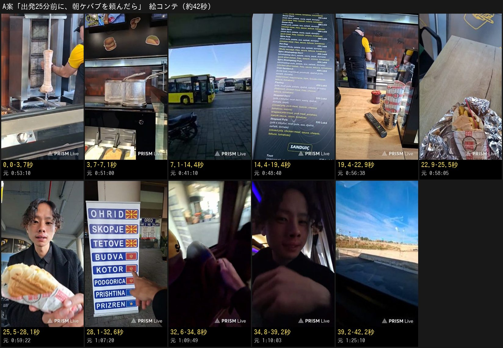
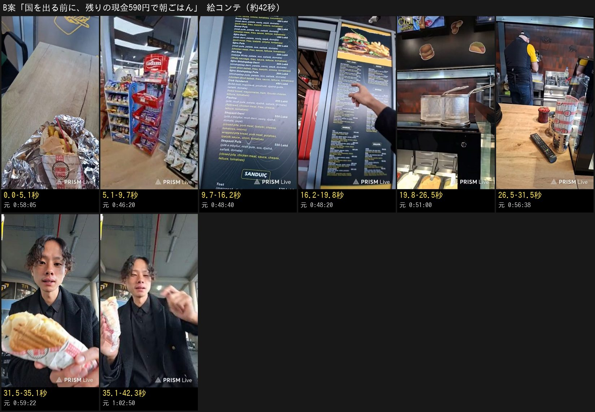
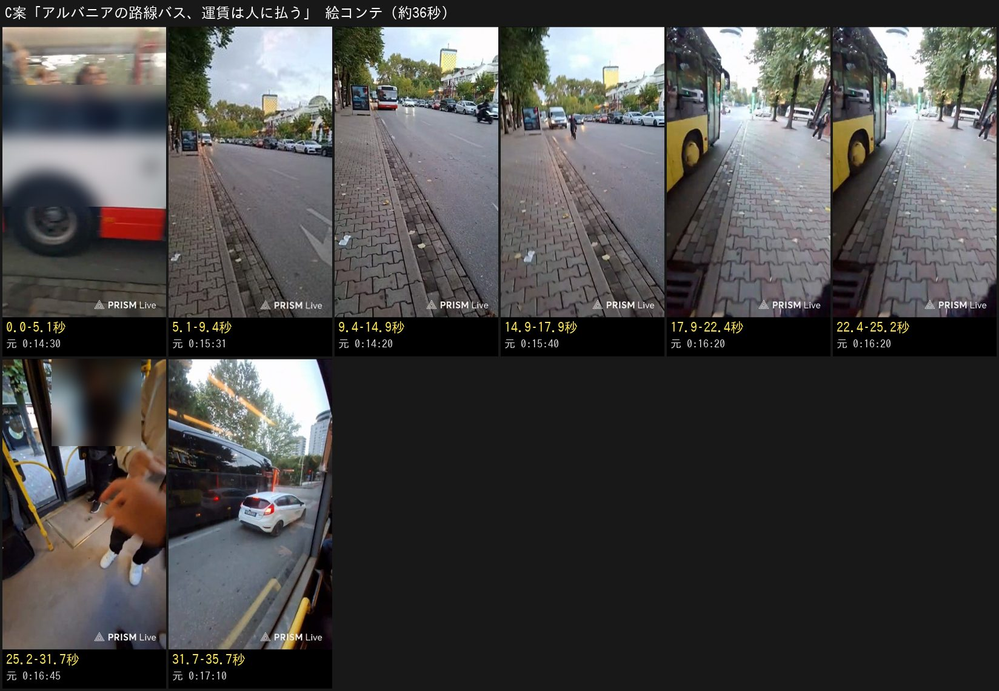

# 北マケドニアへの移動の回 — 企画 p1（3案）

元動画: [北マケドニア共和国いこかー！？](https://www.youtube.com/watch?v=yk-by7R7iPA)（2026-10-12、1時間42分49秒、縦長の配信）

## 決めてほしいこと

**3案から1つ選んで、承認してください。** この issue にコメントで1行です（スマホで打てます）。

- 承認: `/approve plan p1 A`（B案なら最後を `B`。日本語なら `/承認 企画 1 A` でも通ります）
- 直してほしい: `/revise 冒頭をもっと短く` のように1行で
- やめる: `/reject plan p1 理由`

承認が記録されるまで、本編集には進みません。承認のあとで中身を変えたら、もう一度出し直します。

**おすすめは A案**（下に理由）。

## 先に知らせること（元動画で確かめた結果）

- **国境を越える場面は、このアーカイブに入っていません。** 1:17:22 に本人が「国境まで2時間ぐらい」と言い、出発の約23分後に電波が悪くなって配信が終わります。参考にもらった流れのうち、無いのはこれだけでした
- ほかの場面（早朝のバス停／バスに乗れるかの緊張／ケバブを買う・食べる／長距離バス／車窓）は全部ありました
- 配信の画面の右下に、配信ソフトの透かし「PRISM Live」が全編に焼き込まれています。書き出しで消します
- 店員さん・乗客の顔が映る場面は、ぼかしを入れます

## 3案の比べ

| | A案（おすすめ） | B案 | C案 |
| --- | --- | --- | --- |
| 型 | ハプニング・緊迫 | グルメ・発見 | 日本との違い |
| 仮タイトル | 出発25分前に、朝ケバブを頼んだら | 国を出る前に、残りの現金590円で朝ごはん | アルバニアの路線バス、運賃は「人」に払う |
| 尺（見込み） | 約42秒 | 約42秒 | 約36秒 |
| 冒頭1〜2秒 | 回る肉の串 ＋「出発まであと25分」 | アルミ包みからのぞくポテト入りケバブ | 目の前を横切る路線バス |
| 山 | 減っていく時間 → 満員の車内 | ポテト入りの中身・「チキン」→「プーレ」 | 時間切れ → 「黄色いバスだよ」 |
| オチ | 最後の1席だった | 日本で再現するなら3店で買ってプレス | 運賃は車内の係の人に払う |
| 自己採点（40点） | **37** | 35 | 33 |
| 今回確かめる仮説 | 4〜7秒にねじれ（今から揚げる）を置くと、3→8秒の残りと視聴を継続した割合が基準を上回る | 0秒目に食べ物の寄りを置くと、視聴を継続した割合が基準を上回る | 日本との違いを答えに置く短い型は、最後まで見た割合が高い |

自己採点は事前の予想です。当たるかどうかは、出したあとの数字で決めます。

---

## A案「出発25分前に、朝ケバブを頼んだら」（ハプニング型）

### 概要

| 項目 | 内容 |
| --- | --- |
| 狙い | 時間に追われるハラハラと、「最後の1席」の決着。残り時間（25分→20分）を画面に出して、見る人に一緒に焦ってもらう |
| 狙う視聴者 | 主: 旅のドキドキを家で味わいたい 30〜50代の女性。サブ: ハプニングなら見る人 |
| 尺 | 約42秒 |
| 感情の流れ | えっ？（今から揚げる）→ ハラハラ（残り時間が減る）→ ほっ（最後の1席）→ 余韻（あと4時間の旅） |
| 伸びると考えた理由 | 0秒目に「あと25分」と言い切り、**4〜7秒に「なのにポテトは今から揚げる」という2つ目の山**を置いた。あやとの過去ショートで人が離れていたのはちょうど4〜8秒で（伸びなかった回は1秒に6〜9ポイント落ちる。3→8秒の落ちと再生数の順位相関は −0.71）、西園寺さんの伸びた回は13本ともそこに意外な一点を置いている。結末（席はあるか）が最後まで分からないので、見終わる理由もある |

### 原稿（全文・11文・179字）

1. 国際バスの出発まで、あと25分。
2. なのにポテトは、これから揚げるらしい。
3. ここはアルバニア。この日、隣の国へ移るあやとは、使い切れない現金で朝ごはんを買っていた。
4. 選んだのは、280レク。約550円のケバブ。
5. 揚げたてのポテトを入れて、パンをプレス。
6. あと20分。
7. 急いで食べて、乗り場へ。
8. 北マケドニア行きの看板。乗るのは、このミニバン。
9. 席、空いてる？
10. 残っていたのは、最後の1席だけでした。
11. 北マケドニアまで、あと4時間。

**尺の確認:** 無料の読み上げ（Open JTalk）で実際に読ませて測りました。

| 読む速さ | 長さ |
| --- | --- |
| 1.15倍（想定） | 37.9秒 |
| 1.0倍（遅めに読まれた場合） | 43.5秒 |

画だけで見せる間を足しても、60秒未満に収まります。Fish Audio の声が決まったら、その声で測り直します（#908）。

### 絵コンテ

| 動画内 | 元動画 | 映像 | ナレーション | テロップ | 演出 |
| --- | --- | --- | --- | --- | --- |
| 0.0–3.7秒 | 0:53:10–0:53:13 | 店の奥で回る肉の串と調理場（店員さんは腕だけ） | 国際バスの出発まで、あと25分。 | 上（全編）: 出発25分前に、朝ケバブを頼んだら ／ 中央: 出発まで あと25分 | ゆっくり寄る。数字を大きく |
| 3.7–7.1秒 | 0:51:00 / 0:53:02 | 空のフライヤーのかご | なのにポテトは、これから揚げるらしい。 | 中央: 「今から揚げんの？」 | カット |
| 7.1–14.4秒 | 0:41:10 / 0:45:30 | 朝のバスターミナル → 手持ちの現金を数える | ここはアルバニア。この日、隣の国へ移るあやとは、使い切れない現金で朝ごはんを買っていた。 | 中央: アルバニア → 北マケドニア | 地図の矢印を一瞬 |
| 14.4–19.4秒 | 0:48:40 | メニュー（Doner 280 Lekë の行） | 選んだのは、280レク。約550円のケバブ。 | 中央: 280レク ≒ 550円 | メニューの行に寄る |
| 19.4–22.9秒 | 0:56:21–0:56:40 | ポテトを揚げる・挟む（店員さんは後ろ姿） | 揚げたてのポテトを入れて、パンをプレス。 |  | 2カットを速めに |
| 22.9–25.5秒 | 0:58:05 | アルミ包みからポテトがのぞくケバブ | あと20分。 | 中央: あと20分 | 包みに寄る |
| 25.5–28.1秒 | 0:59:22–0:59:35 | プレスの焼き目のついたパンにかぶりつく | 急いで食べて、乗り場へ。 |  | カット |
| 28.1–32.6秒 | 1:07:20 / 1:08:40 | 3か国の旗が並ぶ行き先の看板 → 白いミニバン（IDO TOURS） | 北マケドニア行きの看板。乗るのは、このミニバン。 | 中央: 北マケドニア行き | 看板の旗に寄る → カット |
| 32.6–34.8秒 | 1:09:43–1:09:49 | 満員の暗い車内の通路（乗客の顔はぼかす） | 席、空いてる？ |  | 手持ちの揺れをそのまま |
| 34.8–39.2秒 | 1:09:50–1:10:03 | 窓際の1人席に座る → ほっとした顔 | 残っていたのは、最後の1席だけでした。 | 中央: 最後の1席 |  |
| 39.2–42.2秒 | 1:10:05 / 1:25:10 | 親指を立てる → 走り出したバスの窓の外の青空 | 北マケドニアまで、あと4時間。 |  | BGM を戻して終わる |

合計 **42.2秒**（ナレーションは Open JTalk を1.15倍速で読ませた長さ。1.0倍なら約15%長い）

### 自己評価

| 冒頭の引き | 初見の分かりやすさ | 意外性 | 画の魅力 | 物語 | テンポ | 見終わった満足 | 狙いとの合い | 計 |
| --- | --- | --- | --- | --- | --- | --- | --- | --- |
| 5 | 5 | 3 | 4 | 5 | 5 | 5 | 5 | **37** |

- 冒頭5: 「あと25分」の数字と回る串で、何が起きているかが1文で分かる
- 意外性3: 朝7時半からポテトを揚げる、は日本の感覚とずれるが、強い驚きではない
- 画4: 店内は明るくきれい。乗車の場面は暗い

### 確かめた事実（元動画の時刻）

| ナレーション | 根拠 |
| --- | --- |
| 出発まで、あと25分 | 0:53:51 本人「出発時間まであと25分しかない」。現地時刻は配信開始と本人の発言から 7:34 ごろで、8:00 発と合う |
| ポテトはこれから揚げる | 0:51:55「今からこれポテトあげんの？」、0:53:42「ポテトも今揚げ始めてる」 |
| 使い切れない現金 | 0:24:56〜0:25:14「現金はあと500円ぐらい残ってるから後で使い切ります」（国境を越えると使えない） |
| 280レク、約550円 | メニューのコマ（0:48:40）に Doner 280 Lekë。1レク＝約1.97円（2026年7〜8月の相場） |
| あと20分 | 0:59:06「あと20分しかない」 |
| 北マケドニア行きの看板・ミニバン | 1:07:20 の看板（OHRID・SKOPJE・TETOVE に北マケドニアの旗）、1:08:40 の車体に「IDO TOURS」 |
| 最後の1席 | 1:09:54「最後の一席が空いてました」、1:10:06「1人席が1つだけ空いてた」。コマでも満員の通路 → 窓際の席 |
| あと4時間 | 予約サイトに Ido Tours 08:00 → Skopje 12:00。本人も 0:34:40 で「4時間」 |

### 気をつけること

- 店員さん・乗客の顔はぼかす（0:56〜0:57、1:09:43〜1:09:48）
- 車両の前の角のへこみ（1:09:10）には触れない
- 現地時刻は配信開始の時刻と本人の発言から計算した値

---

## B案「国を出る前に、残りの現金590円で朝ごはん」（グルメ型）

### 概要

| 項目 | 内容 |
| --- | --- |
| 狙い | 海外の朝ごはんの疑似体験。日本と違う中身（ポテト入り）、値段、言葉のやりとり |
| 狙う視聴者 | 主: 現地グルメを家で味わいたい 30〜50代の女性 |
| 尺 | 約42秒 |
| 感情の流れ | おいしそう（冒頭）→ へえ（ポテト入り・プーレ）→ くすっ（3店で再現） |
| 伸びると考えた理由 | 0秒目にこの回でいちばんおいしそうな画（包みからのぞくポテト入りのケバブ）。4〜8秒に意外な値段（クッキー1袋で約200円）。主の視聴者の「現地グルメを家で味わう」にまっすぐ当たる。西園寺さんの伸びた回にも食べ物の回が多い（インド料理を素手で 約130万回、伊勢海老 約72万回） |

### 原稿（全文・8文・191字）

1. 国を出る前に、残りの現金590円を使い切る朝ごはん。
2. スーパーはクッキー1袋で約200円。これでは足りない。
3. 向かったのはケバブ屋。豚も鶏も、280レク。約550円。
4. ここのケバブは、中にフライドポテト入り。
5. 「チキン」と頼むと、返ってきたのは「プーレ」。アルバニア語で、鶏のこと。
6. 揚げたてのポテトに赤いソース。パンはプレスして、カリッと。
7. 本人いわく、ソースはビッグマックの味。
8. 日本で再現するなら、ケバブ屋とスタバとマクドで買ってきて、プレス。……だそうです。

**尺の確認:** 1.15倍で 39.7秒／1.0倍で 45.5秒。

### 絵コンテ

| 動画内 | 元動画 | 映像 | ナレーション | テロップ | 演出 |
| --- | --- | --- | --- | --- | --- |
| 0.0–5.1秒 | 0:58:05 | アルミ包みからポテトがのぞくケバブ | 国を出る前に、残りの現金590円を使い切る朝ごはん。 | 上（全編）: 国を出る前に、残金590円で朝ごはん ／ 中央: 残りの現金 590円 | 包みに寄る |
| 5.1–9.7秒 | 0:46:20–0:47:10 | スーパーの菓子の棚 | スーパーはクッキー1袋で約200円。これでは足りない。 | 中央: クッキー1袋 約200円 | カット |
| 9.7–16.2秒 | 0:48:40 | メニュー（Derri＝豚・Pule＝鶏、どちらも 280 Lekë） | 向かったのはケバブ屋。豚も鶏も、280レク。約550円。 | 中央: 豚も鶏も 280レク | メニューの行に寄る |
| 16.2–19.8秒 | 0:48:40 | メニューの写真（バーガーとポテト）・中身の欄の patate（ポテト） | ここのケバブは、中にフライドポテト入り。 | 中央: 中にポテト入り | patate の字に丸 |
| 19.8–26.5秒 | 0:50:45–0:51:00 | カウンターとフライヤー（注文の声の場面。店員さんの顔は映さない） | 「チキン」と頼むと、返ってきたのは「プーレ」。アルバニア語で、鶏のこと。 | 中央: Pulë ＝ 鶏 |  |
| 26.5–31.5秒 | 0:56:21–0:57:27 | 揚げる・挟む・包む（店員さんの顔はぼかす） | 揚げたてのポテトに赤いソース。パンはプレスして、カリッと。 |  | 3カットを速めに |
| 31.5–35.1秒 | 0:59:22–1:00:17 | 焼き目のパンにかぶりつく | 本人いわく、ソースはビッグマックの味。 | 中央: 「ビッグマックのソースみたい」 |  |
| 35.1–42.3秒 | 1:02:41–1:03:22 | ケバブを手に語るあやと | 日本で再現するなら、ケバブ屋とスタバとマクドで買ってきて、プレス。……だそうです。 | 中央: ケバブ屋 ＋ スタバ ＋ マクド → プレス | 3つの店名を順に出す |

合計 **42.3秒**（ナレーションは Open JTalk を1.15倍速で読ませた長さ。1.0倍なら約15%長い）

### 自己評価

| 冒頭の引き | 初見の分かりやすさ | 意外性 | 画の魅力 | 物語 | テンポ | 見終わった満足 | 狙いとの合い | 計 |
| --- | --- | --- | --- | --- | --- | --- | --- | --- |
| 5 | 5 | 4 | 5 | 3 | 4 | 4 | 5 | **35** |

- 物語3: 「何を食べるか」だけで、ハラハラの山が無い
- 画5: 揚げたてのポテト、焼き目のパン、包みからのぞく中身と、寄りの画がそろっている

### 確かめた事実

| ナレーション | 根拠 |
| --- | --- |
| 残りの現金590円 | 0:45:25〜0:45:41「295レックあります。590円」。**全財産ではない**ので「残りの現金」と言う |
| クッキー1袋 約200円 | 0:47:06「これ200円よ」 |
| 豚も鶏も280レク・中にポテト | メニュー（0:48:40）: Doner Derri（豚）・Doner Pule（鶏）とも 280 Lekë、中身の欄に patate（ポテト） |
| 「プーレ」＝鶏 | 0:50:48 の店の人の言葉。アルバニア語で pulë＝鶏（Wiktionary） |
| ビッグマックのソース | 1:00:17 本人「ビッグマックソースみたいな感じ」 |
| 3店で再現 | 1:02:41〜1:03:22 本人の言葉 |

### 気をつけること

- 注文の場面（0:50:45）は店員さんの顔がはっきり映るので、画は使わず声の場面だけナレーションで言う
- 組み立て（0:57:09〜0:57:27）は店員さんの顔をぼかす
- 「スタバ」「マクド」は本人の言葉の紹介として出す（宣伝や比較の主張にしない）

---

## C案「アルバニアの路線バス、運賃は『人』に払う」（日本との違い型）

### 概要

| 項目 | 内容 |
| --- | --- |
| 狙い | 「はじめての国でバスに乗れるか」という小さな冒険と、日本と違う払い方の発見 |
| 狙う視聴者 | 主: 知らない国の暮らしを知りたい人。サブ: 小さなハラハラ |
| 尺 | 約36秒 |
| 感情の流れ | 不安（番号も払い方も分からない）→ 焦り（時間切れ）→ ほっ（黄色いバス）→ へえ（人から切符を買う） |
| 伸びると考えた理由 | 4〜7秒に「1A……これ、違う？」の山。答え（車内の係の人に払う）が日本との違いそのものなので、見終わる理由がはっきりしている。36秒と短く、最後まで見られやすい |

### 原稿（全文・8文・143字）

1. はじめての国の路線バス。何番かも、払い方も分からない。
2. 来たのは「1A」。……これ、違う？
3. 運賃は40レク、約80円らしい。でも、誰に払うの？
4. 予定の時間は、もう過ぎた。
5. さっき道を聞いた人が、言っていた。「黄色いバスだよ」。
6. 来た。黄色い2番。
7. お金は運転手でも機械でもなく、車内の係の人に渡して、紙の切符をもらう。
8. 本人いわく、「人から買うタイプでした」。

**尺の確認:** 1.15倍で 32.3秒／1.0倍で 37.0秒。

### 絵コンテ

| 動画内 | 元動画 | 映像 | ナレーション | テロップ | 演出 |
| --- | --- | --- | --- | --- | --- |
| 0.0–5.1秒 | 0:14:30 | 目の前を横切る赤白のバス（窓の乗客はぼかす） | はじめての国の路線バス。何番かも、払い方も分からない。 | 上（全編）: アルバニアの路線バス、運賃は「人」に払う | バスの通過に合わせてカット |
| 5.1–9.4秒 | 0:14:12–0:14:27 | 近づくバスと大通り | 来たのは「1A」。……これ、違う？ | 中央: 「1A」？ | 間を置く |
| 9.4–14.9秒 | 0:13:31–0:14:02 | 早朝の大通りのバス停 | 運賃は40レク、約80円らしい。でも、誰に払うの？ | 中央: 運賃 40レク（約80円） |  |
| 14.9–17.9秒 | 0:15:44–0:15:58 | 来ないバスを待つ通り | 予定の時間は、もう過ぎた。 | 中央: 予定の時間を過ぎた |  |
| 17.9–22.4秒 | 0:15:58–0:16:02 | 黄色いバスが近づく | さっき道を聞いた人が、言っていた。「黄色いバスだよ」。 | 中央: 「黄色いバスだよ」 |  |
| 22.4–25.2秒 | 0:16:02–0:16:20 | 黄色いバスが止まる | 来た。黄色い2番。 | 中央: 黄色い2番 |  |
| 25.2–31.7秒 | 0:16:45–0:17:41 | 車内でお金を渡す手（係の人と乗客の顔はぼかす） | お金は運転手でも機械でもなく、車内の係の人に渡して、紙の切符をもらう。 | 中央: 車内の係の人から 紙の切符 |  |
| 31.7–35.7秒 | 0:17:00–0:17:41 | 走り出したバスの窓の外 | 本人いわく、「人から買うタイプでした」。 | 中央: 「人から買うタイプでした」 |  |

合計 **35.7秒**（ナレーションは Open JTalk を1.15倍速で読ませた長さ。1.0倍なら約15%長い）

### 自己評価

| 冒頭の引き | 初見の分かりやすさ | 意外性 | 画の魅力 | 物語 | テンポ | 見終わった満足 | 狙いとの合い | 計 |
| --- | --- | --- | --- | --- | --- | --- | --- | --- |
| 4 | 5 | 4 | 3 | 4 | 5 | 4 | 4 | **33** |

- 画3: 早朝で曇り、手ぶれが多い。車内は乗客の顔のぼかしが多くなる

### 確かめた事実

| ナレーション | 根拠 |
| --- | --- |
| 運賃40レク・誰に払うか分からない | 0:13:31 本人（調べた値）、0:09:13「お金の払い方マジで分からへん」。ティラナの市内バスは 40レクで、車内の係員に現金で払い紙の切符をもらう方式（旅行ガイド複数） |
| 1A | 0:14:16〜0:14:24「1Aって書いてる」 |
| 予定の時間を過ぎた | 0:15:49「時間でも過ぎたよ」 |
| 「黄色いバスだよ」 | 0:16:02〜0:16:16「イエローバスって言ってくれてた。…2番」 |
| 車内の係の人から切符 | 0:16:45 車内で支払い、0:17:41「兄さんがお金受け取ってチケットくれました」 |

### 気をつけること

- 0:16:30 の車内で男性の顔が大きく映る。使わないか、ぼかす
- 「黄色い2番」の番号はコマでは読めない（本人の言葉による）

---

## 3案に共通すること（暫定）

| 項目 | いまの扱い |
| --- | --- |
| ナレーションの声 | Fish Audio の Holiday Twist（#908 で決定）。尺はいまは無料の読み上げ（Open JTalk）で測った見込みで、本物の声で作ったら測り直す |
| BGM | 参考の曲を、投稿のときに各媒体の音源ライブラリから付ける（#909 で決定）。付けられない媒体は「Hiking Trail」を入れる。どちらも声より必ず小さくする |
| テロップ | 参考のスクショに合わせる。上のタイトルは黄色の地に黒の太い丸ゴシック、中央は白字に黒の縁取り（「文字枠」を縁取りと読みました。箱のことなら言ってください） |
| 元の音声 | 原則ミュート。本人の短い一言を残す候補には「残す候補」と書いた |
| 透かし・ぼかし | 右下の「PRISM Live」は消す。第三者の顔はぼかす |
