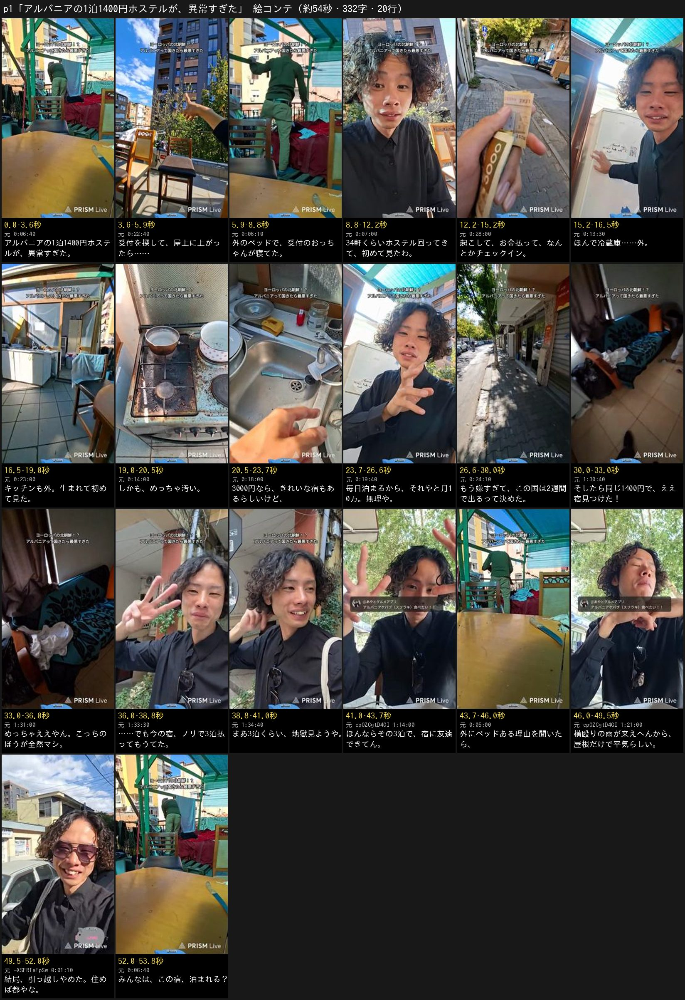

# 最安ホステルの回（zjHZucyfrq8）— 原稿 p1

元動画: [アルバニアのホステルが至上最悪！？](https://www.youtube.com/watch?v=zjHZucyfrq8)（2026-09-28 14:52 CEST 開始、2時間14分12秒、縦長。ティラナの宿の屋上から）。結末は2日後の [アルバニアでケバブスフラキたべよ](https://www.youtube.com/watch?v=cpOZCgtD4GI)（2026-09-30）。
企画はあやとの付箋（テーマ shorts-idea、2026-10-16）:

> 🇦🇱アルバニアの最安ホステルが異常すぎました😰
> ※やばそうな国のやばそうな事情に興味ある人多いかも🤔

**1次レビューは原稿だけです**（あやと 2026-10-18「1次レビューは台本だけで良いや」）。企画の向きは付箋で決まっているので、3案にせず1本です。絵コンテは返事を待つあいだに作り、各コマにその行の原稿を入れて足します。

## 先に知らせること（元動画で確かめた結果）

- **「異常」の中身は、受付のおっちゃんが屋上の外のベッドで寝ていたことと、冷蔵庫とキッチンが屋外にあること**です。どちらも本人がその場で画に映しています（下の「異常の中身」）
- **「最安」は言い切れません。** 本人の言葉は「1000円台のホステルなんよ。1400円ぐらいかな」（0:10:15）、「1000円台のホステルって3つあんのよ」（0:16:01）で、ティラナの安い3軒のうちの1軒です。見学した別の宿も「値段一緒や…どっちも1400円」（1:32:06）でした。**題は「最安」を「1泊1400円」に替えました**（数字のほうが安さの感覚も伝わる）
- **結末は本編の外にありました。** 本編の終わりは「3泊だけ地獄見て、あさって引っ越す」（1:34:32・1:36:01）。2日後の回で、**3泊目の夜に「結局今のホステルに残ることにしました」**（cpOZCgtD4GI 1:12:21–1:12:38）と言っています。理由は「友達もできたんよ」（1:13:53）と、その友達に外にベッドがある理由を聞いたら「横から来る台風みたいな雨は来えへんから、屋根があれば大丈夫らしい」（1:20:51–1:21:36）。「やっぱ住めば都かもしれん」（1:13:47）
- 付箋の「やばそうな国のやばそうな事情」は、**屋外のベッドとキッチン**で見せ、最後にその事情（横殴りの雨が来ない）で答えを出す形にしました
- 配信の上に、チャンネル自身の固定コメント「ヨーロッパの北朝鮮！？ アルバニアって国きたら最悪すぎた」が全コマに出ています。本人も冒頭（0:01:18）で同じ言葉を言っています。**原稿には入れていません**（下の「言わないこと」）。帯は書き出しで隠す前提です

## 伝えたいこと

**1泊1400円の宿は、受付のおっちゃんが屋上の外で寝てて、冷蔵庫もキッチンも外。嫌すぎて出る気やったのに、友達ができて、理由も分かって、結局残った。住めば都。**

## 題（札は4秒まで）

**アルバニアの1泊1400円ホステルが、異常すぎた**

- 付箋の題「アルバニアの最安ホステルが異常すぎました」から、「最安」を確かめられた「1泊1400円」に替え、「〜ました」を言い切りにしました
- シリーズ名（札の上の小さい行）は、旅の回と同じ「関西人が海外でやりたい事」でよければ足します

## 原稿（全文・20行・332字）

- 秒は、上限の倍率（1.4倍）で読んで毎秒6.8字としたときの、行の始まりです。行のあいだは0.25秒
- 本編 ＝ zjHZucyfrq8、9/30 ＝ cpOZCgtD4GI（2日後の回）

| # | 秒 | 原稿 | 根拠（回と時刻） | 使う画 |
| --- | --- | --- | --- | --- |
| 1 | 0.0 | アルバニアの1泊1400円ホステルが、異常すぎた。 | 本編 0:10:15–0:10:20「1000円台のホステルなんよ。1400円ぐらいかな」・1:42:44「ホステルが1泊1400円」 | 屋上に並んだ外のベッド（本編 0:06:40）。0秒目の画・題の札 |
| 2 | 3.6 | 受付を探して、屋上に上がったら…… | 本編 0:06:41–0:06:51「受付の人おらんかったんよ…勝手に登ってきて…屋上来たら」 | 屋上の全体（椅子とテーブル、青空）（本編 0:22:40） |
| 3 | 5.9 | 外のベッドで、受付のおっちゃんが寝てた。 | 本編 0:06:51–0:06:57「屋外ベッドで受付のおっちゃんが寝てました」・0:07:03「今までで1番衝撃でした」 | ベッドのそばに立つ人の後ろ姿 → 別の角度のベッド（本編 0:06:10・0:05:00）。大きい字 |
| 4 | 8.8 | 34軒くらいホステル回ってきて、初めて見たわ。 | 本編 0:06:18–0:06:28「34個ぐらいさ、あのホステル回ってきたけど初めて見たよ。屋外ベッド」 | 目を見開いた顔（本編 0:07:00） |
| 5 | 12.2 | 起こして、お金払って、なんとかチェックイン。 | 本編 0:08:59–0:09:18「おっちゃん起こして…お金払って、なんとかチェックインできました」 | 手に持ったアルバニアのお札（本編 0:28:00） |
| 6 | 15.2 | ほんで冷蔵庫……外。 | 本編 0:12:15「これが冷蔵庫です」・0:13:07「冷蔵庫が屋外。気づいてしまった」 | 屋根の下の白い冷蔵庫に手を当てる（本編 0:13:30）。大きい字 |
| 7 | 16.5 | キッチンも外。生まれて初めて見た。 | 本編 0:13:14「屋外キッチンです」・0:13:30–0:13:33「生まれてきてから初めて見ました」 | 屋上の端の、屋根だけのキッチン（本編 0:23:00） |
| 8 | 19.0 | しかも、めっちゃ汚い。 | 本編 0:14:01–0:14:06「めちゃくちゃ汚いですね」 | 焦げと錆のコンロ → 積んだフライパン（本編 0:14:00・0:14:20）。大きい字 |
| 9 | 20.5 | 3000円なら、きれいな宿もあるらしいけど、 | 本編 0:18:56–0:19:00（チャットを読んで）「3000円くらいのホステルは綺麗なんや」 | 汚れた流し（本編 0:18:00） |
| 10 | 23.7 | 毎日泊まるから、それやと月10万。無理や。 | 本編 0:19:00–0:19:05「3000円は払えないです。3000円払ったら月10万や」・0:19:28「僕もう海外2年いるんで」 | 手を振る顔（本編 0:19:40）。字幕で強調: 月10万 |
| 11 | 26.6 | もう嫌すぎて、この国は2週間で出るって決めた。 | 本編 0:25:09–0:25:24「ホステルが最悪やったから…2週間で出ることになりました」・1:35:12–1:35:28「嫌すぎて…2週間でこの国を出ることを決意して」 | 宿を出て歩くティラナの並木道（本編 0:24:10） |
| 12 | 30.0 | そしたら同じ1400円で、ええ宿見つけた！ | 本編 1:31:54–1:32:19「700…値段一緒や…どっちも1400円」 | 見学した宿の部屋（青緑のソファベッド）（本編 1:30:40） |
| 13 | 33.0 | めっちゃええやん。こっちのほうが全然マシ。 | 本編 1:31:16「めちゃくちゃいいじゃないですか」・1:32:36–1:32:39「全然マシだよね。いや、こっちの方がいい」 | 同じ部屋の寄り（本編 1:31:00）。大きい字 |
| 14 | 36.0 | ……でも今の宿、ノリで3泊払ってもうてた。 | 本編 1:32:52–1:33:03「ノリで3泊予約しちゃった」・1:33:48「今んとこ3泊だけ払ったんよ」 | 指を3本立てる（本編 1:33:30） |
| 15 | 38.8 | まあ3泊くらい、地獄見ようや。 | 本編 1:34:32「3泊ぐらいちょっと地獄見ようよ」 | 苦笑い（本編 1:34:40） |
| 16 | 41.0 | ほんならその3泊で、宿に友達できてん。 | 9/30 1:13:53「友達もできたんよ」・1:14:38–1:14:53「友達ができたんだよ、今のホステルで…同年代がいる」・0:11:57–0:12:05「今日寝たらその3泊が終わっちゃうねんけど」 | 【9/30】木の下のカフェで両手を上げて話す（9/30 1:14:00）。友達の画は使わない。隅に小さく: 2日後の配信 |
| 17 | 43.7 | 外にベッドある理由を聞いたら、 | 9/30 1:20:51–1:21:01「なんでキッチンが野外にあったり、ベッドが野外にあんのかって聞いたんよ…（友達に）聞いたら」 | 屋上のベッドと緑の屋根（本編 0:05:00） |
| 18 | 46.0 | 横殴りの雨が来えへんから、屋根だけで平気らしい。 | 9/30 1:20:59–1:21:36「台風みたいにこうへんから、斜めに雨とかが降らへんらしい…ルーフがあれば大丈夫で、横からこうグーンって来る台風みたいなのはこうへんから…冷蔵庫置いてたりベッド置いてたりしても大丈夫」 | 【9/30】腕を横に振って「横から来る雨」を見せる（9/30 1:21:00） |
| 19 | 49.5 | 結局、引っ越しやめた。住めば都やな。 | 9/30 0:12:11–0:13:33「ホステル入れ替えんのやめようかなと思います…お引っ越しはなしにしようと思います」・1:12:21–1:12:38「結局今のホステルに残ることにしました」・1:13:47「やっぱ住めば都かもしれん」・1:22:10「友達もできちゃったしと思って、滞在することにしました」 | 【9/29】青空の下を歩きながら笑う（-XSFRIeEpSw 0:01:10。同じ回の 0:01:15「結構ね、気に入ってきました」・0:05:43「今のホステルなんか気に入った」）。隅に小さく: 翌日の配信。大きい字 |
| 20 | 52.0 | みんなは、この宿、泊まれる？ | 問い | 冒頭と同じ外のベッド（本編 0:06:40）。冒頭の画に戻して切る |

土台 → 山 → 結末 → 問い（`planning.md` 1.5）:
- **土台**（なぜ応援したくなるか）: 4行目「34軒くらい回ってきて」・10行目「毎日泊まるから、それやと月10万」——宿で暮らしながら旅していて、高い宿には移れない
- **山**: 3行目（外のベッドで受付のおっちゃん）・6〜8行目（冷蔵庫もキッチンも外、汚い）・12〜14行目（同じ値段でええ宿 → でも3泊払ってた）
- **結末**: 16〜19行目（友達ができ、理由が分かり、引っ越しをやめた）
- **問い**: 20行目

## 見る人とそろえる前提

| 見る人の頭に「？」が残りうるところ | そろえる行 | そろえかた |
| --- | --- | --- |
| 1400円が安いのか | 1・9・10 | 題で値段を出し、9・10行目で「3000円ならきれい、でも毎日泊まるから月10万」と物差しを置く |
| 受付の人が寝ているのに、なぜ驚くのか | 3 | 驚きは「寝ている」ではなく「外のベッドで」。3行目の頭に「外のベッドで」を置き、画も屋上のベッド |
| なぜ高い宿に移らないのか | 4・10 | 4行目「34軒くらい回ってきて」で旅暮らしだと分かり、10行目「毎日泊まるから」で月の額に直す |
| 同じ値段で良い宿があるのに、なぜ移らないのか | 14 | 「今の宿、ノリで3泊払ってもうてた」 |
| なぜ外にベッドや冷蔵庫を置けるのか | 17・18 | 本人が友達に聞いた答え「横殴りの雨が来えへんから、屋根だけで平気らしい」。画は屋根の下のベッド |

現地の通貨（レク）は読みません。見学した宿の「700」は本人の換算どおり「同じ1400円」と言います。

## 冒頭0秒の画（候補3つ）

`tools/shorts/plan/hook.py` を、spec と復号した材料（コンタクトシート10秒刻み・clips は無し）で回しました。原稿の全行の範囲で回すと、上位2つは話の外（1:18:30 ケバブ屋のメニュー板・1:16:10 カフェの窓）だったので、**宿の場面（0:05〜0:24）に絞って回し直した上位3つ**です。顔の重み（YuNet）が箱に無く、顔の寄りは 0 で数えています。

| | 時刻 | 何が写るか | 点 | 選ぶか |
| --- | --- | --- | --- | --- |
| 1 | 本編 0:06:40 | 緑の屋根の下、毛布を掛けたパレットのベッドと椅子・テーブル。奥に人の後ろ姿 | 2.87 | **選ぶ。** 題「異常すぎた」の答え（屋上の外にベッド）がそのまま写る。色も強い（色の強さ 70・暖色 32%）。最後の行で同じ画に戻せる。人は後ろ姿で顔は写らない |
| 2 | 本編 0:13:20 | 屋根の下の白い冷蔵庫の横で喋る本人 | 2.75 | 「冷蔵庫が外」は2つ目の驚きで、0秒目に出すと3行目（受付のおっちゃん）の山が弱くなる。顔が画の半分を占める |
| 3 | 本編 0:05:00 | 1と同じベッドを、別の角度から。手前にテーブル、奥に人の後ろ姿 | 2.75 | 1と同じ場面。3・17行目の画に使う |

## 字数と尺

- **20行・332字**（記号を除く。`readtime.py` の `chars`）
- **毎秒6.8字で53.8秒**（行のあいだ0.25秒を含む）。60秒未満・350字・22行前後に入ります
- 2つ目の山（3行目「外のベッドで、受付のおっちゃんが寝てた」）は5.9秒から（4〜8秒の中）
- 数字（1400・3000・34・10万）は声では字数より長く読むので、声を作ったら実物の長さで測り直します。余りは約5秒です

## 使える画の種類（planning.md 1.6）

本編だけで10種類あり、同じ見え方が3行以上続きません: 屋上のベッド・屋上の全体と空・本人の顔・お札・屋外の冷蔵庫・屋外のキッチン・汚れたコンロと流し・ティラナの並木道・見学した宿の部屋・9/30 のカフェ。顔は反応の行（4・10・14・15・16・18・19）だけで、16・18・19 は 9/30 の回の別の場所（木の下）なので、本編の顔と見え方が変わります。

**あやとに頼みたい素材は、いまはありません。** 19行目は、9/30 のカフェの顔が16・18行目と続くので、9/29 の回（-XSFRIeEpSw）の青空の下で笑う画にしました（絵コンテで差し替え）。チャットにあった「屋上から夕日配信」は、その回で「やりたいね」と話しただけで、屋上の夕日の画はありませんでした。残ると決めたあとの屋上の写真か動画があれば、19行目の締めがもっと強くなります。

## 自己点検（`references/script_writing.md` の4）

- [x] **外から説明していないか** — 全部「僕」の一人称の喋り言葉。「本人いわく」「この日、」は無し
- [x] **です・ます調・「〜でした」になっていないか** — 無し。題も付箋の「〜ました」を「〜すぎた」に
- [x] **情報の行が2つ続いていないか** — 2→3は1つの文を2枚に割ったもの（屋上に上がったら → 外のベッドで寝てた）で、4行目で返す。5（事実）→6（冷蔵庫……外。言いさしの驚き）→7（反応つき）→8（反応）。9→10は「あるらしいけど」→「無理や」。12→13、14→15も事実 → 反応。16→17→18は「友達できてん」→「聞いたら」→「屋根だけで平気らしい」で、19行目「住めば都やな」で返す
- [x] **文が整いすぎていないか** — 6・7行目は「〜外」が並ぶが、6は言いさし（……外）、7は反応つきで長さを変えた
- [x] **褒めるだけで終わっていないか** — この話は欠点のほうが主。結末で「残る」に反転する
- [x] **最後が問いで切れているか** — 「みんなは、この宿、泊まれる？」
- [x] **あやとが言いそうにない言葉が入っていないか** — 拾った言い回し: 「受付のおっちゃん」「初めて見た」「生まれて初めて見た」「めっちゃ汚い」「月10万」「2週間で出る」「全然マシ」「ノリで3泊」「地獄見よう」「友達できた」「住めば都」。足した言い回しは「ほんで」「ええ宿」「払ってもうてた」「ほんなら」「来えへん」で、配信と同じ関西の口調
- [x] **盛っていないか** — 1400円は本人の換算（見学した宿の 700レクを「どっちも1400円」）。「最安」は言わない。受付のおっちゃんが寝ていたところは画に無く、本人の体験として言う。3000円の宿がきれいなのはチャットの情報なので「らしい」。月10万は本人の概算（3000円×30日＝9万）をそのまま。雨の話は友達から聞いた話なので「らしい」で、「雨が降らへん」（ティラナは冬に雨が多い）ではなく、本人が言い直した「横から来る台風みたいな雨は来えへん」のほうを使った
- [x] **初めて聞いた人が、何の話か・なぜ驚くのかを分かるか** — 上の「前提」の表

## 言わないこと

- **「ヨーロッパの北朝鮮」** — 本人の冒頭の言葉（0:01:18）で、固定コメントにも出ているが、国をひとまとめにする言いかたで、ほかの国の名前も使う（`planning.md` 4「言わないこと」）
- **アルバニアそのものを悪く言う行** — 「アルバニアなんて大嫌いやって始まったけど」（0:35:57）は使わず、「この国は2週間で出る」（事実）にとどめた。結末で宿に残るので、国を下げて終わらない
- **宿の名前・友達の名前と国** — 言わない・写さない（看板や友達が写るコマは使わない）
- **ほかの泊まり客の話** — 後日の回（10/3・10/12）に、ほかの客についての本人の推測の話があるが、確かめられないうえ第三者のことなので使わない
- **友達の口癖「ネクストレベル」**（9/30 1:16:30–1:18:22、フライパンを洗って渡したら「日本人の食器洗いはネクストレベル」）——面白いが、字数が足りないので入れていない。入れるなら15〜17行目と入れ替え
- 視聴者さんの名前（チャットの読み上げ）

## 気をつけること

- 屋上の人（受付の人かどうかは画からは分からない）は**後ろ姿だけ**。顔が写るコマは使わない
- 全コマに、上の固定コメントの帯と右下の PRISM Live の透かし、ときどき左上にチャットの吹き出し（視聴者さんの名前つき）が出る。帯と透かしは書き出しで隠す。吹き出しが出るコマは使わない（9/30 の回は、上に固定コメント「アルバニアケバブ（スフラキ）食べたい！！」の吹き出しが全コマに出ている。チャンネル自身の書き込みだが、帯と同じく隠す）
- 本人が画面で喋り続ける画（口が動く画）にナレーションを長く重ねない

## 絵コンテ

1次レビューのあとに足したもの。各コマの下に、秒・元動画の時刻・その行の原稿が入っています（`tools/shorts/plan/storyboard.py`）。表は [`table_p1.md`](table_p1.md)。

